# 자기회귀 확산으로 시장 데이터를 생성할 수 있을까 — 나레이션 대본

James Somers의 "Can you use autoregressive diffusion to generate market data?"(Jane Street 블로그, 2026-09-30)를 한 사람이 들려주듯 풀어 쓴 대본.
원문 번역이 아니라 [정리 노트](../../content/notes/autoregressive-diffusion-market-data.md)를 바탕으로 요지와 해설을 다시 서술한 것이다.

형식은 `../build.py` 머리말 참고. `python3 ../build.py autoregressive-diffusion-market-data --voice=유나`로 굽는다(세로 1080x1920).
그림은 `figures/make.py`(SVG), 애니메이션은 `figures/animate.py`(traj·ar-loop·atom mp4). 원문 그림은 쓰지 않고 개념을 새로 그렸다.

출처: James Somers, Jane Street 블로그, 2026년 9월
잉크: #2F6B4F
약어: BBO=Best Bid and Offer, 최우선 매수·매도 호가; DDPM=Denoising Diffusion Probabilistic Models; DDIM=Denoising Diffusion Implicit Models; AdaLN=Adaptive Layer Normalization; TV=Total Variation distance, 총변동 거리; AUC=Area Under the Curve, 곡선 아래 넓이; ROC=Receiver Operating Characteristic; CME=CME Group, 시카고상품거래소 운영사

## 1 | 들어가며 | 표지
> 자기회귀 확산으로 / 시장 데이터를 생성할 수 있을까?
> 

주식 시장의 호가창을 통째로 지어내는 모델이 있다면 어떨까요? ‖ 가격 하나를 맞히는 데서 끝나지 않고 주문이 들어오고 빠지고 체결되는 이벤트 하나하나를 거래소에 도착하는 시각까지 만들어 내는 모델이요. 오늘 소개할 글은 퀀트 트레이딩 회사 Jane Street의 블로그에 2026년 9월에 올라온 글입니다. James Somers가 여름 연구 인턴 Kavish의 프로젝트를 소개해요. 질문은 제목 그대로, 자기회귀 확산 모델로 시장 데이터를 생성할 수 있을까입니다.

## 2 | 배경 | 호가창과 이벤트
> **호가창**이란
> 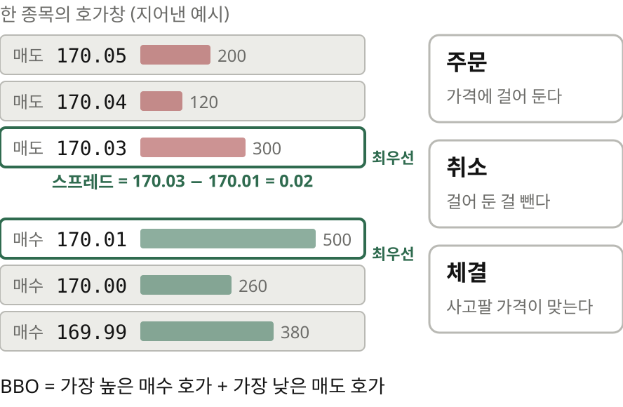

먼저 낯선 말 몇 개를 짚고 갈게요. 거래소의 종목마다 호가창이 있습니다. 참가자들이 이 가격에 사겠다, 이 가격에 팔겠다는 주문을 걸어 두는 곳이에요. 걸어 둔 주문은 취소할 수도 있고, 사려는 쪽과 팔려는 쪽의 가격이 맞으면 체결됩니다. 가장 높은 매수 호가와 가장 낮은 매도 호가를 묶어 BBO라고 부르고 둘 사이의 차이를 스프레드라고 해요.

> 시장 데이터는 / 이벤트가 **한 줄씩**
> 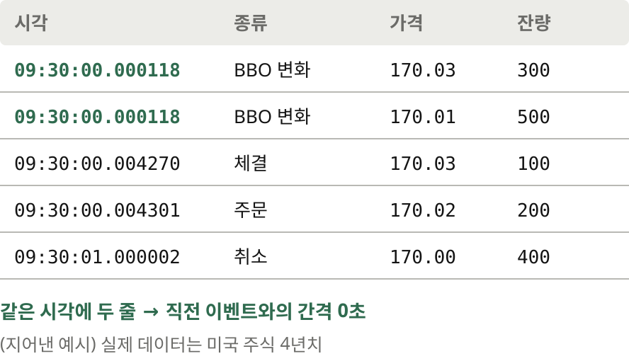

이 글의 시장 데이터는 이런 일이 생길 때마다 한 줄씩 쌓인 기록입니다. 한 줄에는 시각과 가격, 그리고 체결인지 주문인지 취소인지 같은 종류가 들어 있어요. 화면의 표는 지어낸 예시이고 인턴은 미국 주식 4년치 기록으로 모델을 학습시켰습니다.

## 3 | 배경 | 연속인가 이산인가
> 시장 데이터는 / 영상인가, **텍스트**인가
> 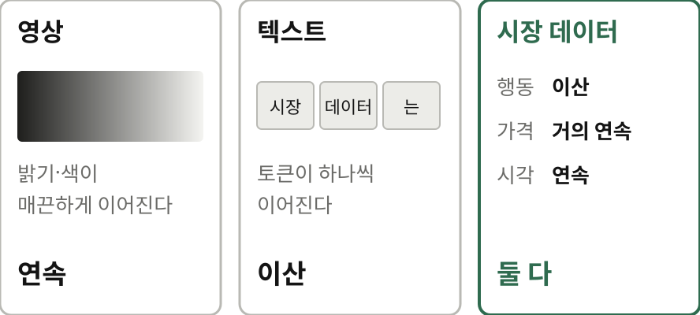

생성 모델을 만들려면 먼저 답해야 할 질문이 있어요. 시장 데이터는 영상에 가까울까요, 텍스트에 가까울까요? ‖ 영상은 픽셀 값이 매끈하게 이어지는 연속 데이터라 확산 모델이 잘 다루고, 텍스트는 토큰이 하나씩 이어지는 이산 데이터라 언어 모델이 다룹니다. 시장 데이터는 둘 다예요. ‖ 주문을 걸고 빼는 행동은 이산적인데, 가격은 가짓수가 워낙 많아 사실상 연속처럼 보이고 주문이 도착하는 시각은 아예 연속이거든요.

> 한 틱 개선이 / 두 틱보다 **훨씬 흔하다**
> 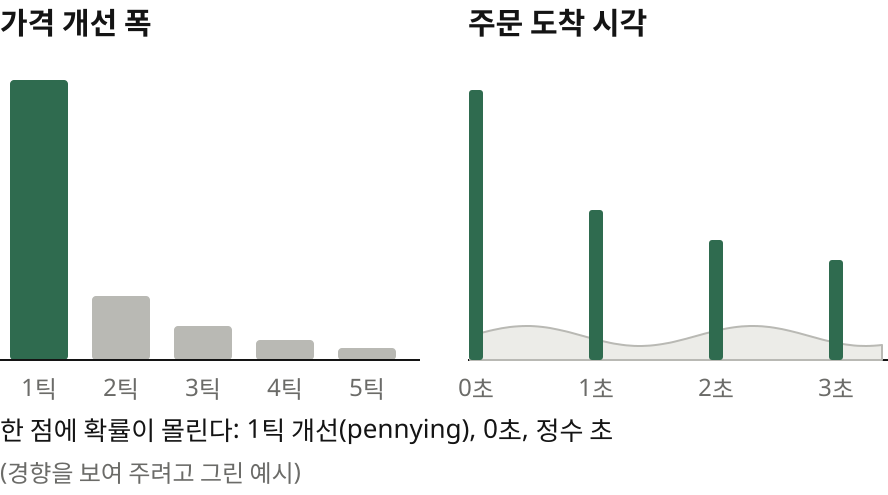

게다가 실제 분포는 뾰족합니다. pennying은 최우선 호가보다 딱 한 틱 나은 가격에 주문을 내서 앞자리를 차지하는 걸 말해요. 한 틱 개선이 두 틱 개선보다 훨씬 흔해요. 주문도 정수 초 근처처럼 특정 시각에 몰려 들어오고요. 화면의 막대는 이 경향을 보여 주려고 그린 예시입니다.

> 일단 연속이라 치고 / **무너지는 곳**을 보라
> 결과 미리 보기: DDPM은 발산, flow matching은 안정
> 진짜 난관은 한 점에 몰린 확률이었다

저자의 접근은 이렇습니다. 일단 연속이라고 치고 어디서 무너지는지 보라. ‖ 한쪽 가정으로 끝까지 밀어 보면 고칠 곳이 실패 지점으로 드러난다는 얘기예요. 결과를 미리 말씀드리면 DDPM이라는 고전적인 방식은 발산했고 flow matching이 훨씬 잘 돌았어요. 진짜 난관은 데이터의 뾰족함이었고요.

## 4 | 배경 | 확산 모델
> **확산 모델**이란
> 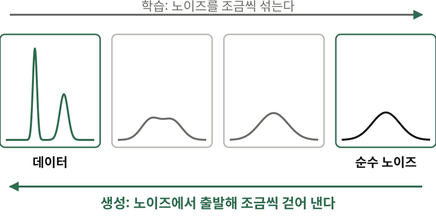

확산 모델은 데이터에 노이즈를 조금씩 섞어 완전한 잡음으로 만드는 과정을 거꾸로 배우는 생성 모델입니다. 생성할 때는 순수한 노이즈에서 출발해 여러 단계에 걸쳐 노이즈를 걷어 내요. 물에 퍼진 잉크를 거꾸로 돌려 다시 한 방울로 모으는 모습을 떠올리시면 됩니다.

## 5 | 모델 구성 | 자기회귀와 두 개의 헤드
> 하나 만들고, / **끝에 붙이고**, 다시
> 

그런데 이미지는 한 장을 통째로 만들지만 시장 데이터는 이벤트가 하나씩 이어집니다. 그래서 언어 모델처럼 자기회귀로 생성해요. 지금까지의 이벤트를 보고 다음 이벤트 하나를 만들고 그걸 흐름 끝에 붙여서 다시 다음을 만드는 겁니다. 다만 가격이나 시간 간격 같은 연속값은 토큰으로 자르지 않고 작은 확산 모델로 만들어요. Tianhong Li 등의 2024년 이미지 생성 논문에서 가져온 구조입니다.

> 종류는 **범주**로, / 값은 **확산**으로
> 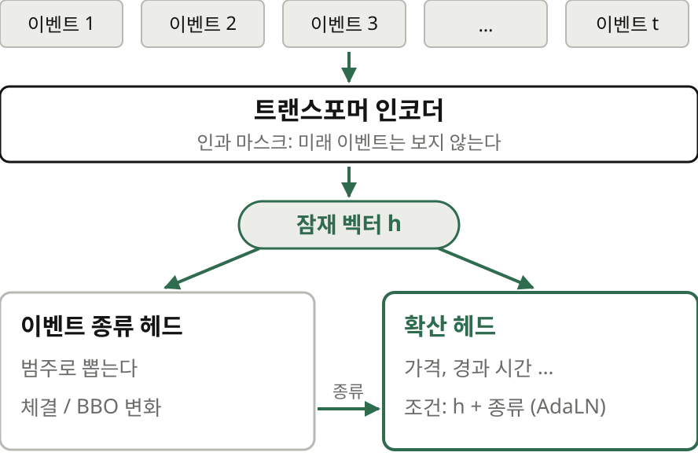

구조를 보면, 트랜스포머 인코더가 이벤트마다 잠재 벡터를 만듭니다. 미래 이벤트는 보지 못하게 인과 마스크를 걸어 두고요. 이 벡터가 두 갈래로 가요. 작은 종류 헤드는 다음 이벤트가 체결인지 BBO 갱신인지를 범주 확률로 내고, 확산 헤드는 가격과 경과 시간 같은 연속값을 만듭니다. 확산 헤드는 잠재 벡터와 이벤트 종류를 AdaLN 방식으로 조건으로 받아요. 종류는 범주로 내고 값은 확산으로 만드는 이 경계선이 뒤의 실험 내내 핵심입니다.

## 6 | DDPM과 flow matching | 노이즈 예측의 함정
> DDPM은 / **노이즈**를 맞힌다
> $$\hat{x}_0 = \frac{x_t - \sqrt{1-\bar\alpha_t}\,\hat\epsilon}{\sqrt{\bar\alpha_t}}$$
> 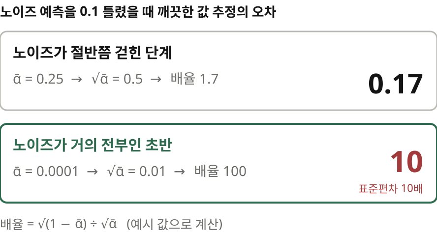

처음 만든 확산 헤드는 DDPM 방식이었습니다. Improved DDPM 논문이 권하는 1,000단계 코사인 스케줄로 노이즈를 섞어 그 노이즈 엡실론을 예측하게 했고 생성은 DDIM 방식으로 돌렸어요. 노이즈를 예측하면 깨끗한 값은 화면의 식으로 거꾸로 계산합니다. 문제는 분모의 루트 알파 바예요. 노이즈가 거의 전부인 초반에는 이 값이 0에 가깝습니다. 알파 바가 0.0001이면 루트는 0.01이에요. 그러면 노이즈를 0.1만 잘못 맞혀도 깨끗한 값은 10만큼, 표준편차의 10배나 틀어져요. ‖ 노이즈가 절반쯤 걷힌 단계라면 같은 실수가 0.17로 끝나고요.

> 초반에 **튀어 나가는** / 궤적
> 

실제로 그렇게 됐습니다. 노이즈를 걷어 내는 궤적이 폭발해서 연속 목표값 일곱 개 모두에서, 생성한 값의 88에서 95퍼센트가 평균에서 표준편차 8배 밖으로 튀어 나갔어요. 화면 왼쪽이 그 모습을 개념으로 그린 것이고, 오른쪽의 flow matching은 노이즈에서 데이터까지 거의 곧은 길로 갑니다.

> 단계를 늘려도 / 겨우 **0.5%**
> 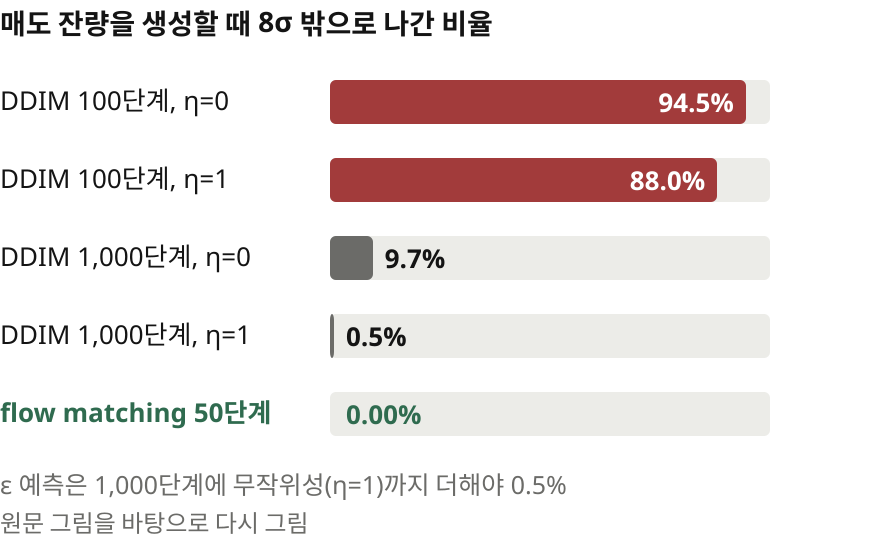

원문 그림을 보면 매도 잔량을 생성할 때 100단계로는 88에서 94.5퍼센트가 범위를 벗어납니다. 1,000단계로 늘리면 한 걸음이 작아져 9.7퍼센트로 줄고, 샘플링에 무작위성을 더하면, 그러니까 에타를 1로 두면 0.5퍼센트까지 내려가요. ‖ 스케줄을 손보는 길도 있었지만 Kavish는 rectified flow가 별다른 조정 없이 잘 도는 걸 보고 flow matching으로 갈아탔습니다. 50단계만으로 넘침이 0퍼센트였어요.

## 7 | DDPM과 flow matching | 곧은 길
> flow matching은 / **속도**를 맞힌다
> $$x_t = (1-t)\,\epsilon + t\,x, \qquad v = x - \epsilon$$
> 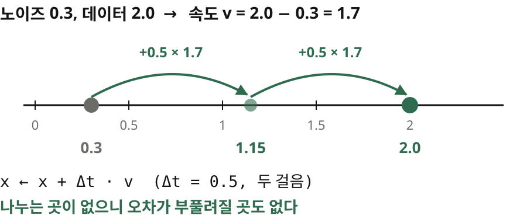

flow matching은 맞히는 대상이 달라요. 노이즈 엡실론과 데이터 x를 직선으로 잇고 그 직선 위의 속도를 예측합니다. 속도는 데이터에서 노이즈를 뺀 값이에요. 노이즈가 0.3, 데이터가 2.0이면 속도는 1.7이죠. 생성할 때는 지금 위치에 예측한 속도만큼 더해 가면 돼요. 두 걸음이면 0.3에서 1.15를 거쳐 2.0에 닿습니다. ‖ 나누는 곳이 없으니 오차가 부풀려질 곳도 없어요.

> 같은 목표, / **다른 매개화**
> 이미지: 픽셀 값의 범위가 정해져 있어 넘친 값은 잘라 내면 그만
> 금융 변수: 꼬리가 길어 증폭이 그대로 폭발로 이어진다

원문 말대로 두 방식은 같은 목적을 다르게 매개화한 것뿐인데 이 데이터에서는 그 차이가 결과를 갈랐습니다. 정리 노트의 해설을 보태면, 이미지는 픽셀 범위가 정해져 있어 넘친 값을 잘라 내면 그만이지만 꼬리가 긴 금융 변수에서는 증폭이 그대로 폭발로 이어진다고 읽을 수 있어요.

## 8 | 불연속 | 칼날 같은 분포
> 분포에 / **칼날**이 있다
> 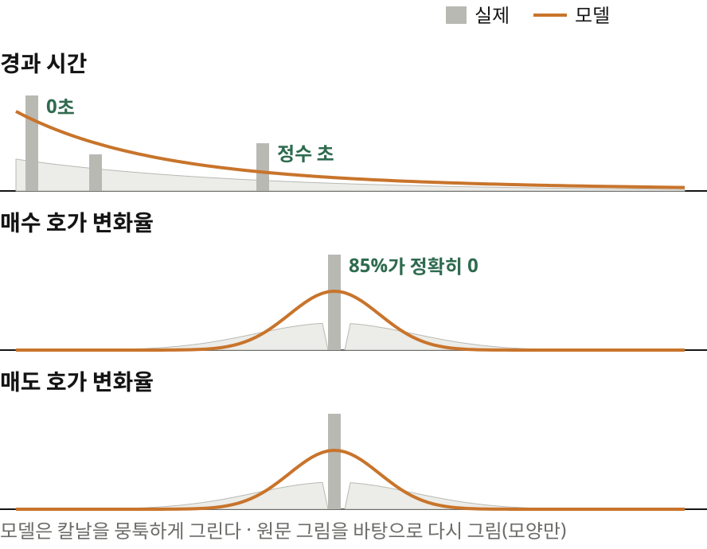

프로젝트 시간 대부분은 이제부터 볼 난관에 들어갔대요. 영상은 장면 안도, 장면 사이의 변화도 연속이죠. 시장 데이터는 한 시점의 상태는 연속이지만 변화는 아주 이산적으로 일어납니다. 직전 이벤트 이후 경과 시간은 동시에 도착한 이벤트 때문에 0초에 확률이 한 점으로 몰리고, 가장 빠른 반응 시간과 정수 초 근처에도 덩어리가 있어요. 호가 변화율은 85퍼센트 가까이가 정확히 0입니다. ‖ flow matching 모델은 이 칼날을 뭉툭하게 그렸어요.

## 9 | 불연속 | 범주를 쪼개다
> 범주를 / **20개**로 쪼갰다
> 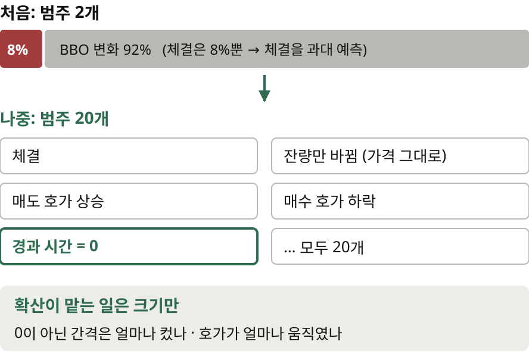

범주 쪽에도 불균형이 있었습니다. 이벤트의 8퍼센트만 체결이라 범주 헤드가 체결을 지나치게 많이 예측했어요. Kavish는 BBO 변화를 잔량만 바뀜, 매도 호가 상승, 매수 호가 하락 같은 흔한 유형으로 쪼갰습니다. 덤으로 한 점에 몰린 확률, 원문 표현으로 atom을 범주로 떼어 낼 수 있게 됐어요. 경과 시간 0을 아예 하나의 클래스로 예측하는 식이죠. 범주는 20개가 됐고 확산은 0이 아닌 간격의 크기나 호가가 움직인 폭만 맡으면 됐습니다.

> 0인가 아닌가, / 그다음에 **크기**
> 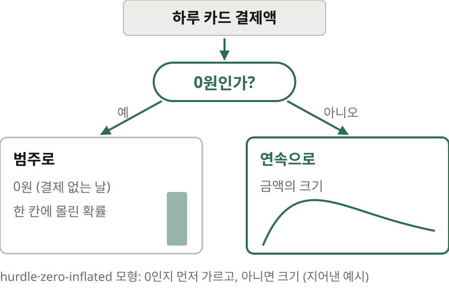

통계에서 익숙한 hurdle 모형이나 zero-inflated 모형과 같은 발상이에요. 먼저 0인지 아닌지를 범주로 가르고, 0이 아니면 크기를 연속으로 모델링합니다. 하루 카드 결제액이라면 결제가 없는 날의 0을 따로 떼어 낼 때 나머지 금액 분포가 훨씬 다루기 쉬워지죠.

> 잘 듣지만 / **손이 너무 많이** 간다
> 모든 특징의 모든 불연속을 범주로 따로 짜야 한다
> "어느 거래소에서 났나"처럼 가짓수가 많은 변수가 더 있다

이렇게 하자 분포가 눈에 띄게 좋아졌지만 손으로 설계할 게 너무 많았어요. 모든 특징의 불연속을 범주로 따로 다루면 특징이 늘 때 감당이 안 됩니다. 어느 거래소에서 일어났는지처럼 가짓수가 많은 변수까지 있으면 클래스 수가 폭발하죠. 그래서 Kavish는 다른 방법을 찾아 나섰습니다.

## 10 | atom smoothing | 펴고 다시 접기
> **분위수 변환**으로도 / 안 펴진다
> 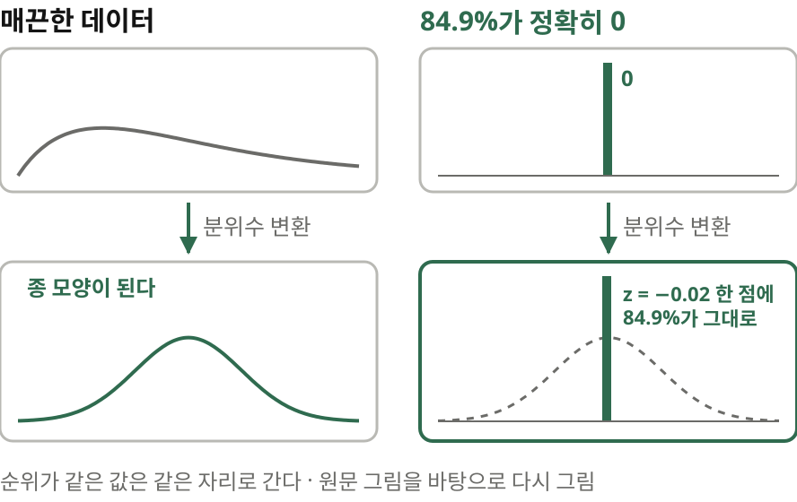

그 전에 분위수 변환부터 볼게요. 값의 순위를 정규분포에서 같은 순위의 자리로 옮기는 흔한 전처리입니다. 매끈한 데이터라면 종 모양으로 바뀌어요. 그런데 호가 변화율처럼 84.9퍼센트가 정확히 0이면, 순위가 같은 값은 같은 자리로 가니까 변환해도 84.9퍼센트가 z가 마이너스 0.02인 한 점에 그대로 남습니다.

> 펴서 배우고, / **다시 접는다**
> 

여기서 Kavish가 atom smoothing이라 이름 붙인 방법이 나옵니다. 그 뾰족한 덩어리를 정규분포의 한 구간에 고르게 펴 놓고 확산 모델을 학습시켜요. 생성한 값이 그 구간에 떨어지면 다시 정확히 0으로 되돌리고요. 되돌릴 수 있는 변환을 하나 끼워 넣은 셈이에요. ‖ 확률 질량은 살리면서 불연속은 만들지 않는 변환이요. 다만 원문은 이걸 그림 한 장과 두 문장으로만 설명해서 구간을 잡는 세부는 정리 노트의 해석입니다.

> 어떤 **표현**으로 / 나타낼지가 관건
> 한 표현에서 날카로운 덩어리가 다른 표현에선 덜 날카로울 수 있다
> 숨은 덩어리를 모두 드러내 펴 줘야 한다

이 방법이 잘 들으려면 변수의 표현을 잘 골라야 한다고 저자는 말합니다. 어떤 표현에서 날카로운 덩어리가 다른 표현에서는 덜 날카로울 수 있으니, 숨은 덩어리를 모두 드러내서 펴 줘야 한다는 거죠.

## 11 | 결과 | 분포와 판별기
> 두 분포의 차이, / **total variation**
> $$\mathrm{TV}(P, Q) = \frac{1}{2}\sum_{x} \lvert P(x) - Q(x) \rvert$$
> 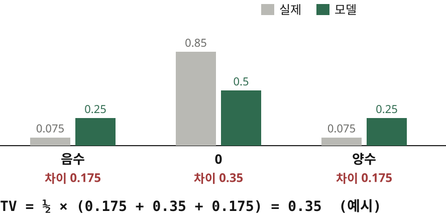

flow matching에 atom smoothing을 더한 모델은 꽤 잘 작동했습니다. 평가는 실제 이벤트 10,240개를 문맥으로 주고 다음 이벤트 하나만 생성해 목표값마다 분포를 실제와 맞대는 방식이었어요. 차이는 total variation 거리로 쟀습니다. 칸마다 두 확률의 차이를 더해 반으로 나눈 값이라 0이면 같고 1이면 전혀 안 겹쳐요. 실제로는 85퍼센트가 0인데 모델이 50퍼센트만 0으로 낸다면, 0인 칸에서 0.35, 양옆 칸에서 합쳐 0.35가 벌어지니 TV는 0.35입니다.

> **판별기**에게 / 진짜와 가짜를 묻다
> 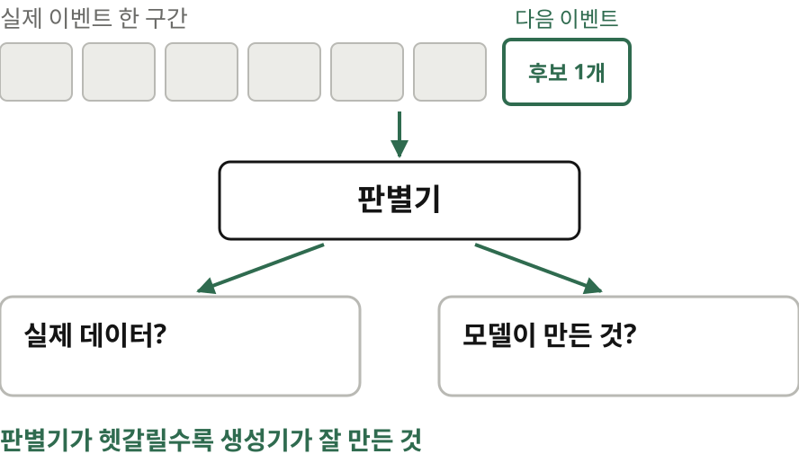

하지만 분포 하나하나가 맞는다고 끝이 아니에요. 특징 사이의 관계나 앞선 문맥과의 일관성은 잡히지 않거든요. 그래서 Kavish는 판별기도 학습시켰습니다. 실제 이벤트 한 구간과 그 뒤의 후보 하나를 읽고, 후보가 모델이 만든 건지 실제인지 맞히는 모델이에요. 판별기가 헷갈릴수록 생성기가 잘 만든 거죠.

> AUC는 / **낮을수록** 좋다
> 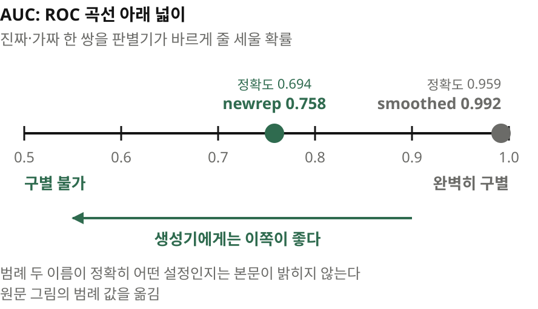

결과는 ROC 곡선과 AUC로 나옵니다. AUC는 진짜 하나와 가짜 하나를 판별기가 바르게 줄 세울 확률이에요. 생성기 입장에서는 낮을수록 좋고 0.5면 전혀 구별하지 못하는 상태입니다. 원문 범례에는 smoothed가 0.992, newrep이 0.758이에요. ‖ 두 이름의 정확한 설정은 본문에 없지만, atom smoothing에 맞게 표현을 바꾼 생성기가 훨씬 그럴듯했다는 문장과 맞춰 보면 newrep이 그쪽으로 읽힙니다. 큰 진전이지만 판별기 정확도가 아직 0.694, 열에 일곱 번은 가짜를 맞힌다는 뜻이기도 해요.

## 12 | 결과 | 롤아웃
> **롤아웃**: / 이어 붙여 길게
> 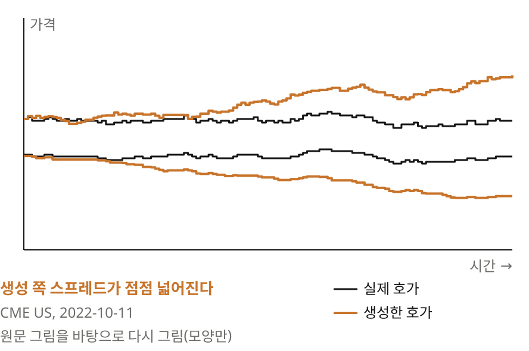

최종 목표는 롤아웃, 생성한 이벤트를 계속 이어 붙여 긴 시장 흐름을 만드는 겁니다. 원문은 CME Group 주식의 2022년 10월 11일 데이터로 실제와 생성 흐름을 보여 줘요. 실제 호가와 겹쳐 보면 시간이 갈수록 생성한 매도 호가가 위로 벌어지며 스프레드가 넓어집니다. 먼 미래일수록 나빠지는 건 당연하지만, 얼마나 빨리 나빠지는지는 앞으로의 연구 질문이라고 원문은 적었어요.

## 13 | 맺으며 | 두 개의 손잡이
> 남은 건 / 두 개의 **손잡이**
> 무엇을 범주로, 무엇을 확산으로 예측할 것인가
> 확산이 잘 듣도록 특징 분포를 어떻게 표현하고 펼 것인가

Kavish의 모델은 아직 실제 같은 생성기라 할 만큼 정확하지 않습니다. 하지만 중요한 손잡이 두 개는 분명해졌어요. ‖ 무엇을 범주로 예측하고 무엇을 확산으로 예측할지, 그리고 확산이 잘 듣도록 특징 분포를 어떻게 표현하고 펼지입니다.

> 같은 이벤트, / **두 가지** 보기
> 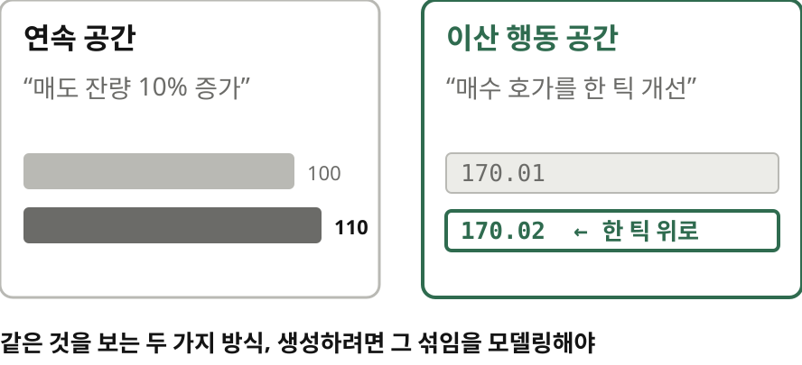

저자는 이 프로젝트 덕분에 호가창 이벤트를 연속 공간과 이산 행동 공간에 동시에 있는 것으로 보게 됐다고 맺습니다. 매도 잔량 10퍼센트 증가와 매수 호가 한 틱 개선은 같은 일을 보는 두 방식이고 시장 데이터를 생성하려면 그 섞임을 제대로 모델링해야 한다고요. 글은 2027년 ML 연구 인턴십 모집 소식으로 끝납니다.

## 14 | 맺으며 | 남는 생각
> 읽으며 짚어 둘 점
> 인턴 한 명의 여름 프로젝트를 회사 블로그 필자가 소개한 글. 모델 크기·학습 비용·코드는 비공개
> 평가는 대부분 다음 이벤트 하나 기준. 긴 롤아웃이 무너지는 속도는 수치로 재지 않았다
> 롤아웃 예시는 CME 주식 한 종목, 하루치

다만 이 글은 인턴 한 명의 여름 프로젝트를 블로그 필자가 소개한 거라 모델 크기, 학습 비용, 코드는 공개되지 않았습니다. 평가도 대부분 다음 이벤트 하나 기준이고 긴 롤아웃이 무너지는 속도는 수치로 재지 않았어요. 롤아웃 예시도 한 종목, 하루치입니다.

> **한 점에 몰린 확률**은 / 어디에나 있다
> 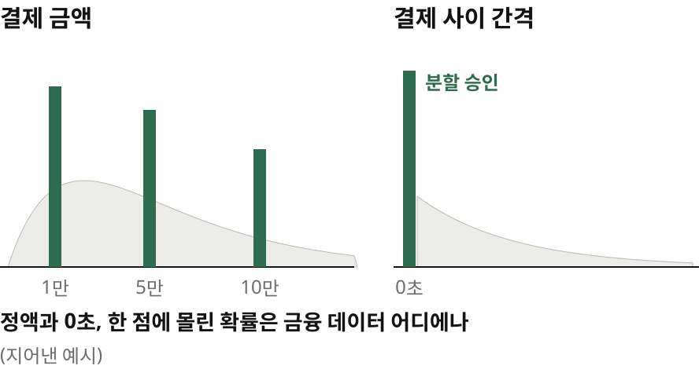
> 원문 blog.janestreet.com, 정리 노트 yoon-gu.github.io/compendium

제 생각을 보태면, 이 글은 연속처럼 보이는 데이터에서 숨은 이산성을 찾아내는 이야기예요. 한 점에 몰린 확률은 금융 데이터 어디에나 있습니다. 카드 결제 금액은 만 원, 오만 원 같은 정액에 몰리고, 거래 간격도 분할 승인 때문에 0초에 덩어리가 생기죠. 생성 모델이든 이상 탐지든 20개 범주 분해와 atom smoothing은 가져다 써 볼 만합니다. 무엇을 범주로, 무엇을 연속으로 다룰지 그 경계를 어디에 긋느냐가 성패를 가르니까요. ‖ 여기까지, Jane Street 블로그의 글이었습니다.
