# 규칙은 코드로, 판단은 모델로 — 나레이션 대본

AWS 블로그 글 "Cut generative AI costs: Code for rules, models for judgment"(2026-11-17)를 한 사람이 들려주듯 풀어 쓴 대본.
원문 번역이 아니라 [정리 노트](../../content/notes/code-for-rules-models-for-judgment.md)를 바탕으로 요지와 해설을 다시 서술한 것이다. 말투는 노트와 같은 해설 문체(짧은 문장, 물음과 답).

형식은 `../build.py` 머리말 참고. `python3 ../build.py code-for-rules-models-for-judgment --voice=유나`로 미리 듣는다(세로 1080x1920).
그림은 `figures/make.py`(SVG), 모션 그래픽은 핵심 대목 네 곳만 `figures/animate.py`(decide·questions·steps·fastpath mp4). 원문 그림은 쓰지 않고 개념을 새로 그렸다.

출처: AWS Artificial Intelligence 블로그, 2026년 11월
잉크: #3F7A66
부제: 어느 모델을 쓸지 묻기 전에, 모델이 필요한지부터
약어: LLM=Large Language Model, 대규모 언어 모델; AWS=Amazon Web Services; JSON=JavaScript Object Notation, 데이터 표기 형식; CI=Continuous Integration, 지속적 통합; ReDoS=Regular expression Denial of Service, 정규식 서비스 거부

## 1 | 들어가며 | 표지
> 규칙은 코드로 / **판단은 모델로**
> 생성형 AI 비용을 줄이는 첫 질문
> — 메건 코타리 외, AWS, 2026년 11월

생성형 에이 아이 비용을 줄이려면 무엇부터 따져야 할까요? 보통은 어느 모델이 싸고 쓸 만한지부터 묻습니다. ‖ 오늘 글은 한 걸음 앞에서 묻습니다. 이 단계에 모델이 필요하기는 한가?

글은 2026년 11월 아마존 웹 서비스 인공지능 블로그에 올라왔습니다. 쓴 사람은 넷입니다. 메건 코타리는 고객 경험 팀에서 제품 관리를 맡고 있어요. 크리슈나 아스와니는 아마존에서 에이전트 구조와 대형 언어 모델의 추론을 연구합니다. 나머지 두 사람도 같은 팀이에요. 클라우드를 파는 회사 사람들이 모델을 덜 부르라고 말하는 글이라 더 눈길이 갑니다.

## 2 | 문제 | 시제품에서 생긴 버릇
> 한 번 잘 되니 / **전부 모델에게**
> 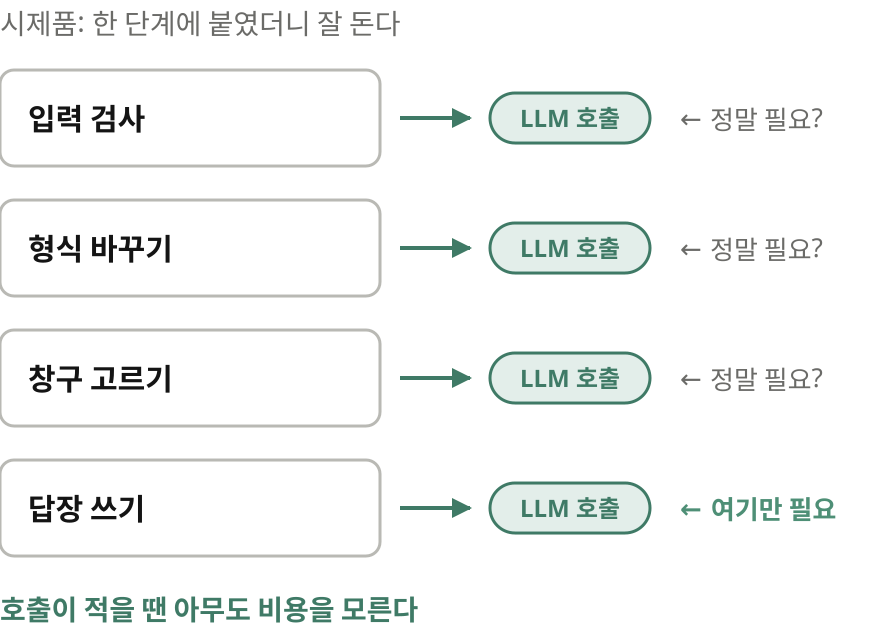

처음에는 다 시제품에서 시작합니다. 한 단계에 모델을 붙였더니 잘 돌아가요. 그러면 다음 단계에도 붙입니다. 입력이 맞는지 검사하기, 요청 형식 바꾸기, 어느 창구로 보낼지 고르기까지 모델이 맡게 되죠. 시제품 단계에서는 호출이 몇 번 안 되니 아무도 비용을 모릅니다.

> 쓸데없는 호출이 치르는 / **세 가지 값**
> 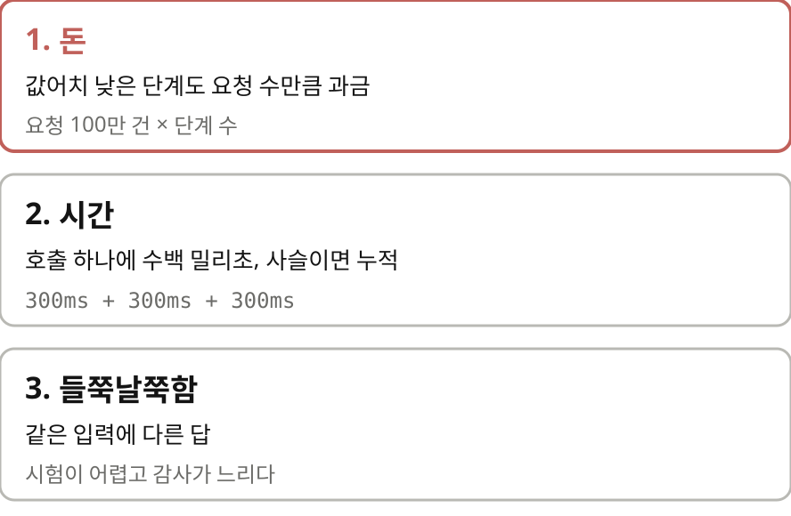

실제 서비스로 가면 사정이 다릅니다. 필요 없는 모델 호출은 세 가지 값을 치르게 해요. 우선 돈이 듭니다. 값어치 낮은 단계라도 요청 수만큼 비용이 붙어요. 시간도 듭니다. 모델 호출 하나가 수백 밀리초인데, 사슬로 엮으면 그만큼 쌓입니다. 그리고 답이 들쭉날쭉해져요. 같은 입력에 다른 답이 나오니 시험하기 어렵고 감사도 느려집니다.

덫이 하나 더 있습니다. 새 모델이 나올 때마다 어느 모델로 바꿀지를 두고 또 회의를 해요. 그 앞의 질문, 이 단계에 모델이 필요한가는 아무도 묻지 않습니다.

## 3 | 배경 | 결정 호출이란
> 쓰게 하지 말고 / **고르게 한다**
> 

본론에 앞서 낯선 말 하나를 풀고 가겠습니다. 결정 호출이에요. 모델에게 글을 쓰게 하는 대신 미리 정해 둔 보기 중 하나만 고르게 하는 호출입니다. 고객 문의를 결제, 기술, 계정, 기타, 이렇게 네 창구 중 하나로 보내야 한다고 해 봅시다. 모델에게 그냥 물으면 결제 문제로 보이지만 계정 쪽일 수도 있다는 식의 문장이 돌아와요. 코드는 이 문장을 다시 읽어서 창구 이름을 뽑아야 하고, 그 사이에 틀릴 구멍이 생깁니다. 결정 호출은 답의 꼴을 아예 묶습니다. 이렇게 답의 모양을 정해 주는 기능을 구조화 출력이라고 해요. 답은 네 창구 중 하나여야 하고, 여기에 모르겠음이라는 보기를 하나 더 둡니다. 모델이 자신 없으면 모르겠음을 고르고 그 건은 더 큰 모델이나 사람에게 넘어가요.

> 모델 호출 / **세 번에서 한 번으로**
> 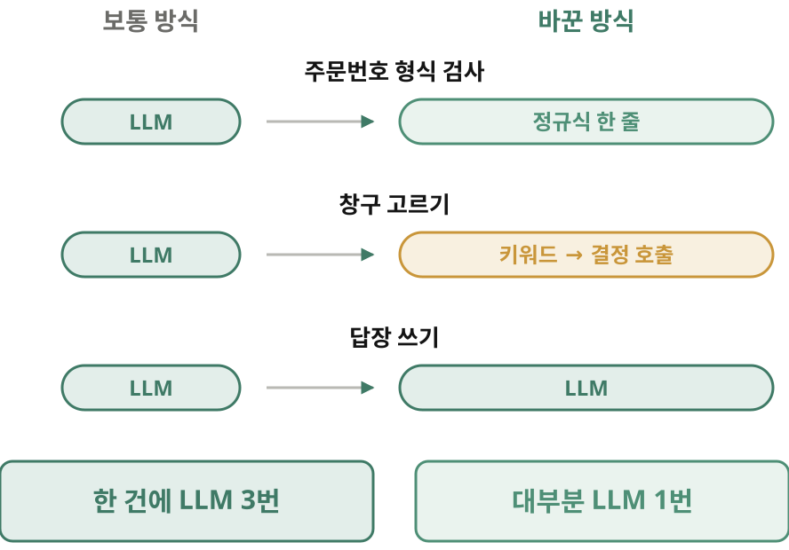

고객 문의 한 건을 처리하는 흐름으로 보면 차이가 분명합니다. 보통 방식은 주문번호 형식 검사, 창구 고르기, 답장 쓰기를 모두 모델에게 맡겨서 한 건에 세 번 부릅니다. 바꾼 방식은 형식 검사를 정규식 한 줄로, 창구 고르기를 키워드나 결정 호출로 처리해요. 진짜 모델이 필요한 답장 쓰기만 남습니다. 대부분의 요청이 모델 한 번으로 끝나요.

## 4 | 판단법 | 단계마다 세 가지 질문
> 단계마다 / **세 가지 질문**
> 

그러면 어떤 단계에 모델이 필요할까요? 글은 단계마다 세 가지를 차례로 물으라고 합니다. 첫째, 성공했는지를 규칙으로 확인할 수 있나? 형식, 스키마, 키워드, 숫자 범위 같은 거예요. 그렇다면 코드로 갑니다. 둘째, 모델이 규칙을 한 번만 써 줄 수 있나? 데이터 모양을 적어 둔 제이슨 스키마나 정규식을 모델이 초안으로 쓰고 사람이 검토해서 저장소에 넣어요. 셋째, 정해진 보기 중 하나를 고르는 일인가? 그렇다면 결정 호출로 갑니다. 셋 다 아니라면 그때 비로소 알맞은 크기의 모델로 보내요. 처음으로 예가 나오는 곳에서 멈추면 됩니다.

> 고객지원 도우미의 / **다섯 단계**
> 

글에 나온 고객지원 도우미의 다섯 단계를 이 질문에 태워 보면 이렇습니다. 주문번호 형식 확인은 규칙으로 끝나니 코드로 갑니다. 의도별로 메시지 보내기는 환불 같은 키워드가 있으면 코드가 처리하고, 나머지만 결정 호출로 넘겨요. 택배사 메일에서 송장번호 뽑기는 모델이 정규식을 한 번 써 주면 그다음부턴 코드입니다. 티켓을 네 창구 중 하나로 보내기는 결정 호출이에요. 마지막으로 고객에게 보낼 답장 쓰기만 모델이 맡습니다. ‖ 다섯 단계 중 모델이 꼭 필요한 건 하나뿐이었어요.

## 5 | 비교 | 코드와 모델
> 규칙으로 될 일을 / **모델에 맡기면**
> 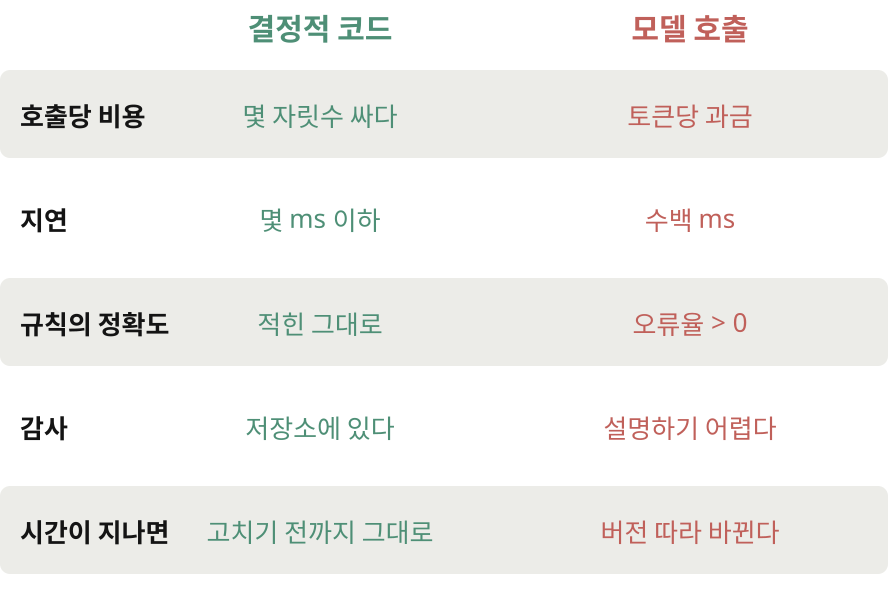

규칙으로 될 일을 모델에 맡기면 무엇을 잃을까요? 비용은 대개 몇 자릿수 차이가 납니다. 속도도 그래요. 코드의 한 자릿수 밀리초 대 모델의 수백 밀리초입니다. 잘 정의된 규칙이라면 코드는 적힌 그대로 정확하지만, 모델은 정확도가 높아도 오류율이 영은 아닙니다. 감사인에게 설명하기도 코드 쪽이 쉽죠. 규칙이 저장소에 그대로 있으니까요. 그리고 모델은 버전을 옮기거나 옛 버전이 사라지면 행동이 바뀝니다. 코드는 내가 고치기 전까지 그대로인데 말이죠.

> 온도 0이어도 / **같은 답은 보장 못 한다**
> 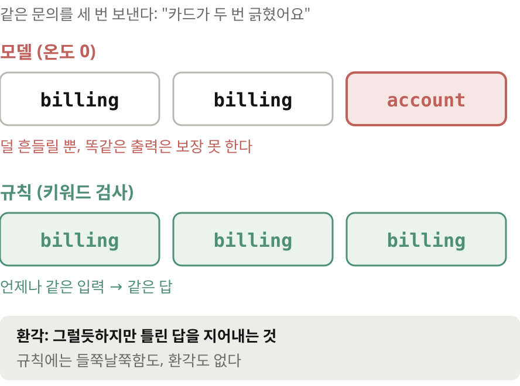

모델의 들쭉날쭉함을 조금 더 짚어 보죠. 모델에는 온도라는 손잡이가 있어요. 온도를 높이면 답이 다채로워지고 낮추면 가장 그럴듯한 답만 고릅니다. 그러니 온도를 영으로 두면 늘 같은 답이 나올 것 같죠. 그런데 글은 그렇지 않다고 말합니다. 덜 흔들릴 뿐, 똑같은 출력을 보장하지는 않아요. 모델은 그럴듯하지만 틀린 답을 지어내기도 합니다. 이걸 환각이라고 부르죠. 규칙에는 이 두 문제가 없습니다. 규제가 있는 업무에서 규칙을 좋아하는 이유가 여기 있어요.

> 합격 시험을 규칙으로 쓸 수 있으면 / **그 단계도 규칙이다**
> 답이 맞았는지 코드로 판정할 수 있나?

합격 시험을 규칙으로 쓸 수 있으면 그 단계도 대개 규칙으로 쓸 수 있습니다. 글이 주는 시금석이에요. 답이 맞았는지 코드로 판정할 수 있나? 이 질문 하나면 꽤 많은 단계가 가려집니다.

## 6 | 고르기 | 생성하지 말고 결정하라
> 보기에서 고르는 / **네 가지 방법**
> 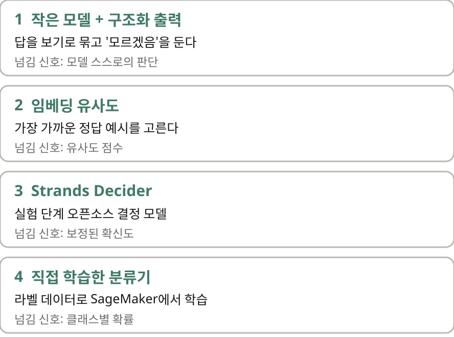

라우팅과 분류는 규칙과 생성 사이 어딘가에 있습니다. 규칙 하나로 모든 경우를 가를 수는 없지만, 글을 지어낼 필요도 없어요. 보기 중 하나만 고르면 되죠. 저자들은 아마존에서 결정 호출을 만드는 방법을 네 가지 듭니다. 하나는 아마존의 생성형 에이 아이 서비스인 베드락에서 작은 모델에 구조화 출력을 거는 겁니다. 답을 보기로 묶고 모르겠음을 보기에 넣어요. 또 하나는 임베딩 유사도입니다. 입력을 숫자 벡터로 바꾼 뒤 정답이 붙은 예시 중 가장 가까운 걸 골라요. 스트랜즈 디사이더라는 오픈소스 결정 모델도 있습니다. 아직 실험 단계예요. 아마존의 머신러닝 서비스인 세이지메이커에서 분류기를 직접 학습시키는 길도 있고요.

> 자신 있다는 말과 / **맞을 확률**은 다르다
> 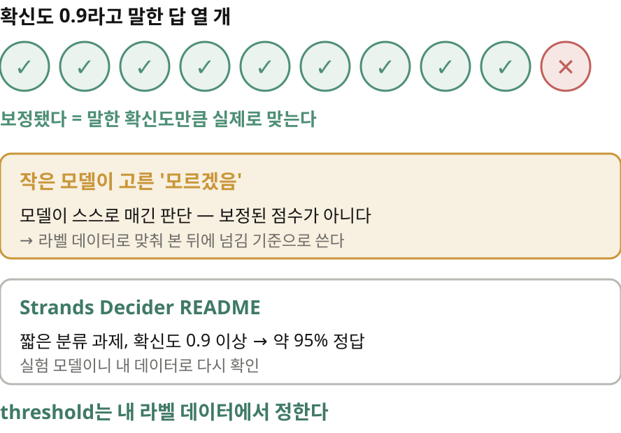

그러면 언제 위로 넘겨야 할까요? 그걸 알려 주는 신호가 필요합니다. 작은 모델이 고른 모르겠음은 모델이 스스로 매긴 판단이에요. 보정된 점수가 아닙니다. 보정됐다는 건 확신도 영 점 구라고 말한 답이 실제로 열에 아홉 번쯤 맞는다는 뜻이에요. 스트랜즈 디사이더의 설명서에는 짧은 분류 과제에서 확신도 영 점 구 이상인 답의 약 구십오 퍼센트가 맞았다고 적혀 있습니다. 그래도 실험 모델이니 내 데이터로 다시 확인하라고 글은 덧붙여요. 어떤 방법을 쓰든 넘김 신호는 정답이 붙은 내 데이터로 검증하고, 스레시홀드도 거기서 정합니다.

> 환불해도 되는지는 모델이 골라도 / **얼마까지**는 코드가 정한다

권한에 관한 결정은 규칙에 남겨 두라는 당부도 있습니다. 모델이 이 건은 환불 창구라고 고를 수는 있어요. 하지만 얼마까지 환불해 줄지는 코드가 정합니다. 돈과 권한이 걸린 선은 흔들리면 안 되니까요.

## 7 | 빠른 길 | 규칙 먼저, 남은 것만 모델로
> **빠른 길**
> 

이제 이 글의 핵심 패턴, 빠른 길입니다. 비용 이야기는 흔히 싼 모델로 보낼지 비싼 모델로 보낼지를 다룹니다. 빠른 길은 그보다 한 층 앞에 있어요. 늘 같은 답을 내는 결정적 검사를 먼저 돌리고 규칙이 못 가른 것만 모델로 보냅니다. 메시지 상당수에는 헷갈릴 것 없는 신호가 있어요. 환불, 비밀번호 재설정 같은 말이죠. 키워드 검사는 이걸 몇 밀리초 안에 가릅니다. 규칙이 요청의 구십오 퍼센트를 해결하면 모델까지 가는 건 스무 건 중 한 건이에요. 하루 백만 건이면 모델은 오만 건만 봅니다. ‖ 모델을 더 싼 걸로 바꾸기도 전에 이미 그래요. 글도 이건 셈을 보이려는 예시이지 실측이 아니라고 밝힙니다.

> 모델이 규칙을 / **한 번만 쓴다**
> 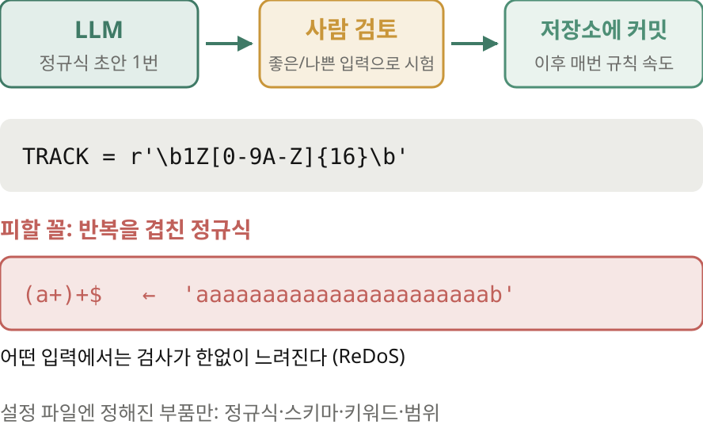

모델이 규칙을 한 번만 써 주게 하는 길도 있습니다. 매번 모델을 돌리는 대신 정규식이나 스키마 초안을 한 번 쓰게 합니다. 사람이 검토해서 저장소에 넣으면 그 뒤로는 규칙의 속도와 값으로 돕니다. 다만 모델이 쓴 정규식은 맞는 입력과 틀린 입력으로 꼭 시험해 보라고 합니다. 반복을 겹친 꼴은 피해야 해요. 어떤 입력에서는 검사가 한없이 느려지거든요. 이걸 정규식 서비스 거부 공격이라고 부릅니다. 규칙을 설정 파일에 둔다면 정해진 부품만 허용하고, 설정 파일에서 아무 코드나 실행하게 두면 안 됩니다.

## 8 | 크기 | 모델이 필요하면 크기를 맞춘다
> 하한을 넘는 것 중 / **가장 작은 모델**
> 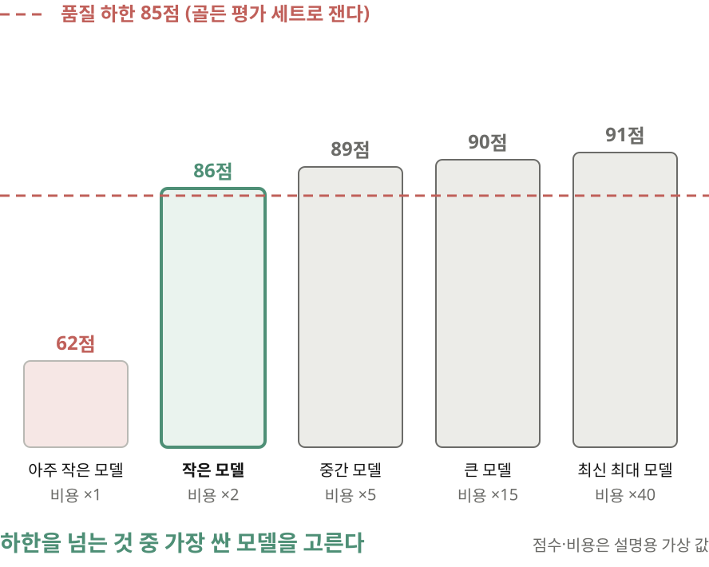

모델이 꼭 필요한 단계라면 무엇을 고를까요? 품질 하한을 넘는 것 중 가장 싸고 빠른 모델입니다. 가장 새것이거나 가장 큰 것이 아닐 때가 많아요. 비교하기 전에 요구부터 적습니다. 받아들일 수 있는 최소 품질, 요청 하나에 낼 수 있는 최대 비용, 견딜 수 있는 응답 시간, 그리고 데이터 저장 위치 같은 규정 제약이요.

> **골든 평가 세트**란
> 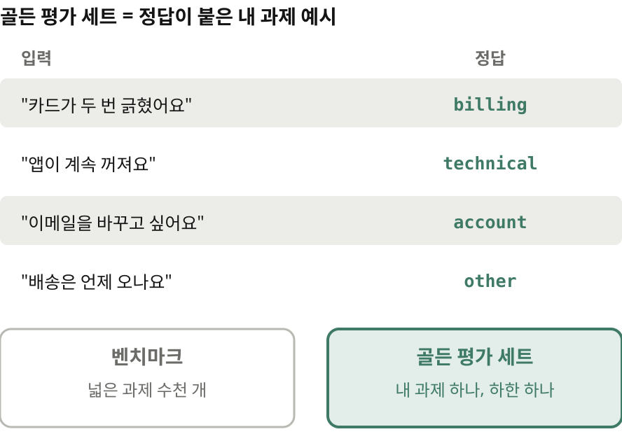

품질 하한은 골든 평가 세트로 잽니다. 정답이 붙은 과제 예시 모음이에요. 새 모델이 나오면 모델 회사는 넓은 벤치마크로 성능을 잽니다. 그런데 내 업무는 과제 하나에 품질 하한 하나예요. 큰 모델이 그 과제를 더 잘하지 못하면서 비용과 지연만 늘릴 수도 있습니다. 그러니 바꾸기 전에 내 골든 평가 세트로 먼저 시험해요.

## 9 | 운영 | 모델 선택도 시험을 거친 설정
> 모델 선택도 / **코드처럼** 다룬다
> 과제마다 골든 평가 세트를 CI에서 돌린다
> 싼 모델이 하한 아래로 떨어지면 회귀
> 모델은 설정 플래그 뒤에, 언제든 되돌리게

모델 선택도 코드처럼 다루라고 합니다. 과제마다 골든 평가 세트를 두고 코드를 고칠 때마다 자동으로 돌려요. 더 싼 모델이 품질 하한 아래로 떨어지면 버그가 생긴 것과 똑같이 봅니다. 모델은 설정 플래그 뒤에 두고요. 바꿨다가 문제가 생기면 바로 되돌릴 수 있게요.

> 규칙도 낡는다 / **그림자 모드**
> 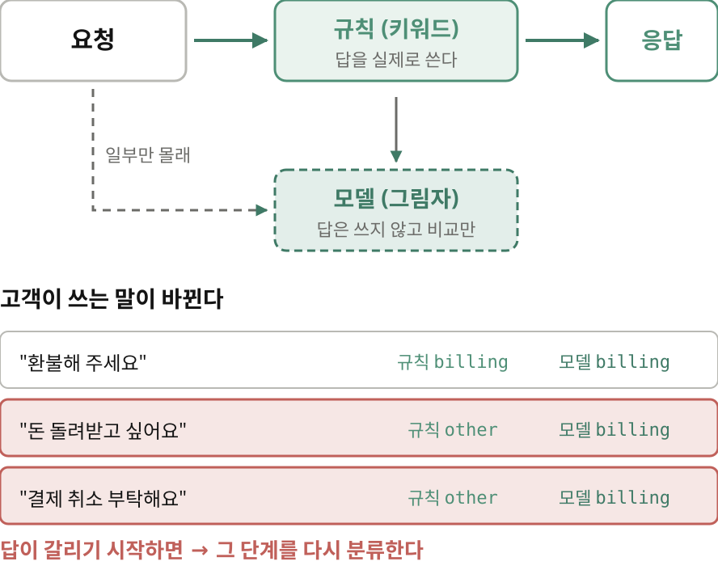

마지막 항목이 재미있습니다. 규칙도 낡아요. 고객이 쓰는 말이 바뀌면 환불 키워드가 놓치는 문의가 늘어납니다. 그래서 규칙이 처리한 요청 일부를 모델에게도 몰래 흘려 봐요. 이걸 그림자 모드라고 합니다. 모델의 답은 쓰지 않고 비교만 해요. 둘의 답이 갈리기 시작하면 그 단계를 다시 분류합니다. 모델에게 일을 맡기지 않고 감시자로 옆에 세워 두는 셈이에요.

## 10 | 맺으며 | 모델이 필요한지부터
> 실제로 해 보기
> 호출마다 코드·결정 호출·모델 꼬리표 달기
> 규칙으로 될 단계부터 코드로 옮기기
> 보기에서 고르는 단계는 결정 호출로
> 새 모델은 골든 평가 세트를 통과해야 기본값

글이 권하는 순서는 이렇습니다. 먼저 호출마다 코드인지, 결정 호출인지, 모델 호출인지 꼬리표를 답니다. 성공한 결과 하나당 비용도 잽니다. 다음으로 규칙으로 될 단계를 코드로 옮겨요. 대개 이게 가장 크고 안전한 이득입니다. 보기에서 고르는 단계는 결정 호출로 바꿉니다. 새 모델은 골든 평가 세트를 통과해야 기본값이 되게 하고요.

> 망치를 내려놓지 말고 / **못이 아닌 것엔 드라이버를**
> 어느 모델을 쓸지 묻기 전에
> 이 단계에 모델이 필요한지부터
> 원문 aws.amazon.com/blogs/machine-learning

망치를 쥐면 모든 게 못으로 보인다고 하죠. 대형 언어 모델이 요즘 그 망치입니다. 이 글도 망치를 내려놓으라고 하지는 않아요. 못이 아닌 것에 드라이버를 쓰자는 거죠. 그리고 무엇이 못인지는 답이 맞았는지 코드로 판정할 수 있느냐는 질문 하나로 대부분 가려져요. 글은 이렇게 끝납니다. 호출이 많은 워크플로 하나를 골라, 그중 얼마가 애초에 모델이 필요 없었는지 재 보라고요. 여기까지, 아마존 웹 서비스 블로그의 글이었습니다.
