# 에이전트가 일하는 시대의 비판적 사고 — 나레이션 대본

Addy Osmani의 "Critical thinking when agents do the work"(X 아티클, 2026-11-03)를 한 사람이 들려주듯 풀어 쓴 대본.
원문 번역이 아니라 [정리 노트](../../content/notes/critical-thinking-when-agents-do-the-work.md)를 바탕으로 요지와 해설을 다시 서술한 것이다. 말투는 노트와 같은 해설 문체(짧은 문장, 물음과 답).

형식은 `../build.py` 머리말 참고. `python3 ../build.py critical-thinking-when-agents-do-the-work --voice=유나`로 미리 듣는다(세로 1080x1920).
그림은 `figures/make.py`(SVG), 모션 그래픽은 핵심 대목 다섯 곳만 `figures/animate.py`(experiment·spectrum·questions·greencheck·tax mp4). 원문 그림은 쓰지 않고 개념을 새로 그렸다.

출처: Addy Osmani, X 아티클, 2026년 11월
잉크: #3F7A66
부제: 에이전트에게 일을 맡기되, 판단까지 넘겨주지 않는 법
약어: PR=Pull Request, 코드 병합 요청; AI=Artificial Intelligence, 인공지능

## 1 | 들어가며 | 표지
> 맡기되 / **넘겨주지 않는 법**
> 에이전트가 일하는 시대의 비판적 사고
> — 애디 오스마니, 2026년 11월

에이전트가 일을 잘할수록 왜 더 위험해질까요? ‖ 오늘 소개할 글은 애디 오스마니가 2026년 11월 엑스에 올린 글입니다. 오스마니는 구글에서 십사 년 넘게 크롬 개발자 경험을 이끌었고, 올해부터는 앤트로픽에서 클로드 코드를 만들고 있어요. 제목은 에이전트가 일할 때의 비판적 사고입니다.

먼저 오해 하나를 풀고 갈게요. 이 글은 에이전트를 덜 쓰자는 글이 아닙니다. 오스마니 자신이 에이전트를 여러 개 동시에 돌리며 일하는 사람이에요. 그가 말하려는 건 따로 있습니다. 일을 다 맡길 수 있는 세상에서 생각하는 힘을 어떻게 지키느냐는 거예요.

## 2 | 문제 | 생각할 틈이 사라졌다
> 질문과 답 사이가 / **몇 초**가 됐다
> 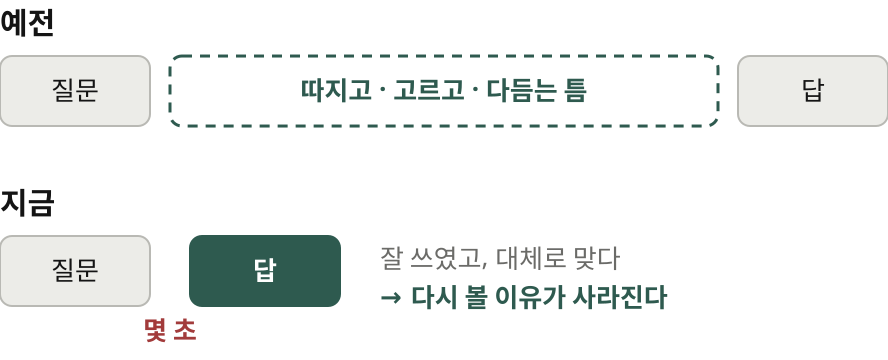

예전에는 질문과 답 사이에 시간이 있었습니다. 우리는 그 틈에서 따지고, 고르고, 다듬었어요. 이제 그 틈은 몇 초입니다.

모델이 좋아지면 문제가 줄어들까요? 오스마니는 반대로 봅니다. 뻔한 오류가 줄어들수록 더 어려워진답니다. 답 대부분이 잘 쓰였고 대체로 맞습니다. 그래서 다시 들여다볼 이유가 없어요.

> 에이전트는 여럿 / 눈은 **한 쌍**
> 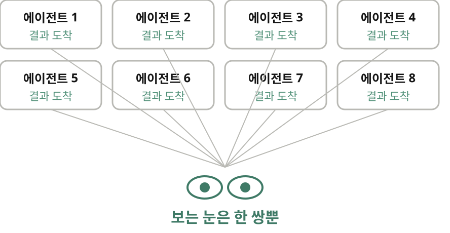

에이전트를 열 개 돌려도 결과를 보는 눈은 한 쌍뿐입니다. 게다가 이 방식은 기분이 좋아요. 빠르고 매끄럽고 자주 맞는 답은 바쁜 하루의 청량제죠. 바로 그래서 경계가 풀립니다. 그러니 비판적 사고를 하루 일과 안에 일부러 심어야 해요. 가만두면 저절로 생기지 않거든요.

## 3 | 배경 | 인지적 항복이란
> **인지적 항복**이란
> 

이 글의 열쇠말은 인지적 항복입니다. 와튼 스쿨의 스티븐 쇼와 기드온 네이브가 만든 말인데, 에이 아이의 답이 확인도 없이 슬그머니 내 판단이 되는 상태를 가리킵니다. 두 사람은 실험을 했습니다. 천삼백칠십이 명에게 추론 문제를 풀게 하고 에이 아이 조수를 붙였어요. 에이 아이가 맞는 답을 주면 정답률이 이십오 퍼센트포인트 올랐습니다. 틀린 답을 주면 십오 퍼센트포인트 떨어졌고요. ‖ 더 무서운 건 그다음입니다. 틀린 답을 받은 사람들의 자신감은 오히려 올라갔어요.

> 위임 · 추종 · 항복 / 나는 **어디에 서 있나**
> 

오스마니는 이 개념을 받아 세 칸으로 나눕니다. 맨 위는 인지 위임이에요. 일을 맡기되 결과의 주인은 나입니다. 오스마니는 하루 종일 이렇게 일하고, 여러분도 그래야 한다고 해요. 가운데는 추종입니다. 도구의 출력이 내 다음 생각의 전제가 되는 단계죠. 맨 아래가 인지적 항복입니다. 출력이 조용히 내 생각이 되고, 확인할 필요조차 느끼지 못해요. 셋 다 나쁜 건 아닙니다. 맨 위는 오히려 권하는 자리예요. 문제는 나도 모르게 아래로 미끄러지는 겁니다.

## 4 | 미끄러짐 | 한 걸음씩
> 한 걸음씩 / **미끄러진다**
> 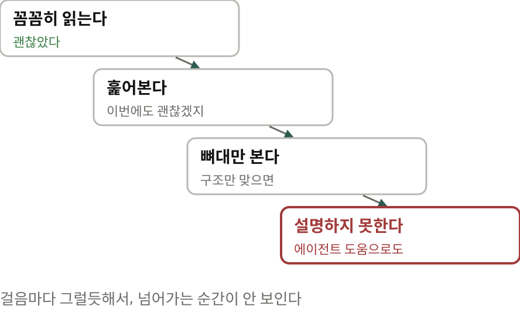

사람들은 어떻게 항복에 이를까요? 한 걸음씩입니다. 앞의 답을 꼼꼼히 읽었어요. 괜찮았습니다. 그래서 다음 답은 훑어요. 그다음 답은 뼈대만 봅니다. 그러다 누가 한 줄을 물어 오면 설명하지 못하죠. 에이전트의 도움을 받아도 못 합니다. 걸음마다 그럴듯해서 넘어가는 순간을 알아채기 어려워요.

> 그 순간에는 / **보이지 않는 빚**
> 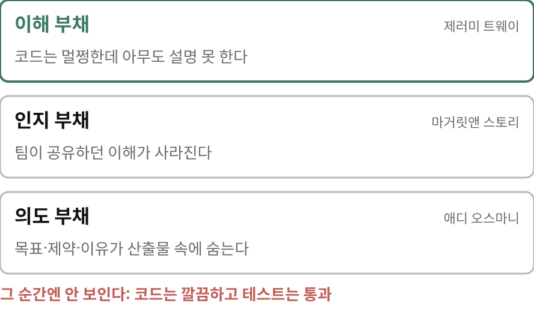

그렇게 빚이 쌓여요. 오스마니 말로는 이해 부채입니다. 코드는 멀쩡한데 아무도 그 코드를 설명하지 못하는 상태예요. 그 순간에는 보이지 않습니다. 코드베이스는 깔끔하고 테스트는 통과하거든요. 시스템을 고쳐야 할 때가 돼서야 드러납니다. 아무도 이걸 모른다는 사실이요. 전략 문서를 목차만 읽고 승인했을 때도 똑같습니다.

그렇다고 큰 코드베이스 전체를 머리에 담고 있으라는 건 불가능한 주문이에요. 클로드 코드 팀은 필요할 때 그 부분만 클로드에게 설명해 달라고 해서 이해를 다시 세웁니다. 전체 그림이 없어도 괜찮습니다. 다만 내가 무엇을 모르는지는 알아야 하죠.

> 틀려도 싼 일은 / **넘긴다**
> 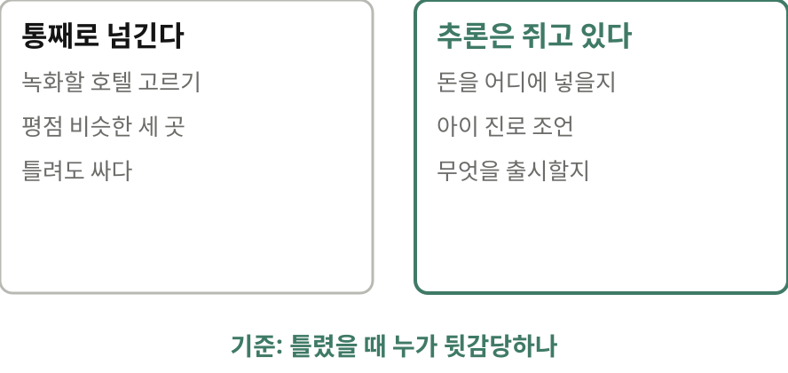

선은 어디에 그을까요? 오스마니는 강의를 녹화할 호텔을 고르는 일을 에이 아이에게 통째로 맡겼습니다. 평점이 비슷한 세 곳 중 하나였어요. 결과도 좋았고요. 하지만 돈을 어디에 넣을지, 아이에게 진로를 어떻게 조언할지, 회사에서 무엇을 출시해도 안전한지는 맡기지 않습니다. 틀려도 싼 일은 넘기고, 남이 뒷감당할 일은 추론을 쥐고 있으라는 거예요.

## 5 | 질문 | 스스로에게 묻는 여섯 가지
> 맡기기 전에 / **스스로에게 묻는 질문**
> 

오스마니는 에이전트에게 묻기 전에 스스로에게 몇 가지를 묻습니다. 첫째, 묻기 전에 가설을 세웠나? 답을 먼저 짐작해 적어 둡니다. 틀린 짐작이어도 괜찮아요. 잘 쓴 답을 읽고 나면 다른 가능성을 떠올리기 어려워지거든요. 둘째, 생각을 도와 달라는 건가, 덜어 달라는 건가? 둘 다 괜찮습니다. 지금 어느 쪽인지 알기만 하면 돼요. 셋째, 이게 틀렸다면 무엇이 참이어야 할까? 그리고 직접 확인합니다. 넷째, 반대 주장을 다른 각도에서 들어 봤나? 오스마니는 모델 여럿에게 반대편을 변호하게 합니다. 다섯째, 이걸 유지보수할 사람 앞에서 걸 수 있나? 여섯째, 나는 무엇을 더는 연습하지 않나? 자잘한 디버깅은 놓아도 됩니다. 다만 일부러 놓아야 해요.

> **사각지대 점검**이란
> 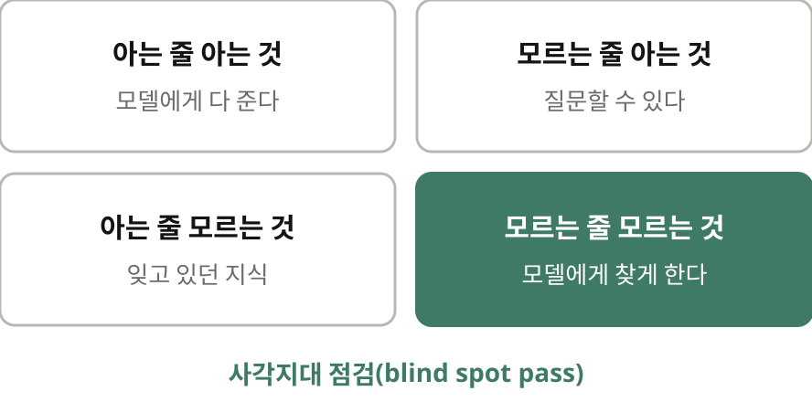

짐작조차 서지 않을 때는 사각지대 점검을 씁니다. 클로드 코드 팀의 타리크 시히파르가 말하는 방법이에요. 내가 아는 것을 모델에게 다 준 다음 찾아 달라고 합니다. 내가 모르는 줄도 모르는 것을요. 그런 건 물어볼 수조차 없으니 남의 눈을 빌려야 보이죠.

## 6 | 검증 | 초록불이 증명한 것
> 병목은 / **확신**으로 옮겨 갔다
> 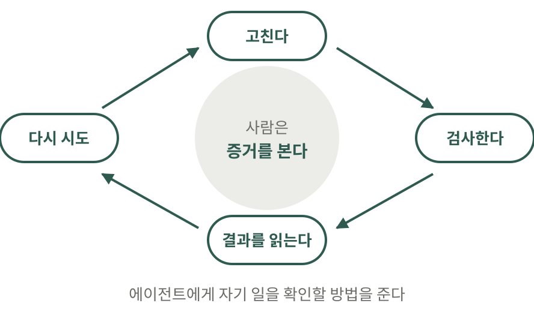

병목이 옮겨 갔습니다. 코드를 쓰는 일에서, 내가 맞다고 확신하는 일로요. 에이전트에게 검증 수단을 주면 사람이 보기도 전에 고치고, 검사하고, 결과를 읽고, 다시 시도합니다. 클로드 코드를 만든 보리스 체르니 식으로 말하면 클로드에게 자기 일을 확인할 방법을 주는 겁니다. 사람은 모든 줄을 읽는 대신 이 고리를 만들고 증거를 봅니다.

> 초록불은 / **한 가지만** 말한다
> 

그런데 검증하는 쪽도 항복할 수 있어요. 결론을 받치는 증거가 있냐고 묻던 것이 어느새 체크가 초록불이었냐는 질문으로 바뀝니다. 예를 하나 볼게요. 할인가를 계산하는 함수가 있습니다. 에이전트는 할인율을 영 점 일 같은 비율로 가정하고 함수를 짰어요. 테스트도 같은 가정으로 썼습니다. 당연히 통과하죠. 그런데 실제 쿠폰은 십, 그러니까 십 퍼센트라고 들어옵니다. 백 원짜리 물건이 마이너스 구백 원이 돼요. ‖ 테스트는 이 경우를 묻지 않았습니다. 그래서 초록불이 켜지면 두 번 물어야 해요. 무엇을 증명했나, 그리고 무엇을 증명하지 않았나.

> 끝났다는 표시는 / **만질 수 있게**
> 통과한 테스트 · 스크린숏 · 로그
> 요약보다 실행한 명령과 출력을 먼저
> 마지막에 한 번 더, 내가 놓친 게 있나?

무엇을 검증됐다고 칠지는 미리 정해 둡니다. 끝나고 나서 정하면 어떤 결과든 합리화하게 되거든요. 끝났다는 표시는 만질 수 있어야 해요. 통과한 테스트, 스크린숏, 로그 같은 것이요. 다 된 것 같다는 느낌에는 해석할 틈이 있고, 우리는 바로 그 틈에서 항복합니다. 에이전트가 끝났다고 알려 오면 요약보다 먼저 실제로 실행한 명령과 출력을 읽으세요. 오스마니는 큰 기능을 끝내면 꼭 묻습니다. 내가 놓친 게 있나? 우스워 보여도 거의 매번 두세 가지가 더 나온대요.

## 7 | 읽기 | 에이전트가 내린 결정
> 600줄 PR, / **어디를 봤나**
> 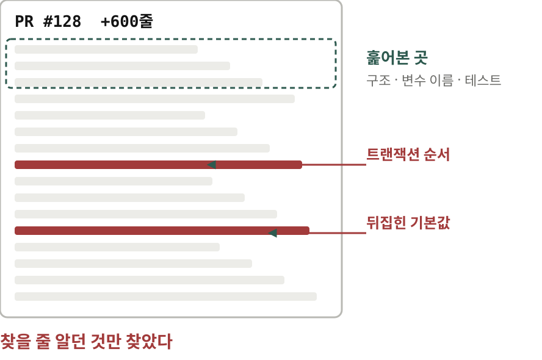

에이전트가 육백 줄짜리 피알을 내밀었다고 해 봅시다. 구조를 대충 봐요. 변수 이름은 그럴듯하고 테스트는 통과합니다. 승인하죠. 그런데 한가운데에서 트랜잭션 순서가 슬쩍 바뀌었습니다. 생각도 못 한 경계 조건의 기본값이 뒤집혔어요. 리뷰는 했습니다. 다만 이미 찾을 줄 알던 것만 찾았죠.

> 디프 너머 / **결정**을 읽는다
> 기본값 · 범위 밖으로 뺀 것 · 부딪친 요구를 고쳐 읽은 곳
> 결정과 가정을 목록으로 달라고 한다
> 아무 줄이나 골라 스스로 쪽지 시험

코드를 쓰는 일과 읽는 일은 다른 기술입니다. 어느 지점을 넘으면 리뷰는 도장 찍기가 돼요. 그래서 오스마니는 디프를 에이 아이가 쓰지 않은 것처럼 읽으라고 합니다. 그리고 디프 너머도 보래요. 에이전트가 대신 내린 결정 말이에요. 긴 세션 동안 에이전트는 작은 결정을 수없이 내립니다. 기본값, 범위 밖으로 뺀 것, 두 요구가 부딪칠 때 어느 쪽을 고쳐 읽었는지. 다 잘됐다는 요약에는 이게 안 보이니 결정과 가정을 목록으로 달라고 해요. 퀴즈를 만점으로 통과해야만 병합하는 사람도 있다고 합니다.

> **오케스트레이션 세금**
> 

에이전트가 만들어 내는 양과 내가 이름을 걸 수 있는 양 사이에도 간격이 생깁니다. 오스마니는 이 간격에 오케스트레이션 세금이라는 이름을 붙였어요. 끝난 일이 내가 소화하는 속도보다 빨리 쌓이면 세션을 하나 더 열어 봐야 소용없습니다. 검사를 조여 내 손이 덜 가게 하거나, 속도를 늦춰야 합니다. ‖ 책임질 수 있는 양보다 많이 만들고 있다면 그건 리뷰가 아니라 그저 바라는 거랍니다.

## 8 | 입력 | 의도는 나에게서
> 사람의 머리는 / **앞과 뒤로**
> 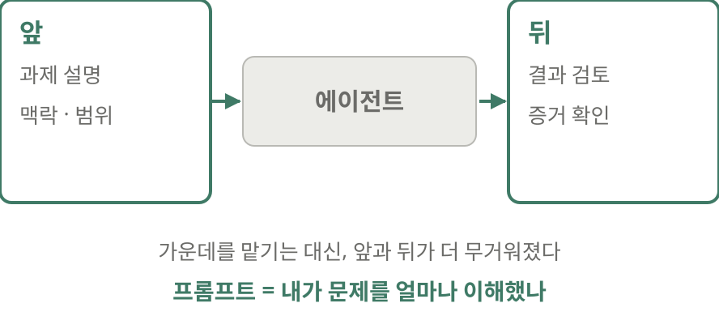

사람도 여전히 일에 머리를 씁니다. 자리만 바뀌었어요. 이제는 한가운데 말고 앞과 뒤에서 일합니다. 앞에서는 과제 설명과 맥락을 쓰고, 뒤에서는 결과를 검토하죠. 그래서 오스마니는 프롬프트를 잘 쓰는 일을 비판적 사고에 속하는 기술로 봅니다.

> 되묻지 않는 동료와 / **의도 부채**
> 누구를 위한 것인가 · 무엇이 범위 밖인가 · 무엇이 완료인가
> 두 번 고쳐도 안 되면, 프롬프트를 새로 쓴다
> 모호하면 에이전트에게 나를 인터뷰하게 한다

예전에는 막연하게 부탁하면 누군가 되물었습니다. 그러면 아, 나 이거 아직 안 정했구나, 하고 깨달았죠. 에이전트는 대개 되묻지 않아요. 빈칸은 알아서 채우고 결과는 다 된 것처럼 보이게 돌려줍니다. 정작 그 밑의 생각은 여전히 흐릿한데도요. 이게 의도 부채입니다. 이 빚은 남이 갚아 줄 수 없어요. 의도는 나에게서 나와야 하니까요. 그래서 도움을 청하기 전에 내 말로 요청서를 씁니다. 누구를 위한 것인지, 무엇이 범위 밖인지, 무엇이 완료인지요.

> 요약의 요약의 / **요약**
> 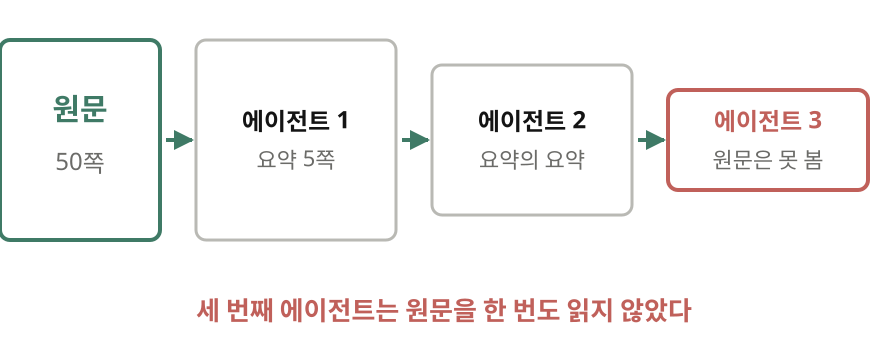

입력의 출처도 봐야 합니다. 에이전트끼리 앞 에이전트의 요약만 넘기다 보면 어떻게 될까요? 세 번째 에이전트는 원문을 한 번도 읽지 않은 채 일하게 됩니다. 그리고 출력에는 내 기준이 있어야 해요. 이제는 모든 것이 깔끔한 서식과 자신 있는 말투로 나옵니다. 매끈함만 보고는 품질을 알 수 없어요. 내 이름을 붙이기 싫은 결과는 내보내지 않는다, 오스마니의 기준입니다.

## 9 | 반론 | 모델이 더 잘할 텐데
> 감독하려면 / **그 실력**이 필요하다
> 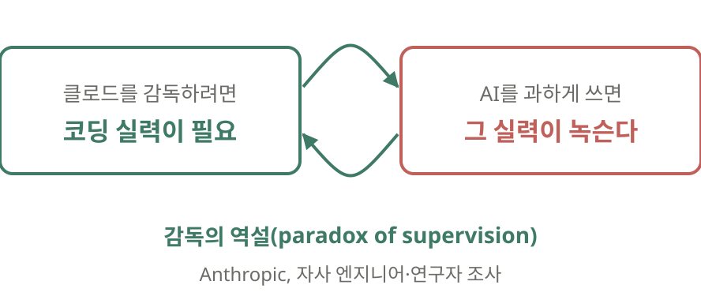

이쯤에서 떠오르는 반론이 있죠. 일이 년 뒤면 모델이 내가 잡을 걸 다 잡을 텐데, 왜 그 기술을 붙들고 있어야 하나? 오스마니는 탐지 상당 부분은 그럴 수 있다고 인정합니다. 그래도 남는 게 있어요. 무엇이 출시되든 누군가는 책임집니다. 에이 아이가 얼마나 도왔든 그 책임은 사람 몫이에요. 감독의 역설이라는 게 있습니다. 앤트로픽이 자사 엔지니어를 조사해서 낸 보고서에 나오는 말입니다. 클로드를 감독하려면 바로 그 코딩 실력이 필요한데, 에이 아이를 과하게 쓰면 그 실력이 녹슨다는 거예요.

> 더 좋은 모델도 / **대신 답하지 않는 질문**
> 무엇을 만드나 · 왜 그럴 가치가 있나
> 누구에게 영향을 주나 · 무엇을 포기할 각오가 있나

모델이 더 좋아져도 대신 풀어 주지 않는 질문이 있습니다. 무엇을 만드나? 왜 그럴 가치가 있나? 누구에게 영향을 주나? 무엇을 포기할 각오가 있나? 에이전트가 함께 따져 줄 수는 있어도 답은 내 것입니다.

## 10 | 맺으며 | 책임은 맡길 수 없다
> 매일 해 볼 만한 것
> 일주일에 한 번, 에이전트 없이 조금 직접 하기
> 한 달에 한 번, 그만둔 일을 적고 놓을지 정하기
> 기계를 확인하는 시간을 일정에 넣기

다 엄격하게 할 필요는 없습니다. 맞는 것만 골라 끼우면 돼요. 일주일에 한 번은 에이전트 없이 코드를 조금 써 봅니다. 오스마니는 이걸 감을 맞추는 연습이라고 불러요. 한 달에 한 번은 내가 그만둔 일을 적고, 그중 무엇을 놓아도 괜찮은지 정합니다. 그리고 기계를 제대로 확인하는 시간을 일정에 넣으세요. 공짜인 척하면 결국 안 하게 됩니다. 쓰지 않는 기술은 생각보다 빨리 사라지니까요.

> 읽으며 **짚어 둘 점**
> 인지적 항복 실험은 짧은 추론 문제로 한 것
> 긴 코드 리뷰·설계 판단에 그대로 옮길지는 열린 질문
> 저자는 에이전트를 만드는 회사 사람이다

다만 짚어 둘 점도 있어요. 쇼와 네이브는 짧은 추론 문제로 실험했습니다. 긴 코드 리뷰나 설계 판단에 그대로 옮길 수 있는지는 아직 열린 질문이에요. 그리고 저자는 에이전트를 만드는 회사 사람입니다. 그래서 처방도 덜 쓰라는 쪽보다는 고리를 설계하라는 쪽에 가깝죠.

> 일과 검사는 맡겨도 / **책임**은 맡길 수 없다
> 묻기 전에 적는다: 무슨 일이 일어날까
> 끝난 뒤에 적는다: 무엇을 확인하지 않았나
> 원문 x.com/addyosmani

오스마니가 권하는 가장 작은 실천은 이겁니다. 묻기 전에 무슨 일이 일어날지 적으세요. 일이 끝나면 에이전트가 확인하지 않은 것 하나를 적으세요. 그리고 그게 결과를 읽는 방식을 바꾸는지 보세요. 일과 검사는 맡길 수 있지만 책임은 맡길 수 없습니다. 여기까지, 애디 오스마니의 글이었습니다.
