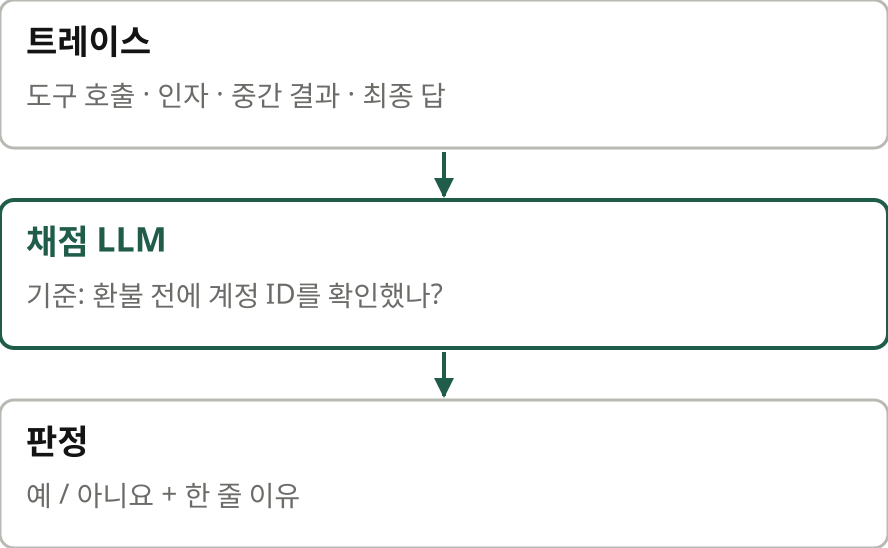
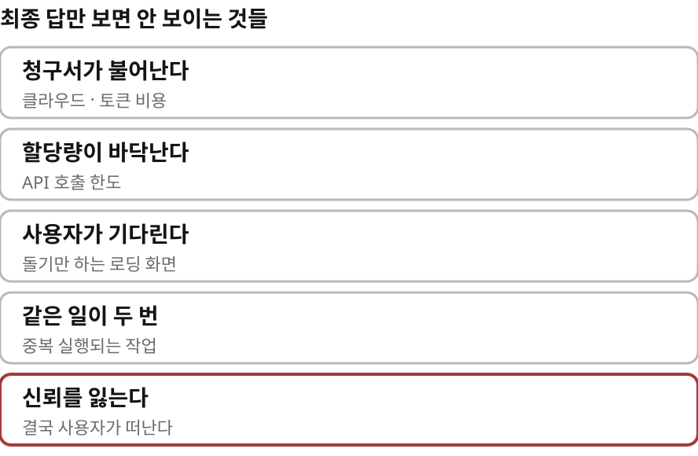
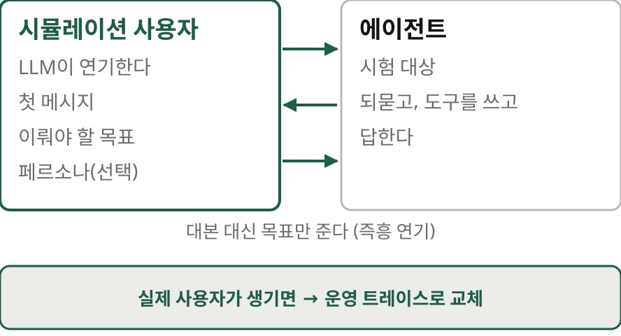
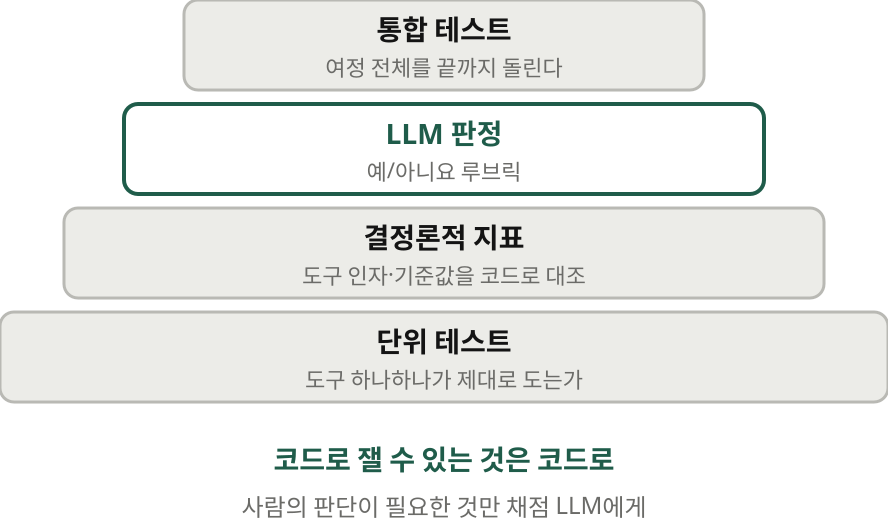
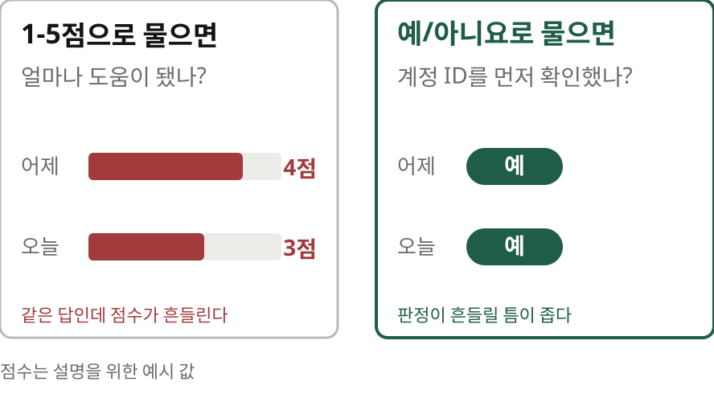
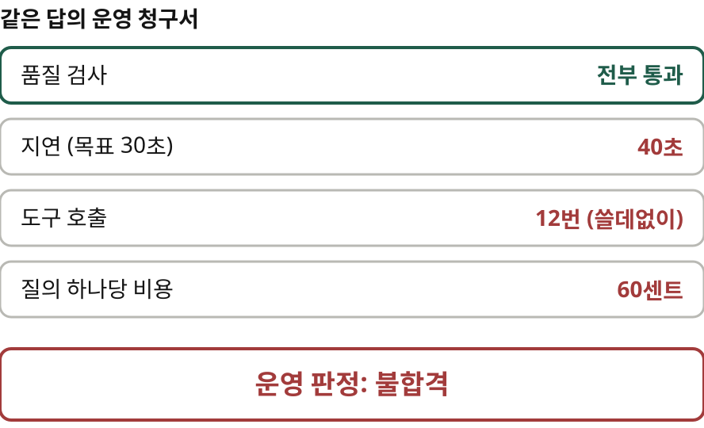
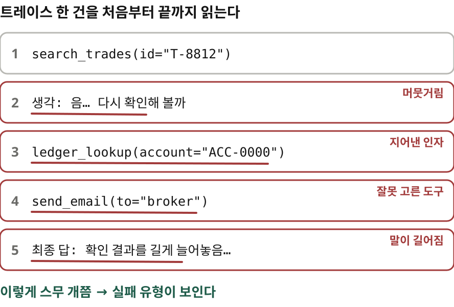
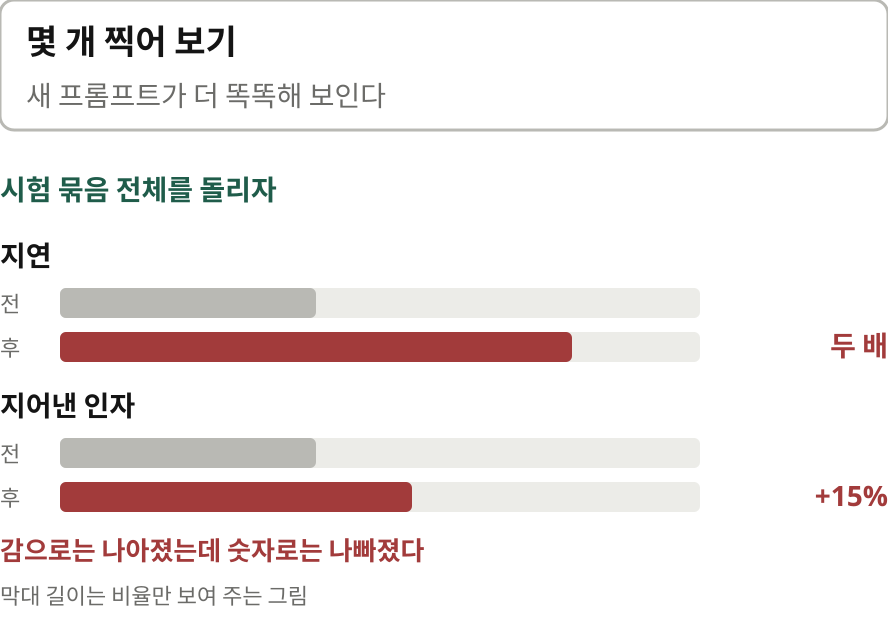

# AI 에이전트 평가, 감에서 벗어나기 — 나레이션 대본

Hugo Selbie·Dani Zamora·Jesse Carah·John DeMartino의 "Evaluating AI agents: moving past the vibe check"(Google Developers Blog, 2026-10-15)를 한 사람이 들려주듯 풀어 쓴 대본.
원문 번역이 아니라 [정리 노트](../../content/notes/evaluating-ai-agents-vibe-check.md)를 바탕으로 요지와 해설을 다시 서술한 것이다. 말투는 노트와 같은 해설 문체(짧은 문장, 물음과 답).

형식은 `../build.py` 머리말 참고. `python3 ../build.py evaluating-ai-agents-vibe-check --voice=유나`로 미리 듣는다(세로 1080x1920).
그림은 `figures/make.py`(SVG), 모션 그래픽은 핵심 대목 네 곳만 `figures/animate.py`(trace·cuj·traps·gate mp4). 원문 그림은 쓰지 않고 개념을 새로 그렸다.

출처: Google Developers Blog, 2026년 10월
잉크: #1F5C4A
부제: 프롬프트 몇 개 돌려 보고 넘어가던 에이전트 시험을 어떻게 바꿀까
약어: LLM=Large Language Model, 대규모 언어 모델; CUJ=Critical User Journey, 핵심 사용자 여정; PR=Pull Request, 코드 병합 요청; API=Application Programming Interface; ADK=Agent Development Kit, Google의 에이전트 개발 도구

## 1 | 들어가며 | 표지
> 감으로 하는 점검을 / **넘어서**
> AI 에이전트를 평가하는 법
> — Google 엔지니어 네 명의 실무 안내

에이전트를 만들고 나면 어떻게 시험하시나요? 프롬프트 몇 개를 돌려 보고 답을 눈으로 훑습니다. 그럴듯하면 넘어가죠. 이걸 바이브 체크라고 부릅니다. 감으로 하는 점검이에요. ‖ 오늘 소개할 글은 2026년 10월 Google 개발자 블로그에 올라온 글입니다. Google 엔지니어 네 명이 썼어요. 고객사의 에이전트를 실제 운영까지 올리는 일을 하는 사람들이에요. 제목은 AI 에이전트 평가하기, 바이브 체크를 넘어서입니다.

## 2 | 배경 | 먼저 알아 둘 말
> **트레이스**란
> 

먼저 트레이스라는 말부터 짚을게요. 챗봇은 질문 하나에 답 하나를 냅니다. 답만 맞으면 그만이에요. 에이전트는 다릅니다. 답에 이르기까지 여러 걸음을 걸어요. 도구를 고르고 인자를 채워 부르고 결과를 읽고 다시 고릅니다. 이 걸음을 전부 적어 둔 기록이 트레이스예요. 왜 트레이스까지 봐야 할까요? 같은 답을 내도 어떤 에이전트는 도구를 두 번 불러 3초 만에 답합니다. 다른 에이전트는 열두 번 불러서 40초가 걸려요. 답안지만 보면 둘 다 만점입니다. 풀이를 보면 하나는 낙제예요.

> **LLM이 채점한다**
> 

두 번째는 채점을 맡는 LLM입니다. 사람 대신 다른 LLM에게 채점 기준을 주고 트레이스를 판정하게 해요. LLM 애즈 어 저지라고 부릅니다. 그런데 이 채점관에게 무엇을 물어야 할까요? 점수 대신 예, 아니요를 물으라는 것이 이 글의 요점 가운데 하나입니다.

## 3 | 문제 | 왜 감으로는 안 되나
> 프롬프트 하나 고쳤더니 / **다른 곳이 망가졌다**
> 

바이브 체크는 처음에는 통합니다. 그다음이 문제예요. 한 워크플로의 프롬프트를 고쳤더니 다른 워크플로의 도구 호출이 조용히 망가집니다. 최종 답만 보니 아무도 몰라요. 그사이 숨은 실패가 비용이 됩니다. 클라우드와 토큰 청구서가 불어나고 API 할당량이 바닥납니다. 사용자는 빙글빙글 도는 화면 앞에서 기다리고요. 같은 작업이 두 번 실행되기도 합니다. 그러다 사용자의 신뢰까지 잃어요.

## 4 | 성공 정의 | 핵심 사용자 여정
> 잘 됐다는 건 / **무엇인가**
> 
> 핵심 사용자 여정(CUJ)의 네 칸

그러면 무엇부터 할까요? 잘 됐다는 게 무엇인지부터 정합니다. 저자들은 핵심 사용자 여정, CUJ에서 출발하라고 해요. 원문의 예로 네 칸을 채워 볼게요. 먼저 누가. 운영 분석가입니다. 다음은 목표예요. 거래 상대방이 따지는 이메일을 받으면 에이전트가 문제의 거래를 찾아 장부와 대조하고 회신 초안을 씁니다. 제약도 있어요. 30초 안에, 사람 손을 빌리지 않고 끝내야 합니다. 마지막은 검증 조건입니다. 올바른 거래 아이디를 찾았나, 초안을 쓰기 전에 장부를 확인했나, 아이디를 브로커 쪽 표기로 제대로 바꿨나. 이렇게 적은 조항 하나하나가 그대로 평가 지점이 됩니다.

## 5 | 시험 문제 | 시뮬레이션과 네 층의 검사
> 사용자도 / **LLM이 연기한다**
> 

시험 문제는 어디서 구할까요? 처음에는 지어냅니다. 순탄하게 흘러가는 경우와 꼬이는 경우로 시나리오를 나누고 사용자 역할을 맡은 LLM에게 줍니다. Google ADK의 사용자 시뮬레이션이 이 일을 해요. 첫 메시지와 이뤄야 할 목표만 적어 주면 나머지는 시뮬레이터가 대화 흐름을 보고 알아서 말합니다. 대본을 외운 배우보다 즉흥 연기를 하는 배우에 가깝죠. 실제 사용자가 생기면 이 문제들을 운영 트레이스로 차츰 바꿔 갑니다.

> 검사는 / **네 층으로**
> 

검사도 한 가지로 끝나지 않습니다. 단위 테스트, 결정론적 지표, LLM 판정, 통합 테스트를 층층이 쌓아요. 코드로 잴 수 있는 건 코드로 잽니다. 사람의 판단이 필요한 것만 채점 LLM에게 넘겨요.

## 6 | 함정 | 피해야 할 네 가지
> 피해야 할 / **네 가지 함정**
> 

저자들은 흔히 빠지는 함정 네 가지를 꼽습니다. 첫째, 시험지를 바꾸는 것. 지난주보다 점수가 올랐는데 그사이 시험을 몇 개 지웠다면 에이전트가 좋아진 건지 시험이 쉬워진 건지 알 수 없어요. 그래서 튜닝하는 동안에는 시험 묶음을 얼려 두고 한 번에 하나만 바꿉니다. 둘째, 일점에서 오점까지 점수로 채점하는 것. 셋째는 답의 품질만 보고 청구서는 안 보는 경우예요. 넷째는 프레임워크마다 평가 파이프라인을 따로 만드는 일입니다. 트레이스를 OpenTelemetry로 남기고 OpenInference 규약에 맞추면 LangGraph로 짰든 ADK로 짰든 파이프라인 하나로 잽니다. 둘째와 셋째는 조금 더 들여다볼게요.

> 1점에서 5점 말고 / **예, 아니요**
> 

채점 LLM에게 이 답이 얼마나 도움이 됐는지 일점에서 오점으로 물으면 어떻게 될까요? 같은 답에 어제는 사점, 오늘은 삼점을 줍니다. 이런 점수로는 나아졌는지 나빠졌는지 가릴 수 없어요. 질문을 바꾸면 됩니다. 환불 도구를 부르기 전에 계정 아이디를 확인했나, 예 아니요. 이렇게 물으면 판정이 흔들릴 틈이 좁아집니다.

> 품질은 합격 / **청구서는 불합격**
> 

셋째 함정도 예로 볼게요. 모든 품질 검사를 통과한 답이 있어요. 그런데 한 번에 40초가 걸립니다. 쓸데없는 도구 호출을 열두 번 하고 질의 하나에 60센트가 듭니다. ‖ 이 답은 합격일까요? 운영에서는 불합격입니다. 그래서 지연과 토큰, API 비용, 도구 호출 횟수를 품질 지표와 한 줄에 나란히 적어요.

## 7 | 들이는 법 | Day 0에서 Day 2까지
> Day 0 / **빨간 펜을 든다**
> 

실제로는 어떻게 시작할까요? 오픈소스 도구 agent-eval을 쓰면 설치는 두어 시간이면 끝납니다. 시간은 무엇을 잴지 정하는 데 들어요. 첫 단계는 의외로 수작업입니다. 시나리오를 돌리고 점수판은 덮어 둡니다. 대신 트레이스를 처음부터 끝까지 읽어요. 답안지를 채점하는 선생님처럼 빨간 펜을 들고 에이전트가 머뭇거린 곳, 인자를 지어낸 곳, 도구를 잘못 고른 곳, 말이 길어진 곳에 표시합니다. 저자들은 트레이스 스무 개만 손으로 읽어도 실패 유형을 짐작하느라 보낼 며칠을 아낀다고 말해요.

> Day 1 / **같은 시험을 매번**
> 

그다음에 자동화합니다. 이때 지킬 규칙이 하나 있어요. 프롬프트든 모델이든 도구 설명 한 줄이든, 무엇을 바꾸든 같은 시험 묶음을 다시 돌리고 기준선과 비교합니다. 채점 LLM도 검증해요. 사람이 빨간 펜으로 채점해 둔 트레이스가 있잖아요. 그걸 다시 채점시켜 보고 판단이 맞을 때까지 채점 프롬프트를 다듬습니다. 튜닝할 때는 갈아엎지 않고 손잡이를 돌리듯 조금씩 맞춰요. 한 번에 하나씩, 50번에서 60번. 원문에 이런 사례가 있습니다. 프롬프트를 하나 바꿨더니 몇 개 찍어 본 결과로는 더 똑똑해 보였어요. 그런데 시험 묶음을 다 돌리자 지연은 두 배가 되고 지어낸 인자는 15% 늘었습니다. ‖ 감으로는 나아졌는데 숫자로는 나빠진 거죠.

> Day 2 / **병합 관문**
> 
> PR을 합치기 전에 시험 묶음이 자동으로 돈다

마지막 단계에서는 이 시험을 팀의 규칙으로 만듭니다. 코드를 합치기 전에 시험 묶음이 자동으로 돌아요. 예, 아니요 검사의 성공률이 threshold를 넘어야 합니다. 원문의 예는 95%예요. 또 전에 통과하던 핵심 지표가 하나라도 떨어지면 안 됩니다. 누가 프롬프트를 고쳐 다른 워크플로를 망가뜨리면 여기서 걸려요. 처음에 말한 그 사고를 이 관문이 막습니다. 결과는 공유 대시보드로 팀 전체가 같이 봅니다. 출시한 뒤에는 실제 운영 트레이스를 다시 시험 묶음에 넣어요.

## 8 | 맺으며 | 감 대신 트레이스
> 새 발명이 아니라 / **테스트의 상식**
> 고정된 시험 묶음 · 한 번에 하나만 · 회귀를 막는 관문
> 달라진 점: 풀이를 채점한다 · 채점관도 검증한다

이 처방이 새로울까요? 저는 그렇지 않다고 봅니다. 고정된 시험 묶음, 한 번에 하나만 바꾸기, 회귀를 막는 관문. 소프트웨어 테스트에서 오래 써 온 상식이에요. 다만 에이전트라서 달라지는 점이 두 가지 있습니다. 하나는 답 대신 풀이를 채점해야 한다는 겁니다. 또 채점관도 LLM이니 채점관부터 사람 채점에 맞춰 확인해야 하고요.

> 읽으며 **짚어 둘 점**
> 권하는 도구가 Google 제품 쪽으로 기울어 있다
> agent-eval의 기본 지원은 저장소 README상 ADK 하나

몇 가지는 짚고 넘어갈게요. Google 엔지니어가 쓴 글이라 권하는 도구가 Google 제품 쪽으로 기울어 있습니다. 원리는 다른 도구로도 그대로 옮길 수 있어요. 원문은 agent-eval이 LangGraph 트레이스도 받는다고 하지만 지금 저장소 README는 기본 지원을 ADK 하나로 적고 있습니다.

> 감 대신 / **트레이스 스무 개**
> 원문 developers.googleblog.com, 정리 노트 yoon-gu.github.io/compendium

가장 값싸고 쓸모 있는 조언은 첫 단계의 빨간 펜이라고 저는 봅니다. 도구도 돈도 들지 않아요. 트레이스 스무 개를 직접 읽으면 됩니다. 감으로 하는 점검에서 벗어나는 첫걸음도 사람이 직접 읽는 일이에요. 여기까지, Google 개발자 블로그의 글이었습니다.
