# 하니스 엔지니어링 101 핸즈온 — 2편 오래 달리는 에이전트 (대본)

Isuru Wijesiri의 *Harness Engineering 101*(6-9장)을 따라 장난감 하니스를 실제로 돌려 보는 강의 2편 대본. 가로판(`build.py --wide --script=script-2.md`).
원문 번역이 아니라 [시나리오](scenario-2.md)와 `lab/` 실습 기록(`lab/runs/l7-*`부터 `l10-*`까지, 2026-10-24 claude-haiku-5-5 실제 호출)을 바탕으로 새로 쓴 것이다. 저자 경험담은 우리 말로 한두 문장만 요약했다.
말투는 1편과 같은 친절한 핸즈온 강사(합쇼체). 실행 화면마다 끝에 "여기까지 확인"을 둔다. 모델 답이 다 뜬 뒤에 설명이 들리도록 터미널 클립은 기준 줄을 1.5초 먼저 찍는다.
TTS가 잘못 읽지 않도록 나레이션 속 영어 이름과 숫자는 한글로 적었다(화면 글은 원래 표기).

출처: Isuru Wijesiri, Harness Engineering 101, 2026년 10월 (코드 MIT)
잉크: #2F5D8A
부제: 2편 · 오래 달리는 에이전트 — 300줄 코딩 에이전트 직접 만들기
약어: 토큰=token, 모델이 글을 세는 단위; 컨텍스트 윈도우=context window, 모델이 한 번에 받을 수 있는 입력의 최대 길이; 서브에이전트=subagent, 빈 배열에서 따로 도는 같은 루프; 리마인더=system reminder, 하니스가 배열 맨 아래에 붙이는 알림; 큐=queue, 먼저 넣은 것이 먼저 나오는 대기열; 압축=compaction, 오래된 대화를 요약 한 덩어리로 바꾸기; 폴링=polling, 끝났는지 계속 들여다보며 기다리기; 스레드=thread, 한 프로그램 안에서 따로 도는 실행 흐름; 백그라운드=background, 기다리지 않고 뒤에서 돌리기; grep=파일에서 글자를 찾는 명령

## 1 | 들어가며 | 표지
> 오래 달리면 / **무엇이** 무너지나
> 2편 · 오래 달리는 에이전트 — Harness Engineering 101 따라 하기

안녕하세요. 하니스 엔지니어링 백일 핸즈온 두 번째 시간입니다. 지난 편에서 우리는 코딩 에이전트의 뼈대를 만들었습니다. 다시 떠올려 보겠습니다. 대화를 담는 배열 하나, 모델을 부르고 도구를 돌리는 와일 루프 하나, 도구 이름을 보고 함수를 고르는 디스패치 표 하나. 실패한 테스트 하나는 이걸로 고쳤습니다. ‖ 오늘은 이 에이전트에게 더 크고 더 오래 걸리는 일을 맡겨 보겠습니다. 그러면 어디가 먼저 무너지는지 직접 보고 한 군데씩 고치겠습니다.

> 루프가 돌수록 **배열이 무거워진다**
> 
> 바퀴마다 모델의 답과 도구 결과가 쌓인다
> 가장 큰 덩어리는 도구 결과
> 배열은 매 바퀴 통째로 다시 간다(1편)

그림을 보겠습니다. 루프가 한 바퀴 돌 때마다 배열에는 모델의 답과 도구 결과가 붙습니다. 그런데 크기가 다릅니다. 모델의 말은 몇 줄입니다. 도구 결과는 파일 하나, 명령 출력 하나가 통째로 들어옵니다. 그리고 1편에서 봤듯이 이 배열은 바퀴마다 통째로 다시 보내집니다. 오래 달릴수록 무거운 짐을 계속 지고 달리게 됩니다.

> 오늘 고칠 **네 군데**
> 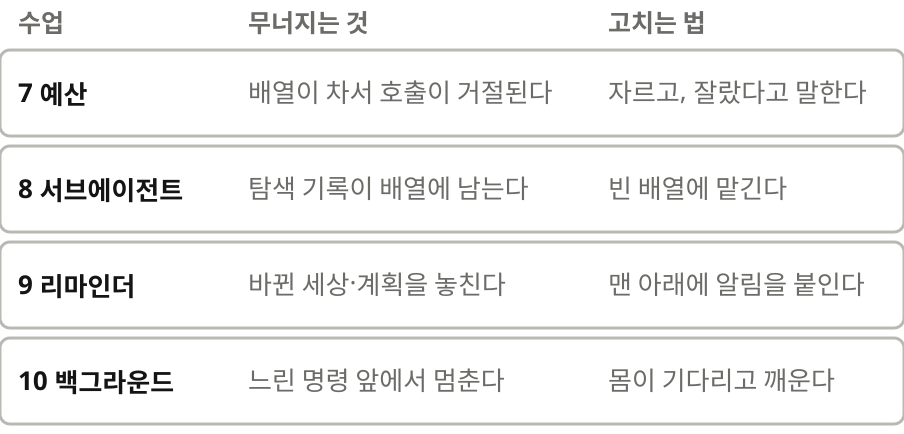
> 수업 틀은 1편과 같다: 같이 쓰기, 실행, 방금 일어난 일, 자주 막히는 곳, 체크포인트

오늘 고칠 곳은 네 군데입니다. 일곱째 수업, 배열이 차서 호출이 거절되는 문제. 여덟째, 한 번 쓰고 말 탐색이 배열에 계속 남는 문제. 아홉째, 모델이 바뀐 세상과 자기 계획을 놓칩니다. 열째, 느린 명령 앞에서는 루프가 멈춰 섭니다. 수업마다 같이 쓰고 돌려 본 다음 무슨 일이 있었는지 짚습니다. 이 순서는 1편과 같습니다.

## 2 | 준비물 | 수업 0
> 준비물은 **1편 그대로**
> 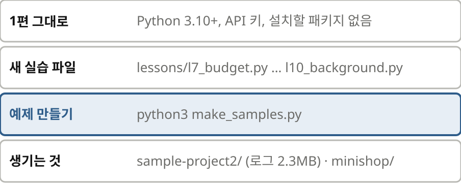
> 새 실습 파일 넷: l7_budget · l8_subagents · l9_reminders · l10_background
> 예제 둘: python3 make_samples.py
> 확인: sample-project2/logs/build.log 가 2.3MB 로 생기면 준비 끝

준비물은 1편 그대로입니다. 파이썬과 에이피아이 키만 있으면 되고 설치할 패키지는 없습니다. 오늘은 수업마다 실습 파일이 하나씩 늘어서 넷이 새로 생깁니다. 예제도 둘 씁니다. 메이크 샘플스라는 스크립트를 한 번 돌리면 큰 빌드 로그가 든 예제 프로젝트와, 작은 쇼핑몰 코드인 미니숍이 만들어집니다. 오늘 실습 전체를 하이쿠로 돌린 비용은 몇백 원 안쪽이었습니다. 여기까지 확인. 로그 파일이 이 점 삼 메가바이트로 생겼으면 준비가 끝났습니다.

## 3 | 수업 7 | 컨텍스트 예산
> 윈도우는 **예산**이지 가방이 아니다
> 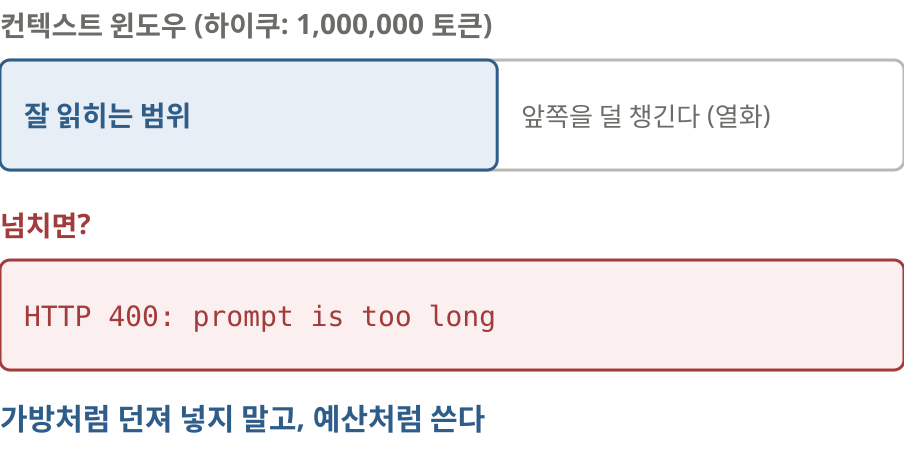
> 컨텍스트 윈도우: 한 번에 받을 수 있는 입력의 최대 길이(하이쿠는 100만 토큰)
> 꽉 차기 전부터 앞쪽 내용을 덜 챙긴다(컨텍스트 열화, context rot)
> 넘치면 호출 자체가 거절된다

먼저 말 하나를 정리하겠습니다. 컨텍스트 윈도우는 모델이 한 번에 받을 수 있는 입력의 최대 길이입니다. 오늘 쓰는 하이쿠는 백만 토큰입니다. 넉넉해 보이지만 함정이 있습니다. 우선 넘치면 호출 자체가 거절됩니다. 게다가 꽉 차기 전부터 모델이 앞쪽 내용을 덜 챙깁니다. 회의록이 백 쪽을 넘어가면 첫 쪽에서 정한 걸 다들 잊어버리는 것과 비슷합니다. 이걸 컨텍스트 열화라고 부릅니다. 그래서 저자는 윈도우를 아무거나 던져 넣는 가방이 아니라 아껴 써야 하는 예산으로 보라고 말합니다.

> 실행해 봅시다: 로그를 **통째로** 읽기
> 
> "logs/build.log를 read_file로 읽고 빌드가 왜 깨졌는지 알려 줘."
> read_file 한 번에 배열이 2,331,535 bytes
> HTTP 400: prompt is too long (1,267,285 > 1,000,000 tokens)
> 확인: 거대한 [array] 숫자 뒤에 400이 나오면 OK

일부러 나쁜 길로 가 보겠습니다. 이 점 삼 메가바이트짜리 빌드 로그를 리드 파일로 통째로 읽고 왜 깨졌는지 알려 달라고 했습니다. 모델은 시킨 대로 파일을 읽습니다. 그 순간 배열 크기를 보십시오. 이백삼십삼만 바이트입니다. ‖ 다음 호출은 바로 거절됩니다. 에이치티티피 사백, 프롬프트가 너무 길다. 백이십육만 토큰을 보냈는데 한도는 백만 토큰이라는 뜻입니다. 모델은 로그를 한 줄도 읽어 보지 못했습니다. 여기까지 확인. 여러분 화면에도 어레이 숫자가 한 번에 수백만으로 뛰고 사백이 나오면 맞게 오셨습니다.

> 무엇이 예산을 먹었나
> 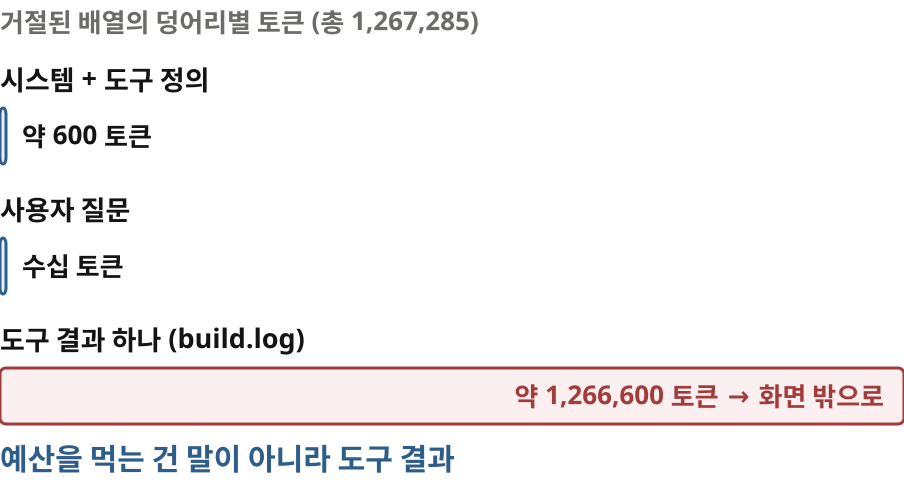
> 시스템 프롬프트 + 도구 정의: 약 600 토큰
> 사용자 질문: 몇십 토큰
> 도구 결과 하나: 약 126만 토큰

거절된 배열 안을 덩어리별로 나눠 보면 이렇습니다. 시스템 프롬프트와 도구 정의를 합쳐 육백 토큰쯤, 제 질문은 몇십 토큰입니다. 나머지 백이십육만 토큰은 전부 도구 결과 하나였습니다. 막대가 화면을 뚫고 나갈 정도입니다. 실제 에이전트도 대체로 이렇습니다. 대화는 예산을 얼마 쓰지 않습니다. 예산은 도구 결과가 먹습니다.

> **잘라 내고, 잘랐다고 말한다**
> 
> 도구 결과 하나의 상한: 20,000자
> 머리 10,000자 + 꼬리 10,000자, 가운데에 "잘랐다" 표시
> 전체는 .harness/ 파일에 저장하고 경로를 알려 준다
> read_file 에 offset·limit: 필요한 줄만 읽기

그럼 고쳐 보겠습니다. 트렁케이트라는 함수를 하나 만듭니다. 도구 결과 하나의 상한을 이만 자로 정하고 그보다 길면 머리 만 자와 꼬리 만 자만 남깁니다. 여기까지는 누구나 생각하는 방법입니다. 한 걸음 더 나가겠습니다. 가운데에 몇 자를 잘랐는지 적고, 잘리기 전 전체를 파일로 저장한 뒤 그 경로를 알려 줍니다. 통째로 읽지 말고 찾아서 읽으라는 말도 붙입니다. 리드 파일 도구에는 오프셋과 리밋 인자를 더해서 몇째 줄부터 몇 줄만 읽을 수 있게 합니다.

> 실행해 봅시다: **같은 질문**, 자르는 판
> 
> 배열 20,873 bytes: 잘린 결과가 들어왔다
> 모델이 "잘렸다"는 표시를 보고 저장 파일에서 grep
> 가운데 묻혀 있던 ModuleNotFoundError 를 찾았다
> 확인: [truncated …] 뒤에 grep·sed 로 다시 찾아 들어가면 OK

같은 질문을 자르는 판에 던져 보겠습니다. 이번에는 리드 파일 뒤 배열이 이만 바이트쯤입니다. 모델의 말을 보십시오. 로그가 약 이백삼십만 자라 잘렸다, 저장된 원본에서 에러 줄만 검색하겠다. ‖ 그리고 저장 파일에서 그렙으로 에러를 찾고 그 근처 줄만 읽어서, 가운데에 묻혀 있던 원인을 찾아냅니다. 페이저 유틸즈라는 모듈이 없어서 패키지 단계가 깨졌다는 겁니다. 이 줄은 일부러 로그 한가운데에 넣어 두었습니다. 머리와 꼬리만 봐서는 보이지 않는 자리입니다. 여기까지 확인. 화면에 트렁케이티드 표시가 보이고 모델이 그렙이나 범위 읽기로 다시 찾아 들어가면 성공입니다.

> 자주 막히는 곳: **말없이** 자르기
> 
> 같은 질문, 자르기만 하고 표시는 없는 판
> 모델: "로그만으로는 원인을 특정할 수 없습니다"
> "로그가 끊기거나 덮어쓰였을 가능성"

잘랐다고 말하는 게 왜 그렇게 중요할까요. 같은 코드에서 표시만 빼고 돌려 보았습니다. 머리와 꼬리는 똑같이 들어갑니다. 그런데 모델은 이 글이 잘린 줄 모릅니다. 그래서 로그만으로는 원인을 특정할 수 없다, 로그가 중간에 끊긴 것 같다고 결론을 냅니다. 잘린 걸 온전한 파일로 믿은 겁니다. 저자도 처음 만든 하니스에서 똑같이 표시 없이 잘랐다가 모델이 헤매는 걸 겪었다고 합니다. 자를 때는 반드시 잘랐다고 말해 주십시오.

> 더 알아 두기: **압축**과 **메모리 파일**
> 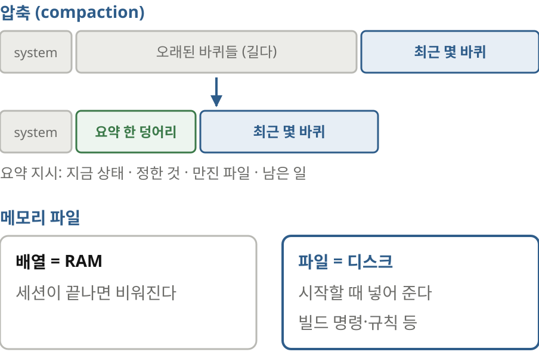
> 압축: 오래된 대화를 요약 한 덩어리로, 최근 몇 바퀴는 그대로
> 요약 지시가 품질을 정한다: 지금 상태, 정한 것, 만진 파일, 남은 일
> 메모리 파일: 세션을 넘어 남길 것은 디스크에(배열은 RAM, 파일은 디스크)

오늘 만들지는 않지만 알아 둘 게 더 있습니다. 먼저 압축입니다. 배열이 정해 둔 크기를 넘으면 오래된 대화를 모델에게 요약시켜 한 덩어리로 바꾸고 최근 몇 바퀴는 그대로 둡니다. 클로드 코드의 슬래시 컴팩트가 이겁니다. 1편 여섯째 수업에서 위를 고치면 캐시가 깨진다고 했죠. 압축도 캐시를 한 번 깹니다. 하지만 아주 가끔 한 번 크게 하는 거라 괜찮습니다. 메모리 파일도 있습니다. 세션이 바뀌어도 남겨야 할 것, 빌드 명령이나 규칙 같은 건 파일로 적어 두고 시작할 때 넣어 줍니다. 배열은 컴퓨터의 램처럼 비워지고 파일은 디스크처럼 남습니다.

> 체크포인트: 도구 결과가 **예산을 가장 많이** 먹는다
> 도구 결과는 상한을 두고 자른다
> 잘랐으면 잘랐다고, 전체가 어디 있는지 알려 준다
> 통째로 밀어 넣기보다 모델이 필요한 만큼 가져가게

일곱째 수업 정리입니다. 도구 결과가 예산을 가장 많이 먹습니다. 그러니 도구 결과에 상한을 두고 자르되, 잘랐다고 말하고 전체가 어디 있는지 알려 줍니다. 처음부터 모든 걸 밀어 넣기보다 모델이 필요한 만큼 찾아 읽게 두는 편이 낫습니다.

## 4 | 수업 8 | 서브에이전트
> 서브에이전트란 **빈 배열로 도는 같은 루프**
> 
> 부모가 일감을 문자열로 건넨다
> 자식은 빈 배열에서 1편의 루프를 돈다
> 마지막 답 한 덩어리만 도구 결과로 돌아오고, 자식 배열은 버린다

자르는 것만으로 안 되는 일이 있습니다. 코드베이스에서 무언가를 찾으려면 파일을 열 개, 스무 개 열어 봐야 하는데 정작 답은 한 문단입니다. 그런데 그 탐색 기록이 부모 배열에 끝까지 남습니다. 그래서 서브에이전트를 씁니다. 거창하게 들리지만 정의는 짧습니다. 부모가 일감 하나를 문자열로 건네면 자식은 빈 배열에서 1편의 루프를 똑같이 돕니다. 일이 끝나면 마지막 답만 도구 결과로 부모에게 돌아오고 자식의 배열은 버려집니다. 팀이나 조직도처럼 설명하는 글이 많습니다. 하지만 서브에이전트는 오직 부모의 배열을 깨끗하게 지키려고 쓰는 겁니다.

> **agent** 도구 같이 쓰기
> 
> 도구 설명: "자식은 이 대화를 전혀 모른다, 배경을 다 적어라"
> run_subagent: 새 배열 + 같은 루프 + 마지막 글만 반환
> 자식에게는 agent 도구를 주지 않는다(손자는 없다)

코드는 놀랄 만큼 짧습니다. 먼저 에이전트라는 도구를 하나 정의합니다. 설명에 이렇게 적습니다. 자식은 이 대화를 전혀 모르니 배경을 다 적어라, 근거로 파일과 줄을 받아 와라. 실행은 런 서브에이전트 함수 하나가 맡습니다. 일감 하나만 든 새 배열을 만듭니다. 1편에서 만든 루프를 그대로 돌리고 마지막 글만 돌려줍니다. 디스패치 표에도 한 줄을 더합니다. 에이전트라는 이름이 오면 이 함수를 부르라는 줄입니다. 자식에게는 에이전트 도구를 주지 않습니다. 손자까지 생기면 비용이 걷잡을 수 없기 때문입니다.

> 실행해 봅시다: 서브에이전트 **없이**
> 
> "minishop에서 바깥으로 나가는 HTTP 호출을 모두 찾아서, 호출마다 시간 제한과 시도 횟수를 표로 정리해 줘."
> 부모가 직접 grep 하고 파일을 읽는다
> 부모 배열 57,052 bytes, 입력 토큰 36,558
> 확인: 마지막 [array] parent 숫자를 적어 두면 OK

미니숍 예제로 비교해 보겠습니다. 바깥으로 나가는 에이치티티피 호출을 모두 찾아서 시간 제한과 시도 횟수를 표로 정리해 달라고 했습니다. 먼저 에이전트 도구를 뺀 판으로 돌립니다. 모델이 직접 그렙으로 후보를 찾고 파일들을 열어 읽습니다. 출력이 길어 한 번 잘리기도 합니다. 답은 잘 나왔습니다. 끝났을 때 부모 배열은 오만 칠천 바이트, 입력 토큰은 삼만 육천 남짓입니다. 여기까지 확인. 마지막 줄의 부모 배열 숫자를 적어 두십시오. 다음 판과 비교합니다.

> 실행해 봅시다: 서브에이전트에게 **맡기기**
> 
> 같은 질문 + "조사는 agent 도구로 서브에이전트에게 맡겨 줘."
> 회색 [sub] 줄 8개: 자식이 따로 탐색
> 자식 배열 140,121 bytes → 버림
> 부모 배열 38,515 bytes
> 확인: [sub] done 뒤 부모 숫자가 더 작으면 OK

이번엔 같은 질문에 서브에이전트에게 맡기라는 말을 한 줄 덧붙였습니다. 부모가 에이전트 도구를 한 번 부르자 들여 쓴 섭 줄들이 지나갑니다. 자식이 따로 그렙하고 파일을 읽는 겁니다. 자식이 끝날 때 배열은 십사만 바이트였고 그대로 버려집니다. ‖ 부모 배열은 삼만 팔천 바이트로 끝났습니다. 다만 부모가 보고를 받고도 핵심 파일을 몇 개 다시 읽었습니다. 그래서 기대만큼 줄지는 않았습니다. 이 버릇은 잠시 뒤에 다시 보겠습니다. 여기까지 확인. 섭 던 줄 뒤에 부모 배열 숫자가 앞 판보다 작으면 성공입니다.

> 무엇을 **아끼고** 무엇을 **쓰나**
> 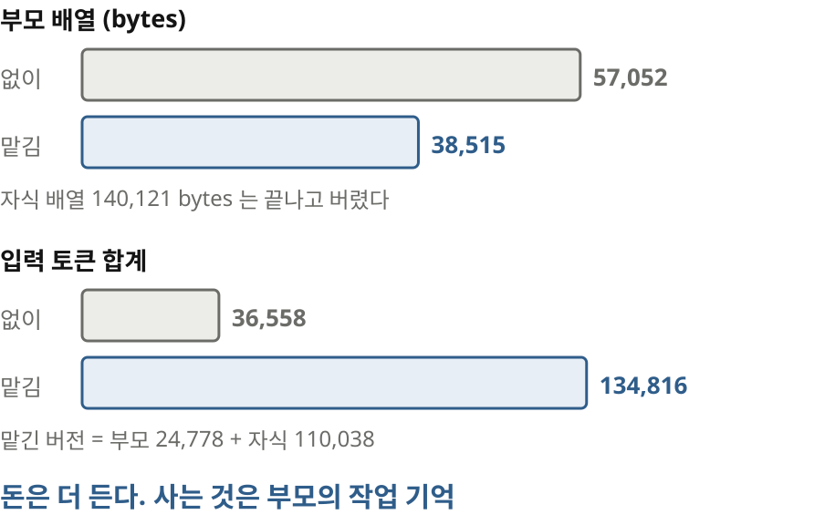
> 부모 배열: 57,052 → 38,515 bytes
> 입력 토큰 합계: 36,558 → 134,816 (자식 110,038)
> 돈은 더 든다. 아끼는 건 부모의 작업 기억

숫자를 나란히 놓겠습니다. 부모 배열은 오만 칠천에서 삼만 팔천 바이트로 줄었습니다. 그런데 입력 토큰 합계는 삼만 육천에서 십삼만 오천으로 오히려 늘었습니다. 그중 십일만을 자식이 썼습니다. ‖ 서브에이전트는 돈을 아끼는 장치가 아닙니다. 돈을 더 쓰고 부모의 작업 기억을 사는 장치입니다. 긴 작업에서 부모 배열은 가장 귀한 자리입니다. 계획과 결정이 거기에 담겨 있기 때문입니다. 그래서 이 거래가 남는 장사가 됩니다.

> 자주 막히는 곳: 자식은 **아무것도 모른다**
> 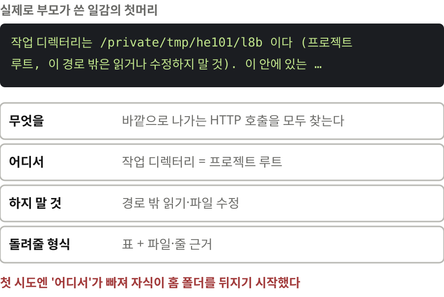
> 첫 시도: 부모가 프로젝트 위치를 안 적었다 → 자식이 컴퓨터 전체를 뒤지기 시작
> 좋은 일감 넷: 무엇을, 어디서, 하지 말 것, 돌려줄 형식
> 탐색만 맡길 자식에게는 쓰기 도구를 주지 않는다

여기서 제가 실제로 겪은 일을 말씀드리겠습니다. 처음 녹화할 때 부모가 쓴 일감에 미니숍이 어디 있는지가 빠져 있었습니다. 자식은 이 대화를 모르니 미니숍을 찾겠다고 컴퓨터의 홈 폴더 전체를 뒤지기 시작했습니다. 저는 바로 멈췄습니다. 자식은 정말로 아무것도 모릅니다. 그래서 일감은 외주 업체에 주는 티켓처럼 써야 합니다. 무엇을 할지, 어디서 할지, 무엇은 하지 말지, 결과를 어떤 모양으로 돌려줄지. 저자도 탐색만 맡긴 자식이 파일을 고쳐 버린 일을 겪고 나서, 탐색용 자식에게는 쓰기 도구를 아예 빼고 건드리지 말 것을 적는다고 합니다. 제 하니스도 지금은 작업 폴더를 자식에게 알려 줍니다. 폴더 밖을 뒤지는 명령은 막습니다.

> 맡길 일, 맡기지 말 일
> 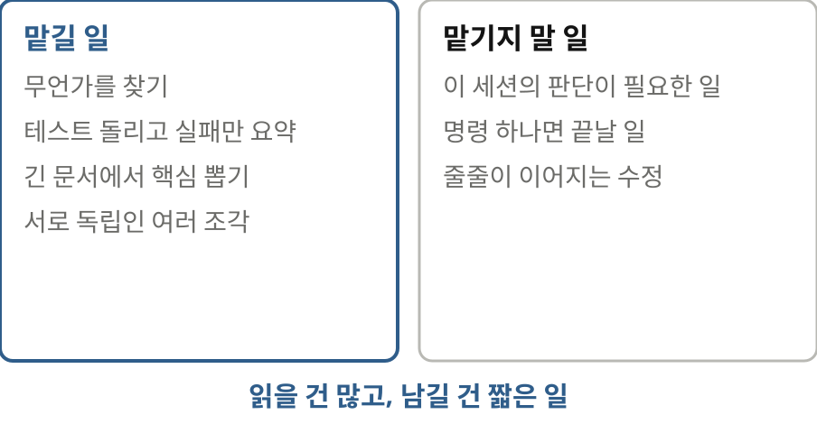
> 체크포인트: 부모 배열은 **깨끗하게** 남는다

언제 맡기면 좋을까요. 읽을 건 많은데 남길 건 짧은 일입니다. 무언가를 찾는 일, 테스트를 돌리고 실패만 요약하는 일, 긴 문서를 읽고 핵심만 뽑는 일이 그렇습니다. 서로 독립인 여러 조각을 나눠 하는 일도 잘 맞습니다. 반대로 맡기지 않는 게 나은 일도 있습니다. 이 세션에서 쌓은 판단이 필요한 일, 명령 하나면 끝날 일, 그리고 앞 단계 결과에 줄줄이 기대는 수정입니다. 여덟째 수업 정리입니다. 서브에이전트를 쓰면 부모 배열은 깨끗하게 남습니다. 대신 일감은 자식이 아무것도 모른다는 전제로 씁니다.

## 5 | 수업 9 | 리마인더와 할 일 목록
> 일하는 도중에 **모델에게 말 걸기**
> 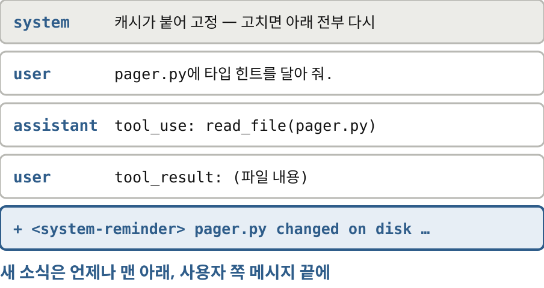
> 모델은 배열에 있는 것만 안다
> 몸이 다음 사용자 쪽 메시지 맨 끝에 <system-reminder> 를 붙인다
> 맨 아래인 이유: 캐시(위를 고치면 아래 전부 다시), 최근 글에 주의가 잘 간다, 사건은 바퀴 사이에 생긴다

이제 모델이 바뀐 세상을 놓치는 문제입니다. 모델은 배열에 있는 것만 압니다. 에이전트가 일하는 도중에 사람이 파일을 고치면? 한참 전에 사람이 커밋하기 전에 물어보라고 했던 말은? 열두 단계 중 일곱째에서 길을 잃으면? 몸이 무언가를 알려 줘야 합니다. 방법은 단순합니다. 다음에 보낼 사용자 쪽 메시지 맨 끝에 글을 하나 붙입니다. 시스템 리마인더라는 꼬리표를 단 글입니다. 시스템 프롬프트를 고치지 않고 왜 굳이 맨 아래에 붙일까요. 1편에서 봤듯 위를 고치면 캐시가 깨집니다. 모델은 최근 글에 더 주의를 기울입니다. 그리고 알릴 일은 언제나 바퀴와 바퀴 사이에 생깁니다.

> **큐 하나**로 알린다
> 
> REMINDERS = [] · remind() 로 넣고 · drain 으로 다음 메시지에 붙인다
> 파일 감시: 모델이 읽은 파일의 수정 시각을 적어 두고 비교
> 모델 자신이 바꾼 것은 알리지 않는다

코드를 같이 쓰겠습니다. 리마인더스라는 빈 리스트가 큐입니다. 하니스의 어느 부분이든 알릴 게 생기면 리마인드 함수로 여기에 넣습니다. 그리고 바퀴가 끝나 도구 결과를 붙일 때 드레인 함수가 큐를 비우면서 그 뒤에 붙입니다. 여기저기서 배열에 글을 바로 끼워 넣지 않습니다. 꼭 큐 하나를 거치게 합니다. 그래야 나중에 모델이 무엇을 언제 봤는지 설명할 수 있습니다. 파일 감시도 하나 넣었습니다. 모델이 파일을 읽을 때 그 파일의 수정 시각을 적어 둡니다. 바퀴마다 비교해서 달라졌으면 다시 읽으라고 알립니다. 모델 자신이 고친 것은 알리지 않습니다.

> 실행해 봅시다: 알림 **없이**
> 
> "pager.py의 함수에 타입 힌트를 달아 줘."
> 모델이 읽은 직후 사람이 page_range() 를 더한다(실습 연출)
> 모델은 예전 내용에 힌트를 달아 통째로 덮어쓴다
> 마지막 grep: 함수 둘. 사람이 더한 함수가 사라졌다

실험을 하나 꾸몄습니다. 페이저 점 파이의 함수에 타입 힌트를 달아 달라고 했습니다. 모델이 파일을 읽은 직후에 사람이 페이지 레인지라는 함수를 하나 더했다고 칩시다. 화면의 휴먼 줄이 그 순간입니다. 먼저 알림이 꺼진 판입니다. 모델은 자기가 읽었던 예전 내용에 힌트를 달아서 파일을 통째로 다시 씁니다. 마지막에 함수 목록을 찍어 보면 둘뿐입니다. ‖ 사람이 방금 더한 함수가 흔적도 없이 사라졌습니다. 모델은 잘못한 줄도 모릅니다. 실제 작업에서 이런 일이 생기면 꽤 오래 모르고 지나갑니다.

> 실행해 봅시다: 알림 **있게**
> 
> 같은 일, 같은 끼어들기
> [reminder] pager.py changed on disk → 모델이 다시 읽는다
> 마지막 grep: 함수 셋. page_range() 에도 힌트가 달렸다
> 확인: 두 판의 마지막 grep 줄 수가 다르면 OK

같은 일을 알림을 켜고 돌립니다. 이번에도 모델이 읽은 직후 사람이 함수를 더합니다. 그러자 리마인더 줄이 찍힙니다. 페이저 점 파이가 디스크에서 바뀌었다. 모델은 그 알림을 보고 파일을 다시 읽은 뒤에 고칩니다. 마지막 함수 목록에는 셋이 있습니다. 사람이 더한 페이지 레인지에도 타입 힌트가 달렸습니다. 여기까지 확인. 두 판의 마지막 그렙 결과가 둘과 셋으로 다르면 성공입니다.

> 배열 끝을 **열어 보기**
> 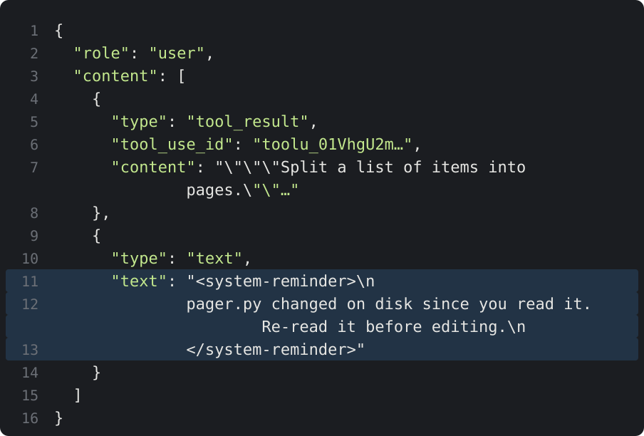
> 사용자 쪽 메시지 = tool_result + 텍스트 블록 하나
> API 는 이 꼬리표를 모른다: 그냥 글자다
> 시스템 프롬프트에 "이 꼬리표는 하니스가 붙인다"고 한 줄 적어 둔다

실제 세션 파일을 열어 보겠습니다. 1편 둘째 수업에서 세션 파일을 열었던 것처럼요. 리드 파일의 결과 바로 뒤에 텍스트 블록이 하나 붙어 있습니다. 그 안에 시스템 리마인더 꼬리표로 감싼 문장이 있습니다. 에이피아이는 이 꼬리표를 따로 알지 못합니다. 그냥 글자입니다. 그래서 시스템 프롬프트에 이 꼬리표 안의 글은 사용자가 아니라 하니스가 붙인 것이라고 한 줄 적어 둡니다.

> 할 일 목록: **스스로** 다는 알림
> 
> todo_write 도구: 모델이 목록을 쓰면 몸이 다음 메시지 맨 아래로 다시 붙인다
> [~] 하는 중 · [x] 끝
> 확인: [todo] 목록이 바퀴마다 갱신되면 OK

알림 중에는 모델이 자기에게 보내는 것도 있습니다. 할 일 목록입니다. 투두 라이트라는 도구를 주고 오타 고치기, 버그 고치기, 테스트 돌리기를 시켰습니다. 모델이 목록을 쓰면 몸은 그 목록을 다음 메시지 맨 아래에 다시 붙여 줍니다. 화면에서 체크 상자가 하나씩 채워집니다. 왜 이게 필요할까요. 오만 토큰 전에 세운 계획은 다른 글과 똑같이 흐려집니다. 목록을 모델 밖에 두고 매번 맨 아래로 다시 넣어 주면 계획이 늘 눈앞에 있습니다. 모델 앞에 화이트보드를 세워 두는 겁니다. 클로드 코드의 체크 목록이 바로 이 장치입니다. 여기까지 확인. 투두 목록이 바퀴마다 갱신되면 성공입니다.

> 자주 막히는 곳: **너무 자주** 알리기
> 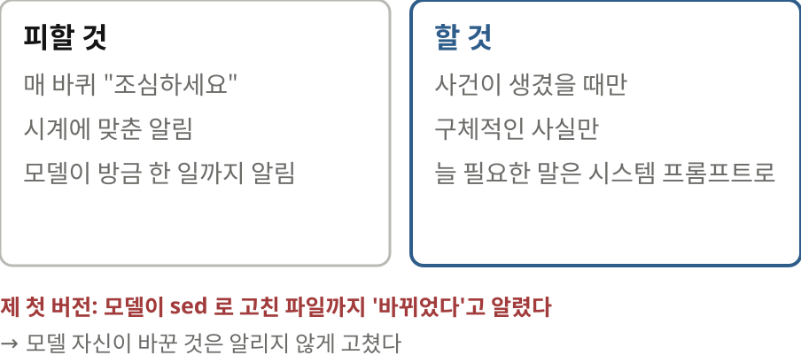
> 알림이 많으면 배경 소음이 된다
> 시계가 아니라 사건으로 알린다
> 늘 필요한 말이면 시스템 프롬프트나 도구 설명으로
> 체크포인트: 몸의 사건이 **배열의 문장**이 된다

알림은 쓰기 쉬워서 남발하기도 쉽습니다. 매 바퀴 조심하라고 붙이면 모델은 그걸 배경 소음으로 듣기 시작합니다. 규칙은 둘입니다. 시계에 맞춰 알리지 말고 사건이 생겼을 때만 알린다. 늘 해야 하는 말이면 알림에서 빼서 시스템 프롬프트나 도구 설명으로 옮긴다. 제 첫 버전도 실수를 했습니다. 모델이 셸 명령으로 파일을 고쳤는데 그것까지 바뀌었다고 알렸습니다. 그래서 모델이 자기가 방금 고친 파일을 계속 다시 읽었습니다. 저자도 같은 헛걸음을 겪었다고 합니다. 읽고 나서 고치라는 규칙을 방금 만든 파일에까지 걸었던 탓입니다. 아홉째 수업 정리입니다. 몸에서 생긴 사건이 배열 맨 아래의 문장이 됩니다. 알림은 드물게 보냅니다. 그리고 구체적인 사실만 담습니다.

## 6 | 수업 10 | 백그라운드 작업
> 느린 명령 앞에서 **루프가 멈춘다**
> 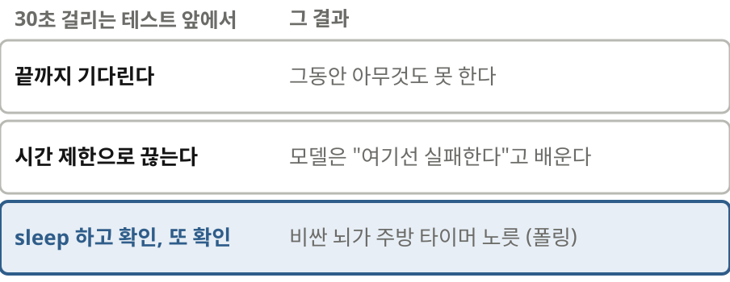
> 끝까지 기다린다: 그동안 아무것도 못 한다
> 시간 제한으로 끊는다: 모델은 "여기선 실패한다"고 배운다
> sleep 하고 확인, 또 확인: 비싼 뇌가 주방 타이머 노릇(폴링)

마지막 수업입니다. 지금까지 만든 루프는 도구를 부르면 결과가 올 때까지 기다립니다. 삼십 초 걸리는 테스트를 만나면 어떻게 될까요. 끝까지 기다리면 그동안 아무 일도 못 합니다. 시간 제한으로 끊으면 모델은 여기서는 테스트가 실패한다고 잘못 배웁니다. 제일 흔하게는 모델이 슬립 오 초 하고 확인하고 또 기다렸다 확인합니다. 이걸 폴링이라고 합니다. 주방 타이머 노릇을 비싼 뇌가 하고 있습니다.

> 작업 표 같이 쓰기
> 
> run_command 에 background 플래그 → 띄우고 바로 "b1 시작"을 돌려준다
> 출력을 모으는 스레드가 끝나면 remind() → 수업 9의 큐
> task_output 도구로 엿보기 · 앞자리 sleep 은 막는다
> 쉬는 동안에도 큐에 알림이 오면 몸이 먼저 모델을 부른다

일을 뒤로 돌리면 됩니다. 런 커맨드 도구에 백그라운드 플래그를 하나 더합니다. 이 플래그가 켜져 있으면 명령을 띄워 놓고 바로 비 원 작업이 시작됐다는 답을 돌려줍니다. 뒤에서는 스레드 하나가 출력을 모으다가 명령이 끝나면 리마인드를 부릅니다. 아홉째 수업의 큐를 그대로 씁니다. 모델이 중간에 들여다볼 수 있게 태스크 아웃풋 도구도 주고 앞자리에서 슬립으로 기다리는 명령은 막습니다. 마지막으로 입력을 기다리는 자리를 고칩니다. 사람이 아무것도 치지 않는 동안에도 큐에 알림이 오면 몸이 먼저 모델을 부릅니다.

> 실행해 봅시다: 테스트는 **뒤로**, 그동안 **다른 일**
> 
> "느린 테스트는 백그라운드로, 그동안 README 오타를 고쳐 줘."
> b1: python 없음(exit 127) → 알림 → python3 로 b2
> 9초: "끝나면 알려 드리겠습니다" → you>
> 36초: 아무도 안 쳤는데 [harness] 가 모델을 깨운다
> 확인: 사람 입력 없이 assistant 가 다시 말하면 OK

돌려 보겠습니다. 느린 테스트를 백그라운드로 돌려 놓고 기다리는 동안 리드미 오타를 고쳐 달라고 했습니다. 첫 작업은 파이썬이라는 명령이 없어서 곧바로 실패합니다. 종료 코드 백이십칠. 이 소식도 알림으로 들어오고 모델은 파이썬 쓰리로 바꿔 다시 띄웁니다. 그사이 리드미 오타를 고치고 구 초쯤에 테스트가 끝나면 알려 드리겠다며 차례를 끝냅니다. 화면이 유 프롬프트로 돌아왔습니다. ‖ 저는 아무것도 치지 않았습니다. 삼십육 초에 테스트가 끝나자 하니스가 알림이 왔다며 스스로 모델을 깨웁니다. 모델은 출력을 읽고 테스트가 실패했다고 보고합니다. 항목 천한 개를 페이지로 나눴더니 천 개만 남았다고 합니다. 1편에서 본 바로 그 페이지 수 버그입니다. 여기까지 확인. 사람이 아무것도 치지 않았는데 어시스턴트가 다시 말하면 성공입니다.

> 자주 막히는 곳: **sleep** 으로 기다리기
> 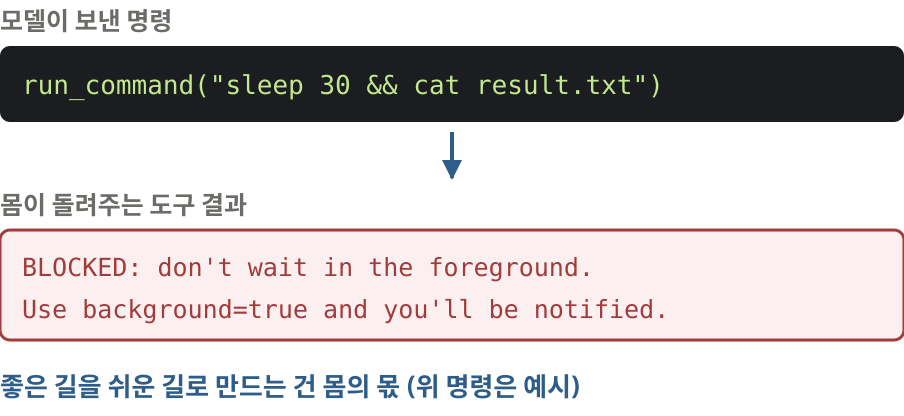
> 모델은 학습 자료처럼 sleep 하고 확인하려 든다
> 몸이 막고 길을 알려 준다: "백그라운드로 돌리면 알려 준다"
> 좋은 길을 쉬운 길로 만드는 건 몸의 몫

이번 녹화에서는 모델이 슬립을 쓰지 않았지만 실제로는 자주 씁니다. 사람들이 쓴 스크립트에 슬립하고 확인하는 코드가 많으니 모델도 그렇게 배웠습니다. 그래서 몸이 막습니다. 슬립으로 시작하는 명령이 오면 실행하지 않습니다. 대신 앞자리에서 기다리지 말고 백그라운드로 돌리라고 알려 줍니다. 그러면 끝났을 때 알림이 온다는 말도 함께 돌려줍니다. 몸은 모델에게 좋은 길을 설명하기보다 그 길을 쉬운 길로 만들어 둬야 합니다.

> **사건**이 차례를 연다
> 
> 키보드 · 작업 완료 · 파일 변경 · 타이머 → 모두 같은 입구
> 감시(조건이 맞으면) · 예약(시각이 되면) · 스스로 알람(모델이 "10분 뒤 깨워 줘")
> 깨울 때마다 돈이 든다 · 알림은 사실이어야 한다 · 사람이 다 보고 멈출 수 있어야 한다
> 체크포인트: 기다리는 일은 **몸**이 한다

방금 본 장면을 넓혀 보겠습니다. 지금까지 차례는 사람이 엔터를 칠 때만 열렸습니다. 이제는 작업이 끝났을 때도 열립니다. 같은 입구로 파일이 바뀌었을 때, 정해 둔 시각이 됐을 때도 열 수 있습니다. 모델이 십 분 뒤에 깨워 달라고 스스로 알람을 맞출 수도 있습니다. 장치는 모두 같습니다. 배열 맨 아래에 알림을 붙이고 모델을 부릅니다. 대신 지킬 게 있습니다. 깨울 때마다 돈이 듭니다. 알림은 사실이어야 합니다. 그리고 지금 무엇이 돌고 있는지 사람이 보고 멈출 수 있어야 합니다. 열째 수업 정리입니다. 기다리는 일은 뇌가 아니라 몸이 합니다.

## 7 | 마무리 | 2편 정리
> 고친 네 군데, **새것은 없었다**
> 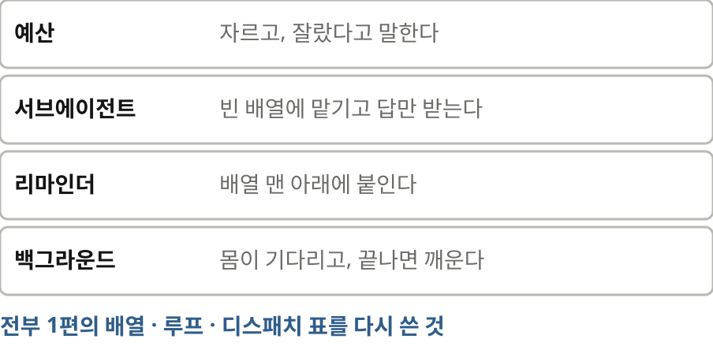
> 예산: 자르고, 잘랐다고 말한다
> 서브에이전트: 빈 배열에 맡기고 답만 받는다
> 리마인더: 맨 아래에 붙인다
> 백그라운드: 몸이 기다리고 깨운다
> 숙제: 압축 만들기. 3편: 모델이 본 것 보기 · 안전장치 · 뇌 갈아 끼우기

오늘 고친 네 군데를 정리하겠습니다. 도구 결과는 자르고 잘랐다고 말한다. 탐색은 빈 배열에 맡기고 답만 받는다. 알릴 일은 배열 맨 아래에 붙인다. 기다리는 일은 몸이 하고 끝나면 모델을 깨운다. 그런데 돌아보면 새로운 개념은 하나도 없었습니다. 전부 1편의 배열과 루프와 디스패치 표를 다시 쓴 겁니다. ‖ 숙제를 하나 드리겠습니다. 압축을 직접 만들어 보십시오. 배열이 정해 둔 크기를 넘으면 오래된 바퀴를 모델에게 요약시켜 한 덩어리로 바꿉니다. 최근 네 바퀴는 그대로 둡니다. 요약을 시킬 때는 지금 상태, 정한 것, 만진 파일, 남은 일을 꼭 넣으라고 적으십시오. 다음 3편에서는 모델이 실제로 무엇을 봤는지 꺼내 봅니다. 그리고 안전장치를 달고 뇌를 로컬 모델로 갈아 끼워 봅니다. 코드와 실습 기록은 설명란의 저장소에 있습니다. 고맙습니다.
