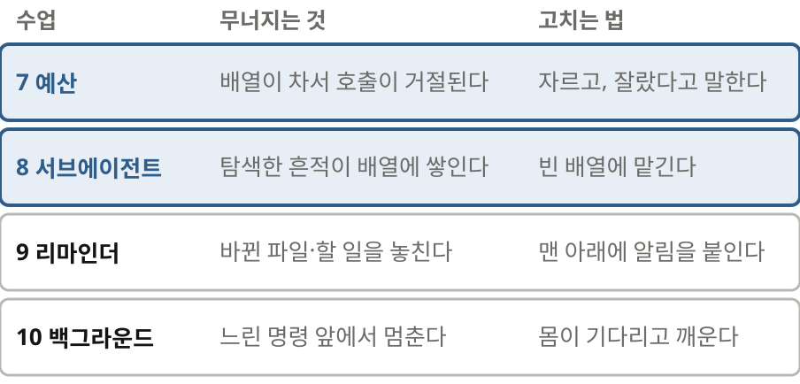
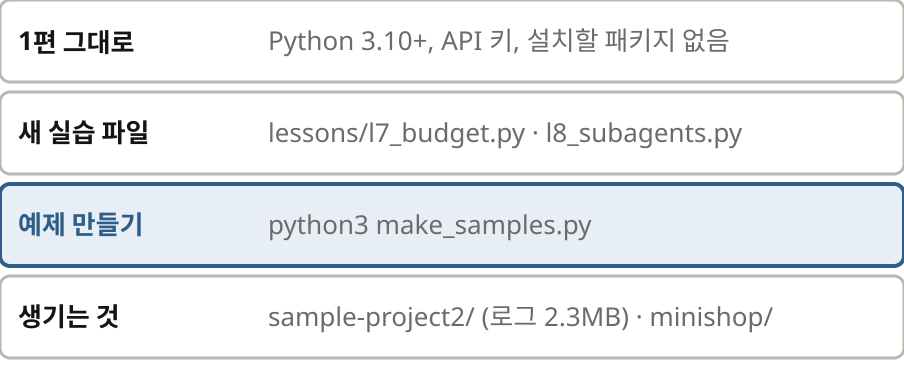
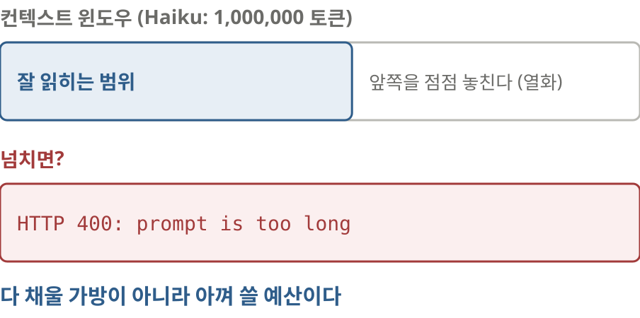
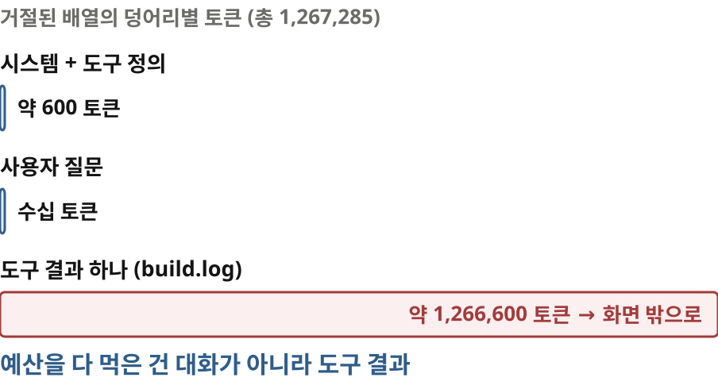
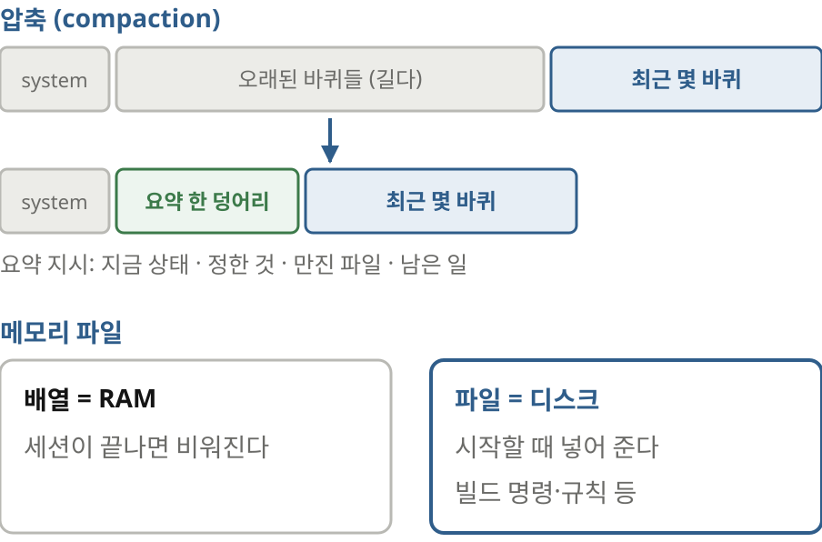
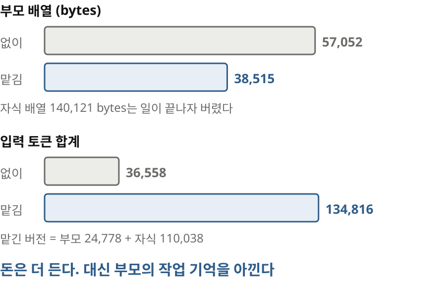
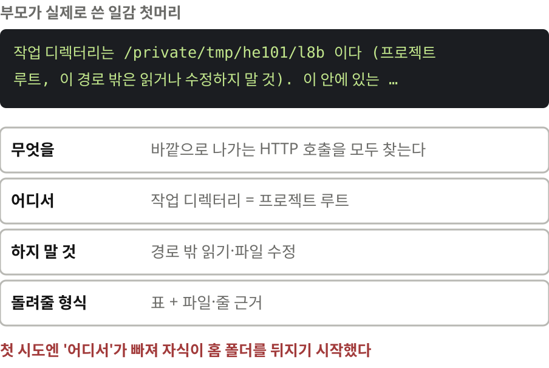
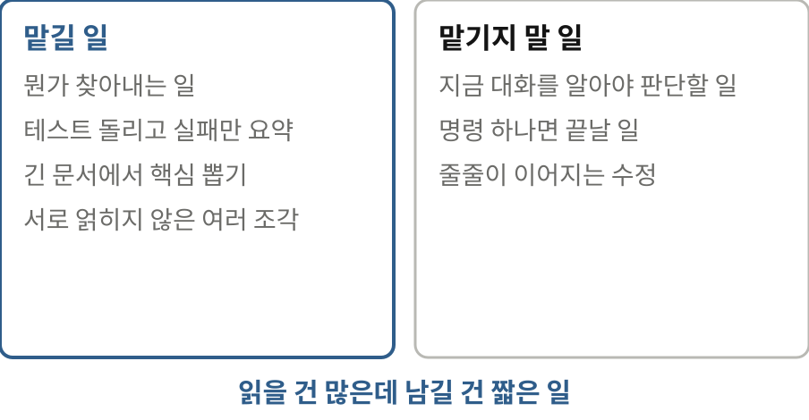

# 하니스 엔지니어링 101 핸즈온 — 2편 오래 달리는 에이전트 ① 예산과 서브에이전트 (대본)

Isuru Wijesiri의 *Harness Engineering 101*(6-7장)을 따라 장난감 하니스를 실제로 돌려 보는 강의 2편 대본. 가로판(`build.py --wide --script=script-2.md`).
원래 수업 7-10을 한 편(26분)으로 만들었다가 길어서 둘로 나눴다(2026-11-09): 2편 = 수업 7-8, 3편([script-3.md](script-3.md)) = 수업 9-10. 수업 본문은 그대로이고 들어가며·준비물·마무리만 새로 썼다.
원문 번역이 아니라 [시나리오](scenario-2.md)와 `lab/` 실습 기록(`lab/runs/l7-*`, `l8-*`, 2026-10-24 claude-haiku-5-5 실제 호출)을 바탕으로 새로 쓴 것이다. 저자 경험담은 우리 말로 한두 문장만 요약했다.
말투는 1편과 같은 친절한 핸즈온 강사(합쇼체). 실행 화면마다 끝에 시청자가 자기 화면을 확인하는 문장을 둔다(명사로 끝나는 "여기까지 확인."은 쓰지 않는다). 모델 답이 다 뜬 뒤에 설명이 들리도록 터미널 클립은 기준 줄을 1.5초 먼저 찍는다.
TTS가 잘못 읽지 않도록 나레이션 속 영어 이름과 숫자는 한글로 적었다(화면 글은 원래 표기).

출처: Isuru Wijesiri, Harness Engineering 101, 2026년 10월 (코드 MIT)
잉크: #2F5D8A
부제: 2편 · 예산과 서브에이전트 — 300줄 코딩 에이전트 직접 만들기
약어: 토큰=token, 모델이 글을 세는 단위; 컨텍스트 윈도우=context window, 모델이 한 번에 받을 수 있는 입력의 최대 길이; 서브에이전트=subagent, 빈 배열에서 따로 도는 같은 루프; 리마인더=system reminder, 하니스가 배열 맨 아래에 붙이는 알림; 큐=queue, 먼저 넣은 것이 먼저 나오는 대기열; 압축=compaction, 오래된 대화를 요약 한 덩어리로 바꾸기; 폴링=polling, 끝났는지 계속 들여다보며 기다리기; 스레드=thread, 한 프로그램 안에서 따로 도는 실행 흐름; 백그라운드=background, 기다리지 않고 뒤에서 돌리기; grep=파일에서 글자를 찾는 명령

## 1 | 들어가며 | 표지
> 오래 달리면 / **무엇이** 무너지나
> 2편 · 오래 달리는 에이전트 ① 예산과 서브에이전트 — Harness Engineering 101 따라 하기

안녕하세요. 하니스 엔지니어링 백일 핸즈온 두 번째 시간입니다. 지난 편에서는 코딩 에이전트의 뼈대를 만들었습니다. 잠깐 다시 떠올려 볼까요. 대화를 담는 배열이 하나, 모델을 부르고 도구를 돌리는 와일 루프가 하나, 도구 이름을 보고 함수를 고르는 디스패치 표가 하나 있었습니다. 이것만으로 실패한 테스트 하나를 고쳤습니다. ‖ 오늘은 이 에이전트에게 더 크고 더 오래 걸리는 일을 맡겨 보겠습니다. 어디가 먼저 무너지는지 직접 보면서 한 군데씩 고쳐 나가겠습니다.

> 루프가 돌수록 **배열이 무거워진다**
> 
> 바퀴마다 모델의 답과 도구 결과가 쌓인다
> 가장 큰 덩어리는 도구 결과
> 배열은 매 바퀴 통째로 다시 간다(1편)

그림을 보시죠. 루프가 한 바퀴 돌 때마다 배열에는 모델의 답과 도구 결과가 붙습니다. 그런데 둘은 크기가 다릅니다. 모델이 한 말은 몇 줄인데 도구 결과는 파일 하나, 명령 출력 하나가 통째로 들어옵니다. 1편에서 봤듯이 이 배열은 바퀴마다 통째로 다시 보냅니다. 오래 달릴수록 무거운 짐을 계속 지고 달리는 셈입니다.

> 오늘 고칠 **두 군데**
> 
> 수업 틀은 1편과 같다: 같이 쓰기, 실행, 방금 일어난 일, 자주 막히는 곳, 체크포인트

오래 달리는 에이전트가 무너지는 곳은 네 군데입니다. 오늘은 표에 칠한 두 군데를 고칩니다. 일곱 번째 수업에서는 배열이 차서 호출이 거절되는 문제를 고칩니다. 여덟 번째에서는 한 번 쓰고 말 탐색이 배열에 계속 남는 문제를 다룹니다. 나머지 두 군데는 다음 3편에서 이어 가겠습니다. 수업마다 같이 쓰고 돌려 본 다음 무슨 일이 있었는지 짚어 보겠습니다. 1편과 같은 순서입니다.

## 2 | 준비물 | 수업 0
> 준비물은 **1편 그대로**
> 
> 새 실습 파일 둘: l7_budget · l8_subagents
> 예제 둘: python3 make_samples.py
> 확인: sample-project2/logs/build.log 가 2.3MB 로 생기면 준비 끝

준비물은 1편 그대로입니다. 파이썬과 에이피아이 키만 있으면 되고 설치할 패키지는 없습니다. 실습 파일은 수업마다 하나씩 늘어나니까 오늘 새로 생기는 건 둘입니다. 예제도 둘 씁니다. 메이크 샘플스라는 스크립트를 한 번 돌리면 둘 다 만들어집니다. 하나는 큰 빌드 로그가 든 예제 프로젝트, 또 하나는 작은 쇼핑몰 코드인 미니숍입니다. 오늘 실습 전체를 하이쿠로 돌렸더니 비용은 몇백 원 안쪽이었습니다. 로그 파일이 이 점 삼 메가바이트로 생겼는지 한번 확인해 보세요. 그렇다면 준비는 끝났습니다.

## 3 | 수업 7 | 컨텍스트 예산
> 윈도우는 **예산**이지 가방이 아니다
> 
> 컨텍스트 윈도우: 한 번에 받을 수 있는 입력의 최대 길이(하이쿠는 100만 토큰)
> 꽉 차기 전부터 앞쪽 내용을 덜 챙긴다(컨텍스트 열화, context rot)
> 넘치면 호출 자체가 거절된다

먼저 용어 하나부터 짚고 가겠습니다. 컨텍스트 윈도우는 모델이 한 번에 받을 수 있는 입력의 최대 길이입니다. 오늘 쓰는 하이쿠는 백만 토큰까지 받습니다. 넉넉해 보이지만 함정이 있습니다. 우선 넘치면 호출 자체가 거절됩니다. 게다가 꽉 차기 전부터 모델이 앞쪽 내용을 덜 챙깁니다. 회의록이 백 쪽을 넘어가면 첫 쪽에서 정한 걸 다들 잊어버리는 것과 비슷하죠. 이런 현상을 컨텍스트 열화라고 합니다. 그래서 저자는 윈도우를 아무거나 던져 넣는 가방으로 보지 말고 아껴 써야 하는 예산으로 보라고 합니다.

> 실행해 봅시다: 로그를 **통째로** 읽기
> 
> "logs/build.log를 read_file로 읽고 빌드가 왜 깨졌는지 알려 줘."
> read_file 한 번에 배열이 2,331,535 bytes
> HTTP 400: prompt is too long (1,267,285 > 1,000,000 tokens)
> 확인: 거대한 [array] 숫자 뒤에 400이 나오면 OK

일부러 잘못된 방법부터 해 보겠습니다. 이 점 삼 메가바이트짜리 빌드 로그를 리드 파일로 통째로 읽어서 왜 깨졌는지 알려 달라고 했습니다. 모델은 시킨 대로 파일을 읽습니다. 그 순간 배열 크기를 보시면 이백삼십삼만 바이트입니다. ‖ 다음 호출은 에이치티티피 사백 에러로 바로 거절됩니다. 프롬프트가 너무 길다고 하네요. 보낸 양은 백이십육만 토큰인데 한도는 백만 토큰입니다. 모델은 로그를 한 줄도 읽어 보지 못했습니다. 여러분 화면도 한번 볼까요? 어레이 숫자가 한 번에 수백만으로 뛰고 사백이 뜨면 제대로 따라오셨습니다.

> 무엇이 예산을 먹었나
> 
> 시스템 프롬프트 + 도구 정의: 약 600 토큰
> 사용자 질문: 몇십 토큰
> 도구 결과 하나: 약 126만 토큰

거절된 배열을 덩어리별로 나눠 보겠습니다. 시스템 프롬프트와 도구 정의를 합쳐 육백 토큰쯤, 제 질문은 몇십 토큰입니다. 나머지 백이십육만 토큰은 전부 도구 결과 하나에서 나왔습니다. 막대로 그리면 화면을 뚫고 나갈 만큼 깁니다. 실제 에이전트도 대개 비슷합니다. 대화에 드는 예산은 얼마 안 됩니다. 예산은 거의 다 도구 결과에 들어갑니다.

> **잘라 내고, 잘랐다고 말한다**
> 
> 도구 결과 하나의 상한: 20,000자
> 머리 10,000자 + 꼬리 10,000자, 가운데에 "잘랐다" 표시
> 전체는 .harness/ 파일에 저장하고 경로를 알려 준다
> read_file 에 offset·limit: 필요한 줄만 읽기

그럼 고쳐 보겠습니다. 트렁케이트라는 함수를 하나 만듭니다. 도구 결과 하나에 이만 자 상한을 두고 그보다 길면 머리 만 자와 꼬리 만 자만 남깁니다. 여기까지는 누구나 떠올리는 방법이죠. 여기서 한 걸음 더 나가겠습니다. 가운데에는 몇 자를 잘랐는지 적어 두고 잘리기 전 전체는 파일로 저장해서 그 경로를 알려 줍니다. 통째로 읽지 말고 찾아서 읽으라는 말도 덧붙입니다. 리드 파일 도구에는 오프셋과 리밋 인자를 더해서 몇 번째 줄부터 몇 줄만 골라 읽을 수 있게 합니다.

> 실행해 봅시다: **같은 질문**, 자르는 버전
> 
> 배열 20,873 bytes: 잘린 결과가 들어왔다
> 모델이 "잘렸다"는 표시를 보고 저장 파일에서 grep
> 가운데 묻혀 있던 ModuleNotFoundError 를 찾았다
> 확인: [truncated …] 뒤에 grep·sed 로 다시 찾아 들어가면 OK

이번에는 자르는 버전에서 같은 질문을 해 보겠습니다. 리드 파일을 부른 뒤에도 배열은 이만 바이트쯤에 그칩니다. 모델이 뭐라고 하는지 보겠습니다. 로그가 약 이백삼십만 자라 잘렸다, 저장된 원본에서 에러 줄만 검색하겠다. ‖ 그다음 저장 파일을 그렙으로 뒤져 에러 위치를 잡고 그 근처 줄만 읽어서 가운데에 묻혀 있던 원인을 찾아냅니다. 페이저 유틸즈라는 모듈이 없어서 패키지 단계가 깨졌습니다. 이 줄은 일부러 로그 한가운데에 넣어 두었습니다. 머리와 꼬리만 봐서는 보이지 않는 자리죠. 여러분도 화면을 확인해 보세요. 트렁케이티드 표시가 뜨고 모델이 그렙이나 범위 읽기로 다시 찾아 들어가면 성공입니다.

> 자주 막히는 곳: **말없이** 자르기
> 
> 같은 질문, 자르기만 하고 표시는 없는 버전
> 모델: "로그만으로는 원인을 특정할 수 없습니다"
> "로그가 끊기거나 덮어쓰였을 가능성"

잘랐다고 말하는 게 왜 그렇게 중요할까요. 같은 코드에서 표시만 빼고 돌려 봤습니다. 머리와 꼬리는 똑같이 들어갑니다. 하지만 모델은 이 글이 잘린 줄 모르니까 이렇게 답합니다. 로그만으로는 원인을 특정할 수 없다, 로그가 중간에 끊긴 것 같다. 잘린 글을 온전한 파일이라고 믿어 버렸습니다. 저자도 처음 만든 하니스에서 똑같이 표시 없이 잘랐다가 모델이 헤매는 일을 겪었다고 합니다. 자를 때는 반드시 잘랐다고 말해 줘야 합니다.

> 더 알아 두기: **압축**과 **메모리 파일**
> 
> 압축: 오래된 대화를 요약 한 덩어리로, 최근 몇 바퀴는 그대로
> 요약 지시가 품질을 정한다: 지금 상태, 정한 것, 만진 파일, 남은 일
> 메모리 파일: 세션을 넘어 남길 것은 디스크에(배열은 RAM, 파일은 디스크)

오늘 만들지는 않지만 알아 두면 좋은 게 더 있습니다. 먼저 압축입니다. 배열이 정해 둔 크기를 넘으면 오래된 대화는 모델에게 요약을 시켜 한 덩어리로 묶고 최근 몇 바퀴는 그대로 둡니다. 클로드 코드에 있는 슬래시 컴팩트가 바로 압축입니다. 1편 여섯 번째 수업에서 위쪽을 고치면 캐시가 깨진다고 했죠. 압축도 캐시를 한 번 깹니다. 그래도 아주 가끔 한 번에 크게 하는 일이라 괜찮습니다. 메모리 파일도 있습니다. 빌드 명령이나 규칙처럼 세션이 바뀌어도 남겨야 할 것은 파일에 적어 두었다가 시작할 때 넣어 줍니다. 배열은 램처럼 비워지고 파일은 디스크처럼 남습니다.

> 체크포인트: 도구 결과가 **예산을 가장 많이** 먹는다
> 도구 결과는 상한을 두고 자른다
> 잘랐으면 잘랐다고, 전체가 어디 있는지 알려 준다
> 통째로 밀어 넣기보다 모델이 필요한 만큼 가져가게

일곱 번째 수업 정리입니다. 예산을 가장 많이 차지하는 건 도구 결과입니다. 그러니 도구 결과에는 상한을 두고 자르되 잘랐다는 사실과 전체가 어디 있는지를 함께 알려 줍니다. 처음부터 모든 걸 밀어 넣지 말고 모델이 필요한 만큼 찾아 읽게 두는 편이 낫습니다.

## 4 | 수업 8 | 서브에이전트
> 서브에이전트란 **빈 배열로 도는 같은 루프**
> 
> 부모가 일감을 문자열로 건넨다
> 자식은 빈 배열에서 1편의 루프를 돈다
> 마지막 답 한 덩어리만 도구 결과로 돌아오고, 자식 배열은 버린다

자르기만으로는 안 되는 일도 있습니다. 코드베이스에서 뭔가를 찾으려면 파일을 열 개, 스무 개씩 열어 봐야 하는데 정작 답은 한 문단입니다. 그런데 그 탐색 기록은 부모 배열에 끝까지 남습니다. 이럴 때 서브에이전트를 씁니다. 거창하게 들리지만 정의는 짧습니다. 부모가 일감 하나를 문자열로 건네면 자식은 빈 배열에서 1편의 루프를 똑같이 돌립니다. 일이 끝나면 마지막 답만 도구 결과로 부모에게 넘기고 자식 배열은 버립니다. 팀이나 조직도에 빗대 설명하는 글이 많습니다. 하지만 서브에이전트는 오직 부모 배열을 깨끗하게 지키려고 씁니다.

> **agent** 도구 같이 쓰기
> 
> 도구 설명: "자식은 이 대화를 전혀 모른다, 배경을 다 적어라"
> run_subagent: 새 배열 + 같은 루프 + 마지막 글만 반환
> 자식에게는 agent 도구를 주지 않는다(손자는 없다)

코드는 놀랄 만큼 짧습니다. 먼저 에이전트라는 도구를 하나 정의하고 설명에 이렇게 적습니다. 자식은 이 대화를 전혀 모르니 배경을 다 적어라, 근거로 파일과 줄을 받아 와라. 실행은 런 서브에이전트 함수 하나면 됩니다. 이 함수는 일감 하나만 담은 새 배열을 만듭니다. 그 배열로 1편에서 만든 루프를 그대로 돌리고 마지막 글만 돌려줍니다. 디스패치 표에도 한 줄 더 넣습니다. 에이전트라는 이름이 오면 이 함수를 부르라는 줄입니다. 자식에게는 에이전트 도구를 주지 않습니다. 손자까지 생기면 비용을 걷잡을 수 없게 됩니다.

> 실행해 봅시다: 서브에이전트 **없이**
> 
> "minishop에서 바깥으로 나가는 HTTP 호출을 모두 찾아서, 호출마다 시간 제한과 시도 횟수를 표로 정리해 줘."
> 부모가 직접 grep 하고 파일을 읽는다
> 부모 배열 57,052 bytes, 입력 토큰 36,558
> 확인: 마지막 [array] parent 숫자를 적어 두면 OK

미니숍 예제로 비교해 보겠습니다. 바깥으로 나가는 에이치티티피 호출을 모두 찾아서 시간 제한과 시도 횟수를 표로 정리해 달라고 했습니다. 먼저 에이전트 도구를 뺀 버전으로 돌려 보겠습니다. 모델이 직접 그렙으로 후보를 찾고 파일을 열어 읽습니다. 출력이 길어서 한 번 잘리기도 합니다. 답은 잘 나왔습니다. 끝나고 보니 부모 배열은 오만 칠천 바이트, 입력 토큰은 삼만 육천 남짓입니다. 여러분도 마지막 줄에 나오는 부모 배열 숫자를 적어 두세요. 다음 버전과 비교해 보겠습니다.

> 실행해 봅시다: 서브에이전트에게 **맡기기**
> 
> 같은 질문 + "조사는 agent 도구로 서브에이전트에게 맡겨 줘."
> 회색 [sub] 줄 8개: 자식이 따로 탐색
> 자식 배열 140,121 bytes → 버림
> 부모 배열 38,515 bytes
> 확인: [sub] done 뒤 부모 숫자가 더 작으면 OK

이번에는 같은 질문 끝에 서브에이전트에게 맡기라는 말을 한 줄 덧붙였습니다. 부모가 에이전트 도구를 한 번 부르자 들여 쓴 섭 줄이 쭉 지나갑니다. 자식이 따로 그렙하고 파일을 읽고 있습니다. 일을 마친 자식의 배열은 십사만 바이트였고 그대로 버려집니다. ‖ 부모 배열은 삼만 팔천 바이트로 끝났습니다. 다만 부모가 보고를 받고도 핵심 파일 몇 개를 다시 읽는 바람에 기대만큼 줄지는 않았습니다. 이 버릇은 잠시 뒤에 다시 보겠습니다. 여러분 화면도 볼까요? 섭 던 줄 뒤에 나오는 부모 배열 숫자가 앞 버전보다 작으면 성공입니다.

> 무엇을 **아끼고** 무엇을 **쓰나**
> 
> 부모 배열: 57,052 → 38,515 bytes
> 입력 토큰 합계: 36,558 → 134,816 (자식 110,038)
> 돈은 더 든다. 아끼는 건 부모의 작업 기억

숫자를 나란히 놓고 보겠습니다. 부모 배열은 오만 칠천에서 삼만 팔천 바이트로 줄었습니다. 그런데 입력 토큰 합계는 삼만 육천에서 십삼만 오천으로 오히려 늘었습니다. 그중 십일만을 자식이 썼습니다. ‖ 서브에이전트는 돈을 아끼는 장치가 아닙니다. 돈을 더 들여서 부모의 작업 기억을 아끼는 장치입니다. 긴 작업에서는 부모 배열이 가장 귀한 자리입니다. 계획과 결정이 다 거기에 담겨 있기 때문입니다. 그러니 돈이 더 들어도 남는 장사입니다.

> 자주 막히는 곳: 자식은 **아무것도 모른다**
> 
> 첫 시도: 부모가 프로젝트 위치를 안 적었다 → 자식이 컴퓨터 전체를 뒤지기 시작
> 좋은 일감 넷: 무엇을, 어디서, 하지 말 것, 돌려줄 형식
> 탐색만 맡길 자식에게는 쓰기 도구를 주지 않는다

여기서 제가 실제로 겪은 일을 하나 말씀드리겠습니다. 처음 녹화할 때 부모가 쓴 일감에 미니숍 위치가 빠져 있었습니다. 자식은 이 대화를 모르니까 미니숍을 찾겠다며 컴퓨터 홈 폴더 전체를 뒤지기 시작했습니다. 저는 바로 멈췄습니다. 자식은 정말로 아무것도 모릅니다. 그러니 일감은 외주 업체에 넘기는 티켓처럼 써야 합니다. 무엇을 할지, 어디서 할지, 무엇은 하지 말지, 결과를 어떤 모양으로 돌려줄지까지 다 적어 줘야 합니다. 저자도 탐색만 맡긴 자식이 파일을 고쳐 버린 일을 겪었다고 합니다. 그 뒤로는 탐색용 자식에게 쓰기 도구를 아예 빼고 건드리지 말라는 말도 적어 둔답니다. 제 하니스도 지금은 자식에게 작업 폴더를 알려 주고 폴더 밖을 뒤지는 명령은 막아 둡니다.

> 맡길 일, 맡기지 말 일
> 
> 체크포인트: 부모 배열은 **깨끗하게** 남는다

언제 맡기면 좋을까요. 읽을 건 많은데 남길 건 짧은 일입니다. 뭔가를 찾는 일, 테스트를 돌려 실패만 요약하는 일, 긴 문서를 읽고 핵심만 뽑는 일이 그렇습니다. 서로 독립된 여러 조각을 나눠서 하는 일도 잘 맞습니다. 반대로 맡기지 않는 편이 나은 일도 있습니다. 이 세션에서 쌓아 온 판단이 있어야 하는 일, 명령 하나면 끝나는 일, 그리고 앞 단계 결과에 줄줄이 기대는 수정 작업입니다. 여덟 번째 수업 정리입니다. 서브에이전트를 쓰면 부모 배열은 깨끗하게 남습니다. 대신 일감은 자식이 아무것도 모른다고 보고 씁니다.

## 5 | 마무리 | 2편 정리
> 고친 두 군데, **새것은 없었다**
> 
> 예산: 자르고, 잘랐다고 말한다
> 서브에이전트: 빈 배열에 맡기고 답만 받는다
> 숙제: 압축 만들기. 3편: 리마인더와 할 일 목록 · 백그라운드 작업

오늘 고친 두 군데를 정리하겠습니다. 도구 결과는 자르고 잘랐다고 말해 줍니다. 탐색은 빈 배열에 맡기고 답만 받아 옵니다. 둘 다 배열을 가볍게 지키는 방법입니다. 돌아보면 새로운 개념은 하나도 없었습니다. 전부 1편에 나온 배열과 루프, 디스패치 표를 다시 썼을 뿐입니다. ‖ 숙제를 하나 드리겠습니다. 압축을 직접 만들어 보시기 바랍니다. 배열이 정해 둔 크기보다 커지면 오래된 바퀴를 모델에게 요약시켜 한 덩어리로 바꿉니다. 최근 네 바퀴는 그대로 둡니다. 요약을 시킬 때는 지금 상태와 정한 것, 만진 파일, 남은 일을 꼭 넣으라고 적어 두시면 됩니다. 다음 3편에서는 일하는 도중에 모델에게 말을 거는 법과 느린 명령을 기다리는 법을 다룹니다. 코드와 실습 기록은 설명란의 저장소에 있습니다. 고맙습니다.
