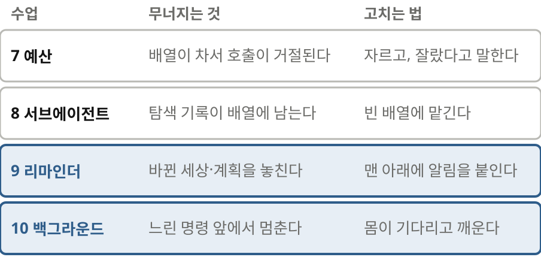
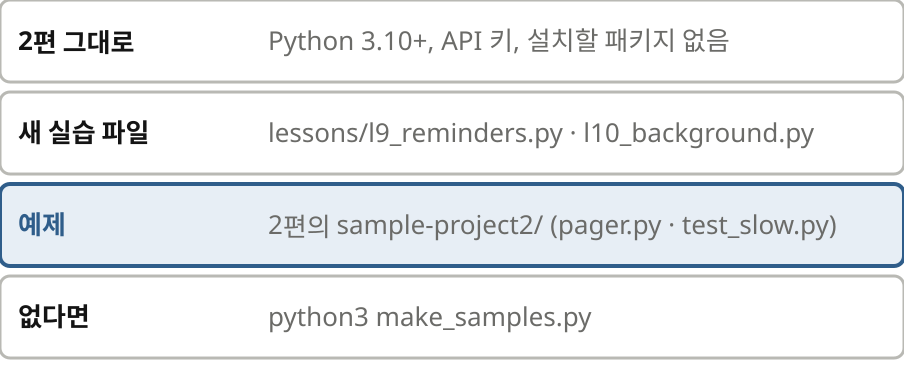
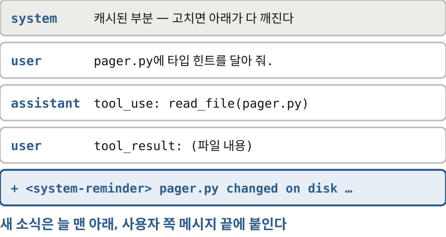
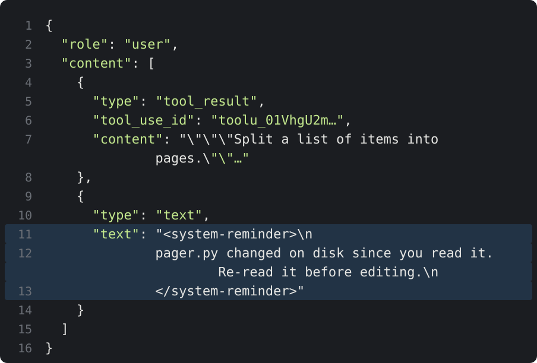
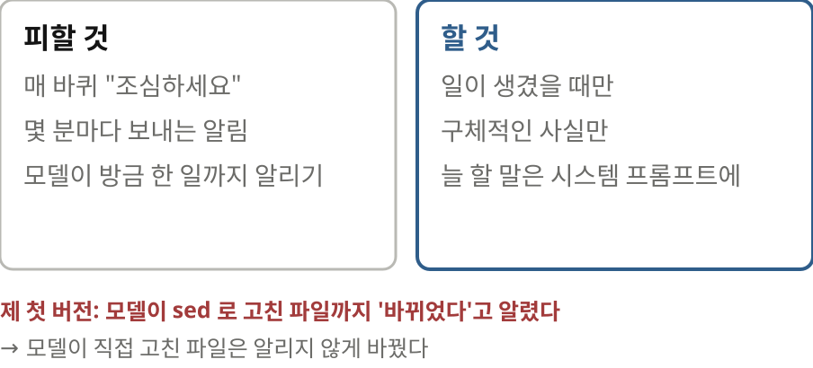
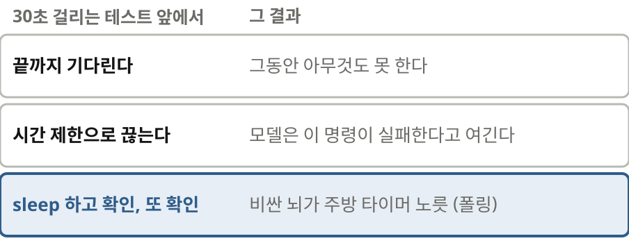
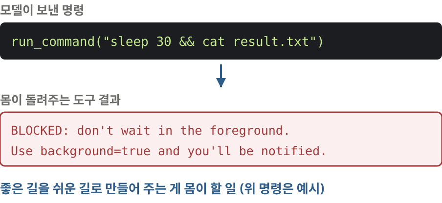
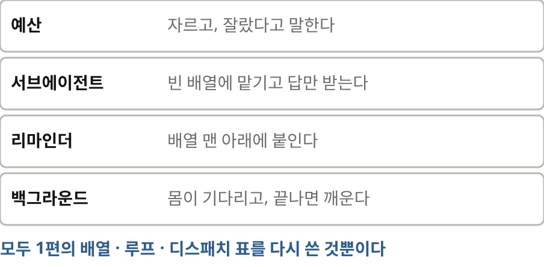

# 하니스 엔지니어링 101 핸즈온 — 3편 오래 달리는 에이전트 ② 알림과 기다리기 (대본)

Isuru Wijesiri의 *Harness Engineering 101*(8-9장)을 따라 장난감 하니스를 실제로 돌려 보는 강의 3편 대본. 가로판(`build.py --wide --script=script-3.md`).
2편(26분)을 둘로 나눈 뒷부분이다(2026-11-09). 수업 9-10 본문은 [script-2.md](script-2.md)에 있던 그대로이고 들어가며·준비물·마무리만 새로 썼다.
바탕은 [시나리오](scenario-2.md)와 `lab/` 실습 기록(`lab/runs/l9-*`, `l10-*`, 2026-10-24 claude-haiku-5-5 실제 호출). 말투·표기 규칙은 2편과 같다.

출처: Isuru Wijesiri, Harness Engineering 101, 2026년 10월 (코드 MIT)
잉크: #2F5D8A
부제: 3편 · 알림과 백그라운드 — 300줄 코딩 에이전트 직접 만들기
약어: 토큰=token, 모델이 글을 세는 단위; 컨텍스트 윈도우=context window, 모델이 한 번에 읽을 수 있는 최대 길이; 서브에이전트=subagent, 빈 배열에서 따로 도는 같은 루프; 리마인더=system reminder, 하니스가 배열 맨 아래에 붙이는 알림; 큐=queue, 먼저 넣은 것이 먼저 나오는 대기열; 압축=compaction, 오래된 대화를 요약 한 덩어리로 바꾸기; 폴링=polling, 끝났는지 계속 들여다보며 기다리기; 스레드=thread, 한 프로그램 안에서 따로 도는 실행 흐름; 백그라운드=background, 기다리지 않고 뒤에서 돌리기; grep=파일에서 글자를 찾는 명령

## 1 | 들어가며 | 표지
> 일하는 도중에 / **세상이 바뀐다면**
> 3편 · 오래 달리는 에이전트 ② 알림과 기다리기 — Harness Engineering 101 따라 하기

안녕하세요. 하니스 엔지니어링 백일 핸즈온 세 번째 시간입니다. 지난 2편에서는 오래 달리는 에이전트의 배열을 가볍게 지켰습니다. 도구 결과는 잘라서 넣었고, 탐색은 서브에이전트에게 맡겼습니다. ‖ 오늘은 배열 바깥으로 눈을 돌립니다. 에이전트가 일하는 동안에도 세상은 멈춰 있지 않습니다. 사람은 파일을 고치고, 오래 걸리는 명령은 아직 돌고 있습니다. 이런 일을 모델에게 어떻게 알릴지 직접 돌려 보면서 고쳐 나가겠습니다.

> 오늘 고칠 **두 군데**
> 
> 수업 순서는 1편과 같다: 같이 쓰기 → 실행 → 방금 일어난 일 → 자주 막히는 곳 → 체크포인트

표에 칠한 두 군데가 오늘 고칠 곳입니다. 위의 두 줄은 2편에서 이미 고쳤습니다. 아홉 번째 수업에서는 모델이 세상이 바뀐 것도, 자기 계획도 놓쳐 버리는 문제를 다룹니다. 열 번째에서는 느린 명령 앞에서 루프가 멈춰 서 버리는 문제를 풉니다. 이번에도 같이 쓰고 돌려 본 다음 무슨 일이 있었는지 짚어 보겠습니다.

## 2 | 준비물 | 수업 0
> 준비물은 **2편 그대로**
> 
> 새 실습 파일 둘: l9_reminders · l10_background
> 예제: 2편에서 만든 sample-project2 (없으면 python3 make_samples.py)
> 확인: sample-project2/test_slow.py 가 있으면 준비 끝

준비물은 2편 그대로입니다. 파이썬과 에이피아이 키만 있으면 되고 설치할 패키지는 없습니다. 오늘 새로 생기는 실습 파일은 둘입니다. 예제는 2편에서 만든 예제 프로젝트를 그대로 씁니다. 페이저 점 파이와 삼십 초 걸리는 느린 테스트가 든 폴더입니다. 2편을 건너뛰셨다면 메이크 샘플스 스크립트를 한 번 돌리시면 됩니다. 폴더에 테스트 슬로 점 파이가 있는지 확인해 보세요. 있으면 준비는 끝났습니다.

## 3 | 수업 9 | 리마인더와 할 일 목록
> 일하는 도중에 **모델에게 말 걸기**
> 
> 모델은 배열에 있는 것만 안다
> 몸이 <system-reminder>를 다음 사용자 쪽 메시지 맨 끝에 붙인다
> 왜 맨 아래인가: 위를 고치면 캐시가 다 깨진다 · 모델은 최근 글을 잘 본다 · 일은 바퀴와 바퀴 사이에 생긴다

이번에는 세상이 바뀌었는데 모델이 모르는 문제입니다. 모델은 배열에 있는 것만 압니다. 에이전트가 일하는 도중에 사람이 파일을 고치면 어떻게 될까요? 사람이 한참 전에 커밋하기 전에 물어보라고 했다면, 그 말은요? 열두 단계 중 일곱 번째에서 길을 잃으면요? 그럴 때는 몸 쪽에서 알려 줘야 합니다. 방법은 단순합니다. 다음 사용자 쪽 메시지를 보낼 때 맨 끝에 글을 하나 붙입니다. 이 글에는 시스템 리마인더라는 꼬리표가 달려 있습니다. 시스템 프롬프트를 고치지 않고 왜 굳이 맨 아래에 붙일까요. 1편에서 봤듯 위를 고치면 캐시가 깨집니다. 모델은 최근 글을 더 잘 봅니다. 또 알릴 일은 언제나 바퀴와 바퀴 사이에 생깁니다.

> **큐 하나**로 알린다
> 
> REMINDERS = [] · remind()로 넣고 · drain으로 꺼내 다음 메시지에 붙인다
> 파일 감시: 모델이 읽은 파일의 수정 시각을 적어 두었다가 비교한다
> 모델이 직접 고친 파일은 알리지 않는다

코드를 같이 쓰겠습니다. 큐는 리마인더스라는 빈 리스트 하나입니다. 하니스 어디서든 알릴 게 생기면 리마인드 함수로 여기에 넣습니다. 바퀴가 끝나고 도구 결과를 붙일 때가 되면 드레인 함수가 큐를 비우면서 그 뒤에 이어 붙입니다. 여기저기서 배열에 글을 바로 끼워 넣지 않고 꼭 큐 하나를 거치게 합니다. 그래야 모델이 무엇을 언제 봤는지 나중에 설명할 수 있습니다. 파일 감시도 하나 넣었습니다. 모델이 파일을 읽으면 그때 파일 수정 시각을 적어 둡니다. 바퀴마다 비교해 보고 달라졌으면 다시 읽으라고 알립니다. 모델 자신이 고친 것은 알리지 않습니다.

> 실행해 봅시다: 알림 **없이**
> 
> "pager.py의 함수에 타입 힌트를 달아 줘."
> 모델이 파일을 읽은 직후 사람이 page_range()를 추가한다(실습용 연출)
> 모델은 읽어 둔 옛 내용에 힌트를 달아 파일을 통째로 덮어쓴다
> 마지막 grep: 함수가 둘. 사람이 추가한 함수가 사라졌다

실험을 하나 꾸몄습니다. 페이저 점 파이에 있는 함수에 타입 힌트를 달아 달라고 했습니다. 모델이 파일을 읽은 직후에 사람이 페이지 레인지라는 함수를 하나 더했다고 칩시다. 화면에 휴먼 줄이 찍힌 곳이 그 순간입니다. 먼저 알림을 끈 버전입니다. 모델은 아까 읽어 둔 예전 내용에 힌트를 달아서 파일을 통째로 다시 씁니다. 마지막에 함수 목록을 찍어 보면 둘뿐입니다. ‖ 사람이 방금 더한 함수가 흔적도 없이 사라졌습니다. 모델은 자기가 잘못한 줄도 모릅니다. 실제 작업에서 이런 일이 생기면 꽤 오래 모른 채 지나갑니다.

> 실행해 봅시다: 알림을 **켜고**
> 
> 같은 일, 같은 때에 사람이 끼어든다
> [reminder] pager.py changed on disk → 모델이 다시 읽는다
> 마지막 grep: 함수가 셋. page_range()에도 힌트가 달렸다
> 확인: 두 버전의 마지막 grep 줄 수가 다르면 OK

같은 일을 이번엔 알림을 켜고 돌려 보겠습니다. 모델이 읽은 직후에 사람이 함수를 더하는 것도 똑같습니다. 그러자 리마인더 줄이 찍힙니다. 페이저 점 파이가 디스크에서 바뀌었다. 모델은 이 알림을 보고 파일을 다시 읽고 나서 고칩니다. 마지막 함수 목록에는 함수가 셋 있습니다. 사람이 더한 페이지 레인지에도 타입 힌트가 달렸습니다. 이제 두 버전의 마지막 그렙 결과를 비교해 보세요. 둘과 셋으로 다르게 나오면 성공입니다.

> 배열 끝을 **열어 보기**
> 
> 사용자 쪽 메시지 = tool_result + 텍스트 블록 하나
> API에게 이 꼬리표는 특별하지 않다: 그냥 글자다
> 시스템 프롬프트에 "이 꼬리표는 하니스가 붙인다"고 한 줄 적어 둔다

실제 세션 파일을 열어 보겠습니다. 1편 두 번째 수업에서 세션 파일을 열어 봤던 것처럼요. 리드 파일 결과 바로 뒤에 텍스트 블록이 하나 붙어 있습니다. 그 안에 시스템 리마인더 꼬리표로 감싼 문장이 들어 있습니다. 에이피아이 쪽에서는 이 꼬리표를 따로 구분하지 않습니다. 그냥 글자입니다. 그래서 시스템 프롬프트에 한 줄 적어 둡니다. 이 꼬리표 안의 글은 사용자가 아니라 하니스가 붙인 것이라고요.

> 할 일 목록: 모델이 **스스로** 거는 알림
> 
> todo_write 도구: 모델이 목록을 쓰면 몸이 그 목록을 다음 메시지 맨 아래에 다시 붙인다
> [~] 하는 중 · [x] 끝
> 확인: [todo] 목록이 바퀴마다 바뀌면 OK

알림 중에는 모델이 자기한테 보내는 것도 있습니다. 바로 할 일 목록입니다. 투두 라이트라는 도구를 주고 오타 고치기, 버그 고치기, 테스트 돌리기를 시켰습니다. 모델이 목록을 쓰면 몸 쪽에서 그 목록을 다음 메시지 맨 아래에 다시 붙여 줍니다. 화면을 보시면 체크 상자가 하나씩 채워집니다. 왜 이런 게 필요할까요. ‖ 오만 토큰쯤 앞에서 세운 계획은 다른 글과 똑같이 흐려집니다. 목록을 모델 밖에 두고 매번 맨 아래에 다시 넣어 주면 계획이 늘 눈앞에 있게 됩니다. 모델 앞에 화이트보드를 하나 세워 둔 셈입니다. 클로드 코드에 있는 체크 목록이 바로 이 장치입니다. 여러분 화면에서도 투두 목록이 바퀴마다 갱신되는지 확인해 보세요.

> 자주 막히는 곳: **너무 자주** 알리기
> 
> 알림이 잦으면 모델은 흘려듣는다
> 몇 분마다가 아니라 일이 생겼을 때 알린다
> 늘 해야 할 말은 시스템 프롬프트나 도구 설명에 적는다
> 체크포인트: 몸에서 생긴 일은 **배열에 글로** 적는다

알림은 붙이기 쉬운 만큼 남발하기도 쉽습니다. 바퀴마다 조심하라는 말을 붙이면 모델은 그 말을 배경 소음처럼 흘려듣게 됩니다. 규칙은 두 가지입니다. 시계에 맞춰 알리지 말고 사건이 생겼을 때만 알린다. 늘 해야 하는 말이면 알림에서 빼서 시스템 프롬프트나 도구 설명으로 옮긴다. 제 첫 버전에도 실수가 있었습니다. 모델이 셸 명령으로 직접 고친 파일까지 바뀌었다고 알렸습니다. 그 바람에 모델이 방금 자기가 고친 파일을 계속 다시 읽었습니다. 저자도 같은 헛걸음을 겪었다고 합니다. 읽고 나서 고치라는 규칙을 방금 만든 파일에까지 걸었던 탓입니다. 아홉 번째 수업 정리입니다. 몸에서 생긴 사건은 배열 맨 아래에 글로 적어 넣습니다. 알림은 드물게 보내고 구체적인 사실만 담습니다.

## 4 | 수업 10 | 백그라운드 작업
> 느린 명령 앞에서 **루프가 멈춘다**
> 
> 끝까지 기다린다: 그동안 아무것도 못 한다
> 시간 제한으로 끊는다: 모델은 이 명령이 실패한다고 여긴다
> sleep 하고 확인하고 또 확인한다: 비싼 뇌가 주방 타이머 노릇을 한다(폴링)

마지막 수업입니다. 지금까지 만든 루프는 도구를 부르면 결과가 올 때까지 기다립니다. 그러다 삼십 초 걸리는 테스트를 만나면 어떻게 될까요. 끝까지 기다리면 그동안 아무 일도 못 합니다. 시간 제한을 걸어 끊으면 모델은 여기서는 테스트가 실패한다고 잘못 배웁니다. 제일 흔하게는 모델이 슬립 오 초로 기다렸다가 확인하고 또 기다렸다가 확인합니다. 폴링이라고 하죠. 비싼 뇌가 주방 타이머 노릇을 하고 있는 셈입니다.

> 작업 표 같이 쓰기
> 
> run_command에 background 플래그 추가 → 띄우자마자 "b1 시작"을 돌려준다
> 출력을 모으던 스레드가 끝나면 remind() 호출 → 수업 9의 큐로
> task_output 도구로 중간 출력 보기 · sleep으로 시작하는 명령은 막는다
> 사람 입력을 기다리는 동안 알림이 오면 몸이 먼저 모델을 부른다

일을 뒤로 돌리면 됩니다. 런 커맨드 도구에 백그라운드 플래그를 하나 더 붙입니다. 이 플래그를 켜면 명령을 띄워 놓기만 하고 비 원 작업을 시작했다는 답을 바로 돌려줍니다. 뒤에서는 스레드 하나를 띄워 출력을 모으고 명령이 끝나면 리마인드를 부르게 합니다. 큐는 아홉 번째 수업에서 만든 걸 그대로 씁니다. 모델이 중간에 들여다볼 수 있도록 태스크 아웃풋 도구도 줍니다. 슬립을 걸어 놓고 그 자리에 붙잡혀 기다리는 명령은 막습니다. 마지막으로 사람 입력을 기다리는 부분을 고칩니다. 사람이 아무것도 치지 않아도 큐에 알림이 들어오면 몸 쪽에서 먼저 모델을 부르게 합니다.

> 실행해 봅시다: 테스트는 **뒤로**, 그동안 **다른 일**
> 
> "느린 테스트는 백그라운드로, 그동안 README 오타를 고쳐 줘."
> b1: python 없음(exit 127) → 알림 → python3 로 b2
> 9초: "끝나면 알려 드리겠습니다" → you>
> 36초: 아무도 입력하지 않았는데 [harness]가 모델을 깨운다
> 확인: 사람 입력 없이 assistant 가 다시 말하면 OK

돌려 보겠습니다. 느린 테스트는 백그라운드로 돌려 두고 그동안 리드미 오타를 고쳐 달라고 했습니다. 첫 작업은 파이썬이라는 명령이 없어서 종료 코드 백이십칠로 곧바로 실패합니다. 이 소식도 알림으로 들어오자 모델은 파이썬 쓰리로 바꿔 다시 띄웁니다. 그사이 리드미 오타를 고치고, 구 초쯤 지났을 때 테스트가 끝나면 알려 드리겠다며 말을 마칩니다. 화면에 다시 유 프롬프트가 떴습니다. ‖ 저는 아무것도 치지 않았습니다. 삼십육 초에 테스트가 끝나자 하니스 쪽에서 알림이 왔다며 모델을 깨웁니다. 모델은 출력을 읽어 보더니 테스트가 실패했다고 알려 줍니다. 항목 천한 개를 페이지로 나눴더니 천 개만 남았다고 합니다. 1편에서 본 바로 그 페이지 수 버그입니다. 마지막으로 확인해 보세요. 사람이 아무것도 치지 않았는데 어시스턴트가 다시 말하면 성공입니다.

> 자주 막히는 곳: / **sleep**으로 기다리기
> 
> 모델은 배운 대로 sleep 하고 확인하려 든다
> 몸이 막고 다른 길을 알려 준다: "백그라운드로 돌리면 끝날 때 알려 준다"
> 좋은 길을 쉬운 길로 만들어 주는 게 몸이 할 일

이번 녹화에서는 모델이 슬립을 쓰지 않았지만 실제로는 자주 씁니다. 사람이 짠 스크립트에 슬립하고 확인하는 코드가 워낙 많아서 모델도 그렇게 배웠습니다. 그러니 몸 쪽에서 막아 둡니다. 슬립으로 시작하는 명령은 실행하지 않습니다. 그 자리에 붙잡혀 기다리지 말고 백그라운드로 돌리라고 대신 알려 줍니다. 그러면 끝났을 때 알림이 온다는 말도 같이 돌려줍니다. 몸은 모델에게 좋은 길을 말로 설명하기보다 처음부터 그 길로 가는 게 제일 쉽도록 만들어 둬야 합니다.

> **일이 생기면** 모델 차례가 온다
> 
> 키 입력 · 작업 완료 · 파일 변경 · 타이머 → 모두 같은 문으로 들어온다
> 감시(조건이 맞으면) · 예약(정한 시각에) · 셀프 알람(모델이 "10분 뒤에 깨워 줘")
> 깨울 때마다 돈이 든다 · 알림 내용은 사실이어야 한다 · 사람이 전부 보고 멈출 수 있어야 한다
> 체크포인트: 기다리는 일은 **몸**이 한다

방금 본 장면을 조금 넓혀서 보겠습니다. 지금까지는 사람이 엔터를 쳐야만 모델이 말을 시작했습니다. 이제는 작업이 끝났을 때도 모델이 다시 말을 시작합니다. 파일이 바뀌었을 때, 정해 둔 시각이 됐을 때도 같은 입구로 모델을 깨울 수 있습니다. 모델이 십 분 뒤에 깨워 달라며 스스로 알람을 맞춰 둘 수도 있습니다. 장치는 모두 같습니다. 배열 맨 아래에 알림을 붙이고 모델을 부르면 됩니다. 대신 지킬 게 있습니다. 모델을 깨울 때마다 돈이 듭니다. 알림은 사실이어야 합니다. 또 지금 뭐가 돌고 있는지 사람이 보고 멈출 수 있어야 합니다. 열 번째 수업 정리입니다. 기다리는 일은 뇌가 아니라 몸이 합니다.

## 5 | 마무리 | 3편 정리
> 네 군데를 고쳤다 / **새 개념 없이**
> 
> 예산: 자르고, 잘랐다고 말한다
> 서브에이전트: 빈 배열에 맡기고 답만 받는다
> 리마인더: 맨 아래에 붙인다
> 백그라운드: 몸이 기다리고 깨운다
> 4편: 모델이 본 것 · 안전장치 · 뇌 바꾸기

지난 2편과 오늘 고친 네 군데를 한꺼번에 정리하겠습니다. 도구 결과는 자르고 잘랐다고 말해 줍니다. 탐색은 빈 배열에 맡기고 답만 받아 옵니다. 알릴 일은 배열 맨 아래에 붙입니다. 기다리는 일은 몸이 하고 끝나면 모델을 깨웁니다. 돌아보면 새로운 개념은 하나도 없었습니다. 전부 1편에 나온 배열과 루프, 디스패치 표를 다시 썼을 뿐입니다. ‖ 다음 4편에서는 모델이 실제로 무엇을 봤는지 꺼내 봅니다. 안전장치도 달고 뇌를 로컬 모델로 갈아 끼워 보겠습니다. 코드와 실습 기록은 설명란의 저장소에 있습니다. 고맙습니다.
