# 하니스 엔지니어링 101 핸즈온 — 1편 에이전트의 뼈대 (대본)

Isuru Wijesiri의 *Harness Engineering 101*(1-5장)을 따라 장난감 하니스를 실제로 돌려 보는 강의 대본. 가로판(`build.py --wide`).
원문 번역이 아니라 [정리 노트](../../content/notes/harness-engineering-101.md)와 `lab/` 실습 기록(`lab/runs/*.jsonl`, 실제 API 호출)을 바탕으로 새로 쓴 것이다.
말투는 친절한 핸즈온 강사(존댓말). 터미널 클립(`figures/term-*.mp4`)은 실제 실행 기록을 글자 그대로 다시 그린 것이고, 모션 그래픽은 `figures/animate.py`, 코드·다이어그램은 `figures/make.py`.
TTS가 잘못 읽지 않도록 나레이션 속 영어 이름과 숫자는 처음부터 한글로 적었다(화면 글은 원래 표기).

출처: Isuru Wijesiri, Harness Engineering 101, 2026년 10월 (코드 MIT)
잉크: #2F5D8A
부제: 1편 · 에이전트의 뼈대 — 300줄 코딩 에이전트 직접 만들기
약어: API=Application Programming Interface, 프로그램끼리 부르는 약속; JSON=JavaScript Object Notation, 글자로 적는 자료 형식; LLM=Large Language Model, 대형 언어 모델

## 1 | 들어가며 | 표지
> 300줄로 / **코딩 에이전트** 직접 만들기
> 1편 · 에이전트의 뼈대 — Harness Engineering 101 따라 하기

안녕하세요. 오늘부터 세 번에 걸쳐 코딩 에이전트를 처음부터 직접 만들어 봅니다. 교재는 이수루 위제시리가 쓴 하니스 엔지니어링 백일이라는 공개 책이에요. 저자는 더블유에스오투에서 코딩 도우미를 세 개 만든 사람입니다. 이 책의 주장은 단순해요. 에이전트는 채팅 호출을 감싼 와일 루프고, 나머지는 전부 뭔가 고장 나서 덧댄 땜질이다. ‖ 오늘은 그 루프를 우리 손으로 만들어 봅니다. 파이썬 파일 세 개, 다 합쳐 백 줄쯤이에요. 따라 치기 좋게 천천히 가겠습니다.

> 뇌는 **모델**, 몸은 **하니스**
> 
> 뇌: 글자를 받아 글자를 낸다
> 몸: 배열을 짜고 도구를 돌린다
> 둘 사이 통로는 JSON 배열 하나

먼저 말 하나만 정리하고 갈게요. 하니스는 원래 말에 채우는 마구예요. 여기서는 모델을 둘러싼 프로그램을 뜻합니다. 저자의 비유로는 모델이 뇌, 하니스가 몸이에요. 뇌는 글자를 받아서 글자를 낼 뿐입니다. 파일을 읽고 명령을 돌리는 일은 언제나 몸이 해요. 그리고 뇌와 몸 사이에 오가는 건 제이슨 배열 하나뿐입니다. 이 영상 내내 이 그림을 머리에 두시면 됩니다.

> 수업마다 **같은 순서**로 갑니다
> 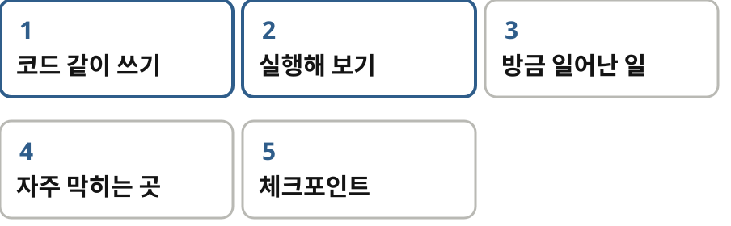
> 왼쪽은 설명, 오른쪽은 코드와 터미널
> 터미널은 실제 실행 기록 그대로

수업은 여섯 개고 매번 같은 순서로 진행해요. 오늘 만들 걸 먼저 보여 드리고, 같이 코드를 쓰고, 실제로 돌려 보고, 방금 무슨 일이 있었는지 그림으로 짚고, 자주 막히는 곳을 알려 드린 다음, 한 줄로 정리합니다. 화면 왼쪽은 설명, 오른쪽은 코드와 터미널이에요. 터미널에는 제가 실제로 돌린 기록이 그대로 나옵니다.

## 2 | 준비물 | 수업 0
> 준비물은 **넷**입니다
> 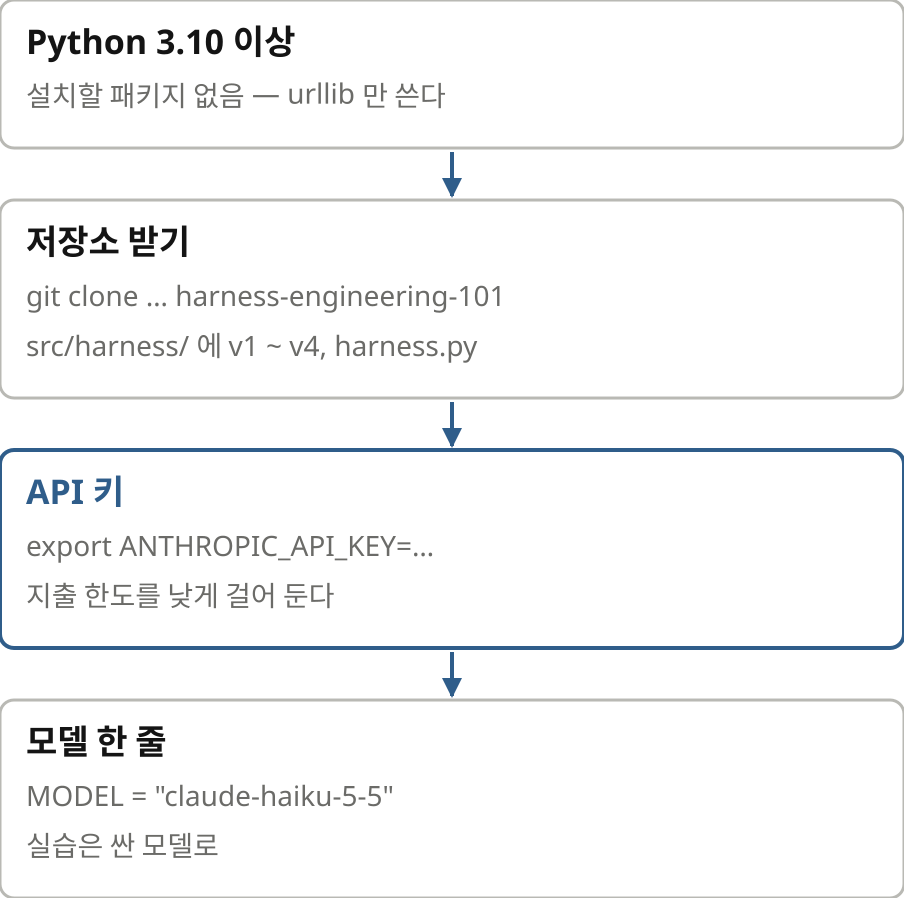
> Python 3.10 이상, 패키지 설치 없음
> 저장소 src/harness/ 의 v1-v4
> API 키는 지출 한도를 걸어 두고
> MODEL 한 줄만 바꾼다 (실습은 Haiku)

준비물부터요. 첫째, 파이썬 삼 점 십 이상이면 됩니다. 설치할 패키지는 없어요. 책의 코드는 표준 라이브러리만 씁니다. 둘째, 깃허브에서 저장소를 받습니다. 에스알씨 슬래시 하니스 폴더에 브이원부터 브이포, 그리고 완성판이 있어요. 셋째, 앤트로픽 에이피아이 키를 환경 변수로 넣습니다. 실습용 키니까 콘솔에서 지출 한도를 낮게 걸어 두세요. 넷째, 파일 맨 위의 모델 이름 한 줄을 바꿉니다. 저는 비용을 아끼려고 하이쿠로 돌렸어요. 책에 적힌 모델 그대로도 돌아갑니다.

## 3 | 수업 1 | 30줄 채팅
> 서버는 **아무것도 기억하지 않는다**
> 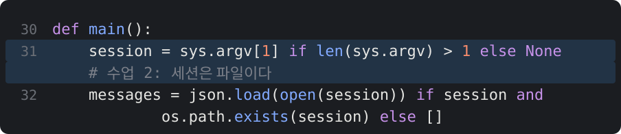
> 빈 리스트에 붙이고, 통째로 보내고, 답을 붙인다
> 새로 넣은 두 줄: [array] 크기 출력 · 세션 파일 저장

첫 수업은 서른 줄짜리 채팅입니다. 코드를 보세요. 메시지라는 빈 리스트가 하나 있고, 사용자가 치면 리스트에 붙이고, 통째로 보내고, 답이 오면 또 붙입니다. 이게 전부예요. 저는 여기에 두 줄만 더했습니다. 파란 줄이요. 답이 올 때마다 배열의 길이를 바이트로 찍고 배열을 파일로 저장합니다. 두 번째 줄은 다음 수업에서 씁니다.

> 실행해 봅시다
> 
> 턴 1: 2 messages, 1488 bytes
> 턴 2: 4 messages, 1719 bytes
> /clear 뒤: 2 messages, 277 bytes

돌려 볼게요. 제 이름을 말하고 다음 턴에 이름을 물어봅니다. 기억하죠. 그런데 배열 크기를 보세요. 첫 턴에 천사백팔십팔 바이트, 둘째 턴에 천칠백십구 바이트. 둘째 턴에는 첫 턴의 질문과 답까지 다시 보낸 거예요. ‖ 이제 슬래시 클리어를 치고 다시 이름을 물으면 모델은 자기 이름을 말합니다. 제 이름은 모르죠. 배열이 비었으니까요.

> 기억은 **내 리스트**에 있다
> 
> API는 상태가 없어 호출 사이를 기억하지 않는다
> /clear 의 구현은 messages = []
> 모델이 잊었다 = 배열에서 빠졌다

방금 무슨 일이 있었을까요. 에이피아이는 상태가 없습니다. 서버는 호출과 호출 사이에 아무것도 기억하지 않아요. 그래도 대화가 이어지는 것처럼 보이죠. 우리 프로그램이 리스트를 들고 있다가 매번 통째로 다시 보내서 그렇습니다. 그래서 슬래시 클리어의 구현은 메시지 이즈 빈 리스트, 한 줄이에요. 서버에 지울 세션이 없습니다. 체크포인트 하나. 대화 기억은 리스트 하나다. 모델이 잊었다는 말은 배열에서 빠졌다는 뜻이다.

## 4 | 수업 2 | 세션 파일
> 모델은 **배열에 적힌 것**을 믿는다
> 
> 세션 JSON의 지난 답을 '홍길동'으로 고쳐 저장
> 다시 띄워 물으니 모델이 그렇게 말한 걸 사과한다
> assistant 라고 적히면 자기 말로 믿는다

이번 수업은 짧지만 중요해요. 아까 저장한 세션 파일을 열어 봅시다. 그냥 제이슨이에요. 마지막에 모델이 한 답을 제가 손으로 고쳤습니다. 당신 이름은 홍길동이에요, 라고요. 그리고 같은 파일로 다시 띄워서 묻습니다. 방금 제 이름이 뭐라고 했죠? ‖ 모델의 답을 보세요. 방금 제가 홍길동이라고 한 것은 근거 없이 지어낸 답이었어요, 죄송합니다. 자기가 그런 말을 한 적이 없는데 사과를 해요. 배열에 어시스턴트라고 적혀 있으니 자기가 한 말이라고 믿는 겁니다.

> 세션은 **파일**이다
> 코딩 에이전트의 --resume 은 파일 읽기, /clear 는 빈 리스트
> 지난 답을 고칠 수 있다. 12장에선 디버깅 도구, 13장에선 안전 문제

이게 왜 중요하냐면요. 우선 세션 관리가 뭔지 눈으로 봤습니다. 거창한 기능 같지만 파일 저장과 읽기예요. 그리고 지난 답을 고쳐도 모델은 모른다는 걸 봤어요. 이건 나중에 득도 되고 독도 됩니다. 세 번째 편에서 디버깅할 때는 요긴한 도구가 되고요, 안전 문제이기도 해요. 배열에 든 글자가 모두 진짜라는 보장이 없으니까요.

## 5 | 수업 3 | 도구 붙이기
> 모델은 **부탁**하고, 실행은 **내 코드**가 한다
> 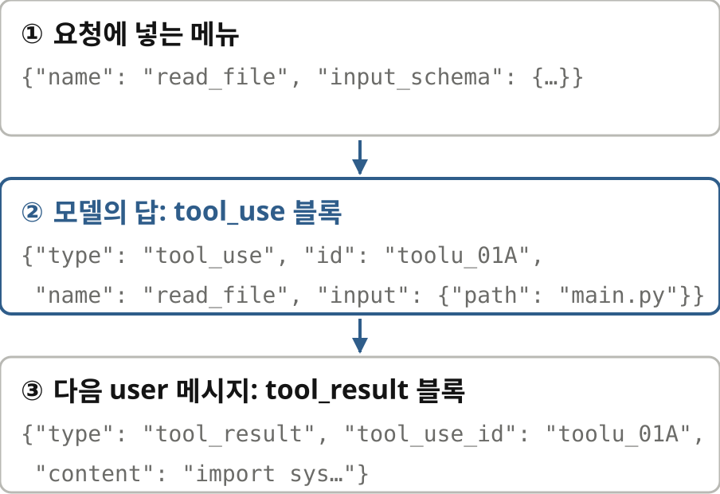
> ① 요청에 넣는 메뉴(스키마)
> ② 답에 오는 tool_use 블록
> ③ 다음 메시지에 붙이는 tool_result

이제 손을 달아 줍니다. 도구예요. 도구는 제이슨 세 조각입니다. 요청에 함께 보내는 메뉴, 모델이 답으로 보내는 툴 유즈 블록, 그리고 우리가 다음 메시지에 붙이는 툴 리절트 블록. 모델은 절대 아무것도 실행하지 않아요. 이 파일을 읽어 달라고 부탁할 뿐입니다. 파일은 실제로 우리 코드가 열어요. 안전 이야기는 나중에 전부 이 한 문장에서 출발합니다.

> 메뉴와 디스패치 표 만들기
> 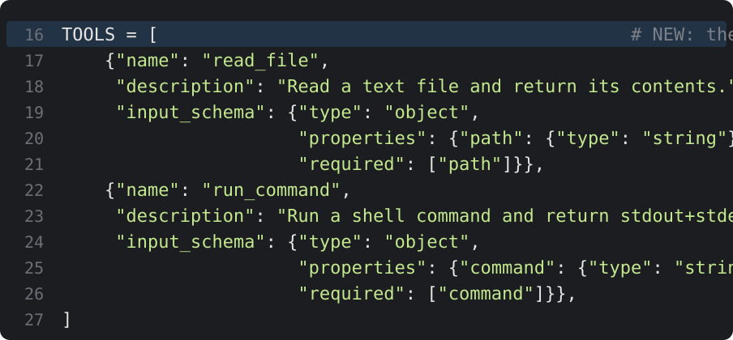
> read_file · run_command 두 도구
> 모델이 받는 문서는 description 하나뿐

코드로 보면 두 덩어리예요. 위는 메뉴입니다. 리드 파일과 런 커맨드, 각각 이름과 설명과 인자 스키마. 이 설명이 모델이 받는 유일한 문서예요. 설명이 애매하면 모델이 엉뚱하게 씁니다.

> 이름을 함수에 잇는 **딕셔너리 조회**
> 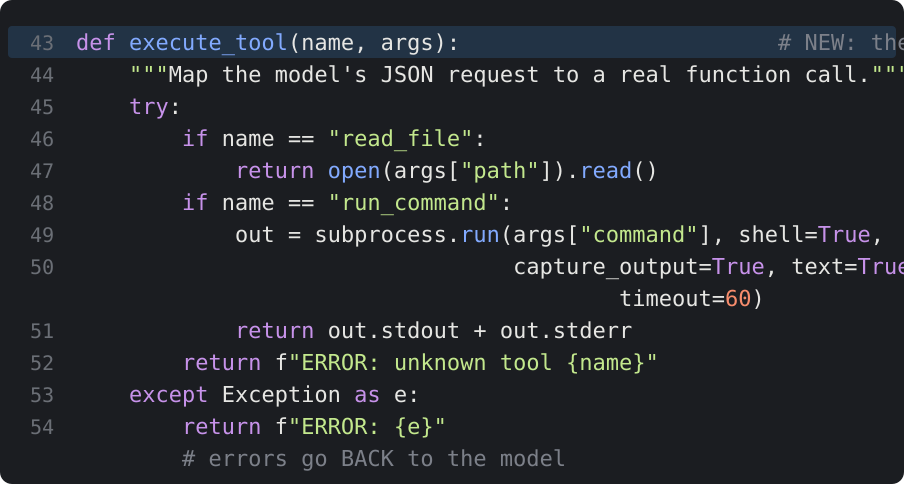
> 이름 → 함수: if 두 줄
> 예외는 던지지 않고 오류 문자열로 돌려준다

아래는 디스패치 표입니다. 이름이 리드 파일이면 열어서 읽고 런 커맨드면 서브프로세스로 돌려요. 도구라고 하면 거창하게 들리죠. 들여다보면 딕셔너리 조회예요. 그리고 마지막 줄을 꼭 보세요. 예외가 나면 던지지 않고 오류 문자열을 돌려줍니다. 이 문자열이 그대로 모델에게 갑니다. 왜 그래야 하는지는 다섯째 수업에서 확인할 거예요.

> 실행해 봅시다: 두 단계짜리 부탁
> 
> "가장 큰 파일을 읽어 줘"
> find 로 크기를 재려다 결과가 비었다
> 한 턴에 도구 한 번 → 사람에게 돌아온다

돌려 봅시다. 이 폴더에서 가장 큰 파일을 읽어 달라고 했어요. 모델은 먼저 파인드 명령으로 크기를 재려고 합니다. 그런데 결과가 비어서 다시 확인하겠다고 말하고는 멈춰요. ‖ 왜 멈췄을까요. 이 버전은 한 턴에 도구를 딱 한 번만 돌리고 사용자에게 돌아오거든요. 두 번째 도구를 부르려면 사람이 엔터를 쳐 줘야 합니다. 그래서 제가 다음 질문을 쳤더니 이번엔 사백 오류가 났어요.

> 자주 막히는 곳: **HTTP 400**
> 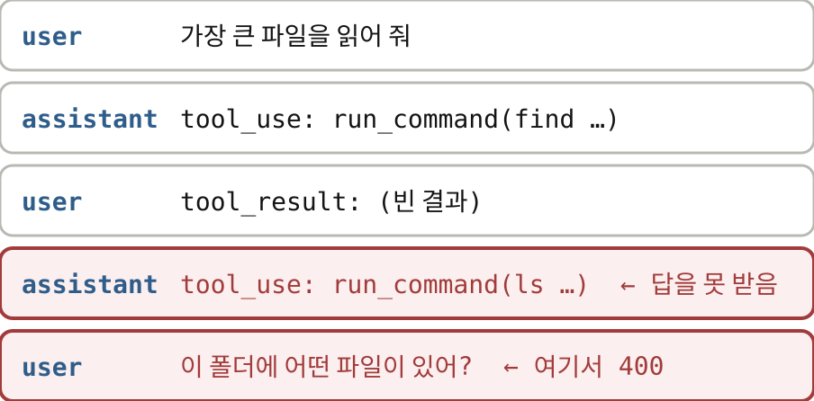
> 답을 못 받은 tool_use 가 배열에 매달려 있다
> 거기에 user 메시지를 붙이면 서버가 거절한다
> 고치려면 결과를 붙이고 다시 호출 → 수업 4

이 사백 오류는 여러분도 분명히 만나실 거라 짚고 갑니다. 모델의 마지막 답에 툴 유즈 블록이 들어 있었죠. 그런데 우리는 그 결과를 안 붙이고 새 사용자 메시지를 붙였어요. 그러면 서버가 거절합니다. 답을 못 받은 부탁이 배열에 매달려 있으면 안 되거든요. 배열이 문법에 안 맞는 상태가 된 거예요. 고치는 법은 간단하고 다음 수업에서 바로 합니다. 부탁을 받았으면 결과를 붙이고 다시 호출할 것.

## 6 | 수업 4 | 루프 하나로 에이전트
> 에이전트는 **while 루프**다
> 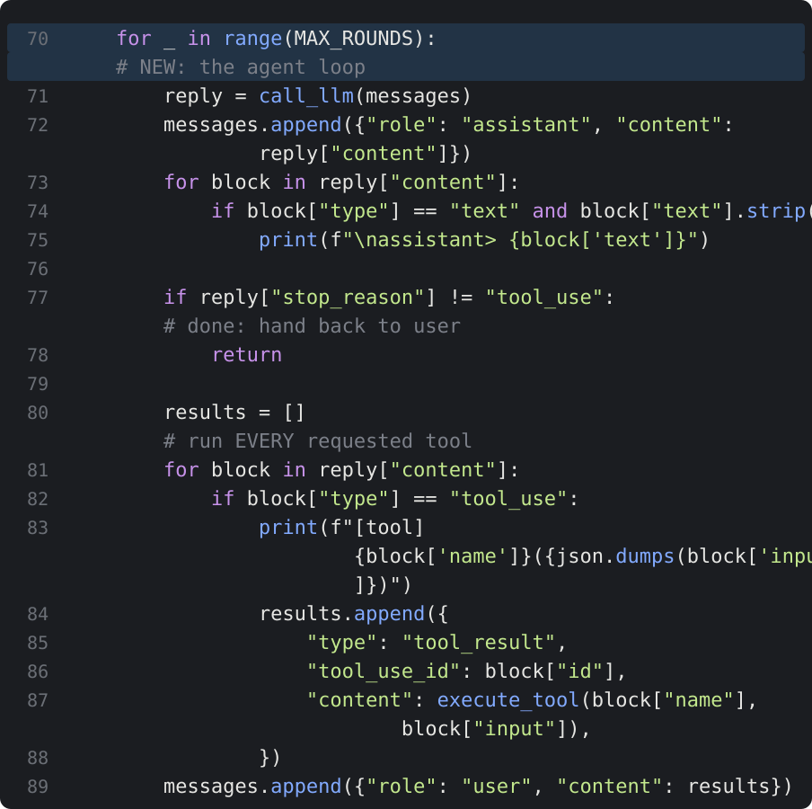
> 부르고 → 붙이고 → tool_use 아니면 끝
> 부탁받은 도구를 전부 돌려 한 메시지로 붙인다
> MAX_ROUNDS = 50, write_file 추가

넷째 수업이 오늘의 핵심이에요. 포 루프 하나만 바뀌었습니다. 모델을 부르고, 답을 붙이고, 멈춤 이유가 툴 유즈가 아니면 끝. 툴 유즈면 부탁받은 도구를 전부 돌리고 결과를 사용자 메시지 하나로 붙여서 다시 부릅니다. 상한은 오십 번이에요. 두 가지 실패를 왔다 갔다 하는 모델이 예산을 다 태우지 않게요. 그리고 쓰기 도구를 하나 더했습니다. 이제 파일을 고칠 수 있어요.

> 실행해 봅시다: 실패한 테스트 고치기
> 
> 21개를 10개씩 → 3쪽이어야 하는데 2쪽만 나온다
> "테스트가 하나 실패해. 원인을 찾아서 고쳐 줘."
> 엔터 한 번, 도구 호출 5번, 테스트 3개 통과

제가 작은 프로젝트를 준비했어요. 페이지 나누기 함수예요. 스물한 개를 열 개씩 나누면 세 쪽이 나와야 하는데 두 쪽이라고 답하는 버그를 심어 뒀습니다. 테스트 하나가 실패해요. 에이전트에게 말합니다. 테스트가 하나 실패해, 원인을 찾아서 고쳐 줘. ‖ 보세요. 파일 목록을 보고, 리드미와 코드와 테스트를 읽고, 테스트를 돌려 실패를 확인하고, 내림 나눗셈이 원인이라고 짚은 다음, 올림으로 고쳐 쓰고, 다시 돌려 세 개 통과를 확인합니다. 저는 엔터를 딱 한 번 쳤어요.

> 호출 → 멈춤 이유 → 실행 → 붙임 → 다시
> 
> 사용자 한 턴 = API 호출 6번
> 똑똑한 건 루프가 아니다. 모델이 연습해 둔 패턴이다
> 루프는 결과를 되돌려 주는 일만 한다

어떻게 된 걸까요. 사용자 한 턴에 에이피아이 호출은 여섯 번이었어요. 매번 멈춤 이유를 보고 갈라집니다. 툴 유즈면 계속, 엔드 턴이면 멈춤. 이 작은 루프는 똑똑하지 않은데도 그렇게 많은 일을 해내요. 모델 덕분이에요. 모델이 강화학습으로 이 패턴을 수백만 번 연습했거든요. 결과를 보고 다음 수를 정하는 일을요. 루프는 그 연습이 돌아가도록 결과를 계속 되돌려 주는 일만 해요.

> 멈춤 이유 네 가지
> 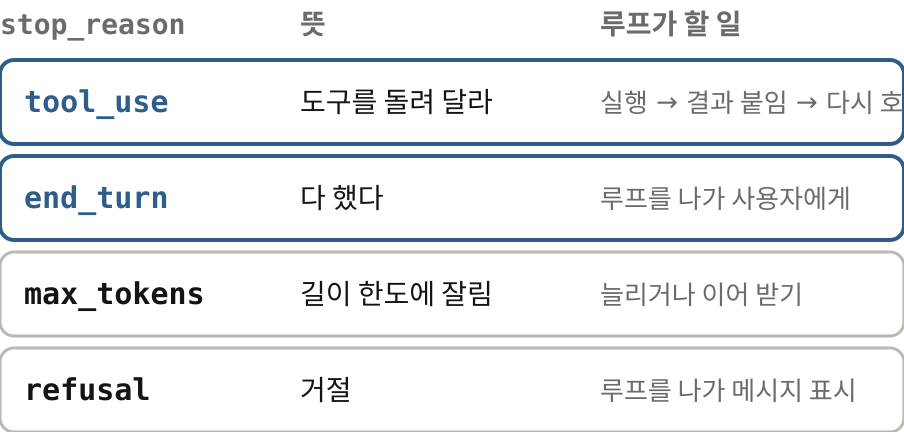
> tool_use → 계속, end_turn → 멈춤
> max_tokens 는 잘린 것, refusal 은 거절

멈춤 이유는 넷을 알아 두시면 됩니다. 툴 유즈는 도구를 돌려 달라, 엔드 턴은 다 했다. 이 둘이 핵심이에요. 맥스 토큰스는 답이 길이 한도에 닿아 잘렸다는 뜻이라 따로 처리해야 하고 리퓨절은 거절입니다. 체크포인트. 에이전트는 와일 루프다. 사용자 한 턴이 호출 수십 번일 수 있으니 상한을 둔다.

## 7 | 수업 5 | 오류를 돌려주기
> 오류는 **모델의 연료**다
> 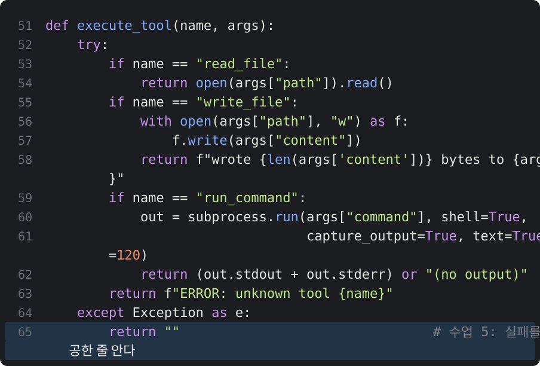
> 나쁜 예: 예외가 나면 빈 문자열을 돌려준다
> 모델 눈에는 성공처럼 보인다
> 저자가 MI Copilot 에서 겪은 사고와 같은 꼴

아까 미뤄 둔 그 한 줄로 돌아가 봅시다. 예외를 잡아서 오류 문자열을 돌려주는 줄이요. 이번엔 일부러 나쁜 버전을 만들어 봤습니다. 파란 줄처럼, 예외가 나면 빈 문자열을 돌려줘요. 모델 눈에는 성공한 것처럼 보이죠. 저자가 엠아이 코파일럿에서 실제로 이런 사고를 겪었어요. 파일 쓰기가 실패했는데 모델이 몰랐고 없는 내용 위에 계속 편집을 쌓다가 파일을 망가뜨렸습니다.

> 실행해 봅시다: 읽기 전용 파일
> 
> pager.py 를 chmod 444 로 잠그고 같은 과제
> 6번째 호출에서 Permission denied 를 바로 읽는다
> chmod → 다시 쓰기, 호출 9번

실험은 이렇게 했어요. 페이저 파이를 읽기 전용으로 바꿔 두고 두 버전에 똑같이 테스트를 고치라고 했습니다. 먼저 정직한 버전이에요. 여섯 번째 호출에서 쓰기가 퍼미션 디나이드로 실패하자 모델이 바로 읽어요. 파일이 읽기 전용이라 쓰기가 거부됐다, 권한을 추가하겠다. 씨에이치모드를 치고 다시 써서 한 바퀴 만에 끝냅니다. 도구 호출 아홉 번이었어요.

> 삼키면 **탐정 놀이**가 시작된다
> 
> 7번째 쓰기가 "" 를 돌려준다 → 성공한 줄 안다
> 테스트는 그대로 실패 → 그제야 의심
> 호출 12번. 이번엔 알아챘지만 운이 좋았다

이번엔 삼키는 버전입니다. 일곱 번째에서 쓰기가 빈 문자열을 돌려줘요. 모델은 성공한 줄 알고 테스트를 돌립니다. 그런데 여전히 실패하죠. 그제야 의심을 시작해요. 라이트 파일이 오류 없이 끝났는데 파일 크기가 그대로다. 파일을 다시 읽고, 권한을 보고, 씨에이치모드를 하고, 다시 씁니다. 도구 호출 열두 번. ‖ 솔직히 말씀드리면 이번 모델은 똑똑해서 결국 알아냈어요. 하지만 세 바퀴를 더 썼고 저자의 사례처럼 못 알아채면 파일이 망가집니다.

> 오류는 그대로, 표시만 붙여서
> 
> 피할 것: 루프가 죽기 · 오류 뭉개기 · 몰래 고치기
> 진짜 출력 아니면 진짜 오류를 돌려준다. 사람이 읽어도 손쓸 수 있을 만큼

저자가 꼽는 나쁜 버릇은 셋입니다. 도구 오류에 루프가 죽는 것, 오류를 실패했음처럼 뭉개는 것, 그리고 하니스가 몰래 고쳐서 다시 해 보는 것. 마지막이 가장 나빠요. 모델이 아는 세상과 실제 세상이 어긋나니까요. 체크포인트. 도구 결과는 진짜 출력이거나 진짜 오류여야 한다. 오류라고 표시해서, 사람이 봐도 조치할 수 있을 만큼 자세히.

## 8 | 수업 6 | 비용 재기
> 매 바퀴 **배열 전체**를 다시 보낸다
> 40바퀴 × 자라는 배열 = 요청 하나에 입력 토큰 약 196만
> 땜질은 프롬프트 캐싱 — 앞부분이 같으면 값의 10%만 낸다

마지막은 돈 이야기예요. 넷째 수업에서 호출이 여섯 번이었죠. 매번 배열 전체를 다시 보냈습니다. 책의 계산을 빌려 볼게요. 만 토큰에서 시작해 한 바퀴에 이천 토큰씩 늘고 마흔 바퀴를 돌면 입력 토큰 합계가 백구십육만이에요. 요청 하나에요. ‖ 땜질은 프롬프트 캐싱입니다. 공급자는 이미 처리한 앞부분을 저장해 둬요. 다음 요청이 오면 앞에서부터 바이트 단위로 같은 데까지는 다시 계산하지 않아요. 그 부분은 값의 십 퍼센트만 받습니다.

> 캐시 지점 두 개와 생체 신호 한 줄
> 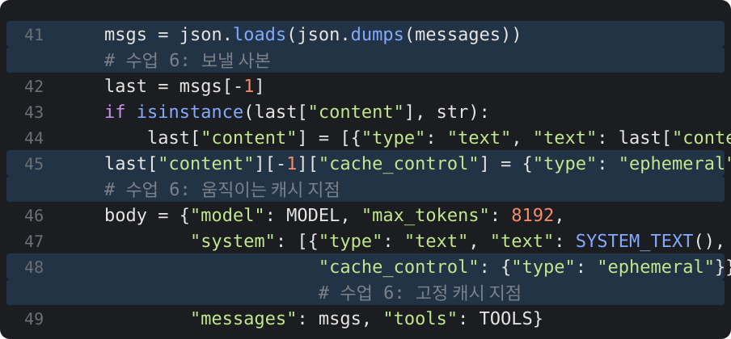
> system 블록에 cache_control 하나
> 매 바퀴 마지막 메시지에 하나 더 (뒤로 움직인다)

코드는 이렇게 고쳤어요. 시스템 프롬프트 블록에 캐시 컨트롤 표시를 하나 붙이고 매 바퀴 마지막 메시지에도 하나 붙입니다. 두 번째 표시는 바퀴마다 뒤로 움직여요. 그래서 다음 바퀴의 앞부분 전체가 캐시에 맞습니다.

> 생체 신호 한 줄: **cache_read_input_tokens**
> 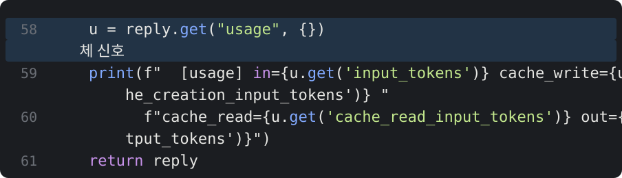
> 응답 usage 에서 매 바퀴 출력
> 캐시가 깨져도 오류는 없다. 청구서에만 찍힌다

그리고 응답의 유시지 블록에서 캐시 리드 인풋 토큰스를 매 바퀴 찍습니다. 저자는 이 숫자를 생체 신호라고 불러요. 캐시가 깨져도 오류는 안 나고 청구서에만 찍히거든요.

> 실행해 봅시다: 캐시가 자란다
> 
> cache_read: 0 → 633 → 1068 → 1768 → 2254
> 새로 쓰는 건 그 바퀴에 더해진 조각뿐

같은 버그 고치기를 다시 시킵니다. 유시지 줄을 보세요. 첫 바퀴는 캐시 리드가 영이에요. 처음 보는 바이트니까 당연하죠. 둘째 바퀴 육백삼십삼, 셋째 천육십팔, 넷째 천칠백육십팔, 다섯째 이천이백오십사. 매 바퀴 지난 배열 전부를 캐시에서 읽고 그 바퀴에 더해진 조각만 새로 씁니다.

> 자주 막히는 곳: **맨 위 한 줄**
> 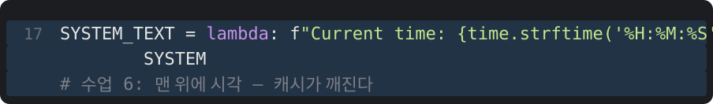
> Current time: HH:MM:SS 를 system 맨 위에
> 다른 것은 하나도 없다

이제 일부러 깨 볼게요. 시스템 프롬프트 맨 위에 현재 시각 한 줄을 넣었습니다. 초 단위로요. 이것만 다릅니다.

> 실행해 봅시다: 캐시가 **깨진다**
> 
> cache_read: 0, 0, 0, 0, 0
> cache_write: 644 → 1146 → 1555 → 2105 → 2648
> 매 바퀴 전체를 새로 쓰고 25% 웃돈까지

같은 작업인데 캐시 리드가 끝까지 영이에요. 대신 캐시 라이트가 육백사십사, 천백사십육, 천오백오십오, 이천백오, 이천육백사십팔로 자랍니다. 매 바퀴 배열 전체를 새로 캐시에 쓰면서 이십오 퍼센트 웃돈까지 내요. 그래 놓고 정작 한 번도 읽어 쓰지 않습니다. 오류는 한 줄도 안 났습니다.

> 위를 고치면 **아래 전부**를 다시 낸다
> 
> 앞에서부터 같은 바이트까지만 캐시 적중
> 시각 · 도구 순서 · 중간 삭제, 다 같은 사고

나란히 놓고 볼까요. 왼쪽은 안정된 프롬프트, 오른쪽은 시각 한 줄을 넣은 프롬프트. 같은 작업, 같은 모델이에요. 캐시는 앞에서부터 바이트가 같은 데까지만 맞춥니다. 첫 바이트가 다르면 뒤의 수만 토큰이 같아도 전부 제값이에요. ‖ 그래서 규칙은 하나입니다. 덧붙이기는 싸고 위쪽을 고치면 그 아래 전부를 다시 낸다. 시각, 도구 순서가 바뀌는 것, 세션 중간에 도구 목록을 바꾸는 것, 공간 아끼려고 중간 메시지를 지우는 것. 다 같은 사고예요.

> 캐시는 **앞부분**이 같아야 한다
> 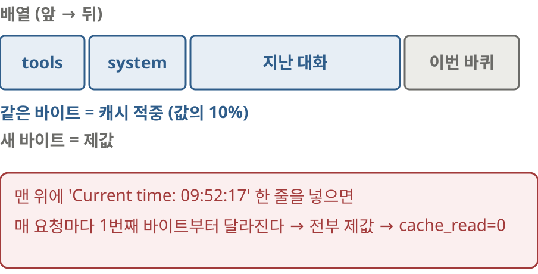
> 둘째 바퀴부터 입력 대부분이 cache_read 여야 정상
> 숙제: time.time() 을 넣어 0 으로 떨어지는 걸 보기

체크포인트. 캐시 리드 인풋 토큰스를 매 바퀴 지켜볼 것. 둘째 바퀴부터는 입력 대부분이 이 숫자여야 정상이다. 숙제도 하나 드릴게요. 여러분 코드의 시스템 프롬프트에 타임 점 타임을 넣어 보고 이 숫자가 영으로 떨어지는 걸 직접 보세요. 그리고 다시 빼세요.

## 9 | 마무리 | 1편 정리
> 배열, 루프, 디스패치 표
> 1편: 서버는 기억하지 않는다 · 모델은 부탁만 한다 · 에이전트는 while 루프 · 오류는 연료 · 위를 고치면 아래 전부를 낸다
> 2편: 컨텍스트 예산 · 서브에이전트 · 리마인더 · 백그라운드 작업

오늘 만든 걸 정리할게요. 배열 하나, 와일 루프 하나, 이름을 함수에 잇는 표 하나. 이게 에이전트의 뼈대입니다. 백 줄이 안 돼요. 다섯 가지를 눈으로 확인했습니다. 서버는 기억하지 않는다. 모델은 부탁만 하고 실행은 내 코드가 한다. 에이전트는 와일 루프다. 오류는 모델의 연료다. 위를 고치면 아래 전부를 다시 낸다. ‖ 다음 편에서는 이 루프가 오래 달릴 때 생기는 문제를 다룹니다. 컨텍스트가 차고, 작업이 배열 하나에 안 들어가고, 모델이 길을 잃고, 세상은 기다려 주지 않아요. 서브에이전트와 리마인더, 백그라운드 작업을 직접 붙여 봅니다. 코드와 실습 기록은 설명란의 저장소에 있어요. 고맙습니다.
