# 마케팅 엔지니어, 우리 카드사라면 — 토의편 화면 대본

`podcast.md`(사회자 + 가상 카드사 네 부서 토의)로 구운 오디오 위에 얹는 화면 대본. 토의 전용 그림(`figures/make.py`의 p-*)과 규제 관문 애니메이션(`figures/animate.py`의 consent)을 새로 그렸다.
각 화면의 첫 줄 `@분:초`는 `work/podcast-turns.tsv`에서 그 대목이 시작되는 차례의 시각이다. 뒤의 대사는 확인용이고 읽히지 않는다.

`python3 ../build.py marketing-engineers --script=script-podcast.md --audio=out/marketing-engineers-podcast.m4a`

출처: Greg Isenberg, X 아티클, 2026년 10월 · 가상 토의
잉크: #2B4C7E
부제: 가상 카드사 네 부서와 사회자의 토의

## 1 | 여는 말 | 표지
> 마케팅 엔지니어, / **우리 카드사라면**
> 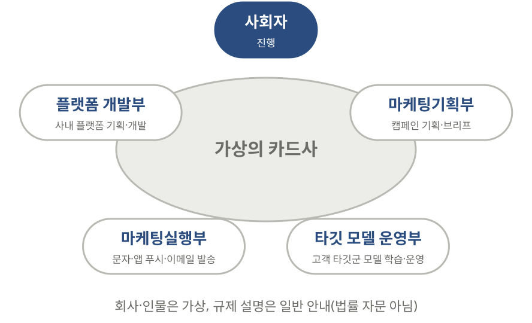

@0:00 사회: 안녕하세요, 듣는 편람입니다. 오늘은 조금 다르게 해 보려고요.

## 2 | 병목은 어디에 | 6주
> 아이디어에서 발송까지 / **6주**
> 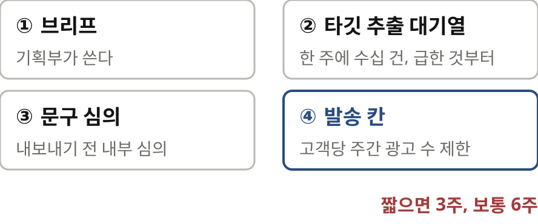

@1:00 사회: 그 줄 이야기부터 해 보죠.

## 3 | 두뇌 폴더 | 카드사판
> 두뇌 폴더, / **카드사판**
> 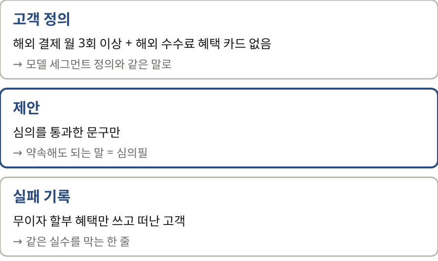

@1:48 사회: 글은 에이전트보다 두뇌 폴더를 먼저 쓰라고 해요.

## 4 | 잇는 표와 망분리 | 캠페인 아이디
> 반응률이 아니라 / **발급 뒤까지** 한 줄로
> 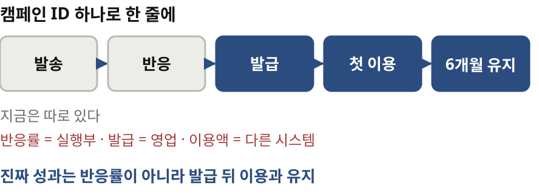

@2:57 사회: 글이 가장 값지다고 한 게 캠페인 아이디였어요.

> 망분리라는 / **벽**
> 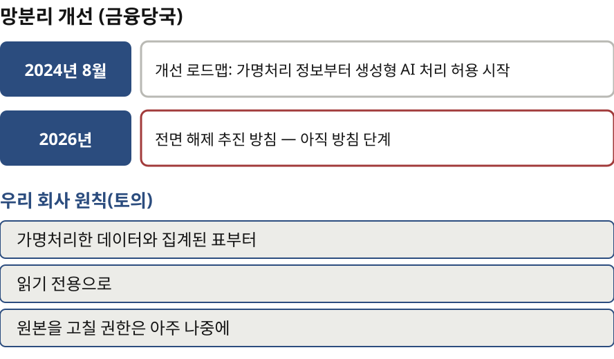

@3:22 사회: 그 표를 에이전트가 읽을 수는 있어요?

## 5 | 에이전트를 우리 업무에 | 세 에이전트
> 상담 녹취가 / **고객 언어**의 자리
> 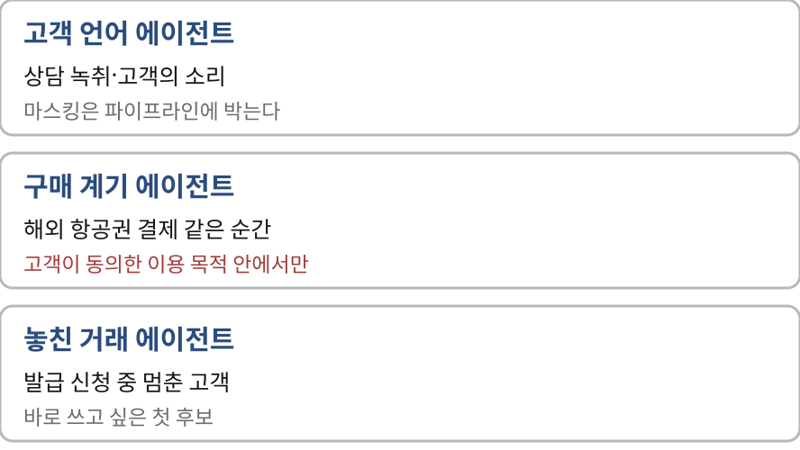

@4:01 사회: 글의 첫 에이전트는 고객 언어 에이전트였어요.

## 6 | 규제는 코드에 | 발송 엔진
> 안전장치는 / **발송 엔진의 코드**로
> 
> 정보통신망법: 광고성 정보 사전 수신 동의, 오후 9시-오전 8시 별도 동의
> (광고) 표시·보낸 곳·무료 수신 거부, 정기적인 동의 확인

@4:56 사회: 글에서 제일 공감한 대목이 이거예요.

> 모집 혜택에도 / **한도**
> 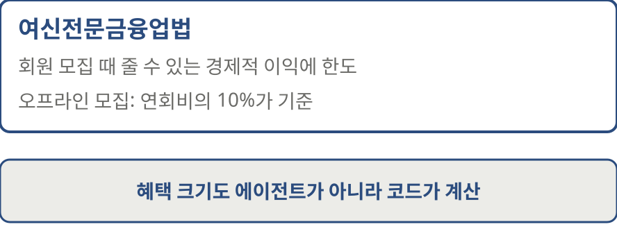

@5:52 기획: 혜택도 그래요.

> 승인 대기열 = / **심의 대기열**
> 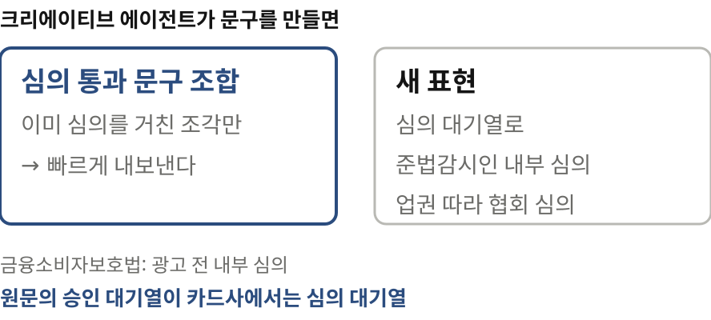

@6:05 사회: 광고 문구 심의는요?

## 7 | 모델이 결정할 때 | 자동화된 결정
> 에이전트가 / **결정**하기 시작하면
> 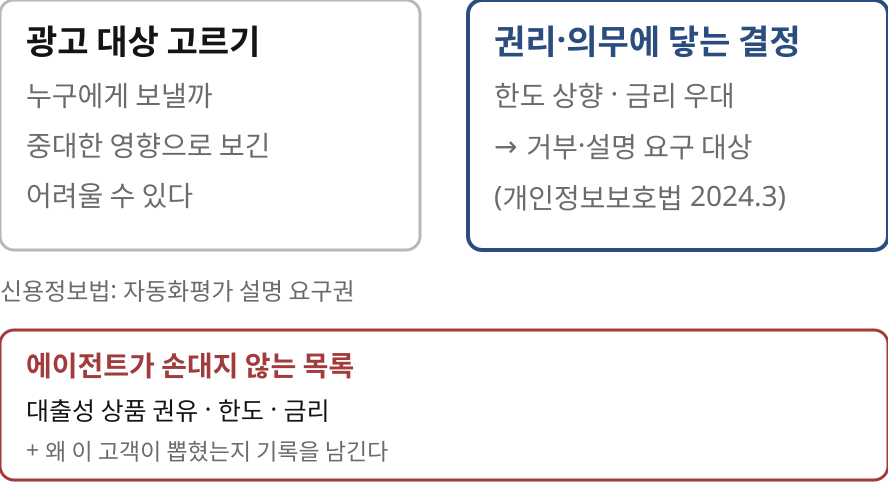

@6:25 모델: 저희 부서가 꼭 짚고 싶은 게 있어요.

## 8 | 우리 회사의 일주일 | 사례
> 우리 회사의 / **일주일**
> 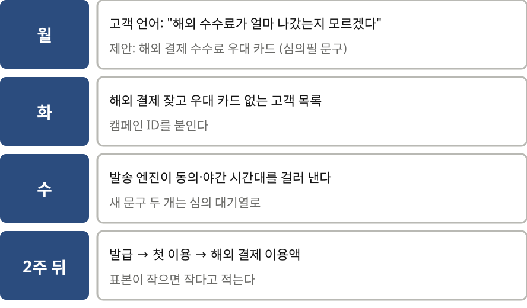

@7:30 사회: 글의 회계 사무소 사례를 우리 회사로 옮겨 볼까요?

## 9 | 맺는 말 | 내일부터
> 내일부터 / **무엇을 할까**
> 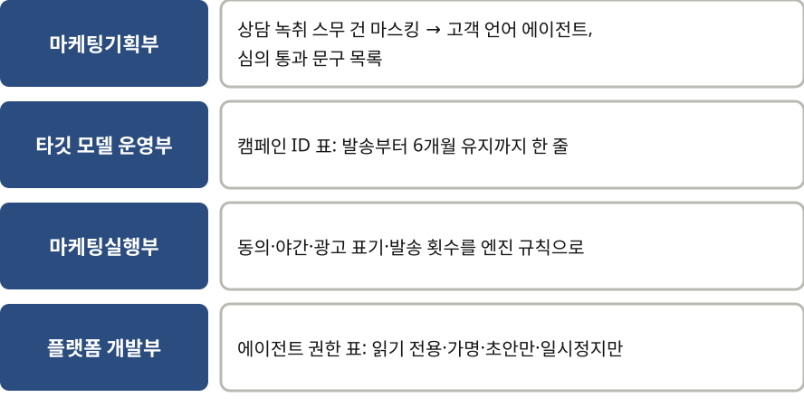

@8:16 사회: 마지막으로 한마디씩 부탁드려요.

> 마케팅 엔지니어는 / **네 부서가 만나는 자리**
> 회사·인물은 가상, 규제 설명은 일반 안내(법률 자문 아님)
> 원문 x.com/gregisenberg

@8:52 사회: 듣고 보니 글이 말한 마케팅 엔지니어가 금융에서는 네 부서가 만나는 자리 같네요.
