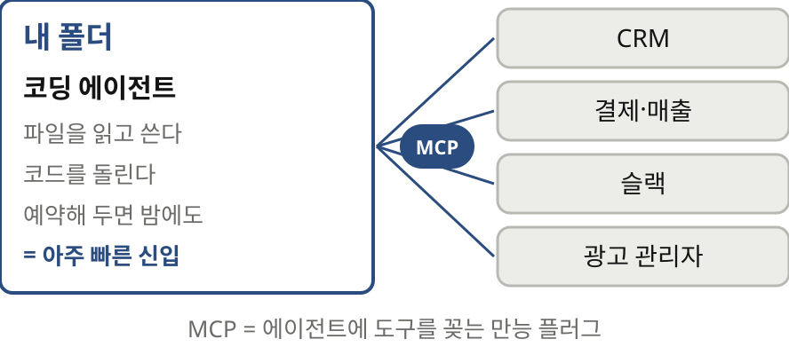
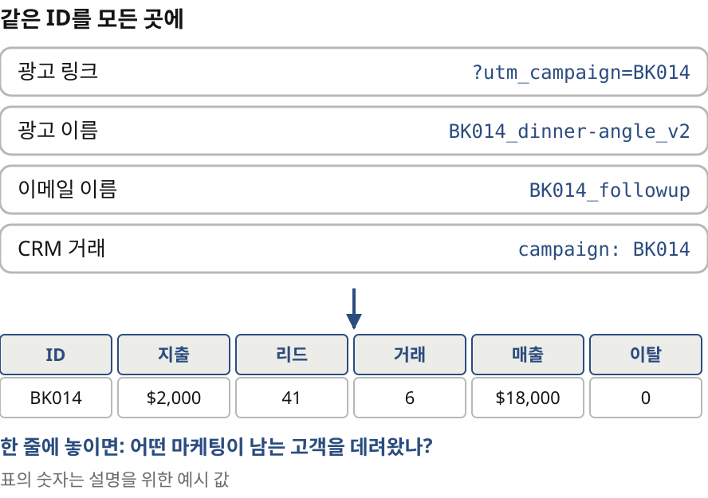
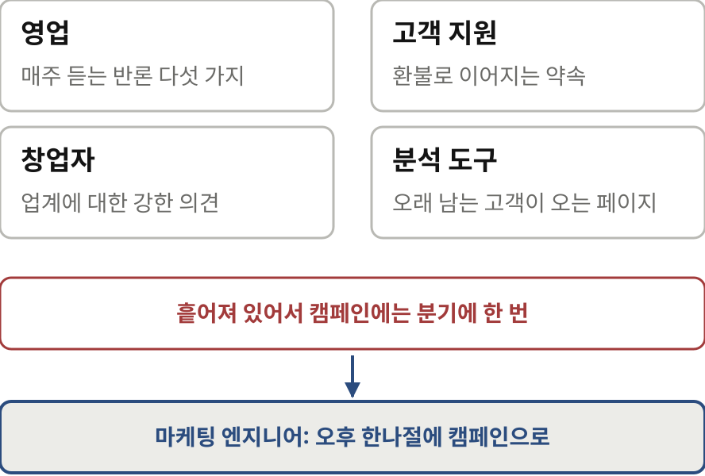
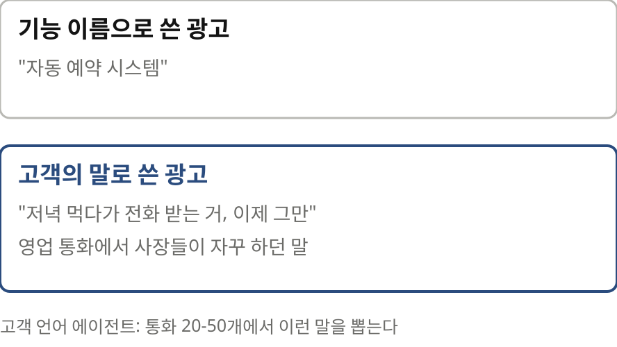
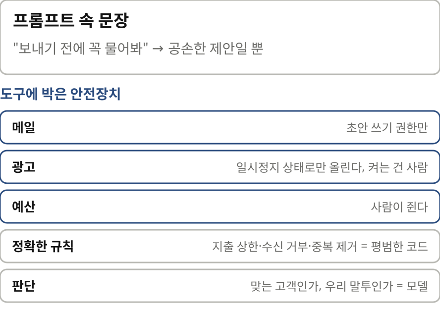
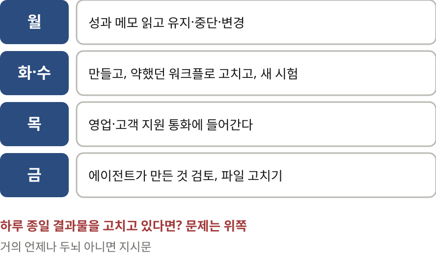

# 마케팅 엔지니어 — 나레이션 대본

Greg Isenberg의 "Marketing Engineers: 100x More Experiments with AI agents"(X 아티클, 2026-10-08)를 한 사람이 들려주듯 풀어 쓴 대본.
원문 번역이 아니라 [정리 노트](../../content/notes/marketing-engineers.md)를 바탕으로 요지와 해설을 다시 서술한 것이다. 말투는 노트와 같은 해설 문체(짧은 문장, 물음과 답).

형식은 `../build.py` 머리말 참고. `python3 ../build.py marketing-engineers --voice=유나`로 미리 듣는다(세로 1080x1920).
그림은 `figures/make.py`(SVG), 모션 그래픽은 핵심 대목 네 곳만 `figures/animate.py`(eras·brain·agents·week mp4). 원문 그림은 쓰지 않고 개념을 새로 그렸다.

출처: Greg Isenberg, X 아티클, 2026년 10월
잉크: #2B4C7E
부제: AI 에이전트로 실험을 100배 돌리는 사람
약어: MCP=Model Context Protocol, 에이전트가 도구를 부르는 규격; CRM=Customer Relationship Management, 고객 관계 관리; UTM=Urchin Tracking Module, 링크에 붙이는 유입 경로 표시; CTR=Click-Through Rate, 클릭률; SSO=Single Sign-On, 한 번 로그인으로 여러 서비스 쓰기

## 1 | 들어가며 | 표지
> 아이디어를 낸 사람이 / **직접 만든다**
> 마케팅 엔지니어
> — AI 에이전트로 실험을 100배 돌리는 사람

마케팅에서 가장 어려운 건 뭐였을까요? 아이디어가 아니었습니다. 영업은 거래가 왜 성사되는지 알았고 고객 지원은 고객이 왜 떠나는지 알았어요. 어려운 건 실행이었습니다. 아이디어 하나가 나오려면 브리프를 쓰고, 디자이너와 개발자와 분석가를 거치고, 회의를 두 번 넘어야 했죠. 대부분은 슬랙 대화방에서 죽었습니다. ‖ 오늘 글은 그레그 아이젠버그가 2026년 10월에 쓴 글입니다. 스타트업 팟캐스트 진행자이고 디자인 회사 대표예요. 그는 이 병목이 깨졌다고 말합니다. 그 자리에 마케팅 엔지니어라는 새 직업이 생겼다는 거죠.

## 2 | 배경 | 먼저 알아 둘 말
> **코딩 에이전트**와 MCP
> 

먼저 두 가지를 짚을게요. 하나는 코딩 에이전트입니다. 클로드 코드나 커서 같은 도구예요. 그레그는 이걸 아주 빠른 신입 직원에 빗댑니다. 내 컴퓨터 폴더 하나에 사는 신입이에요. 폴더 안의 파일을 다 읽고, 새 파일을 쓰고, 코드를 돌리죠. 여기에 MCP라는 규격으로 도구를 꽂아 줍니다. 그러면 에이전트가 사람처럼 고객 관리 프로그램을 읽고 지난주 매출을 가져옵니다.

> **캠페인 ID**로 잇는다
> 

다른 하나는 캠페인 아이디입니다. 광고 링크, 광고 이름, 이메일 이름, 고객 관리 프로그램의 거래 칸에 똑같은 아이디를 박아 두는 거예요. 지루해 보이지만 저자는 이걸 전체에서 가장 값진 일로 꼽습니다. 대부분의 회사는 캠페인별 클릭과 고객별 매출을 따로 압니다. 둘을 잇지 못하죠. 아이디 하나로 이으면 진짜 중요한 질문에 답할 수 있습니다. 어떤 마케팅이 돈을 내고 남아 있는 고객을 데려왔나?

## 3 | 역사 | 다섯 시대
> 실험 한 번의 값이 / **계속 무너져 왔다**
> 

저자는 마케팅의 역사를 다섯 시대로 나눕니다. 첫째는 매드맨 시대예요. 티브이와 신문, 큰 예산으로 일 년에 몇 번 승부를 걸었습니다. 둘째, 디지털 마케터가 등장합니다. 검색 광고가 나오면서 클릭을 셀 수 있게 됐고 한 달에 몇 번 실험했죠. 셋째는 그로스 해커예요. 퍼널과 에이 비 테스트로 일했지만 아이디어마다 엔지니어가 필요해서 줄을 서야 했습니다. 넷째는 에이아이 보조 마케터입니다. 초안은 빨라졌는데 조직도와 회의는 그대로였어요. 다섯째가 마케팅 엔지니어입니다. 아이디어를 낸 사람과 만드는 사람이 같은 사람이에요. 하루에 실험을 수십 번 돌립니다. 흐름은 하나예요. 실험을 가장 많이 돌리는 쪽이 가장 빨리 배우고, 가장 빨리 배우는 쪽이 이깁니다.

## 4 | 왜 중요한가 | 회사의 금더미
> 회사마다 쓰지 않는 / **금더미**가 있다
> 

회사마다 거의 쓰지 않는 금더미가 있다고 저자는 말합니다. 영업은 매주 같은 반론을 듣습니다. 고객 지원은 어떤 약속이 환불로 이어지는지 알죠. 창업자는 업계에 대한 강한 의견을 머릿속에 품고 있고요. 그런데 이 지식은 서로 다른 도구와 사람에게 흩어져 있어서 캠페인에 닿는 건 분기에 한 번쯤입니다. 마케팅 엔지니어는 이걸 오후 한나절에 캠페인으로 바꿉니다. 구체적인 마케팅이 싸지면 고객을 가장 잘 아는 회사가 이기게 되죠.

## 5 | 두뇌 | 에이전트보다 맥락이 먼저
> 에이전트보다 먼저 / **두뇌**를 쓴다
> 

흔한 실수가 있습니다. 들뜬 마음에 에이전트 열 개를 띄우고, 뻔한 결과물이 산더미로 돌아오자 에이아이 마케팅은 과대평가됐다고 결론짓는 거예요. 무엇이 잘못됐을까요? 맥락이 얇았던 겁니다. 그래서 먼저 두뇌를 만듭니다. 신입에게 첫날 회사를 설명하듯 사업을 설명하는 폴더예요. 파일 여섯 개가 대부분의 일을 합니다. 하나, 모든 에이전트가 먼저 읽는 시작 페이지. 둘, 고객 정의. 누가 사고 누가 남는지 아주 구체적으로 적어요. 셋, 제안서. 무엇을 얼마에 팔고 무엇을 약속해도 되는지 적습니다. 넷, 말투 파일. 좋았던 광고와 퇴짜 놓은 광고를 이유와 함께 붙여 둡니다. 다섯, 창업자의 강한 의견. 여섯, 실제 돈을 치른 실패 기록입니다.

> 추측은 에이전트가 / **방침은 사람**이 옮긴다
> 에이전트는 evidence 폴더에 추측을 더할 수 있다
> company 폴더로 옮기는 건 사람만

규칙도 하나 있어요. 에이전트는 증거 폴더에 추측을 더할 수 있습니다. 하지만 회사 폴더로 옮기는 건 사람만 해요. 그러지 않으면 에이전트 하나의 짐작이 슬그머니 회사 방침이 되거든요.

## 6 | 에이전트 | 하나를 훌륭하게, 그다음에 다섯
> 사람은 기능보다 / **상황**을 산다
> 

에이전트는 하나를 훌륭하게 만든 다음에 둘째를 만듭니다. 첫날부터 여섯 개가 서로 떠들게 두면 주말 내내 단체 대화방을 디버깅하게 되니까요. 첫 에이전트는 고객 언어 에이전트입니다. 최근 영업 통화 스무 개에서 쉰 개를 읽고 단어를 뽑아요. 고객이 문제를 말할 때 쓰는 바로 그 단어요. 처음엔 칠십 퍼센트쯤 맞는다고 해요. 틀린 곳을 고쳐 가며 서너 번 돌리면 쓸 만해지고요. 예를 들어 배관 업체에 예약 프로그램을 판다고 하죠. 그러면 에이전트가 찾아냅니다. 사장들이 자꾸 저녁 먹다가 전화 받는 게 지쳤다고 말한다는 걸요. 이 한 줄이 자동 예약이라는 말보다 훨씬 좋은 광고 문구예요.

> 나머지 **다섯 에이전트**
> 

나머지 다섯도 하나씩 더합니다. 구매 계기 에이전트는 투자 유치나 새 매장처럼 수요가 하룻밤에 생기는 순간을 지켜봐요. 검색 에이전트는 사람들이 사기 직전에 던지는 질문마다 가장 쓸모 있는 페이지를 만듭니다. 크리에이티브 에이전트는 사야 할 이유가 서로 다른 광고를 만들어 시험하고요. 놓친 거래 에이전트는 잃은 거래를 다시 읽고 다시 열릴 조건을 적어 둡니다. 이 에이전트 하나가 나머지 비용을 다 뽑아 준다고 해요. 마지막으로 성과 에이전트가 매주 월요일 메모를 씁니다. 줄마다 유지, 중단, 변경, 시험 가운데 하나로 끝나요.

## 7 | 안전장치 | 문장이 아니라 도구에
> 보내기 전에 물어봐는 / **안전장치가 아니다**
> 

가장 빨리 낭패를 보는 길은 프롬프트 속 문장을 믿는 겁니다. 보내기 전에 꼭 물어보라는 말도 모델 입장에선 공손한 제안일 뿐이에요. 진짜 안전장치는 도구에 있습니다. 메일 에이전트에게는 초안 권한만 줍니다. 광고는 일시정지 상태로만 올리고 사람이 켜요. 예산도 사람이 쥡니다. 지출 상한이나 수신 거부 목록 같은 정확한 규칙은 평범한 코드로 짭니다. 모델에게는 판단만 맡기고요.

## 8 | 사례 | 캠페인 하나의 일주일
> 회계 사무소의 / **캠페인 하나**
> 

저자의 예를 따라가 볼게요. 온라인 쇼핑몰 고객을 늘리고 싶은 회계 사무소입니다. 월요일, 고객 언어 보고서에 같은 말이 보입니다. 반품과 배송비와 수수료를 빼면 실제로 돈을 벌었는지 모르겠다는 말이에요. 그래서 무료 수익성 점검이라는 제안을 승인합니다. 화요일, 에이전트들이 움직입니다. 고객의 말로 광고 세 가지를 만들고, 이익 계산기 페이지를 만들고, 잠재 고객 육십 명에게 보낼 편지 초안도 씁니다. 예전에 결산 끝나고 보자던 사람들이에요. 수요일, 사람이 한자리에서 다 검토해요. 지킬 수 없는 절감을 약속한 광고 하나를 빼고 이천 달러짜리 시험을 띄웁니다. 그리고 2주 뒤, 성과 에이전트가 지출을 계약까지 이어 봅니다. 계산기 페이지가 가장 잘 팔렸지만 표본이 아직 작다는 말도 덧붙여요.

> 고객의 처음 말이 / **끝까지 살아남았다**
> 리서치 요약 · 브리프 · 다섯 번의 수정을 거치지 않았다
> 인용문이 캠페인 폴더와 함께 다녔다

보통은 날카로운 통찰이 요약과 브리프와 수정을 거치며 흔한 광고처럼 둥글어집니다. 이 사례에서는 고객이 처음 한 말이 끝까지 살아남았어요. ‖ 인용문이 캠페인 폴더와 함께 다녀서 모든 에이전트가 그 말을 봤기 때문입니다.

## 9 | 일하는 방식 | 만들기보다 고르기
> 만드는 일보다 / **고르는 일**
> 

기계가 다 갖춰지고 나면 일은 만들기보다 편집에 가까워집니다. 월요일엔 성과 메모를 읽고 결정해요. 화요일과 수요일엔 만들고 고칩니다. 목요일엔 영업과 고객 지원 통화에 들어가요. 다음 주의 좋은 아이디어가 거기 숨어 있으니까요. 금요일엔 에이전트가 만든 것을 검토하고 파일을 고칩니다. 하루 종일 에이전트 결과물을 고치고 있다면 문제는 그 앞단에 있어요. 거의 언제나 두뇌 아니면 지시문입니다.

## 10 | 맺으며 | 고객을 가장 잘 아는 쪽이 이긴다
> 지루한 두 가지가 / **가장 값지다**
> 맥락을 담은 두뇌 폴더 · 지출과 매출을 잇는 캠페인 아이디

저는 이 글에서 에이전트 이야기보다 지루한 두 가지가 더 값지다고 봅니다. 하나는 두뇌 폴더예요. 에이전트가 뻔한 결과를 내는 건 모델 탓이 아니라 맥락 탓이라는 진단은 마케팅 밖에서도 통합니다. 다른 하나는 캠페인 아이디입니다. 클릭과 매출을 한 줄에 놓지 못하면 에이전트를 수십 개 돌려도 무엇이 통했는지 모르니까요.

> 읽으며 **짚어 둘 점**
> 권하는 도구 하나는 저자 동업자의 서비스
> 70% · 2-3주 · 2028년 같은 숫자는 근거 없이 제시된다

다만 짚어 둘 점도 있습니다. 저자가 권하는 도구 하나는 동업자의 서비스예요. 글 끝에는 자기 회사 홍보가 붙어 있고요. 칠십 퍼센트, 2028년 전망 같은 숫자도 근거 없이 나옵니다. 저자는 2028년쯤이면 최고의 마케팅 팀이 에이전트 수십 개를 돌리는 한두 명일 거라고 추측하는데요. 그 말이 맞든 틀리든 어디서 시작할지는 이미 나와 있어요.

> 이번 주말 / **못생긴 페이지 하나**
> 원문 x.com/gregisenberg

저자의 마지막 권유는 이렇습니다. 이번 주말에 에이아이 코딩 도구로 못생긴 랜딩 페이지 하나를 띄워 보라는 거예요. 배포한 페이지 하나에서 강의 열 개보다 배울 게 많다고요. 여기까지, 그레그 아이젠버그의 마케팅 엔지니어 이야기였습니다.
