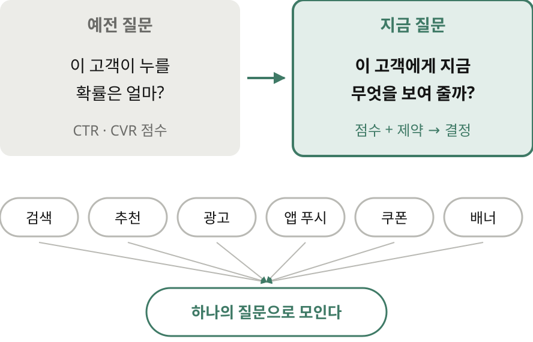
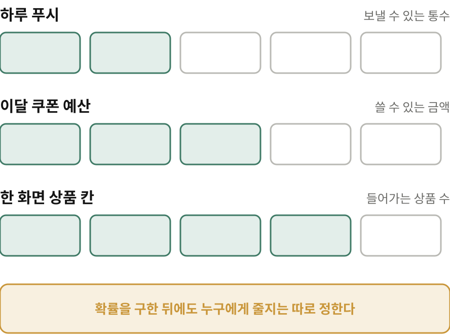
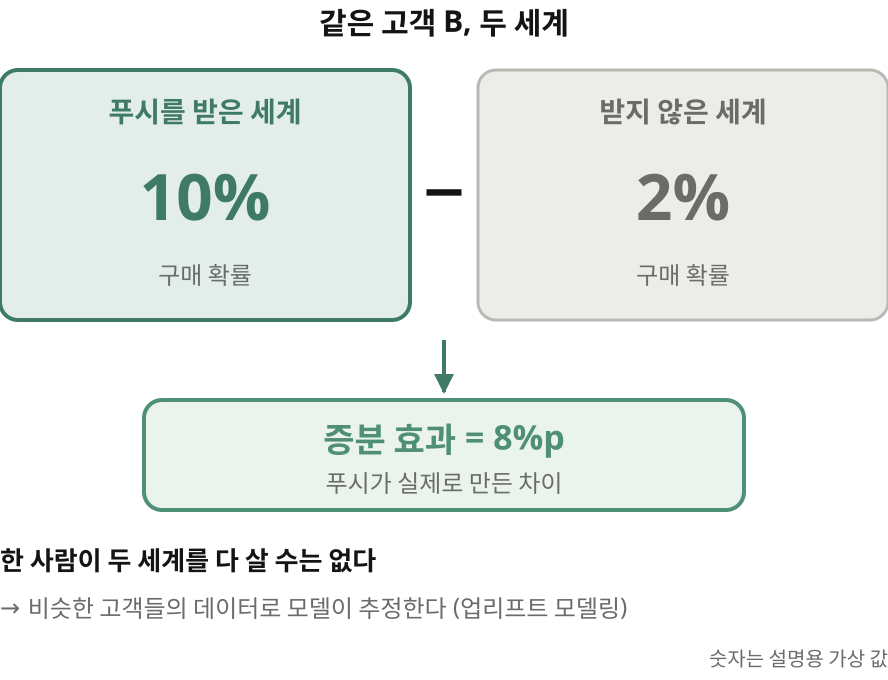
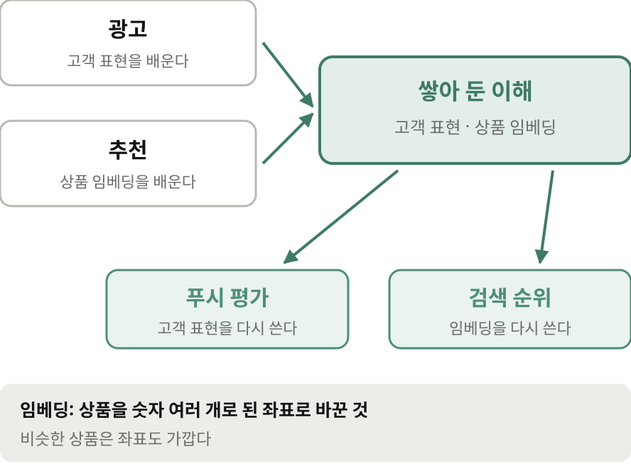
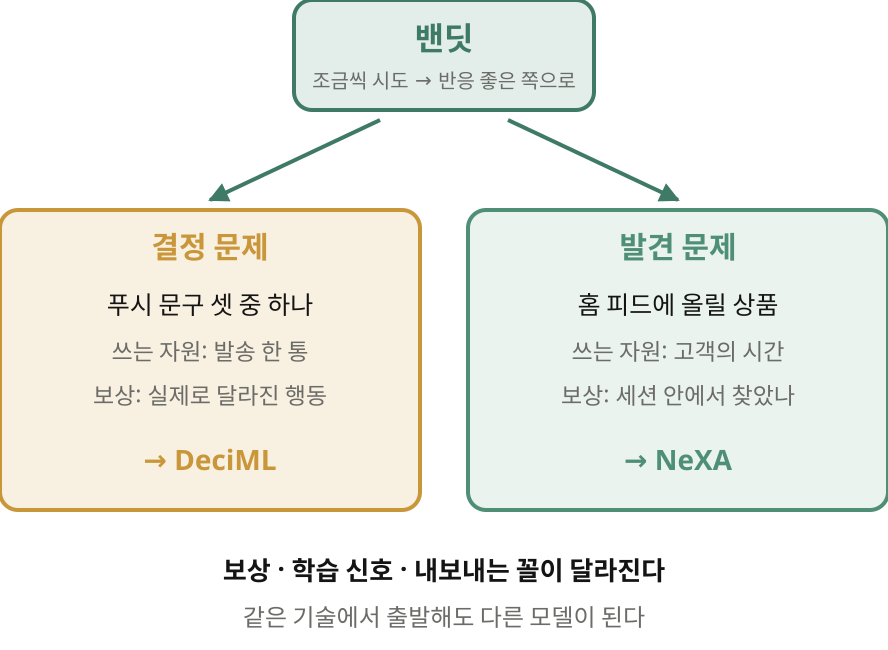
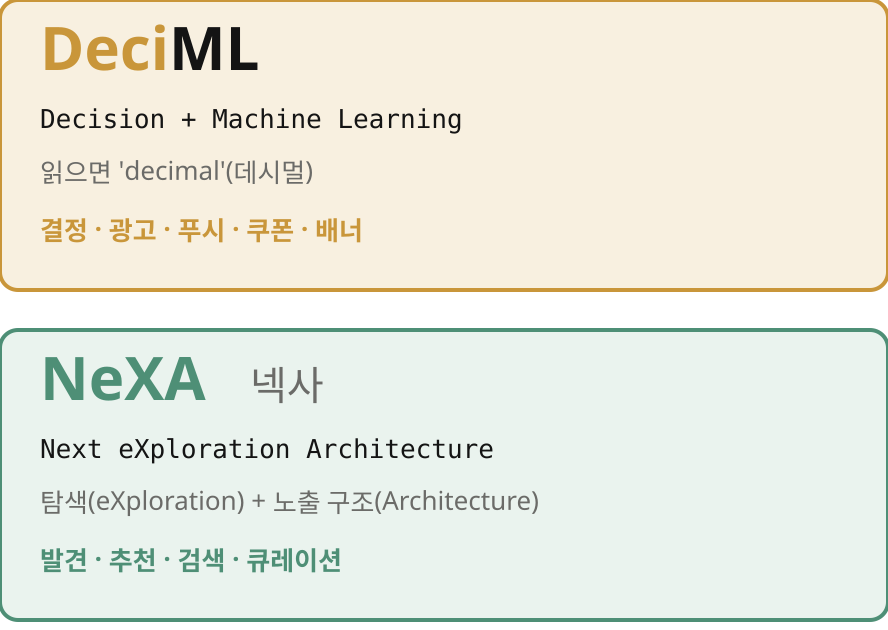
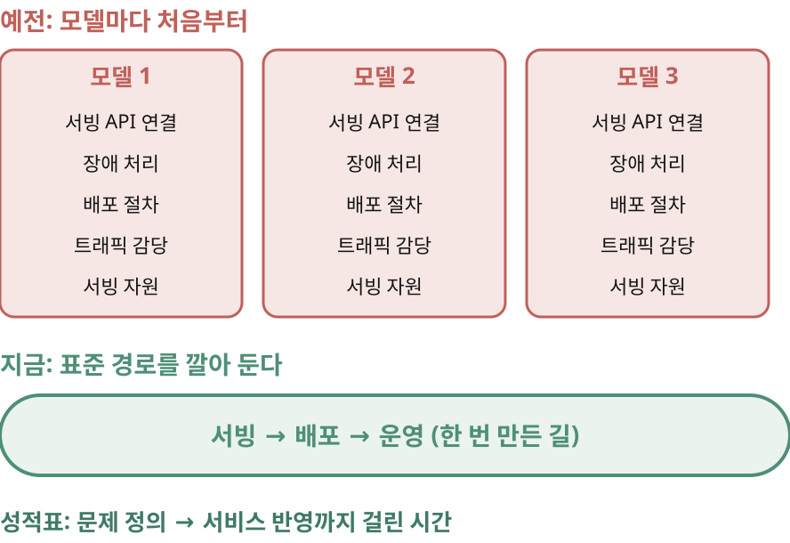
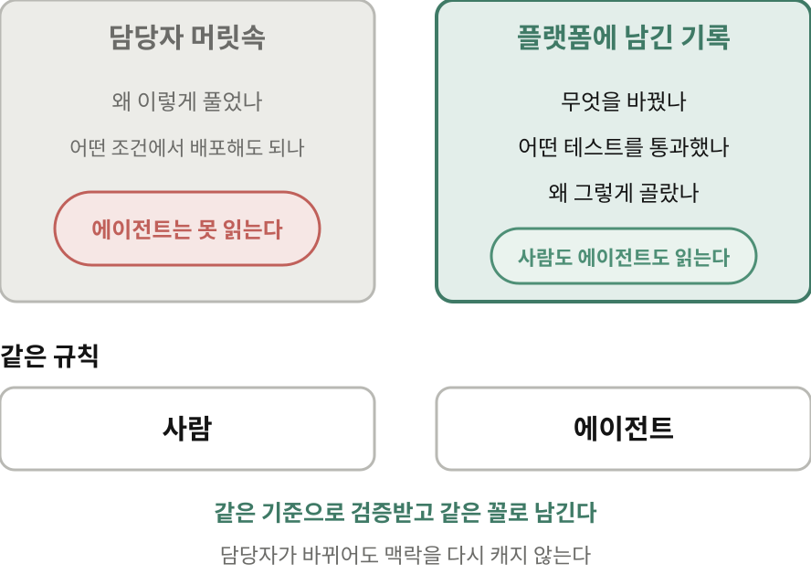
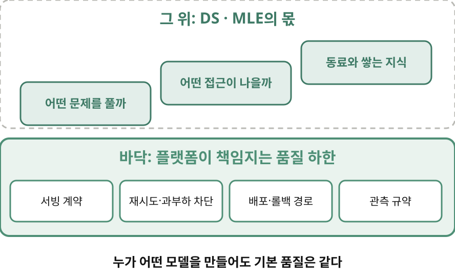
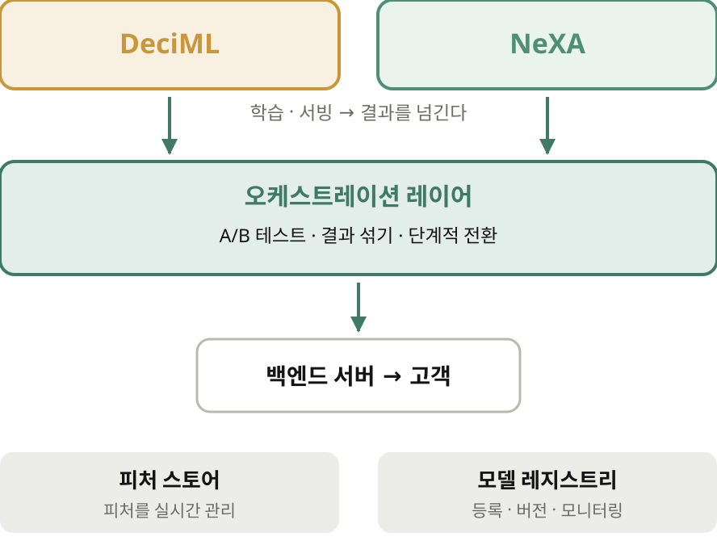

# 예측을 넘어 결정과 발견으로 — 나레이션 대본

무신사 테크 블로그 글 "예측을 넘어 결정과 발견으로: DeciML과 NeXA를 만든 이유"(김윤태, 2026-11-03)를 한 사람이 들려주듯 풀어 쓴 대본.
원문 그대로 읽지 않고 [정리 노트](../../content/notes/musinsa-deciml-nexa.md)를 바탕으로 요지와 해설을 다시 서술했다. 말투는 노트와 같은 해설 문체(짧은 문장, 물음과 답).

형식은 `../build.py` 머리말 참고. `python3 ../build.py musinsa-deciml-nexa --voice=유나`로 미리 듣는다(세로 1080x1920).
그림은 `figures/make.py`(SVG), 모션 그래픽은 핵심 대목 네 곳만 `figures/animate.py`(uplift·problems·stages·owner mp4). 원문 그림은 쓰지 않고 개념을 새로 그렸다.

출처: 무신사 테크 블로그, 2026년 11월
잉크: #3F7A66
부제: 반응 확률을 맞히는 데서 자원을 쓰는 결정으로
약어: ML=Machine Learning, 머신러닝; CTR=Click-Through Rate, 클릭률; CVR=Conversion Rate, 구매 전환율; DS=Data Scientist, 데이터 과학자; MLE=Machine Learning Engineer, ML 엔지니어; API=Application Programming Interface

## 1 | 들어가며 | 표지
> 예측을 넘어 / **결정과 발견으로**
> 무신사가 ML 플랫폼 두 개를 새로 만든 이유
> — 김윤태, 무신사 테크 블로그, 2026년 11월

푸시 알림의 클릭률을 올렸습니다. 그런데 구매는 그대로예요. 무엇이 잘못됐을까요? ‖ 오늘은 이 물음에서 출발한 글을 읽습니다.

글은 2026년 11월 무신사 테크 블로그에 올라왔습니다. 쓴 사람은 김윤태 님이에요. 무신사 개인화 팀의 머신러닝 엔지니어로 추천, 고객 관리 메시지, 유저 속성, 머신러닝 플랫폼을 맡고 있어요. 팀이 새로 만든 두 플랫폼, 데시멀과 넥사를 소개하는 시리즈의 첫 편이에요.

## 2 | 문제 | 질문이 바뀌었다
> 얼마나 반응할까 → / **지금 무엇을 보여 줄까**
> 

개인화 팀이 오래 풀어 온 문제는 익숙한 꼴이었습니다. 이 고객이 이 상품을 누를 확률은 얼마일까? 클릭률이나 구매 전환율을 잘 맞히고, 점수가 가장 높은 걸 고르면 됐죠.

그런데 검색, 추천, 광고, 앱 푸시, 쿠폰, 배너처럼 채널이 늘면서 질문이 하나로 모였습니다. 이 고객에게 지금 무엇을 보여 줄 것인가?

> 확률이 높아도 / **다 보여 줄 수는 없다**
> 

확률만으로는 이 질문에 답이 안 나옵니다. 하루에 보낼 수 있는 푸시는 몇 통으로 정해져 있어요. 이번 달 쿠폰 예산에도 끝이 있고, 한 화면에 들어가는 상품 수도 정해져 있습니다. 확률을 구한 뒤에도 그 한계 안에서 누구에게 무엇을 줄지는 따로 정해야 해요. 이게 결정 문제입니다.

## 3 | 배경 | 예측과 결정
> 반응할 사람이 아니라 / **달라질 사람**
> 

예측과 결정이 어떻게 다른지 숫자로 보겠습니다. 숫자는 설명을 위해 지어낸 값이에요. 고객이 두 명 있습니다. 에이는 단골이에요. 푸시를 받으면 살 확률이 삼십 퍼센트인데 안 받아도 이십팔 퍼센트입니다. 비는 요즘 뜸한 고객이에요. 푸시를 받으면 십 퍼센트, 안 받으면 이 퍼센트입니다. 푸시를 한 통만 보낼 수 있다면 누구에게 보내야 할까요? 반응 확률로 고르면 삼십 퍼센트인 에이가 뽑힙니다. 하지만 에이는 푸시가 없어도 살 사람이에요. 푸시가 만든 차이는 고작 이 퍼센트포인트입니다. 비는 팔 퍼센트포인트나 달라져요. ‖ 결정의 눈으로 보면 비에게 보내야 합니다.

> **업리프트 모델링**이란
> 

이렇게 개입이 만든 차이를 추정하는 방법을 업리프트 모델링이라고 부릅니다. 한 고객을 두고 푸시를 받은 세계와 받지 않은 세계를 나란히 놓습니다. 그리고 두 세계의 구매 확률 차이를 재는 거예요. 실제로는 한 사람이 두 세계를 다 살 수 없으니 모델로 추정합니다. 이 차이를 증분 효과라고 해요. 클릭률을 올렸는데 구매가 그대로였던 이유가 여기 있습니다. 원래 살 사람에게 보냈던 거죠.

## 4 | 한계 | 점수로는 못 푸는 네 가지
> 점수 예측만으로는 / **답할 수 없는 네 가지**
> 

글은 서비스 곳곳에서 이미 드러난 한계를 네 가지로 묶습니다. 첫째는 제약 아래 배분이에요. 오늘 보낼 수 있는 푸시가 한 통이라면 누구에게 보낼까요? 보내지 않을 사람을 정하는 것도 여기 들어갑니다. 둘째는 방금 본 증분 효과입니다. 반응할 확률 대신 실제로 달라질 정도를 재야 해요. 셋째는 지면 간 조율입니다. 아침 푸시로 보여 준 상품을 낮에 홈 화면 맨 위에 또 올려야 할까요? 지면마다 따로 최적화하면 각자의 성적만 오르고 고객이 하루 동안 겪는 경험은 뒷전이 됩니다. 넷째는 발견 지면의 구조예요. 다음 달 새 큐레이션 지면이 생기면 서빙을 처음부터 다시 만들어야 할까요? 그래서는 개인화가 서비스가 바뀌는 속도를 따라가지 못합니다.

## 5 | 흐름 | 이해, 평가, 선택
> 이해하고 → 평가하고 → / **선택한다**
> 

네 문제는 생김새가 다 다릅니다. 그런데 푸는 순서는 같다고 글은 말합니다. 먼저 이해 단계예요. 고객과 상품을 머신러닝이 쓸 수 있는 표현과 피처로 바꿉니다. 다음은 평가 단계입니다. 선택지마다 가치를 매겨요. 개입이 만들 변화, 고객과 상품이 얼마나 맞는지, 노출했을 때 기대할 수 있는 값을 서로 비교할 수 있는 숫자로 바꿉니다. 마지막이 선택 단계예요. 그 숫자와 비즈니스 제약을 놓고 실제로 고릅니다. 슬롯을 누구에게 쓸지, 화면에 무엇을 어떤 순서로 놓을지요. 그리고 그 결과가 실제 발송이나 노출까지 이어져야 의미가 있습니다.

> 한 번 푼 것이 / **다음 문제의 출발점**
> 

이 대목에서 글이 힘주어 말하는 건 축적입니다. 팀은 이 흐름을 이미 수없이 되풀이해 왔어요. 그런데 결과가 프로젝트마다 흩어져 다음 문제로 이어지지 않았습니다. 이제는 단계마다 나온 결과를 쌓아 두고 다시 씁니다. 광고를 위해 배운 고객 표현을 푸시 평가에 쓰고, 추천을 위해 배운 상품 임베딩을 검색 순위에 쓰는 식이에요. 임베딩은 상품을 숫자 여러 개로 된 좌표로 바꾼 것이라고 보시면 됩니다.

## 6 | 경계 | 자원이 누구 것인가
> 기술이 아니라 / **문제로 나눈다**
> 

그러면 플랫폼을 어떻게 나눌까요? 랭커, 밴딧, 업리프트 모델 같은 기술은 어느 쪽에서나 씁니다. 기술로 나누면 거의 다 겹쳐요. 그래서 팀은 질문으로 나눴습니다. 그 질문은 유한한 자원이 누구 것이냐로 갈립니다. 푸시 한 통, 쿠폰 예산, 유료 노출 자리는 서비스의 자원이에요. 서비스가 먼저 고객에게 다가가며 씁니다. 이 자원을 누구에게, 언제 쓸지를 정하는 게 결정 문제이고 데시멀이 맡습니다. 반대로 고객의 시간과 주의는 고객의 자원이에요. 고객이 먼저 검색하거나 피드를 넘깁니다. 넥사가 맡는 발견 문제는 그 시간 안에 원하는 걸 찾게 돕는 일이에요.

> 같은 밴딧도 / **쓰임에 따라 갈린다**
> 

밴딧은 이런 알고리즘이에요. 여러 선택지를 조금씩 시도해 보며 반응이 좋은 쪽으로 차차 몰아줍니다. 같은 밴딧이라도 푸시 문구 후보 중 하나를 고르는 데 쓰면 결정 문제입니다. 발송이라는 서비스 자원을 쓰니까요. 홈 피드에 올릴 상품을 고를 때는 고객의 탐색을 돕는 셈이라 발견 문제예요. 문제가 다르면 보상의 정의도, 배우는 신호도, 결과를 내보내는 꼴도 달라집니다. ‖ 출발한 기술이 같아도 결국 다른 모델이 돼요.

> 기술은 바뀌어도 / **질문은 남는다**

경계가 늘 또렷하진 않다고 글도 인정합니다. 그래도 질문으로 나누는 이유가 있어요. 플랫폼에 쌓이는 평가 기준과 데이터, 결과를 서비스로 보내는 방식은 기술이 아니라 질문을 따라 갈립니다. 같은 질문끼리 묶어야 그걸 함께 쓸 수 있어요. 나중에 기술을 갈아 끼운다고 쌓아 둔 게 사라지지는 않습니다.

## 7 | 두 플랫폼 | 데시멀과 넥사
> DeciML과 / **NeXA**
> 

이름에도 뜻을 담았습니다. 데시멀은 결정을 뜻하는 디시전과 머신러닝을 합친 이름이에요. 소리 내어 읽으면 소수를 뜻하는 영어 단어와 같은 소리가 납니다. 고객과 비즈니스를 잴 수 있는 값으로 바꾸고 그 위에서 판단한다는 뜻을 함께 실었어요. 넥사는 넥스트 익스플로레이션 아키텍처의 줄임말입니다. 고객이 원하는 걸 찾아 나가는 탐색, 그리고 머신러닝 결과를 화면에 내보이는 구조를 가리켜요.

두 플랫폼은 같은 틀 위에서 돕니다. 배포하는 길, 서빙 규약, 관측 기준이 같고 고객에 대한 이해도 함께 씁니다. 데시멀은 서비스가 고객에게 먼저 할 행동을 정해요. 넥사는 고객이 서비스 안에서 무엇을 어떤 모습으로 발견할지를 정합니다. 넥사는 순서를 매긴 상품 목록을 내보내기도 하고, 여러 후보를 한 화면에 맞게 묶은 슬레이트를 내보내기도 해요.

## 8 | 원칙 1 | 모델을 운영하던 사람이 만들었다
> 모델 하나 내보낼 때마다 / **같은 논의를 또**
> 

글은 플랫폼을 관통하는 원칙 세 가지를 듭니다. 첫째는 모델을 운영해 본 사람이 만들었다는 점이에요. 팀은 모델을 직접 만들고, 배포하고, 운영해 왔습니다. 그런데 모델 하나를 서비스에 내보낼 때마다 같은 논의를 처음부터 다시 했어요. 서빙 API를 어떻게 연결할지, 장애는 어떻게 처리할지, 트래픽은 버틸지, 데이터 규모에 맞는 자원은 얼마인지요. 문제를 고민하는 시간보다 같은 시행착오를 되풀이하는 시간이 더 길었습니다. 그래서 서빙부터 배포와 운영까지 가는 길을 표준으로 깔았어요.

대신 포기한 것도 있습니다. 성격이 다른 일을 두루 받아 주는 범용 플랫폼은 아니에요. 방향은 모든 것이 개인화되는 커머스예요. 거기에 맞춰 자주 푸는 문제를 훨씬 빨리 푸는 쪽을 골랐습니다. 그래서 플랫폼의 성적도 모델을 몇 종류나 올릴 수 있느냐로 매기지 않아요. 데이터 과학자와 머신러닝 엔지니어가 문제 하나를 정의해서 서비스에 반영한다고 해 보죠. 거기까지 걸리는 시간을 얼마나 줄였느냐로 잽니다.

## 9 | 원칙 2 | 사람과 에이전트가 같은 규칙으로
> 에이전트는 / **사람의 기억을 못 읽는다**
> 

둘째 원칙은 에이아이 네이티브입니다. 이 플랫폼에서는 에이전트도 코드를 쓰고, 테스트를 짜고, 배포를 준비해요. 그래서 사람과 에이전트가 같은 기준으로 검증받고 같은 꼴로 결과를 남기게 했습니다.

여기서 기록 방식이 바뀌어야 합니다. 지금까지는 이 문제를 왜 이렇게 풀었는지, 이 모델을 어떤 조건에서 배포해도 되는지가 담당자 머릿속에만 있어도 일이 굴러갔어요. 그런데 에이전트는 사람의 기억을 읽을 수 없습니다. 무엇을 바꿨고, 어떤 테스트를 통과했고, 왜 그렇게 골랐는지가 플랫폼이 읽을 수 있는 곳에 남아야 해요. 그래야 다음 작업이 거기서 바로 이어집니다. 사람에게도 좋아요. 담당자가 바뀔 때 맥락을 다시 캐느라 시간을 버리지 않으니까요.

## 10 | 원칙 3 | 바닥은 플랫폼이
> 품질 하한은 플랫폼이 / **그 위는 사람이**
> 

셋째 원칙은 바닥 위에서 일한다는 겁니다. 플랫폼은 품질의 하한을 책임져요. 서빙 계약, 재시도와 과부하 차단, 배포와 되돌리기 경로, 관측 규약 같은 것들입니다. 매번 새로 만들면 사람마다 다른 답이 나오는 일이죠. 이걸 플랫폼이 기본으로 주면 누가 어떤 모델을 만들어도 기본 품질은 일정합니다.

그 위는 데이터 과학자와 머신러닝 엔지니어의 몫입니다. 어떤 문제를 풀지, 어떤 접근이 나은지, 동료와 논의하며 쌓는 지식은 플랫폼이 대신 가질 수 없어요. 플랫폼은 바닥을 받칩니다. 그 위에 무엇을 얼마나 높이 쌓을지는 사람이 정해요.

## 11 | 앞으로 | 맞물리는 플랫폼들
> 혼자가 아니라 / **맞물려 돈다**
> 

두 플랫폼은 모델을 학습하고 서빙해서 결과를 다음 층으로 넘기는 데까지 맡습니다. 그다음 층은 오케스트레이션 레이어예요. 여기서 에이비 테스트를 돌리고, 여러 모델의 결과를 섞거나 단계적으로 바꿔서 백엔드 서버로 보냅니다. 에이비 테스트란 고객을 무작위로 두 무리로 나누는 실험이에요. 무리마다 서로 다른 방식을 보여 주고 결과를 비교합니다. 옆에는 두 가지가 붙습니다. 피처를 실시간으로 관리하는 피처 스토어, 그리고 모델의 등록과 버전을 관리하는 모델 레지스트리예요.

다음 편은 데시멀이 서빙을 셋으로 나눈 이야기라고 예고했어요. 바로 답해야 하는 실시간 에이피아이, 정해진 때에 한꺼번에 돌리는 배치 작업, 뒤에서 차례로 처리하는 비동기 워커입니다. 그 뒤로는 발송 슬롯 배분, 예산 아래 쿠폰 타기팅 같은 실제 사례를 결과가 확인된 것부터 내놓는다고 해요.

## 12 | 맺으며 | 기술은 바뀌어도 질문은 남는다
> 읽고 나서 남는 것
> 경계는 기술이 아니라 질문에 긋는다
> 판단의 이유는 머릿속이 아니라 읽을 수 있는 곳에
> 아직 성과 수치는 없다 — 첫 편

이 글에는 아직 성과 수치가 없습니다. 첫 편이라 문제와 원칙만 담았어요. 그래도 남는 게 둘 있습니다. 하나는 경계를 긋는 기준이에요. 랭커냐 밴딧이냐로 나누면 같은 질문을 푸는 사람들이 흩어집니다. 자원이 누구 것이냐로 나누면 평가 기준과 데이터가 질문을 따라 모여요. 다른 하나는 기록입니다. 에이전트가 코드를 쓰는 팀이라면 판단의 이유를 머릿속에 두면 안 돼요. 읽을 수 있는 곳에 남겨야 다음 사람도, 다음 에이전트도 그 위에서 시작합니다.

> 예측은 / **출발점일 뿐**
> 이 고객에게 지금 무엇을 보여 줄까?
> 원문 techblog.musinsa.com

처음 물음으로 돌아가 볼까요. 클릭률을 올렸는데 구매가 그대로였던 건, 반응할 사람을 찾았을 뿐 달라질 사람을 찾지 않아서였습니다. 예측은 출발점이에요. 그 점수로 무엇을 할지 정하는 데서 개인화가 완성된다는 게 이 글의 주장입니다. 실제 구조가 이 원칙을 어떻게 받치는지는 다음 편들을 봐야 알겠죠. 여기까지, 무신사 테크 블로그의 글이었습니다.
