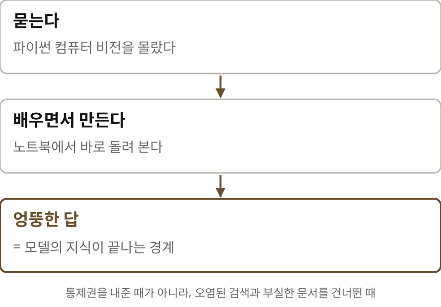

# 예전의 내 일이 아득하다 — 나레이션 대본

Chris의 "My old job feels very distant now"(Pinecoder blog, 2026-10-15)를 한 사람이 들려주듯 풀어 쓴 대본.
원문 번역이 아니라 [정리 노트](../../content/notes/my-old-job-is-distant.md)를 바탕으로 요지와 해설을 다시 서술한 것이다. 말투는 노트와 같은 해설 문체(짧은 문장, 물음과 답).
TTS가 잘못 읽지 않도록 나레이션 속 영어 이름과 숫자는 처음부터 한글로 적었다(화면 글은 원래 표기).

형식은 `../build.py` 머리말 참고. 그림은 `figures/make.py`(SVG), 모션 그래픽은 핵심 대목 세 곳만 `figures/animate.py`(stages·habits·iphone mp4).

출처: Chris, Pinecoder blog, 2026년 10월
잉크: #6B4E2E
부제: 한 개발자가 ChatGPT에서 Opus 5.5까지 걸어온 길
약어: QA=Quality Assurance, 품질 검증; PR=Pull Request, 코드 병합 요청

## 1 | 들어가며 | 표지
> 예전의 내 일이 / **아득하다**
> 한 개발자가 ChatGPT에서 Opus 5.5까지 걸어온 길

에이아이가 개발자의 일을 어떻게 바꿨을까요? 거창한 전망 말고, 한 사람의 하루는 어떻게 달라졌을까요? ‖ 오늘 글은 한 개발자의 회고입니다. 그 물음에 자기 경험으로 답했어요. 글쓴이는 크리스라는 개발자예요. 파인코더라는 개인 블로그를 씁니다. 글머리에 사람이 직접 썼다고 밝혀 둔 글입니다. 제목을 우리말로 옮기면 이래요. 예전의 내 일이 이제 아득하게 느껴진다.

## 2 | 배경 | 먼저 알아 둘 말
> **탭 완성**과 / **에이전트 코딩**
> 

먼저 두 가지 일하는 방식을 짚을게요. 탭 완성은 편집기가 다음 몇 줄을 회색 글씨로 미리 보여 주고, 개발자가 탭 키를 눌러 받아들이는 방식입니다. 주도권은 개발자에게 있죠. 에이전트 코딩은 다릅니다. 할 일을 말로 맡기면 에이전트가 파일을 읽고, 여러 파일을 고치고, 테스트를 돌리고, 결과를 보고해요. 개발자가 하는 일도 바뀌어요. 직접 쓰던 사람이 이제 맡기고 검토합니다.

## 3 | 여정 | 여섯 단계
> 검색창에서 / **앱 하나**까지
> 

저자의 여정은 여섯 단계로 볼 수 있습니다. 첫째, 챗지피티를 더 나은 검색창으로 썼습니다. 둘째, 예시 코드를 붙여 넣고 원하는 동작을 설명해 코드를 받았어요. 저자에겐 싫어하던 루비를 제대로 배우지 않고 넘어갈 비상구였습니다. 셋째, 커서의 탭 완성을 썼지만 대부분 이미 쓴 패턴을 되풀이할 뿐이었어요. 넷째, 클로드에게 말로 시키는 에이전트 코딩으로 넘어갔습니다. 그때도 모든 줄을 검토했죠. 다섯째, 오퍼스 사 점 오와 사 점 육 무렵엔 일일이 짚어 주지 않아도 됐습니다. 여섯째, 오퍼스 오 점 오에서는 한 단계 위에서 일합니다.

## 4 | 좋았던 시절 | 배우면서 만들기
> 엉뚱한 답은 / **지식의 경계**
> 

가장 좋았던 시기로 저자는 컴퓨터 비전 프로젝트를 잠시 맡았던 때를 꼽습니다. 처음 보는 물체의 경계를 찾아내는 일이었어요. 파이썬 컴퓨터 비전은 몰랐지만 챗지피티에게 물어 가며 배우면서 만들었습니다. 모델이 엉뚱한 소리를 하면 거기가 모델 지식의 경계라고 받아들였어요. 저자에게 이 시기는 통제권을 내준 때가 아니라 오염된 검색 결과와 부실한 문서를 건너뛰게 해 준 때였죠.

## 5 | 병목 | 리뷰
> 세 배 빨리 쓰면 / **세 배 읽어야** 한다
> 

오퍼스 사 점 오와 사 점 육 무렵, 저자는 몇 달 동안 합쳐진 코드를 기준으로 생산성이 세 배쯤 올랐다고 짐작합니다. ‖ 그러자 무엇이 막혔을까요? 리뷰입니다. 모든 줄을 똑같이 꼼꼼히 볼 수는 없으니 어디를 깊이 볼지 고릅니다. 표준 라이브러리와 익숙한 패턴은 훑습니다. 회사만의 규칙, 고객 데이터, 데이터베이스 변경이나 암호화처럼 되돌리기 어려운 곳은 꼼꼼히 봅니다.

## 6 | 갈아탔다 돌아오다 | 비용과 수다
> 더 싸고 덜 수다스러운 쪽으로 / **갔다가 돌아왔다**
> 

모델은 버전마다 나아졌습니다. 고칠 일이 줄었고 가끔은 스스로 잘못을 바로잡았어요. 대신 비용이 오르고 말이 많아졌습니다. 저자는 한동안 챗지피티로 갈아탔어요. 코딩 실력은 비슷했고 더 쌌고 덜 장황했거든요. 그래도 돌아왔습니다. 저자가 보기에 앤트로픽 모델이 다시 비슷해지거나 나아졌을 때였어요. 오픈에이아이를 믿지 못한다는 개인적 편향도 저자는 숨기지 않습니다.

## 7 | 한 단계 위 | 지금 일하는 법
> 코드보다 / **QA와 도구**
> 

오퍼스 오 점 오에서 저자는 한 단계 위에서 일해야 한다고 느낍니다. 지금은 이렇게 일합니다. 하나, 코드 리뷰보다 큐에이를 중심으로 계획을 짭니다. 둘, 화면을 만들 땐 여러 안을 한꺼번에 뽑아 봅니다. 셋, 계획과 진행 상황은 모델이 저자의 노트 앱에 직접 적게 합니다. 넷, 자기도 쓰고 모델도 쓰는 도구와 대시보드를 만듭니다. 다섯, 일을 여러 서브에이전트에게 나눠 주고 감독 에이전트를 둡니다. 여섯, 쓸모없는 실험도 잔뜩 만들어요. 대부분 횡설수설 같지만 아이디어를 모으는 일이 즐겁다고 합니다.

## 8 | 몇 시간 만의 앱 | 아이폰
> 맡기고 자리를 뜨자 / **앱이 폰에 깔렸다**
> 

저자가 가장 놀란 건 자기 노트 앱 일이었어요. 일렉트론으로 만든 이 앱을 아이폰으로 옮길 수 있을지 알아보라고 맡기고 자리를 떴습니다. 몇 시간 뒤 돌아와 보니 스위프트로 짠 기본 앱이 폰에 설치돼 있었고 모델이 큐에이를 해 달라고 기다리고 있었어요. 기능이 다 갖춰지진 않았지만 작동했습니다. 든 비용은 월 이십 달러 구독의 다섯 시간 한도 가운데 사십 퍼센트쯤이었어요.

> 150ms를 15ms로 / **잘못 적었다**
> 고치지 않고 모델이 어디까지 하나 보기로 했다
> 결과는 글에 나오지 않는다

한번은 이미지 처리가 백오십 밀리초 안에 끝나야 한다고 쓰려다 십오 밀리초라고 잘못 적었습니다. 저자는 고치지 않고 모델이 어디까지 하나 보기로 했어요. 결과는 글에 나오지 않습니다. 다만 무엇까지 가능하다고 볼지, 자기 기준을 다시 생각했다고 해요.

## 9 | 맺으며 | 아득해지는 예전의 일
> 리뷰에서 / **QA와 도구로**
> 세 배 빨리 쓰면 세 배 읽어야 한다
> 사람이 코드를 읽는 대신, 코드가 제대로 도는지 확인하는 장치를 짓는다

저자는 변화의 속도가 신나면서도 불안하다고 씁니다. 지금은 설계와 제약 조건을 붙잡습니다. 빠르게 바뀌는 코드를 이해하게 해 주는 도구도요. 기계적이고 지루한 일이 사라진 건 반갑지만 예전의 일하는 방식은 점점 멀어져 갑니다. 저는 리뷰가 병목이 됐다는 대목이 가장 실용적이라고 봅니다. 위험한 곳을 골라 깊이 보고 그다음엔 사람이 읽던 자리에 확인하는 장치를 지으니까요.

> 읽으며 **짚어 둘 점**
> 생산성 세 배는 합쳐진 PR 수로 어림한 개인의 감
> 아이폰 앱은 기능이 다 갖춰지지 않은 시제품, 한 사람의 회고

물론 생산성 세 배는 합쳐진 코드 수로 어림한 개인의 감이에요. 품질은 따로 재지 않았고요. 아이폰 앱은 기능이 다 갖춰지지 않은 시제품입니다. 무엇보다 이 글은 한 사람의 회고예요.

> 예전의 일하는 방식은 / **멀어져 간다**
> 원문 pinecoder.dev

그래도 이 글에는 흔적이 그대로 남아 있습니다. 한 사람이 몇 년에 걸쳐 같은 물음에 다르게 답해 온 흔적이요. 에이아이를 어디까지 믿을 것인가? 처음엔 검색 결과만큼 믿던 사람이 이제는 앱 하나만큼 믿습니다. 여기까지, 파인코더 블로그의 글이었습니다.
