# 에이전트 규모의 소스 컨트롤 — 나레이션 대본

Anthropic Engineering 블로그 "Redesigning source control at Anthropic"(2026-10-13)을 한 사람이 들려주듯 풀어 쓴 대본.
원문 번역이 아니라 [정리 노트](../../content/notes/redesigning-source-control.md)를 바탕으로 요지와 해설을 다시 서술한 것이다.

형식은 `../build.py` 머리말 참고. `python3 ../build.py redesigning-source-control --voice=유나`로 미리 듣는다(세로 1080x1920).
그림은 `figures/make.py`(SVG), 애니메이션은 `figures/animate.py`(growth·fetch·tiers·merge mp4). 원문 그림은 쓰지 않고 개념을 새로 그렸다.

출처: Anthropic Engineering 블로그, 2026년 10월
잉크: #5B3F8C
부제: 하루 병합 3만 건, 일곱 명이 다섯 달 만에 만든 사내 버전 관리 시스템 Scion
약어: CI=Continuous Integration, 지속적 통합; GB=Gigabyte; PB=Petabyte, 1PB = 1,000,000GB; CPU=Central Processing Unit; IAM=Identity and Access Management, 권한 관리; RPC=Remote Procedure Call, 원격 호출

## 1 | 들어가며 | 표지
> 에이전트 규모의 / **소스 컨트롤**
> 

하루에 코드 변경이 3만 건 병합되는 저장소가 있다면 어떨까요? 다섯 달 전만 해도 2,500건이었는데요. ‖ 오늘 소개할 글은 Anthropic의 엔지니어링 블로그에 2026년 10월에 올라온 글입니다. Claude가 코드를 쓰기 시작하자 병목이 어디로 옮겨 갔는지, 그리고 그 병목을 풀려고 git을 떠나 사내 버전 관리 시스템을 새로 만든 이야기예요.

## 2 | 배경 | 병목이 옮겨 갔다
> 병목은 이제 / **코딩이 아니다**
> 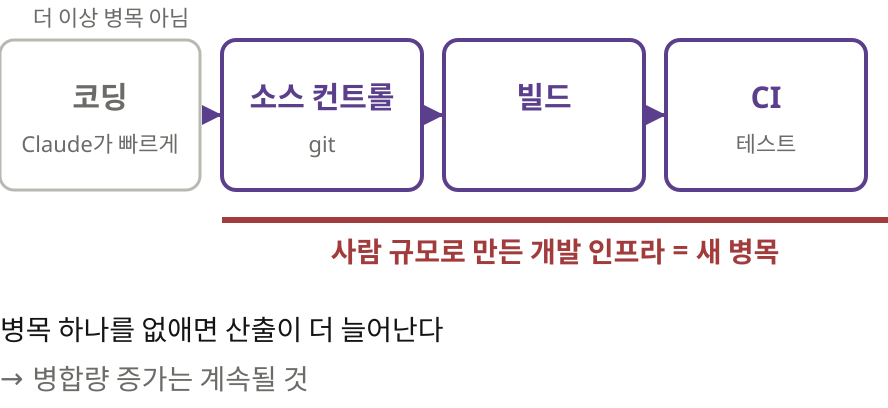

글은 이렇게 시작합니다. Anthropic에서는 Claude가 연구를 반복하고, 프로그램을 최적화하고, 서비스를 빠르게 만들어요. 그러자 코딩은 더 이상 병목이 아니게 됐습니다. 대신 사람 속도에 맞춰 만든 개발 인프라, 그러니까 소스 컨트롤과 빌드와 CI가 병목이 됐죠. 병목 하나를 없애면 산출이 더 늘어나니까 이 증가는 계속될 거라고 저자들은 봅니다.

## 3 | 배경 | 먼저 알아 둘 말
> **모노레포**란
> 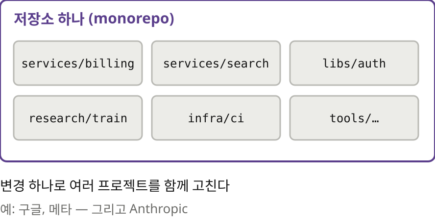

본론에 앞서 낯선 말 세 개를 짚고 갈게요. 첫 번째는 모노레포입니다. 회사의 여러 서비스와 라이브러리를 저장소 하나에 모아 두는 방식이에요. 의존성을 한곳에서 관리하고 변경 하나로 여러 프로젝트를 함께 고칠 수 있어서 구글이나 메타 같은 큰 회사들이 써 왔습니다.

> **분산** 버전 관리, git
> 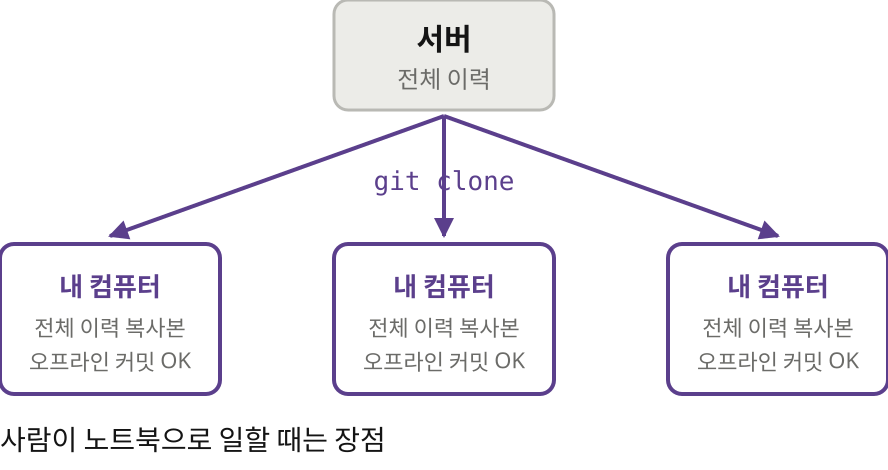

두 번째는 git이 분산 버전 관리 시스템이라는 점입니다. git clone을 하면 저장소의 전체 이력이 내 컴퓨터로 내려와요. 그 뒤로는 서버 없이도 커밋하고 이력을 볼 수 있습니다. 비행기 안에서 일하는 개발자에게는 큰 장점이죠.

> **CI 체크아웃**이란
> 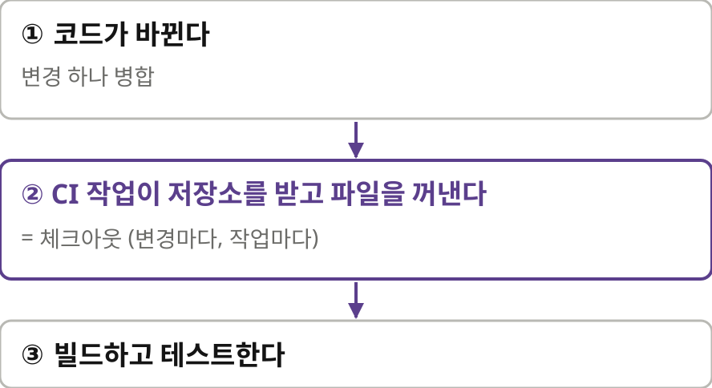

세 번째는 CI 체크아웃입니다. 코드가 바뀔 때마다 자동으로 빌드하고 테스트하는 걸 CI라고 하는데요. CI 작업은 돌 때마다 저장소를 받아서 파일을 꺼내 놓아야 합니다. 이걸 체크아웃이라고 해요. 사람이 하루 몇 번 하는 일을 기계는 수백만 번 합니다.

## 4 | 규모 | 숫자로 본 모노레포
> 하루 **600PB**가 넘는 / git 트래픽
> 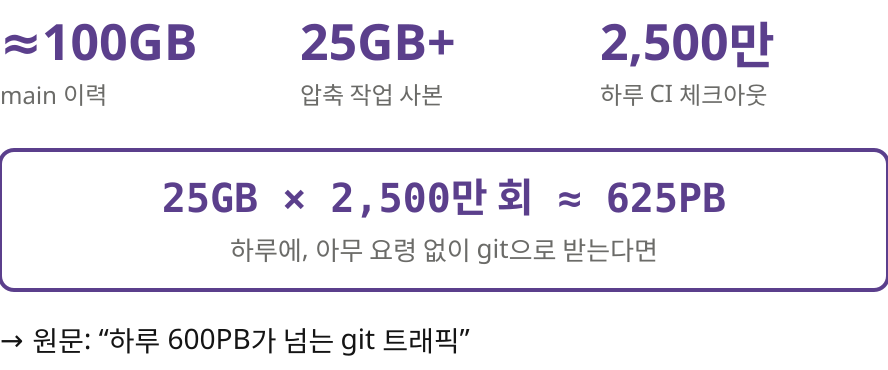

Anthropic의 모노레포는 이렇습니다. main 브랜치 이력이 100기가바이트에 가깝고 압축한 작업 사본만 25기가바이트가 넘어요. CI 체크아웃은 하루 약 2,500만 번 일어납니다. 25기가바이트를 2,500만 번 받으면 하루 600페타바이트가 넘어요. ‖ 아무 요령 없이 git으로 받으면 이만큼의 트래픽이 생긴다는 뜻입니다.

> 미러를 **수백 대** 돌려도
> 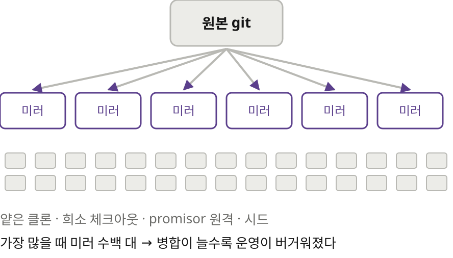

물론 요령은 다 썼습니다. 최근 이력만 받는 얕은 클론, 일부 디렉터리만 받는 희소 체크아웃, 빠진 객체를 나중에 받아 오는 promisor 원격, 사내 미러, 미리 받아 둔 시드까지요. 가장 많을 때는 사내 미러를 수백 대 돌렸는데, 병합 속도가 오를수록 운영이 버거워졌다고 해요.

> 클라이언트는 / **늘 온라인**이다
> 이 저장소를 받는 쪽은 거의 전부 데이터센터 안의 에이전트와 CI 작업
> git의 오프라인 우선 설계가 오히려 짐이 됐다

여기서 저자들은 핵심을 짚습니다. 이 저장소를 받는 쪽은 거의 전부 늘 온라인인 에이전트와 CI 작업이에요. git이 자랑하는 오프라인 우선 성질이 오히려 발목을 잡고 있었던 거죠. 전제가 바뀌면 같은 설계가 장점에서 짐으로 뒤집힙니다.

## 5 | 원칙 | 여섯 가지
> 에이전트 규모 소스 컨트롤의 / **원칙 여섯 가지**
> ① 클라이언트는 늘 온라인이다
> ② 이력·커밋·병합은 서버가, 클라이언트는 파일만
> ③ 모든 조회를 API로
> ④ 서버를 수평으로 늘린다
> ⑤ 커밋은 싸고 잠금이 없다
> ⑥ 체크아웃은 선택, 읽는 파일만

그래서 원칙 여섯 가지를 세웁니다. 구글의 Piper와 메타의 Sapling 같은 선례를 참고했다고 밝혀요. 첫째, 클라이언트는 늘 온라인이라고 보고 데이터는 필요할 때 받습니다. 둘째, 이력과 커밋, 병합과 리베이스는 서버가 맡고 클라이언트는 작은 캐시와 작업 파일만 들고 있어요. 셋째, 모든 조회를 API로 할 수 있게 해서 로컬 저장소가 필요 없는 작업을 늘립니다. 넷째, 서버를 수평으로 늘리고 어디에도 전체 사본을 두지 않아요. 다섯째, 커밋은 서버에서 싸게, 잠금 없이 합니다. 여섯째, 체크아웃은 선택이고 실제로 읽는 파일만 내려받습니다.

> 전부 받기 vs / **읽는 것만** 받기
> 

둘째 원칙이 가장 큰 차이를 만들어요. git에서는 작업마다 이력을 통째로 받아 갑니다. Scion에서는 이력이 서버에 남고 작업은 테스트가 실제로 여는 파일만 그때그때 받아 가죠. 체크아웃이 아예 필요 없는 작업도 많습니다. 어느 커밋에서 테스트가 깨졌는지 찾는 일처럼 서버에 묻기만 하면 되는 경우예요.

## 6 | Scion | 체인지셋
> 커밋 대신 / **체인지셋**
> 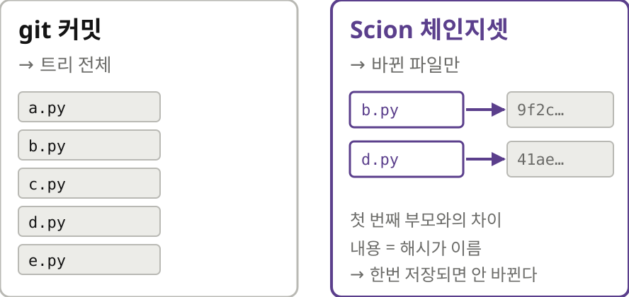

이제 Scion이 어떻게 동작하는지 볼게요. 기본 단위는 체인지셋입니다. git 커밋은 그 시점의 트리 전체를 가리키는데, 체인지셋은 첫 번째 부모에 비해 바뀐 파일만 적어요. 파일 내용은 내용 주소로 가리킵니다. 내용 주소란 파일 내용으로 만든 해시를 이름으로 쓰는 방식이라, 같은 내용은 언제나 같은 이름이고 한번 저장되면 바뀌지 않아요.

> ref 이동은 / **비교 후 교환** 한 번
> 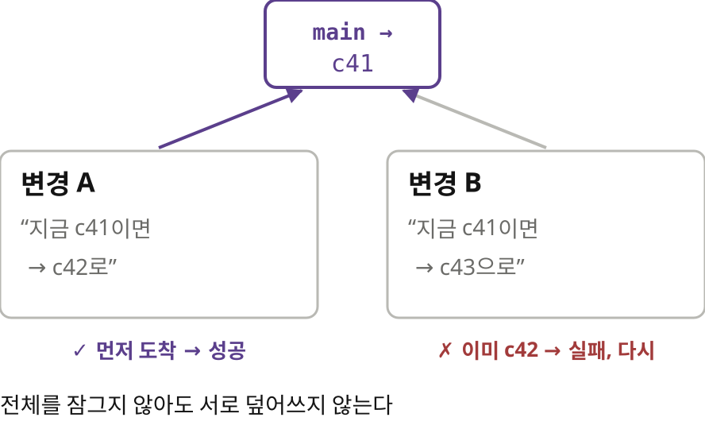

체인지셋은 서버에서 아주 빠르게 만들어집니다. 패키지 파일도, 잠금도 없어요. main 같은 ref를 옮길 때도 Spanner 데이터베이스의 행 하나에 비교 후 교환을 한 번 하면 끝입니다. 비교 후 교환은 지금 값이 내가 아는 값일 때만 새 값으로 바꾸는 연산이에요. 그사이 누가 먼저 바꿨으면 실패하니까, 전체를 잠그지 않아도 두 변경이 서로를 덮어쓰지 않습니다.

## 7 | Scion | 3층 캐시
> 요청의 99%는 / **가까운 층**에서 끝난다
> 

확장은 세 층의 캐시로 합니다. 노드마다 scion-daemon이 하나씩 있고, 지역마다 scion-cache가, 그 뒤에 원본 scion-server가 있어요. 내용 주소 데이터는 절대 바뀌지 않으니 어느 층이든 마음 놓고 캐시할 수 있죠. 층마다 캐시 적중률이 99%를 넘어서 원본까지 가는 요청은 아주 적습니다. 층 사이 경계를 엄격하게 지켜 한 층의 장애가 번지지 않게 했답니다.

> 결과
> 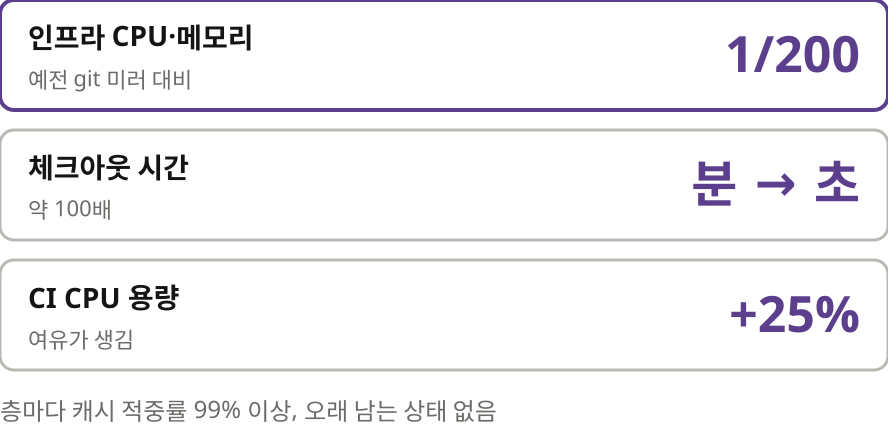

결과는 이렇습니다. 예전 git 미러 인프라보다 CPU와 메모리를 200분의 1만 써요. CI와 연구용 체크아웃은 분 단위에서 초 단위로, 약 100배 빨라졌습니다. ‖ CI의 CPU 용량도 25% 남게 됐고요.

## 8 | 배운 것 | 엔지니어의 일
> 일곱 명, **다섯 달**
> Scion, 코드 리뷰 도구 Antique, 코드 검색, IAM까지
> 그사이 병합량은 10배로

이걸 일곱 명이 다섯 달 만에 해냈습니다. Scion뿐 아니라 코드 리뷰 도구 Antique, 코드 검색, 권한 관리 시스템까지 같이 만들었고 그사이 병합량은 열 배로 늘었어요.

> 엔지니어의 일은 / **"아니오"** 라고 말하기
> 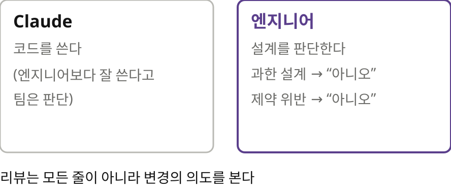

엔지니어의 역할도 바뀌었다고 해요. 엔지니어들은 Claude가 자신들보다 코드를 더 잘 쓴다고 판단합니다. 대신 시스템 수준의 설계 판단을 맡아요. 일의 상당 부분이 Claude에게 아니오라고 말하는 것이었답니다. 에이전트가 과하게 설계하거나 제약을 어길 때 막는 거죠. 사람 리뷰어는 모든 줄을 읽는 대신 변경의 의도를 봅니다.

> 메모리 **20분의 1**, / 속도 **4배**
> 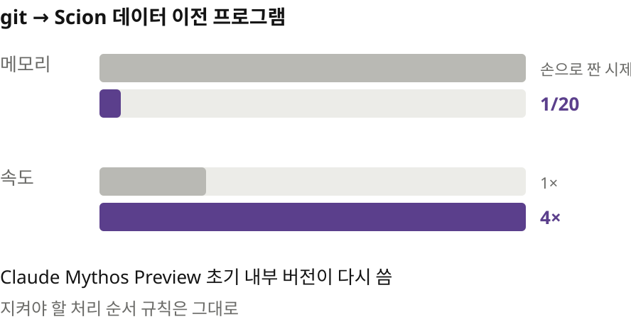

품질 이야기도 있어요. 외부에 의존하지 않는 시뮬레이션과 퍼징으로 철저히 테스트했습니다. 저자들은 이 코드베이스가 자신들이 다뤄 본 것 중 가장 잘 테스트된 축에 든다고 말해요. Claude Mythos Preview의 초기 내부 버전에게 손으로 짠 데이터 이전 시제품을 다시 쓰게 했더니, 지켜야 할 순서 규칙은 그대로 두고 메모리는 20분의 1, 속도는 4배가 됐다고 해요.

## 9 | 배운 것 | 운영과 병합
> 구성 요소마다 / **슈퍼팬** Claude
> 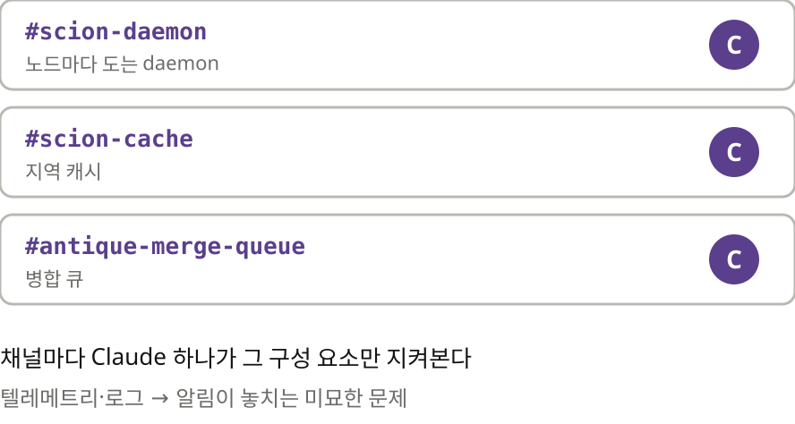

운영은 Slack에서 Claude가 맡습니다. 구성 요소마다 Slack 채널을 하나씩 두고 Claude 하나가 그 구성 요소의 건강만 지켜봐요. 원문은 이걸 슈퍼팬 Claude라고 부릅니다. daemon 담당, cache 담당, 병합 큐 담당이 따로 있죠. 텔레메트리와 로그를 보면서 보통의 알림이 놓치는 미묘한 문제를 잡아낸답니다.

> 병합 전에 다 막기 vs / **병합 뒤에 빨리 고치기**
> 

마지막 교훈은 작업 방식이에요. 전통적인 병합 큐는 변경을 한 줄로 세워서 하나씩 검사하고 병합합니다. 하루 3만 건이면 이 줄 자체가 병목이 되죠. 그래서 병합 뒤 테스트와 배포 전 테스트에 기댔습니다. 동시에 들어온 변경끼리 충돌할 수 있다는 걸 받아들였고요. ‖ 충돌이 나도 사람이 알아채기 전에 Claude가 보통 먼저 고친다고 해요.

## 10 | 맺으며 | 생태계와 남는 생각
> Scion은 / git의 **대체품이 아니다**
> 엔지니어 수만 명, 또는 에이전트가 아주 많은 초대형 모노레포용
> 공개는 어렵고, 대신 생각을 나눈다: 서버 RPC, 새 협상 프로토콜, 희소·얕은 기능

저자들은 Scion이 git을 대신하는 범용 도구가 아니라고 선을 긋습니다. 엔지니어가 수만 명이거나 에이전트가 아주 많은 초대형 모노레포에 맞는 거예요. 공개하기도 어렵다고 합니다. git과 갈라진 데다 리뷰와 검색과 CI 도구를 따로 갖춰야 하니까요. 대신 서버 쪽 원격 호출, 새 협상 프로토콜, 희소와 얕은 기능 같은 생각을 나눠서 git 쪽에서 가져다 쓸 수 있게 하겠다고 해요. GitHub, GitLab, 오픈소스 커뮤니티와 협력하고 싶다고 맺습니다.

> 읽으며 **짚어 둘 점**
> 성능 수치는 모두 Anthropic이 직접 잰 값, 그림의 세부 값은 본문에 없다
> Scion은 공개되지 않아 바깥에서 재현할 수 없다
> 병합 뒤 복구 방식의 실패율·되돌림 비율은 나오지 않는다

다만 짚어 둘 점도 있어요. 성능 수치는 모두 Anthropic이 직접 잰 값이고 Scion은 공개되지 않아서 바깥에서 재현할 수 없습니다. 병합 뒤에 고치는 방식이 얼마나 자주 실패하는지도 숫자로는 나오지 않아요.

> 클라이언트가 바뀌면 / **전제**도 바뀐다
> 원문 anthropic.com/engineering, 정리 노트 yoon-gu.github.io/compendium

정리하면, 이 글의 요지는 클라이언트가 바뀌면 인프라의 전제도 바뀐다는 겁니다. git은 오프라인에서 일하는 사람을 위해 설계됐고 Anthropic의 클라이언트는 늘 온라인인 에이전트였어요. 대부분의 팀에게 쓸모 있는 건 Scion 자체보다 원칙 쪽일 겁니다. 체크아웃이 필요 없는 작업은 체크아웃하지 말 것, 그리고 전역 상태를 줄일 것. 여기까지, Anthropic 엔지니어링 블로그의 글이었습니다.
