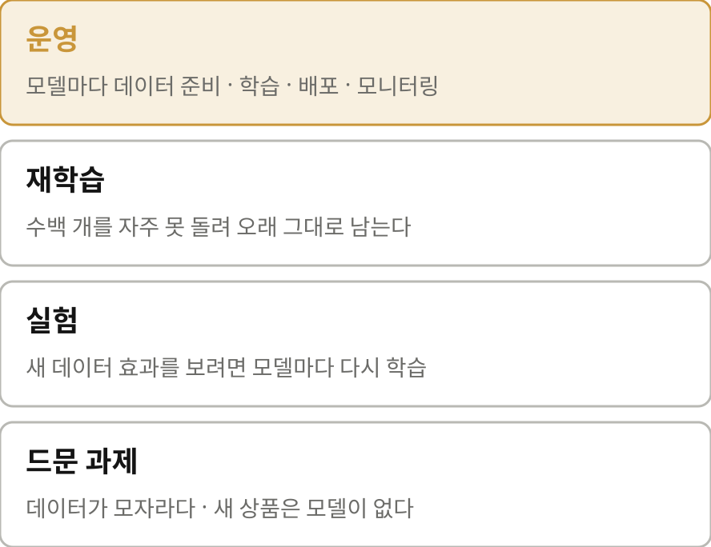
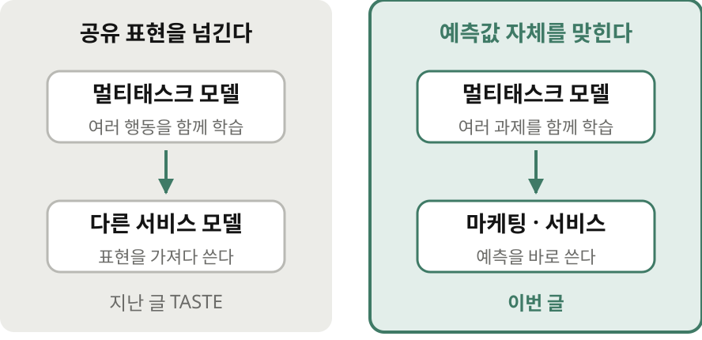
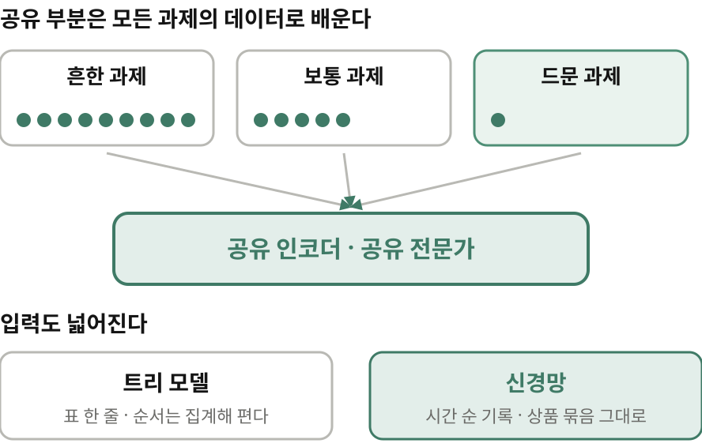
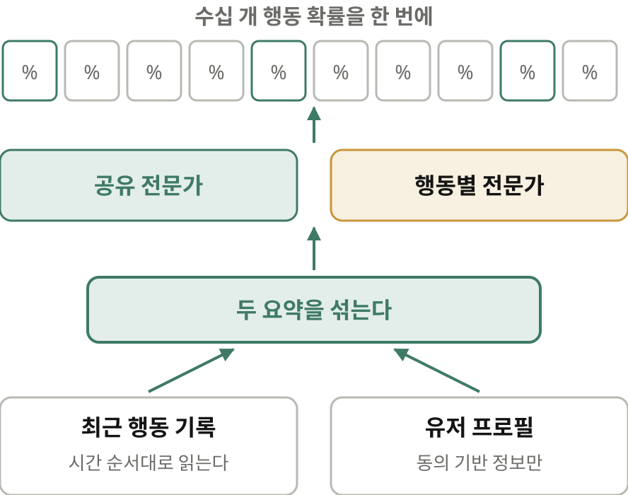
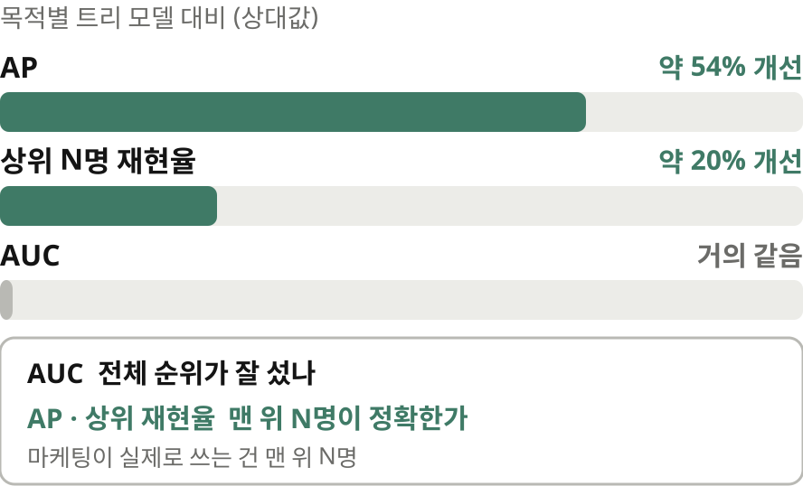
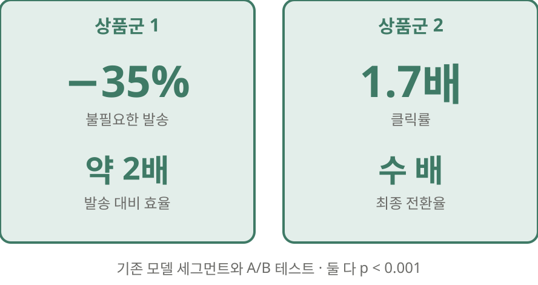
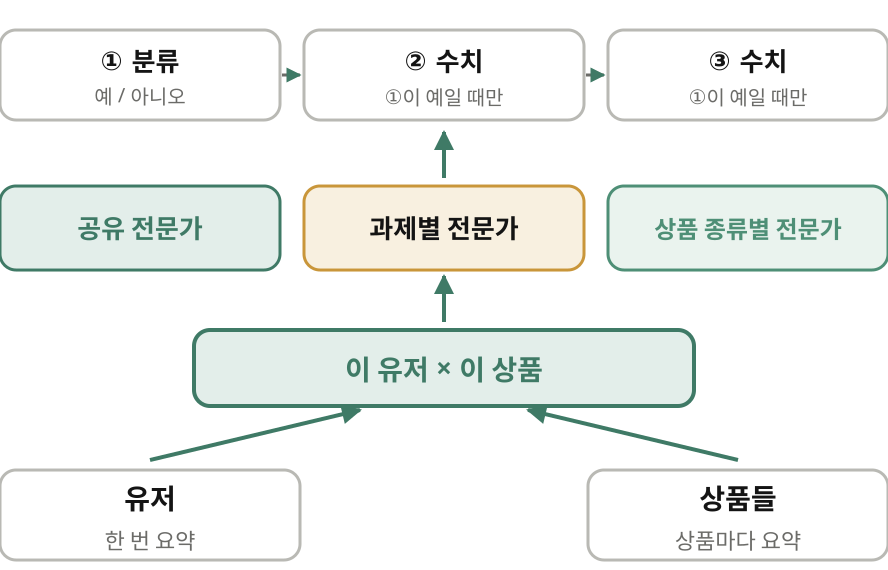
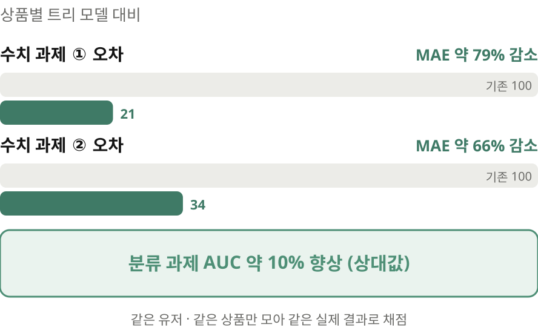
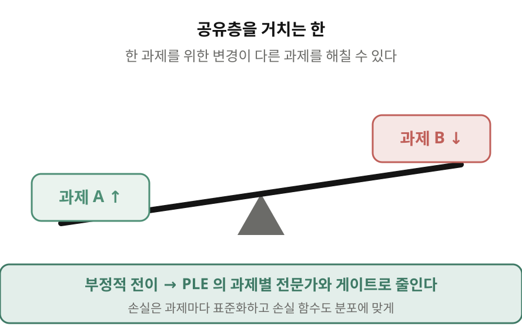
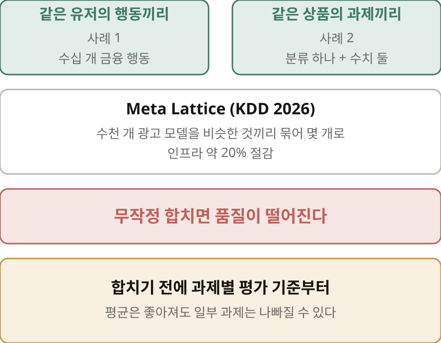

# 목적마다, 상품마다 늘던 모델을 하나로 — 나레이션 대본

토스 테크 블로그 글 "목적마다, 상품마다 늘던 모델을 하나로: 금융 도메인에 멀티태스크 학습 적용하기"(토스 ML 챕터, 2026-11-23)를 한 사람이 들려주듯 풀어 쓴 대본.
원문 그대로 읽지 않고 [정리 노트](../../content/notes/toss-multi-task-learning-finance.md)를 바탕으로 요지와 해설을 다시 서술했다. 말투는 노트와 같은 해설 문체(짧은 문장, 물음과 답).

형식은 `../build.py` 머리말 참고. 그림은 `figures/make.py`(SVG).
모션 그래픽은 핵심 대목 네 곳만 Remotion으로 만든다(`../remotion/src/toss/`, explosion·ple·mask·shortcut). 시각은 `figures/timing.py`가 whisper로 잡아 `figures/<이름>-timing.json`에 쓰고, `figures/render.sh`가 그 값을 Remotion 속성으로 넘겨 mp4로 굽는다. 원문 그림은 쓰지 않고 개념을 새로 그렸다.

출처: 토스 테크 블로그, 2026년 11월
잉크: #3F7A66
부제: 질문마다 모델 하나씩 붙이던 방식을 멈춘 이유
약어: ML=Machine Learning, 머신러닝; MTL=Multi-Task Learning, 멀티태스크 학습; PLE=Progressive Layered Extraction; AP=Average Precision, 평균 정밀도; AUC=Area Under the ROC Curve; MAE=Mean Absolute Error, 평균 절대 오차; MLE=Machine Learning Engineer, ML 엔지니어

## 1 | 들어가며 | 표지
> 목적마다, 상품마다 늘던 모델을 / **하나로**
> 토스가 금융 예측에 멀티태스크 학습을 쓴 방법
> — 토스 ML 챕터, 토스 테크 블로그, 2026년 11월

여러분 팀에는 머신러닝 모델이 몇 개 있나요? 그중 매일 돌면서 몇 달째 다시 학습하지 못한 모델은 몇 개일까요? ‖ 오늘은 이 물음에 답한 글을 읽습니다.

글은 2026년 11월 토스 테크 블로그에 올라왔습니다. 쓴 곳은 토스의 머신러닝 엔지니어 조직인 토스 엠엘 챕터예요. 앞서 소개한 추천 플랫폼 테이스트는 여러 행동을 함께 학습해 사용자 표현을 만들었는데, 이번 글은 같은 구조를 금융 예측 자체에 쓴 후속 편입니다.

## 2 | 문제 | 모델이 불어난다
> 질문 하나에 / **모델 하나**
> 

회사가 커지면 묻고 싶은 게 늘어납니다. 이 유저가 다음 달에 이 상품을 신청할까? 신청하면 어떤 결과를 받고 조건은 어떨까? 질문이 하나 생길 때마다 트리 모델을 하나씩 붙이면 처음엔 편해요. 트리 모델은 빨리 만들 수 있고 성능도 괜찮거든요. 과제가 늘고 상품도 늘어나면 모델 수는 과제 수에 상품 수를 곱한 만큼이 됩니다. 금세 수십 개, 수백 개예요. ‖ 게다가 대부분 매일 돌아야 합니다.

> 모델이 수백 개면 / **비용도 수백 배**
> 

무엇이 문제일까요? 모델마다 학습 데이터 준비, 학습, 배포, 모니터링이 따로 있습니다. 모델이 수백 개면 파이프라인도 수백 개고 고장 날 곳도 그만큼 많아요. 데이터 분포는 계속 바뀌는데 수백 개를 모두 자주 다시 학습하긴 어렵습니다. 결국 한 번 만든 모델이 오래 그대로 남아요. 좋은 신호가 될 데이터가 새로 생겨도 모델마다 다시 학습해서 비교해야 하니 실험이 자꾸 미뤄집니다. 드문 행동이나 정답이 드문 상품은 혼자 배우기엔 데이터가 모자라요. 새로 나온 상품은 모델이 생기기 전까지 예측할 방법이 아예 없습니다.

## 3 | 배경 | 멀티태스크 학습
> 앞부분은 함께, / **끝부분만 따로**
> 

토스는 이 모델들을 하나로 합쳤습니다. 쓴 방법이 멀티태스크 학습이에요. 여러 과제를 한 모델로 함께 배우는 방법입니다. 입력을 요약하는 앞부분은 모든 과제가 같이 씁니다. 이 부분을 공유 인코더라고 불러요. 과제별 답을 내는 끝부분, 출력층만 과제마다 따로 둡니다. 과제를 그냥 한데 묶으면 서로 간섭하니 토스는 중국 기업 텐센트가 발표한 피엘이라는 구조를 썼습니다. 이 구조는 모든 과제가 함께 쓰는 공유 전문가와 과제마다 따로 쓰는 과제별 전문가를 둡니다. 과제마다 게이트도 하나씩 있어서 어느 전문가를 얼마나 쓸지 정해요. 과제별 게이트는 공유 전문가와 자기 전문가만 봅니다. ‖ 그만큼 남의 과제가 끼어들 틈이 줄어요.

> 같은 구조, / **다른 쓰임**
> 

멀티태스크 학습은 쓰임새가 두 갈래예요. 함께 배우며 좋은 공유 표현을 만들어 다른 모델에 넘겨줄 수 있습니다. 지난 글 테이스트가 이쪽이었죠. 이번 글은 여러 과제의 예측값 자체를 한 모델로 잘 맞히는 쪽이에요. 그 예측을 마케팅과 서비스에 바로 씁니다.

## 4 | 공통 설계 | 정답이 없는 과제
> 샘플은 두고 / **손실만 가린다**
> 

토스가 만든 두 모델은 예측하는 대상이 전혀 다르지만 뼈대는 같아요. 그 뼈대에서 눈여겨볼 대목이 하나 있습니다. 한 샘플 안에서도 정답이 있는 과제와 없는 과제가 섞여 있어요. 예를 들어 앞 과제가 이 상품을 신청할지 묻는 분류라고 해 봅시다. 답이 아니오라면, 뒤에 오는 수치 과제에는 정답 자체가 없습니다. 신청한 뒤의 결과를 묻는 과제니까요. 그렇다고 이 샘플을 통째로 빼 버리면 어떻게 될까요? 분류 과제가 아니오라는 경우를 배우지 못합니다. 토스는 샘플을 그대로 두고 정답이 없는 과제의 손실만 계산에서 뺐어요. 손실은 모델의 답이 정답에서 얼마나 틀렸는지를 잰 값입니다. 모델은 이 값을 줄이는 쪽으로 배워요.

> 드문 과제가 / **큰 과제에서 배운다**
> 

이 뼈대 덕에 트리 모델 수백 개로는 얻기 어려웠던 게 생겼습니다. 공유 부분이 모든 과제의 데이터로 학습되니 정답이 드문 과제도 비슷한 과제가 배운 것을 같이 씁니다. 혼자였으면 출발도 못 했을 과제도 출발점이 생기죠. 입력도 넓어집니다. 트리 모델은 표 한 줄만 읽기 때문에 시간 순서가 있는 정보는 사람이 집계해 숫자로 펴서 넣어야 해요. 신경망은 시간 순 기록이나 상품 여러 개의 묶음도 그 모양대로 읽습니다.

## 5 | 사례 1 | 금융 행동 수십 개
> 수십 개 행동을 / **한 번에**
> 

첫 번째 사례는 마케팅입니다. 이 유저가 한 달 안에 어떤 서비스를 쓸까, 이 상품을 신청할까. 전에는 목적마다 트리 모델을 따로 뒀는데 토스는 한 유저의 여러 행동 확률을 한 번에 내는 모델을 만들었습니다. 최근 행동 기록을 시간 순서대로 읽은 요약과 유저 프로필 요약을 섞어요. 이걸 공유 전문가와 행동별 전문가에 통과시켜 수십 개 확률을 함께 냅니다. 입력은 동의 기반 정보만 썼어요. 행동마다 일어나는 빈도가 제각각이라 드문 행동일수록 맞힌 사례에 무게를 더 실었습니다. 너무 커지지 않게 상한도 뒀고요.

## 6 | 사례 1 결과 | 상위 N명이 중요하다
> AUC는 그대로, / **AP는 54% 올랐다**
> 

결과는 어땠을까요? 목적별 트리 모델과 견줘 평균 정밀도, 에이피가 상대적으로 약 오십사 퍼센트 올랐습니다. 상위 엔 명 재현율도 약 이십 퍼센트 올랐어요. 그런데 에이유씨는 거의 같았습니다. 이게 왜 중요할까요? 에이유씨는 전체 순위가 얼마나 잘 섰는지를 봅니다. 마케팅이 실제로 쓰는 건 전체가 아니라 맨 위 엔 명이에요. 에이피와 상위 재현율은 바로 그 위쪽이 얼마나 정확한지를 봅니다. ‖ 위쪽이 정확해졌으니 그만큼 성과를 낸 거예요.

> 실제 발송에서도 / **덜 보내고 더 맞혔다**
> 

실제 마케팅에서도 기존 모델과 에이비 테스트로 비교했는데 두 상품군 모두 통계적으로 유의하게 좋았어요. 첫 번째 상품군에서는 불필요한 발송을 약 삼십오 퍼센트 줄였고, 발송 대비 효율은 약 두 배였습니다. 두 번째 상품군에서는 클릭률이 약 일 점 칠 배, 최종 전환율은 몇 배 수준이었어요. 이 결과가 나온 뒤로 마케팅 타기팅에서 이 모델을 널리 쓰고 있다고 합니다.

## 7 | 사례 2 | 상품마다 세 과제
> 분류 하나와 회귀 둘을 / **한 모델에**
> 

두 번째 사례는 조금 더 까다롭습니다. 상품마다 예측할 과제가 셋인데 성격이 서로 달랐어요. 예 아니오를 맞히는 분류가 하나, 수치를 맞히는 회귀가 둘입니다. 전에는 과제마다, 상품마다 트리 모델을 따로 둬서 수백 개였어요. 새 상품이 나오면 엠엘이가 그 상품의 모델을 새로 학습해야 했어요. 예측할 상품은 처음 모델을 만들 때보다 세 배 넘게 늘었고요. 토스는 한 유저와 그날 예측할 상품들을 한 묶음으로 받는 모델을 만들었습니다. 유저와 상품을 각각 요약하고 둘을 맞붙여 이 유저와 이 상품의 표현을 만들어요. 여기에 공유 전문가, 과제별 전문가, 상품 종류별 전문가가 붙습니다. 상품 종류별 전문가는 비슷한 상품끼리 배운 것을 나눠 써요. 상품 정보가 입력으로 들어가니 처음 보는 상품도 모델을 새로 만들지 않고 예측할 수 있어요.

## 8 | 사례 2 | 중요한 신호에 전용 길
> 넣기만 해서는 / **흐려진다**
> 

이 사례에서 원문이 가장 힘주어 말하는 대목이 있습니다. 좋은 신호를 넣는 것만으로는 모자랐어요. 중요한 신호를 다른 입력과 함께 넣으면 깊은 층을 지나는 동안 값이 흐려집니다. 모델이 그 신호를 충분히 쓰지 못하자 토스는 전용 길을 냈어요. 가장 중요한 신호는 입력에 넣고 출력층 가까이에도 한 번 더 넣었습니다. 이전 시점의 정보와 지금의 맥락도 나란히 줘서 그사이 무엇이 바뀌었는지 모델이 직접 비교하게 했어요. 트리 모델도 같은 신호를 피처로 넣을 수는 있습니다. 하지만 그 신호를 어떻게 쓸지는 모델이 분기를 만들며 스스로 정해요. ‖ 딥러닝으로 바꾸며 가장 크게 달라진 게 이겁니다. 쓰는 방식을 사람이 구조로 정할 수 있어요.

## 9 | 사례 2 결과 | 오차가 크게 줄었다
> 오차는 66-79% 줄고 / **AUC는 10% 올랐다**
> 

결과는 세 과제 모두에서 기존 상품별 트리 모델을 크게 앞섰습니다. 두 수치 과제의 평균 절대 오차, 엠에이이는 각각 약 칠십구 퍼센트와 육십육 퍼센트 줄었어요. 분류 과제의 에이유씨도 상대적으로 약 십 퍼센트 올랐습니다. 비교할 때는 두 모델이 모두 예측을 낸 경우만 골라 같은 유저와 같은 상품을 같은 실제 결과로 채점했어요. 모델 수만 준 게 아니라 성능까지 오른 데에는 구조가 큰 몫을 했다고 원문은 봅니다. 중요한 신호를 모델이 실제로 쓰게 한 구조요.

## 10 | 어려움 | 합치면 생기는 일
> 한쪽이 오르면 / **한쪽이 내려간다**
> 

그렇다면 합치기만 하면 다 좋을까요? 원문은 어려움도 솔직하게 적습니다. 공유층을 거치는 한, 한 과제를 위한 변경이 다른 과제를 해칠 수 있어요. 이걸 부정적 전이라고 합니다. 한 과제가 좋아지면 다른 과제가 나빠지는 시소 현상도 흔해요. 두 모델 모두에 피엘이를 쓴 이유가 이 간섭을 줄이기 위해서였습니다. 과제마다 손실의 크기와 모양이 다르면 한 과제가 학습을 독차지하기도 해요. 그래서 수치 타깃은 과제마다 표준화했고 손실 함수도 분포에 맞게 따로 골랐습니다.

> 하나라서 편하고 / **하나라서 묶인다**

데이터가 많은 과제가 드문 과제를 덮기도 합니다. 공유층이 정답 많은 과제 쪽으로 기울기 쉽거든요. 모델이 하나라서 작은 변경도 모든 과제의 지표를 다시 봐야 해요. 토스는 매일 서빙한 예측을 실제 결과로 과제별로 자동 채점합니다. 배포도 묶여요. 재학습과 배포가 한 번이라 편하지만, 한 과제만 따로 고치거나 되돌리기는 어렵습니다.

## 11 | 교훈 | 무엇끼리 묶을까
> 어떻게 합칠까보다 / **무엇끼리 묶을까**
> 

이런 방향은 토스만의 길이 아닙니다. 메타도 광고 추천에서 수천 개 모델을 비슷한 것끼리 묶어 몇 개로 줄였어요. 품질 지표는 오르고 인프라 용량은 약 이십 퍼센트 줄었다고 합니다. 그런데 메타도, 토스도 같은 말을 해요. 무작정 합치면 품질이 떨어진다. 토스는 같은 유저의 행동끼리, 같은 상품의 세 과제끼리 묶었습니다. 합치기 전에는 과제별 평가 기준부터 정했어요. 합치면 평균은 좋아져도 일부 과제는 나빠질 수 있으니까요.

## 12 | 맺으며 | 질문이 늘 때마다 모델을 늘릴 것인가
> 읽고 나서 남는 것
> 운영이 가벼워진다 — 재학습·평가·실험을 한 곳에서
> 새 과제·새 상품이 계속 생기는 곳일수록 효과가 크다
> 드문 과제는 묶여서 덕을 본다

정리해 보겠습니다. 하나로 합치면 재학습과 평가와 실험을 한 곳에서 자주 할 수 있어 운영이 가벼워집니다. 새 과제와 새 상품이 계속 생기는 곳일수록 효과가 커요. 데이터가 적은 과제는 묶여서 덕을 봅니다. 트리 모델에 넣기 어려웠던 입력도 쓰고 중요한 신호에 전용 길도 낼 수 있어요.

> 질문이 늘 때마다 / **모델을 늘릴 것인가**
> 모든 문제를 한 모델로 풀 수는 없다
> 원문 toss.tech

물론 모든 문제를 한 모델로 풀 수는 없습니다. 토스도 문제에 따라 다른 모델을 함께 써요. 다만 비슷한 목적의 모델이 과제마다, 상품마다 늘고 있다면 하나로 묶을 수 있을지 한 번은 따져 볼 만합니다. 회사가 커지는 한 질문은 계속 늘어날 테니까요. 지금까지 토스 엠엘 챕터의 글을 함께 읽었습니다. 고맙습니다.
