# LLM을 생성형에서 결정형으로 — Unsloth 결정 모델 — 나레이션 대본

Unsloth 공식 문서 "Train your own Decision Model"(2026년 10월)을 한 사람이 들려주듯 풀어 쓴 대본.
원문 번역이 아니라 [정리 노트](../../content/notes/unsloth-decision-model.md)를 바탕으로 요지와 해설을 다시 서술한 것이다.

형식은 `../build.py` 머리말 참고. `python3 ../build.py unsloth-decision-model --voice=유나`로 미리 듣는다(세로 1080x1920).
그림은 `figures/make.py`(SVG). 원문 스크린샷은 쓰지 않고 개념을 새로 그렸다.

출처: Unsloth 공식 문서, 2026년 10월
잉크: #8A4B2A
약어: LLM=Large Language Model, 거대 언어 모델; LoRA=Low-Rank Adaptation, 저랭크 적응; GPU=Graphics Processing Unit

## 1 | 들어가며 | 표지
> LLM을 / **생성형에서 결정형**으로
> Unsloth, Train your own Decision Model, 2026년 10월
> 글을 쓰는 대신 선택지에 확률을 매기는 결정 모델 만들기

고객 문의가 하루에 만 건 들어온다고 해 볼게요. 이걸 결제팀, 기술팀, 영업팀으로 나누고 환불 요청인지, 얼마나 급한지도 매겨야 합니다. 요즘은 이런 일에 LLM을 많이 쓰죠. ‖ 그런데 이 일에 정말 글을 쓰는 모델이 필요할까요? 오늘 소개할 글은 LLM 파인튜닝 도구로 유명한 Unsloth의 공식 문서입니다. LLM을 글 대신 결정을 내놓는 모델로 바꿔 학습하는 방법을 다뤄요.

## 2 | 배경 | 보통의 방식
> LLM에게 / **글로 답하게** 하면
> 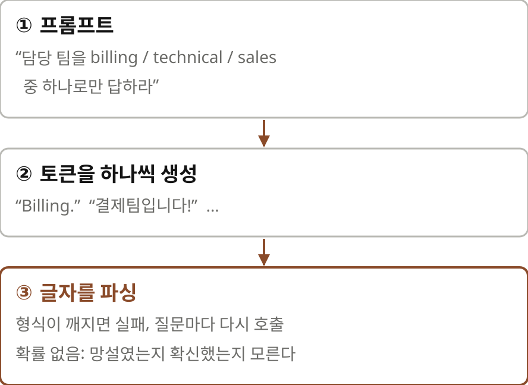

보통은 이렇게 합니다. 문의 내용을 프롬프트에 넣고 billing, technical, sales 중 하나로만 답하라고 시켜요. 모델은 토큰을 하나씩 생성하고 우리는 나온 글자를 파싱합니다. 여기서 세 가지가 걸려요. 첫째, 모델이 Billing 뒤에 마침표를 찍거나 결제팀입니다 하고 친절하게 답하면 파싱이 깨집니다. 둘째, 질문이 셋이면 호출도 세 번이거나, JSON으로 한꺼번에 답하라고 시켜 놓고 형식이 깨질까 걱정해야 하죠. 셋째, 확률이 없습니다. 모델이 반쯤 망설이다 고른 건지 확신하고 고른 건지 알 수가 없어요.

## 3 | 배경 | 먼저 알아 둘 말
> **헤드**란
> 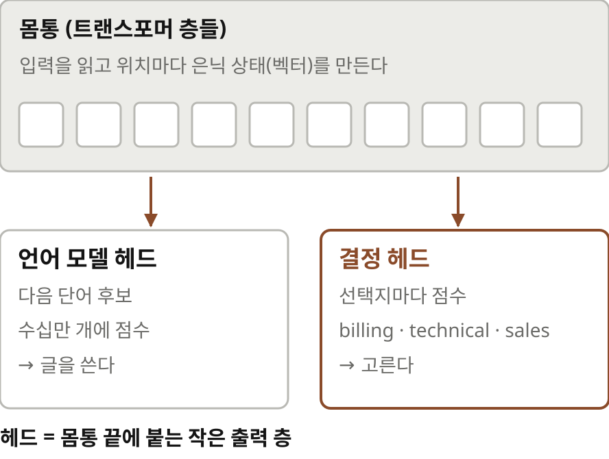

본론에 앞서 낯선 말 두 개를 짚고 갈게요. 첫 번째는 헤드입니다. 트랜스포머 모델은 크게 몸통과 헤드로 나눌 수 있어요. 몸통은 입력을 읽고 위치마다 숫자 벡터, 그러니까 은닉 상태를 만듭니다. 헤드는 그 끝에 붙는 작은 출력 층이에요. 글을 쓰는 LLM에는 언어 모델 헤드가 붙어 있어서 다음에 올 단어 후보 수십만 개에 점수를 매깁니다. 오늘 이야기는 이 헤드를 선택지에 점수를 매기는 작은 헤드로 바꿔 다는 거예요.

> **LoRA**란
> 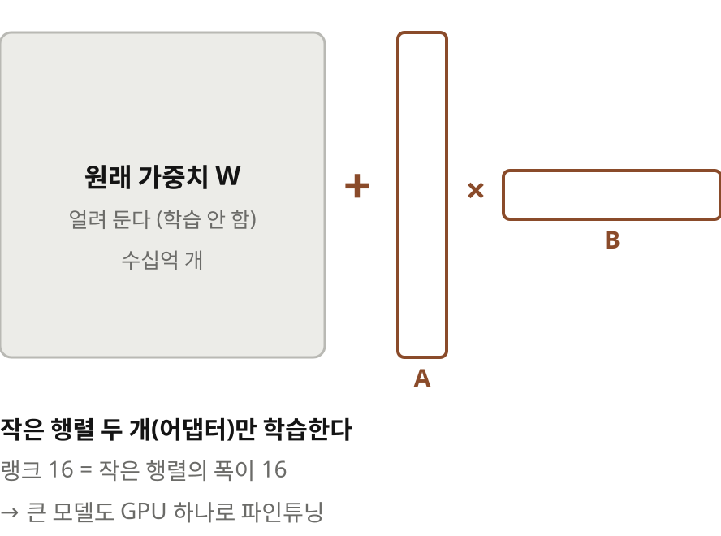

두 번째는 LoRA입니다. 수십억 개의 가중치를 전부 다시 학습하려면 메모리가 엄청나게 들어요. LoRA는 원래 가중치는 얼려 두고 옆에 아주 작은 행렬 두 개를 붙여 그것만 학습합니다. 이 작은 행렬 묶음을 어댑터라고 불러요. 랭크 16이라고 하면 그 작은 행렬의 폭이 16이라는 뜻입니다. 덕분에 큰 모델도 GPU 하나로 파인튜닝할 수 있어요.

## 4 | 결정 모델이란 | 질문 세 종류
> 결정 모델은 / **질문 타입** 세 가지로 묻는다
> 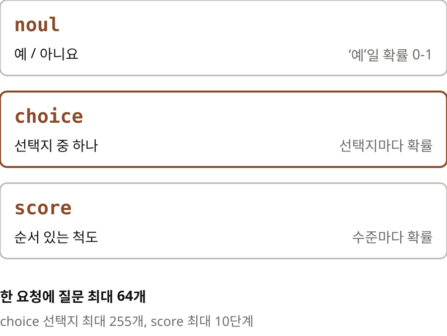

결정 모델은 텍스트를 받아서 앱이 바로 행동할 수 있는 결정을 돌려주는 모델이에요. TypeSafe라는 회사의 Jev가 이 형식의 API를 먼저 내놓았고 Cloudflare의 Clef와 Laya가 같은 형식을 따르는 공개 모델입니다. 요청에는 판단할 텍스트와 질문 목록을 넣어요. 질문은 세 종류입니다. 예 아니면 아니요로 답하는 noul, 여러 선택지 중 하나를 고르는 choice, 그리고 안 급함, 곧, 오늘처럼 순서가 있는 척도에 매기는 score예요. 한 요청에 질문을 64개까지 넣을 수 있습니다.

> 한 번에 **세 질문**, / 답은 확률로
> 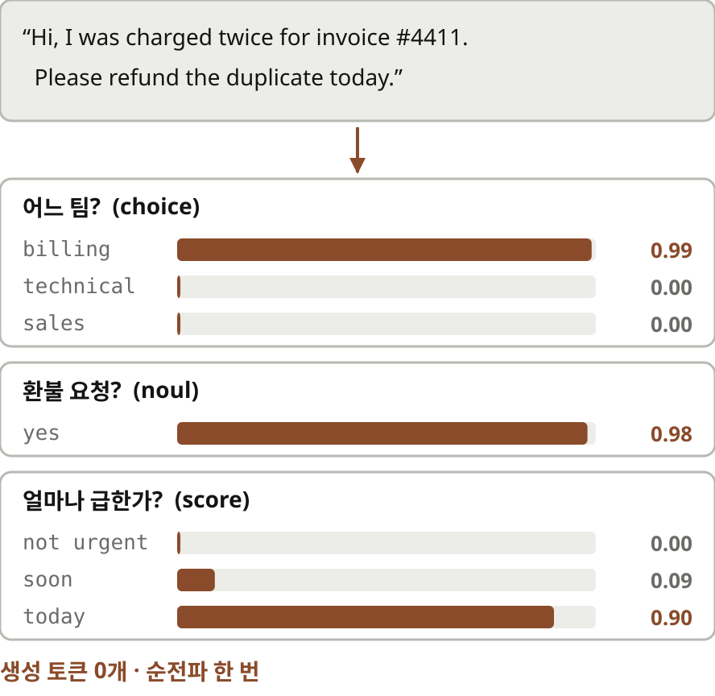

문서에 나오는 예시를 볼게요. 인보이스가 두 번 청구됐으니 오늘 중으로 환불해 달라는 문의입니다. 질문은 세 개예요. 어느 팀이 맡을지, 환불 요청인지, 얼마나 급한지. 결정 모델은 이걸 한 번에 읽고 결제팀일 확률 거의 1, 환불 요청일 확률 0.98, 오늘 처리해야 할 확률 0.9를 돌려줍니다. 생성된 토큰은 하나도 없어요. 답은 언제나 우리가 준 선택지 중 하나라서 파싱할 일도 없습니다.

## 5 | 결정 모델이란 | 확률로 행동하기
> 행동은 **확률의 문턱값**으로
> 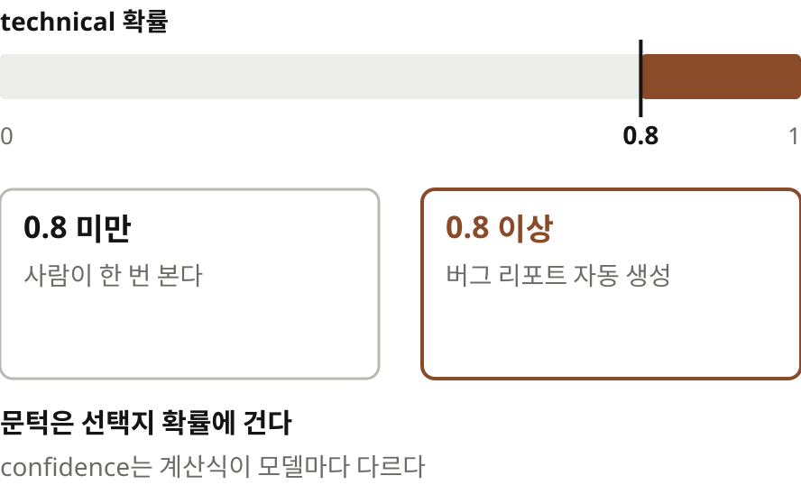

확률이 있으면 행동 규칙을 코드로 정할 수 있어요. 문서가 드는 예는 이렇습니다. 기술팀일 확률이 0.8을 넘을 때만 버그 리포트를 자동으로 만들고 그보다 낮으면 사람이 한 번 보게 하는 거죠. 문서는 confidence라는 값보다 선택지별 확률에 문턱을 걸라고 권합니다. confidence는 확률이 한쪽으로 쏠렸는지를 보여 주는 값이라 계산식이 모델마다 다르거든요.

## 6 | 학습 결과 | 30%대에서 70%대로
> 거의 찍는 수준에서 / **78%**까지
> 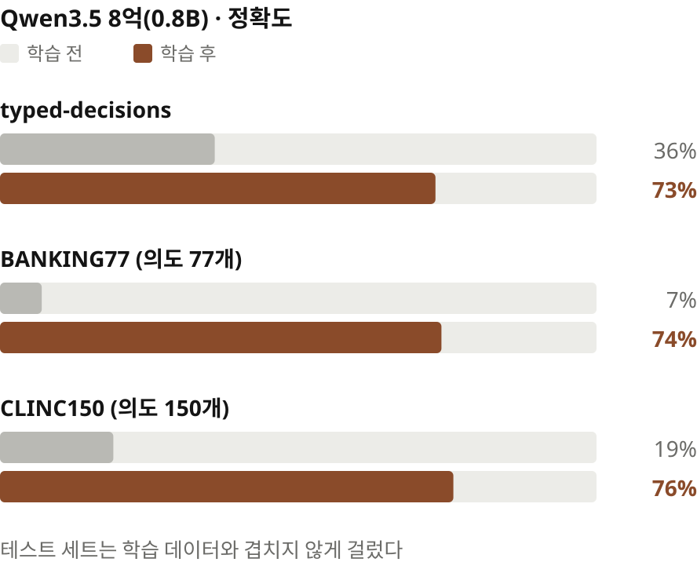

이제 Unsloth의 결과를 볼게요. Qwen 3.5의 8억 파라미터 모델에 결정 헤드를 달고 LoRA로 학습했습니다. 학습 전 정확도는 30퍼센트대, 거의 찍는 수준이었어요. 학습 후에는 typed-decisions라는 데이터셋에서 36퍼센트가 73퍼센트로 올랐습니다. 은행 고객 문의를 77개 의도로 나누는 BANKING77에서는 7퍼센트가 74퍼센트로, 의도가 150개인 CLINC150에서는 19퍼센트가 76퍼센트로 올랐어요. ‖ 테스트 세트는 학습 데이터와 겹치지 않도록 미리 걸러 냈다고 합니다.

> 작은 모델이 / **싸게** 따라붙는다
> 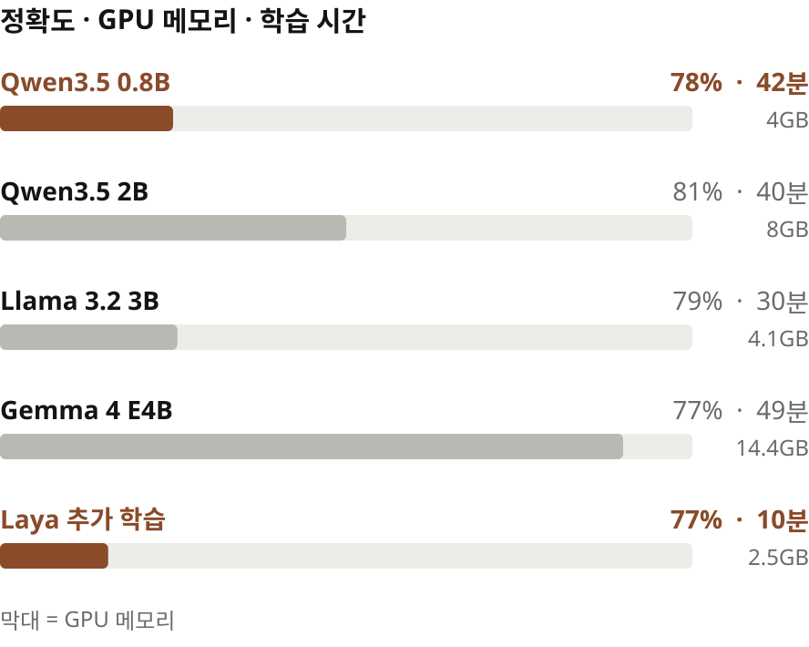

다른 모델도 같은 방식으로 됩니다. 8억 파라미터 모델은 GPU 메모리 4기가바이트로 42분 학습해 78퍼센트, 20억 파라미터 모델은 8기가바이트로 81퍼센트였어요. Llama 3.2 30억 모델은 79퍼센트, Gemma 4는 77퍼센트였고요. 이미 결정 모델인 Laya를 추가로 학습하면 2.5기가바이트, 10분이면 77퍼센트에 닿습니다.

> 학습 데이터: / typed-decisions + **공개 데이터셋 12개**
> 뉴스 주제, 과학 문제, 예/아니요 질의응답, 상식 추론, 자연어 추론, 프롬프트 주입 탐지, 감성 분류 …
> 테스트 3,000행: typed-decisions 2,000 + BANKING77 500 + CLINC150 500

학습 데이터는 typed-decisions에 공개 데이터셋 열두 개를 섞었습니다. 뉴스 주제 분류, 과학 문제, 예 아니요 질의응답, 상식 추론, 문장 사이의 함의를 따지는 자연어 추론, 프롬프트 주입 탐지, 다섯 단계 감성 분류 같은 것들이에요. 성격이 다른 판단을 골고루 섞어 어떤 질문이 와도 고르는 법을 익히게 한 셈이죠.

## 7 | 학습하기 | 세 갈래 길
> 학습하는 길은 / **세 가지**
> 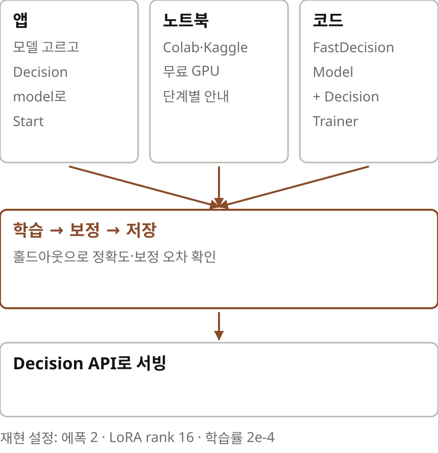

학습하는 방법은 세 가지예요. 가장 쉬운 건 Unsloth 데스크톱 앱입니다. Train 탭에서 모델을 고르고 학습 방식을 Decision model로 바꾼 뒤 데이터셋을 고르고 시작 버튼을 누르면 돼요. 문서의 결과를 재현하려면 에폭 2, LoRA 랭크 16, 학습률 2e-4로 맞추라고 합니다. GPU가 없으면 Google Colab이나 Kaggle의 무료 노트북을 쓰면 되고요. 코드로 하고 싶다면 FastDecisionModel로 모델을 불러 LoRA 어댑터를 달고 DecisionTrainer로 학습합니다. 데이터는 한 행에 입력, 질문들, 정답을 넣는 형식이에요.

## 8 | 학습하기 | 보정
> 80% 확신한 답은 / **80%** 맞아야 한다
> 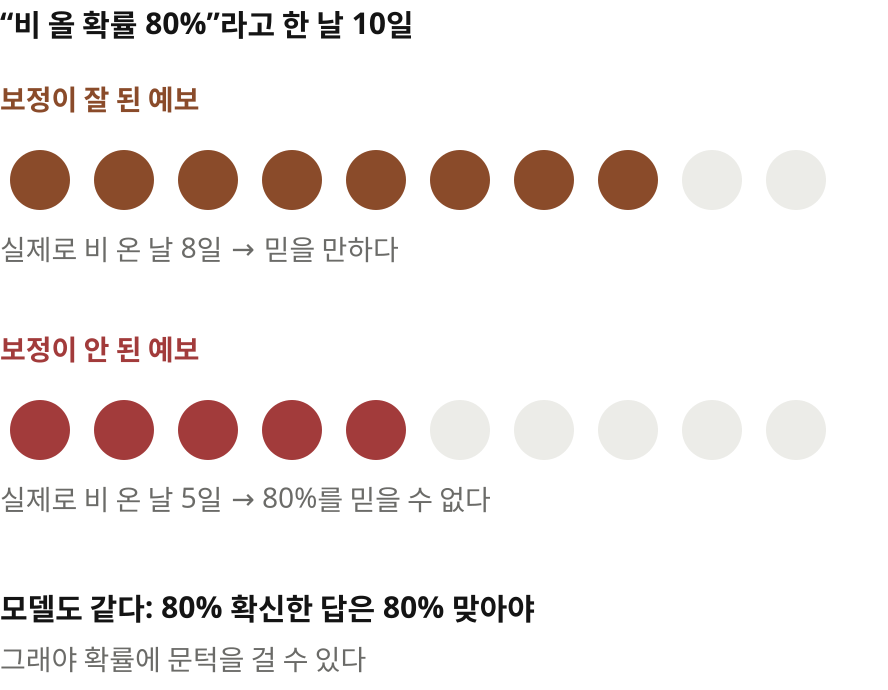

학습이 끝나면 보정을 합니다. 보정이란 모델이 말하는 확률과 실제로 맞는 비율을 맞추는 일이에요. 일기예보로 생각하면 쉽습니다. 비 올 확률 80퍼센트라고 한 날을 모아 보면 실제로 열흘 중 여드레쯤 비가 와야 믿을 만한 예보죠. 모델도 마찬가지입니다. 80퍼센트 확신한 답들을 모았는데 절반만 맞는다면 그 확률로 문턱을 정하는 건 의미가 없어요. Unsloth는 학습에 쓰지 않고 떼어 둔 데이터로 이 보정을 하고 정확도와 함께 기대 보정 오차를 알려 줍니다.

> 기대 보정 오차
> $$\mathrm{ECE}=\sum_{m}\frac{|B_m|}{n}\,\bigl|\mathrm{acc}(B_m)-\mathrm{conf}(B_m)\bigr|$$
> 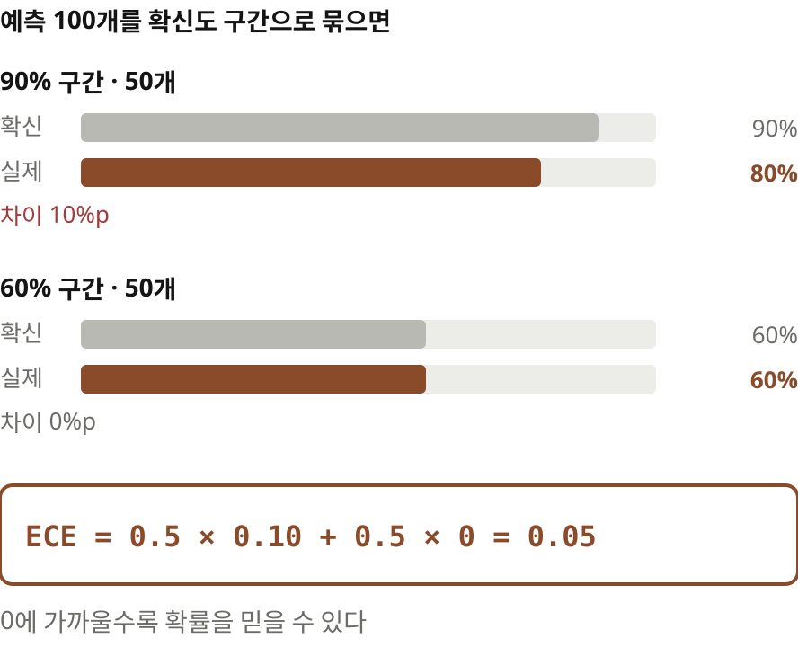

기대 보정 오차는 이렇게 계산해요. 예측을 확신도 구간별로 묶습니다. 구간마다 평균 확신도와 실제 정확도의 차이를 재고 그 구간에 든 예측 수만큼 가중해 더해요. 예를 들어 예측 100개 중 50개는 90퍼센트를 확신했는데 실제로는 80퍼센트가 맞았고, 나머지 50개는 60퍼센트를 확신해서 딱 60퍼센트가 맞았다고 해 보죠. 그러면 절반은 10퍼센트포인트, 절반은 0만큼 어긋났으니 기대 보정 오차는 0.05입니다. 0에 가까울수록 확률을 믿을 수 있어요.

## 9 | 서빙 | Decision API
> 주소만 바꾸면 / **내 모델**로
> 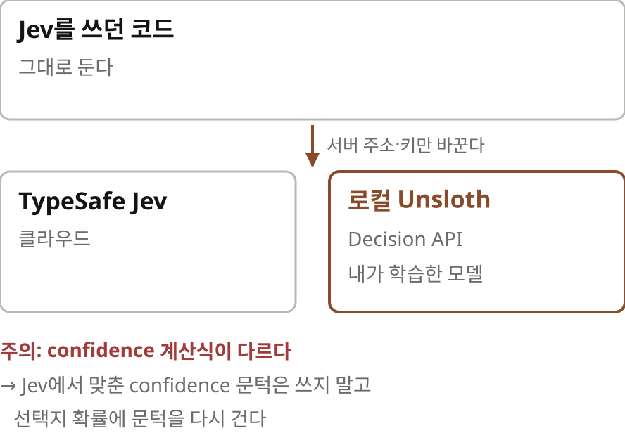

학습한 모델은 Unsloth의 Decision API로 바로 띄울 수 있어요. 앱에서 학습했다면 Use in Decision API 버튼 하나면 되고 코드로 학습했다면 합친 모델 폴더를 지정해 Unsloth를 실행하면 됩니다. 재미있는 건 이 API가 Jev와 호환된다는 점이에요. Jev를 쓰던 코드는 SDK의 서버 주소와 키만 로컬 Unsloth로 바꾸면 그대로 돕니다. 다만 confidence 계산식이 달라서 Jev에서 맞춰 둔 confidence 문턱값은 옮겨 쓸 수 없어요. 문턱은 확률에 걸어야 합니다.

## 10 | 동작 원리 | 한 번 읽고 점수 매기기
> 한 번 읽고, / 헤드가 **선택지마다** 점수
> 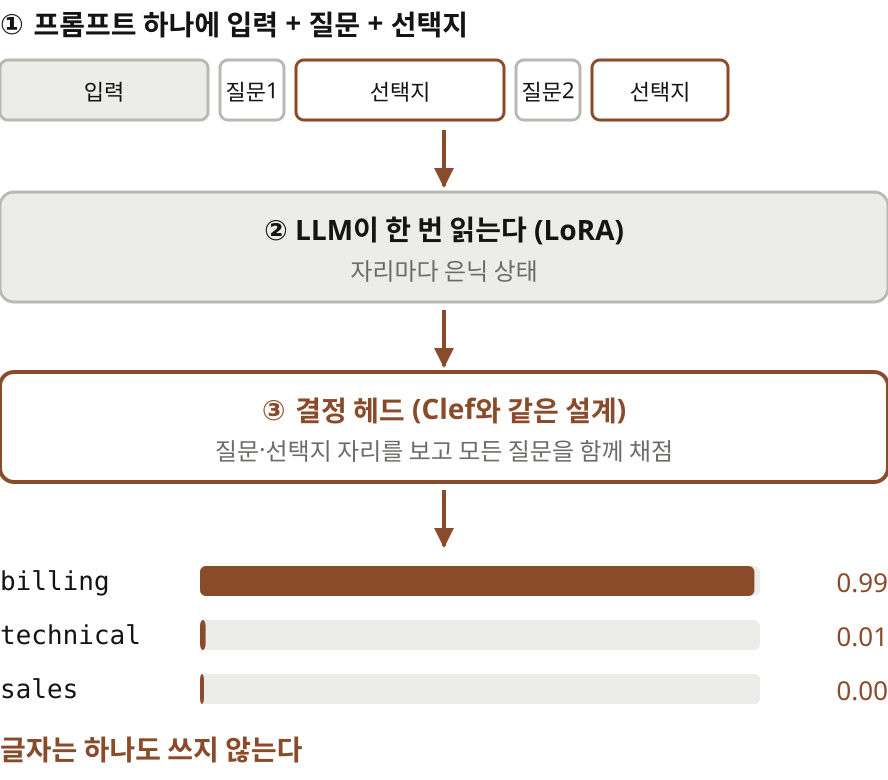

동작 원리는 단순합니다. 입력을 프롬프트 하나에 넣고 그 뒤에 모든 질문과 선택지를 이어 붙여요. LLM은 이걸 딱 한 번 읽습니다. 그다음 Cloudflare의 Clef와 같은 설계의 작은 헤드가 질문과 선택지 자리의 은닉 상태를 보고 선택지마다 점수를 매겨요. 모든 질문을 함께 결정합니다.

> 단어 **수십만 개** 대신 / 선택지 **세 개**
> 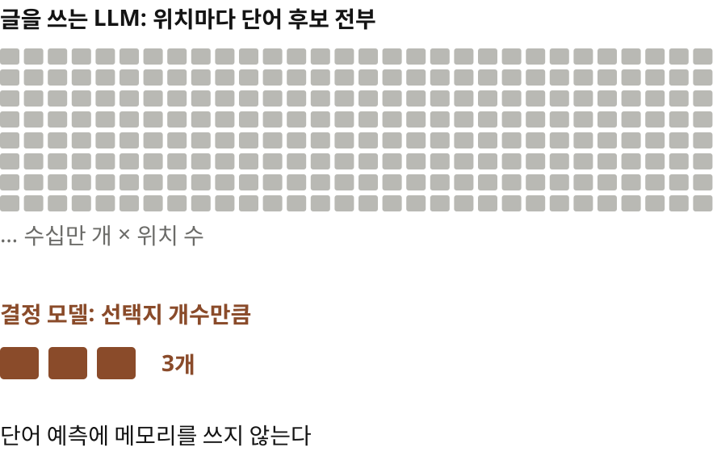

글을 쓰지 않으니 메모리도 아낍니다. 글을 쓰는 LLM은 위치마다 단어 후보 수십만 개 전부에 점수를 계산해야 해요. 결정 모델은 선택지가 세 개면 점수도 세 개만 내면 됩니다.

## 11 | 해설 | 분류기와 생성기 사이
> 분류기와 생성기 / **사이의 자리**
> 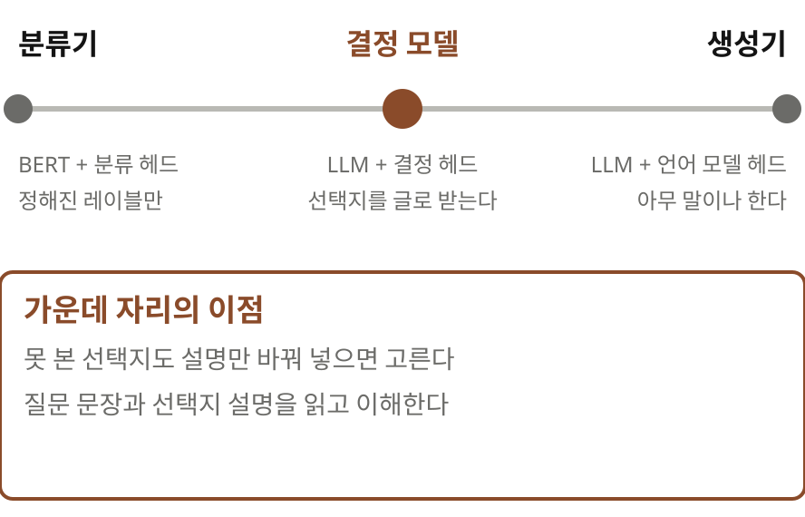

정리 노트의 해설을 하나 보탤게요. 구조만 보면 예전에 BERT에 분류 헤드를 달아 파인튜닝하던 방식과 닮았습니다. 다른 점은 두 가지예요. 하나는 선택지를 고정된 출력 층이 아니라 프롬프트 속 글로 준다는 겁니다. 그래서 학습 때 못 본 선택지도 설명만 바꿔 넣으면 고를 수 있어요. 다른 하나는 바탕이 지시를 따르도록 학습된 LLM이라 질문 문장과 선택지 설명을 읽고 이해한다는 점이죠. ‖ 정해진 레이블만 배우는 분류기와 아무 말이나 하는 생성기, 그 사이의 자리입니다.

## 12 | 맺으며 | 짚어 둘 점
> 읽으며 **짚어 둘 점**
> 설정이 문서 안에서 어긋난다: 랭크 64·1에폭 / 랭크 16·2에폭 / 코드는 학습률 2e-5
> 20억 모델이 의도 분류 두 곳에서 8억 모델보다 낮다(58%, 62%) — 이유 설명 없음
> 성능 수치는 Unsloth가 직접 잰 것

다만 짚어 둘 점도 있어요. 문서 안에서 학습 설정이 조금씩 어긋납니다. 성능표 옆 설명은 랭크 64로 한 에폭이라 하고, 앱 안내는 랭크 16에 두 에폭이라 하고, 코드 예시는 학습률이 2e-5예요. 20억 모델이 의도 분류 두 곳에서 8억 모델보다 낮은데 그 이유도 설명하지 않습니다. 수치는 모두 Unsloth가 직접 잰 것이고요.

> 정해진 선택지라면 / **생성 API 전에** 시험해 볼 길
> 원문 unsloth.ai/docs, 정리 노트 yoon-gu.github.io/compendium

정리하면, 생성형 LLM으로 분류할 때 늘 걸리던 세 가지가 있었죠. 답 형식이 깨지고, 질문마다 호출해야 하고, 얼마나 확신하는지 모른다는 것. 결정 모델은 이 셋을 한꺼번에 풉니다. 그리고 Unsloth는 이걸 내 데이터로, 4기가바이트 GPU에서, 한 시간 안에 학습해 로컬 API로 띄우는 데까지 이어 놓았어요. 선택지가 정해진 판단을 대량으로 돌려야 한다면 생성형 API를 부르기 전에 한번 시험해 볼 만합니다. 여기까지, Unsloth의 결정 모델 학습 안내였습니다.

