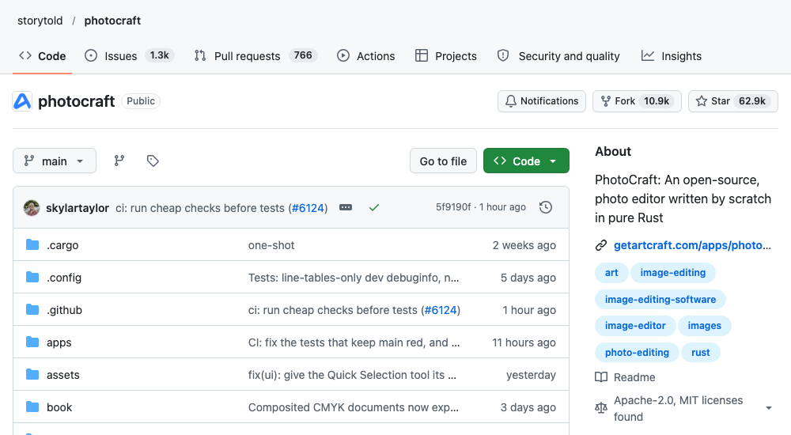
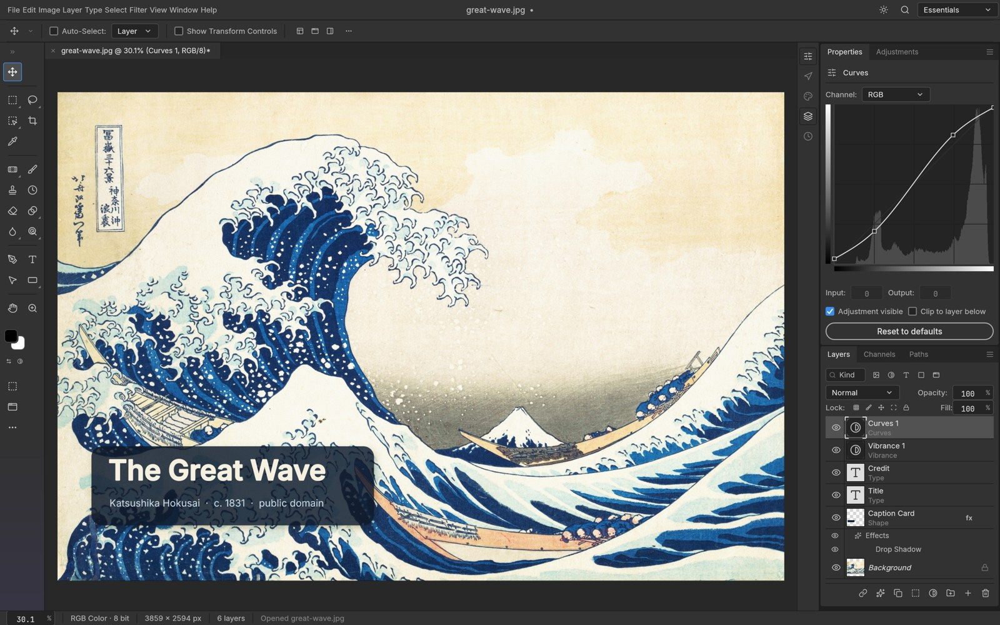
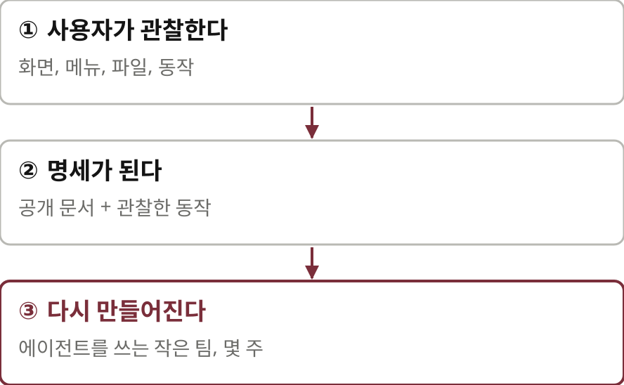
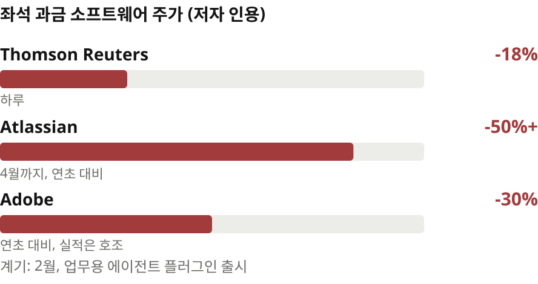
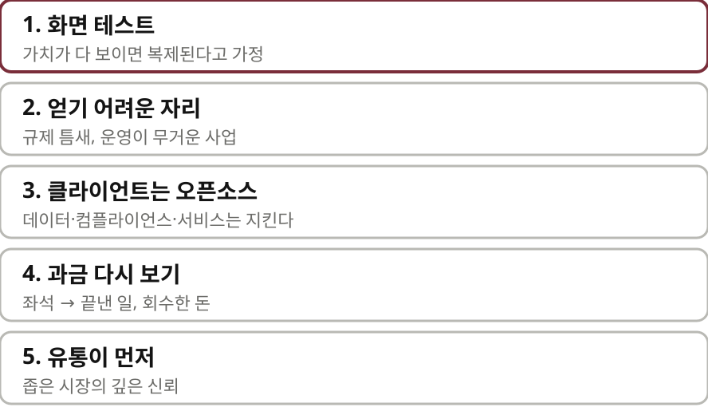
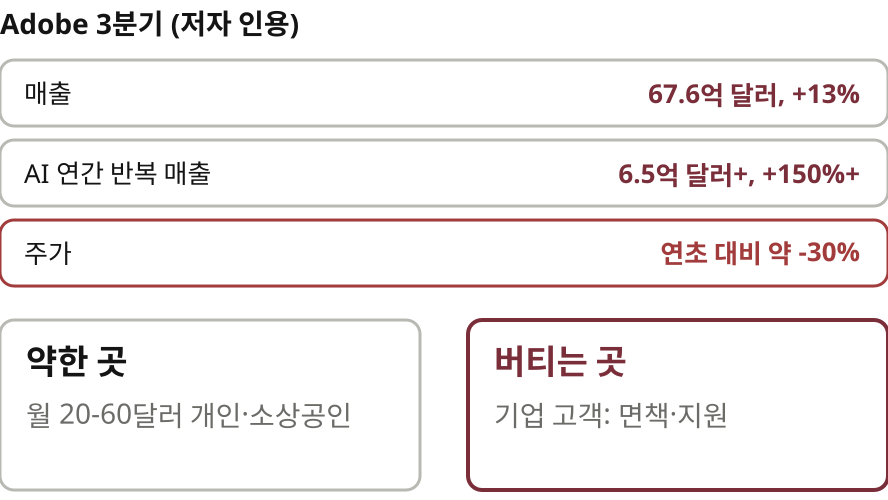

# 당신의 해자는 죽었다 — 나레이션 대본

Mathias Klenk의 "Your Moat Is Dead. Anyone Can Rebuild Your Product."(Tech Founder Stack, 2026-10-07)를 한 사람이 들려주듯 풀어 쓴 대본.
원문 번역이 아니라 [정리 노트](../../content/notes/your-moat-is-dead.md)를 바탕으로 요지와 해설을 다시 서술한 것이다. 말투는 노트와 같은 해설 문체(짧은 문장, 물음과 답).

형식은 `../build.py` 머리말 참고. `python3 ../build.py your-moat-is-dead --voice=유나`로 미리 듣는다(세로 1080x1920).
그림은 `figures/make.py`(SVG), 애니메이션은 `figures/animate.py`(moat·moats·cleanroom·leak·hold·compound mp4). 원문 그림은 쓰지 않고 개념을 새로 그렸다.

출처: Tech Founder Stack, 2026년 10월
잉크: #7A2E3A
부제: AI가 코드를 싸게 만들면, 소프트웨어 회사에는 무엇이 남는가
약어: CI=Continuous Integration, 지속적 통합; MCP=Model Context Protocol, 에이전트가 도구를 부르는 규격; ARR=Annual Recurring Revenue, 연간 반복 매출

## 1 | 들어가며 | 표지
> 당신의 해자는 / **죽었다**
> 

엔지니어 열몇 명이 Photoshop을 다시 만들었습니다. 몇 년이 아니라 몇 주 만에요. 그러면 Adobe가 수십 년 쌓은 코드는 이제 무엇을 지켜 줄까요? ‖ 오늘 소개할 글은 창업자 뉴스레터 Tech Founder Stack에 2026년 10월에 올라온 글입니다. 글쓴이 마티아스 클렝크는 신원 인증 스타트업 Passbase를 함께 세우고 기술 책임자로 일했던 사람이에요. 제목은 당신의 해자는 죽었다, 누구나 당신의 제품을 다시 만들 수 있다예요.

## 2 | 배경 | 먼저 알아 둘 말
> **해자**란
> 
> — 사진: Michael Gaylard, 영국 보디엄 성(Bodiam Castle), CC BY 2.0, Wikimedia Commons

먼저 해자라는 말부터 짚고 갈게요. 해자는 성을 둘러싼 물길입니다. 적이 쉽게 건너오지 못하게 막아 주죠. 사업에서는 경쟁자가 쉽게 따라오지 못하게 하는 방어력을 해자라고 부릅니다.

> 오랫동안 믿어 온 / **다섯 해자**
> 

소프트웨어 회사는 오랫동안 다섯 가지를 해자로 믿었어요. 쌓아 온 기능, 손에 익은 화면, 독자 파일 형식, 수많은 연동, 그리고 사람 수만큼 받는 좌석 과금입니다.

> **클린룸**이란
> 

두 번째는 클린룸입니다. 원본 코드를 보지 않고 같은 동작을 다시 만드는 방법이에요. 팀을 둘로 나눕니다. 한 팀은 원본이 어떻게 움직이는지 관찰해서 명세만 씁니다. 원본을 한 번도 본 적 없는 다른 팀이 그 명세를 보고 구현하죠. 왜 이렇게 번거롭게 할까요? 저작권은 코드라는 표현을 보호하지 기능을 보호하지 않기 때문입니다. 1984년 피닉스라는 회사가 이렇게 IBM PC의 바이오스를 복제했고 몇 달이 걸렸어요. 지금은 명세를 쓰는 에이전트와 구현하는 에이전트가 이 일을 나눠 합니다.

## 3 | 무슨 일이 | PhotoCraft
> Photoshop을 다시 만든 / **PhotoCraft**
> 
> — 화면: github.com/storytold/photocraft, MIT 또는 Apache-2.0, 2026년 10월 16일 갈무리

이야기의 계기는 PhotoCraft입니다. 작은 팀이 Rust로 Photoshop을 다시 구현해 공개했고 일주일 만에 GitHub 별을 수천 개 받았어요. Premiere, Lightroom, InDesign, Word를 겨냥한 형제 프로젝트도 이어서 나왔습니다.

> 실제 앱 화면은 / **Photoshop을 닮았다**
> 
> — 화면: PhotoCraft README 스크린샷(MIT 또는 Apache-2.0), 그림: 가쓰시카 호쿠사이, 퍼블릭 도메인

PSD 파서는 Adobe가 공개한 파일 명세로 만들었고 실제 Photoshop 파일로 테스트해서 렌더 결과를 맞대어 봤다고 해요. 모든 명령은 MCP 서버로도 열려 있어서 에이전트가 직접 조작할 수 있습니다.

> 완성도보다 / **비용**을 보라
> 기능 수준은 Photoshop의 절반 이하라는 추정(WebProNews)
> 피사체 선택, 내용 인식 채우기, 플러그인은 아직 없다

물론 아직 멀었습니다. 기능 수준은 Photoshop의 절반 이하라는 추정이 있어요. 피사체 선택도, 내용 인식 채우기도 없고 Adobe 플러그인도 돌지 않습니다. 그래도 저자는 지금의 완성도보다는 여기까지 오는 데 비용이 얼마나 적게 들었는지를 봅니다.

## 4 | 핵심 원리 | 보이면 다시 만든다
> 보이는 것은 명세가 되고 / 명세는 **다시 만들어진다**
> 

저자는 여기서 원리 하나를 뽑아냅니다. 사용자가 관찰할 수 있는 것은 명세가 될 수 있다. 그리고 명세가 된 것은 에이전트를 쓰는 작은 팀이 몇 주 만에 다시 만들 수 있다는 거죠. ‖ 법은 어떨까요? 저작권은 기능을 보호하지 않는다는 판례가 쌓여 왔습니다. 다만 특허와 상표 위험은 남아요. 그리고 모델이 학습 중에 원본을 봤을 수 있을 때도 클린룸이 성립하는지는 아직 법정에서 다퉈진 적이 없습니다.

## 5 | 새는 해자 | 다섯 가지
> 새는 해자 / **다섯 가지**
> 

무엇이 새고 있을까요? 저자는 다섯 가지를 듭니다. 첫째, 기능입니다. PhotoCraft에는 Photoshop의 메뉴 목록과 자기 명령 목록을 비교하는 빌드 작업이 있어요. 기능을 따라잡는 일이 매번 도는 테스트가 된 거죠. 둘째, 손에 익은 화면도 똑같이 베낄 수 있습니다. 셋째, 파일 형식은 누군가 잘 문서화하면 더는 사슬이 아니에요. 넷째, 연동은 원래 하기 고된 일이었는데 고된 일은 이제 에이전트가 합니다.

> 좌석 과금이 / **흔들린다**
> 

다섯째가 사업 모델입니다. 좌석 과금은 사람이 소프트웨어를 쓴다는 전제에 서 있어요. 일하는 주체가 에이전트가 되면 그 전제가 흔들립니다. 저자에 따르면 2월 Anthropic이 업무용 에이전트 플러그인을 내놓자 Thomson Reuters가 하루에 18% 가까이 떨어졌습니다. Adobe는 실적이 좋았는데도 연초보다 30%쯤 떨어졌고요.

## 6 | 버티는 해자 | 코드 밖의 방어력
> 코드 밖에서 / **버티는 것들**
> 

반대로 코드 밖에서 버티는 것들도 있습니다. 먼저 책임입니다. 저자는 신원 인증 회사에서 일하며 은행을 상대했습니다. 은행은 기댈 수 있는 상대에게 돈을 냈다고 해요. 계약으로도 규제 당국 앞에서도 기댈 수 있는 상대 말이에요. 인가와 감사, 인증, 보험은 명세로 복제할 수 없습니다. 살아 있는 데이터도 버텨요. 정적인 데이터는 근사할 수 있지만 운영이 계속 만들어 내는 데이터는 다릅니다. 그 운영을 따라 하기 어렵다면요. 신뢰와 유통도 그렇고요. 에이전트는 코드를 쓸 수 있어도 대기업 보안 심사를 통과하지는 못하죠. 마지막은 창고나 설치 현장 같은 물리 세계입니다.

> 인수자의 체크리스트에 / **코드 품질은 없다**
> 하드웨어 결합 · 양면 네트워크 효과 · 박혀 있는 소통 관계망
> 닫힌 피드백 루프의 독점 데이터 · 운영상의 전환 비용

인수하는 쪽의 기준도 바뀌고 있습니다. 일부 사모펀드는 AI에 버티는 해자를 요구한다고 해요. 하드웨어와의 결합, 양면 네트워크 효과, 독점 데이터, 운영상의 전환 비용 같은 것들입니다. 그 목록에 코드 품질은 없었어요.

## 7 | 커지는 해자 | 결과를 책임진다
> 커지는 해자는 / **결과를 책임지는 것**
> 

저자는 계속 커지는 해자로 단 하나를 꼽습니다. 도구를 팔지 말고 결과를 팔라는 거예요. 그리고 결과가 나오지 않으면 책임을 지라고요. 결과를 책임지기 시작하면 나머지 해자가 따라오거든요. 결과를 내려면 데이터가 돌아야 하고, 책임을 지니 책임 해자가 생기고, 갈아 치우기 어려운 상대가 되고, 일을 자기 서버에서 하게 되죠. 도구는 주말에 복제할 수 있지만 약속은 매달 지켜야 합니다.

## 8 | 창업자에게 | 다섯 가지 조언
> 창업자에게 / **다섯 가지**
> 

창업자에게는 이렇게 말합니다. 가치가 대부분 화면에 보인다면 빠르게 복제된다고 가정하라. 규제가 있는 틈새나 운영이 무거운 사업처럼 얻기 어려운 자리를 골라라. 클라이언트는 오픈소스로 풀고 데이터와 컴플라이언스와 서비스는 지켜라. 좌석이 아니라 끝낸 일과 회수한 돈에 값을 매겨라. 그리고 기능보다 유통이 먼저라고요.

## 9 | 거대 기업 | Adobe의 경우
> 숫자는 좋은데 / **주가는 떨어졌다**
> 

Adobe를 보죠. 저자가 인용한 3분기 매출은 67억 6천만 달러로 13% 늘었고 AI 쪽 연간 반복 매출은 150% 넘게 자랐습니다. 그런데도 주가는 30%쯤 떨어졌어요. 가장 약한 곳은 월 20달러에서 60달러를 내는 개인과 소상공인 고객입니다. 기업 고객은 상대적으로 안전해요. 면책과 깨끗한 학습 데이터, 지원 같은 것을 함께 사기 때문입니다. 저자는 가치를 서버로 옮기고, 책임을 상품으로 팔고, 에이전트가 쓰기 가장 좋은 도구가 되라고 권합니다.

## 10 | 맺으며 | 책임지는 부분을 만들어라
> 책임지는 부분은 만들고 / **나머지는 열어라**
> 코드만으로는 해자가 되지 못한다
> 고객은 배우고, 믿을 수 있고, 약속을 지키는 상대에게 돈을 낸다

저자는 코드만으로는 이제 해자가 되지 못한다고 결론짓습니다. 고객은 자기에게서 배우고, 믿을 수 있고, 약속을 지키는 상대에게 돈을 낸다는 거예요. 그러니 책임지는 부분을 만들고 나머지는 오픈소스로 풀라고 하죠.

> 읽으며 **짚어 둘 점**
> 주가·실적 숫자는 저자가 인용한 것, 일부 반응은 SNS 게시물
> PhotoCraft는 아직 Photoshop의 절반에도 못 미친다는 추정
> 클린룸의 법적 안전성은 모델 학습 문제로 열려 있다

다만 짚어 둘 점도 있어요. 주가와 실적 숫자는 저자가 인용한 것이고 일부 반응은 SNS 게시물입니다. PhotoCraft는 아직 Photoshop의 절반에도 못 미친다는 추정이 있고요. 클린룸이 법적으로 안전한지도 아직 열려 있습니다.

> 화면에 보이는 것은 복제되고 / **보이지 않는 책임**은 남는다
> 원문 techfounderstack.com

화면에 보이는 것은 복제됩니다. 보이지 않는 책임과 관계와 운영은 남아요. 결과를 판다는 처방이 모든 소프트웨어에 맞지는 않겠지만, 무엇을 지켜야 할지 한 번 묻게 되는 글입니다. 여기까지, Tech Founder Stack의 글이었습니다.
